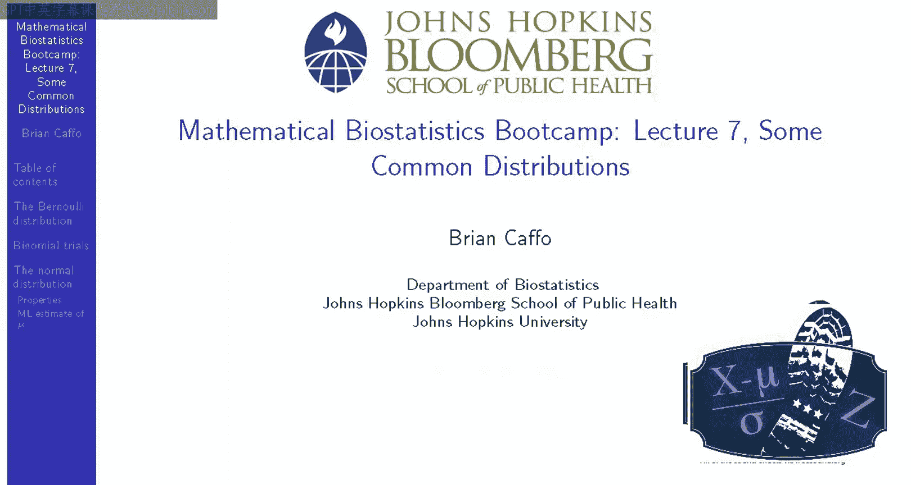
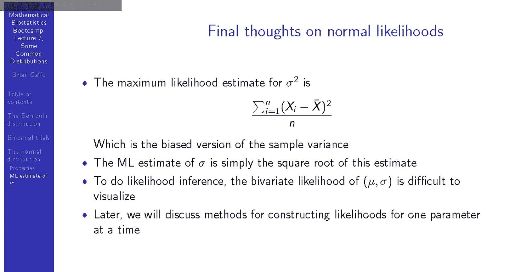

# 约翰霍普金斯大学《数据科学的高级统计｜Advanced Statistics for Data Science》中英字幕（deepseek p18 17_正态分布.zh_en -BV1htPjeYEFH_p18-

So that's the binomial distribution， let's talk about the most famous of all distributions。

And probably the most handy of all distributions is the so called normal or Gaussian distribution。

 the term Gaussian comes the great mathematician Gaus。

 and it's kind of interesting to know Gaus didn't invent the normal distribution The invention of the normal distribution is kind of a debated topic。

For example， Bnoulli had used something not unlike the Gaussian distribution as a probabilistic inequality。

 not formalizing it as a density， if you're interested in this。

 the book like Stephen Stigler on the history of statistics actually has a nice summary of exactly where and when and who came up with the Gaussian distribution。

 but it's clear that Gaus was instrumental in the early development and in use of the Gaussian distribution。

 so a random variable is said to follow a normal or Gaussian distribution with parameters mu and sigma squared。

 if the density looks like this2 pi sigma squared to the minus1 half e to the negative x minus mu squared over two sigma squared。

And so this density， it looks like a bell and it's centered at mu and sigma squared sort of controls how flat or peak it it is。

 and so it turns out that the mu is exactly the mean distribution and sigma squared is exactly the variance of this distribution。

 so you only need two parameter， a shift parameter and a scale parameter to characterize a normal distribution。

 so we might write that x is this little squiggggle and n mu sigma squared as just sort of shorthand for saying that a random variable follows a normal distribution with mean mu and variance sigma squared。

And in fact， one instance of the normal distribution is sort of the kind of root instance from which all the others are sort of derived and that's when mu equals0 and sigma equals1 and so we would call that the standard normal distribution it's centered at zero and its variance is one and so all other normal distributions are simple shifts and rescaling of the standard normal distribution。

 but then again you could pick a different root， maybe mu equals5 and sigma equal2。

 but it wouldn't be quite as convenient， you could still get every other distribution from that one by shifting and scaling appropriately。

 but it wouldn't be as convenient， this is the most convenient way to define a sort of root of the normal distribution。

The standard normal density is so common that we often reserve a Greek letter for it。

 so the lowercase phi we usually use for the normal density and the uppercase phi we would use for the normal distribution function。

And standard normal random variables are often labeled with the Z and you sometimes we even hear introductory statistics。

 textbooks and so on refer to them as Z variables or Z distributed or something like that and that's because this notation has become so common here's the normal distribution。

 it looks like a bell that's how it gets its name the bell shaped curve。And sort of here。

 I've drawn reference lines at one standard deviation。

 two standard deviations and three standard deviations。

 one above and negatives being below and positives being above。Now， again， here so the。The one。

 right， because this is a standard normal distribution， right。

 the one represents one standard deviation away from the mean here the mean is zero。

One is one standard deviation away from the mean， two is two standard deviations away from mean and three is three standard deviations away from the mean。

Instead of thinking of these numbers as just Z values on denominators。

 if we think about them in the units of the original。

Data right in this representing one standard deviation from the mean two standard deviations from the mean and three standard deviations from the。

 it doesn't matter whether we're talking about a standard normal or non standardard normal。

 they all are going to follow the same rules。 So about 68% of the distribution is going to lie within one standard deviation about 95% is going to lie within  two standard deviations IU between minus2 and plus2 and about almost all of the distribution about 99% of it's going to lie within three standard deviations。

 we can get from a nonstand normal to a standard normal very easily So if x is normal with mean mu and variance sigma squared。

 then Z。Equal to x minus mu over sigma is in fact， standard normal Now you could at least given the information from this class。

 check immediately that z has the right mean invari， so if you take the expected value of z。

 you get the expected value of x minus mu divided by sigma。

 you can pull the sigma out and then you have expected value of x minus mu which is just0 because that's expected value of x minus expected value of mu mu is not random so that's just mu and mu is defined as expected value of x so that's just0。

Then the same thing with the variant if you take the variance of z。

 you get the variance of x minus mu divided by sigma right so if we pull the sigma out of the variance。

 it becomes a sigma squared， and we have variance x minus mu and we learn to rule with variances that if we shift a random variable by a constant say in this case subtracting off mu。

 it doesn't change the variance at all so we get variance of x divided by sigma squared。

 variance of x is sigma squared so we get sigma squared divided by sigma squared which is1 so at the bare minimum we can check that z has mean zero and variance 1。

By the way， there was nothing intrinsic to the normal distribution that occurred in that calculation。

 right， so we've also just learned an interesting fact which is that take any random variable。

 subtract off its population mean and divide by its standard deviation。

 and the result is a random variable that has mean zero and variance 1。In this case， in addition。

 if x happens to be normal， then Z also happens to be normal。Similarly。

 we can just take this equation where z equals x minus mu over sigma and we can multiply by sigma and then add the mu and get that if we were to take a standard normal。

 say Z scale it by sigma and then shift it by mu， then we wind up with a nonstandard normal you know the top calculation goes from a nonstandard normal and converts it into a standard normal and the bottom equation starts with a nonstandard normal and converts it into a normal。

 Another interesting fact is that the non standard normal density。Can just be obtained as a。

Plugging into the standard normal density so if you take the standard normal density phi and instead of just plugging in z to it。

 say you plug an x minus mu over sigma and then divide the whole thing by sigma then that is exactly the nonstandard normal density and this is kind of a way to generate just kind of as an interesting aside here mu is a shift parameter so all mu does is shifts the distribution to the left or the right right just like whenever you subtract a constant from an argument in a mathematical function it's just moving the function to the left and the right and then sigma is a scale factor and so basically whenever you take a kernel density some density I guess it works for any density。

 but it makes most sense to do it with a density with mean zero invari1。

And then you create a new family where you're plugging an x minus mu over sigma and then divide the density by Sigma。

 you wind up with a new family of densities that now have mean mu and variance sigma squared。

 so this is kind of an interesting way of taking a root density。

With mean zero in variance1 and then creating a whole family of densities that have mean mu andvariant sigma squared。

 they're usually called location scale families。 any rate。

 we're only interested in this case in the normal distribution and this formula right here is exactly how you can go from the standard normal density and use it to create a non-standard normal density by plugging into its formula Let's just talk about some basic facts about the normal distribution that you should memorize。

So about 68%， 95% and 99% of the normal density lies within1。

2 and three standard deviations of the mean respectively， and it's symmetric about mu。

 so for example， take one standard deviation about 34%。

 one half of 68% lies from within one standard deviation on the positive side and about 34% lies within one standard deviation below the mean。

 so each of these numbers split equally to above the mean versus below the mean。

And then there's certain quantiles of the normal distribution that are kind of common to have memorized so negative 1。

28 1。645 negative 1。96 and negative 2。33 are the 10 fifth， 2。

5th and first percentiles of the standard normal distribution and then again by symmetrymetry so if we just flip it around right so if negative 1。

28 is the 10th percentile then 1。28 has to be the 90th percentile so by symmetrymetry 1。28 1。6451。

96 2。33 are the 90th 95th， 97。5 and 99th percentile of the standard normal distribution one in specific I want to point out that you really need to memorize is 1。

96 the reason it's useful is it's the point so that if you take negative 1。96 and positive 1。

96 the probability of lying outside of that range right？Below negative 1。96 or above positive 1。

96 well that's 5% so 2。5% below it and 2。5% above it so that's 5% so the probability of lying between 1。

96 negative 1。96 and positive 1。96 is 95% and so anyway it's used to do things like create confidence intervals and these other entities that are very useful in statistics and people have kind of stuck with 95% is a reasonable benchmark for confidence intervals and 5% is a reasonable cutoff or statistical test and if you're doing two sided you need to account for both sides and so you use 1。

96 and then the other fact is that 1。96 is close enough to two that we just roundup so a lot of times things like confidence intervals you might hear people talking about we'll just add and subtract two standard errors they're getting that two from this 1。

96 right here so anyway that one in specific you should memorize we should probably just memorize all of them。

Let's go through some simple examples。So we'll go through two and you should just be able to do lots of these after I go through two。

So let's take an example， what's the 95th percentile of a normal distribution with me mu and variance sigma squared？

So recall， what do we want to solve for if we want a percentile？We want the point x n。

 so that the probability that a random variable from that distribution x being less than or equal to x n turns out to be 95% or 0。

95。Okay and so you know it's kind of hard to work with non-standard normal So the probability that x being less than or equal to x not is 0。

95 well why don't we subtract off mu from both sides of this equation and divide by sigma from both sides of this equation and on the lefthand side of this inequality x minus mu over sigma well that's just a z random variable now a standard normal random variable So the probability that x is less than or equal to x not is the same as the probability that a standard normal is less than or equal to x not minus mu over sigma and we want that to be 0。

95 Well if you go back to my previous slide0。95 95th percentile of the standard normal is 1。

645 so we just need this number x minus mu over sigma to be equal to 1。

645 to make this equation work and so let's just set it equal to 1。

645 right and then solve for x not so we get x equals。Mu plus sigma times 1。

645 so now you could ask lots of questions with specific values of mu and sigma。

 but you'll wind up with the same exact calculation in here， in fact， you know we used 1。

645 because we wanted the 95th percentile， but in general。

 x nots going to be equal to mu plus sigma z not where zO is the appropriate standard normal quantile that you want。

And then you can just get them very easily， you know。

 the other thing I would mention too is you should be able to do these calculations more than anything just so you've kind of internalized what quantiles from distributions are and how to sort of go back and forth between standard and nonstandard normals and the kind of ideas of location scale densities and that sort of thing。

In reality in practice， you know it's pretty easy to get these quantiles because， for example。

 in R you would just type in Q norm0。95 and then give it a mean and a variance。

 or if you wanted if you did Q norm 。95 without a mean in a variance， it'll return 1。

645 and you can do the remainder of the calculation yourself。

 but even that's a little bit obnoxious so you can just plug in a mu in a sigma。

 So these calculations aren't so necessary from a practical point of view。

 even very rudimentary calculators will give you normal quantiles nonstandard normal quantiles。

 The hope is that you'll kind of understand。You know the probability manipulations you'll understand you know what a quantile means。

 you'll understand you know what the goals of these problems are and you'll understand sort of how to go backwards between a standard and nonstandard normal that's kind of what we're going for here it's kind of clear I think everyone agrees that you can very easily just look these things up without having to to bother with any of these calculations let's go with another。

Easy calculation What's the probability that a normal mu comma sigma squared random variable is two standard deviations above the meanme？

So in other words， we want to know the probability that x is greater than mu plus2 sigma Well again do the same trick where we subtract off mu and sigma from both sides and we just get the answer that that's the probability that a standard normal is bigger than 2 and that's about 2。

5% and so you can see the kind of rule here if you want to know the probability that a random variable is bigger than any。

spececific number or smaller than any specific number or between any two numbers。

 instead of take those numbers and convert them into standard deviations from the mean right and that can of course be fractional。

 it could be 1。12 standard deviations from the mean or whatever。

 and the way you do that is by subtracting off mu and dividing by sigma。

And then revert that calculation to a standard normal calculation so if you wanted to know what's the probability that a random variable is bigger than say let's say 3。

1 just to pick out a random complicated sounding number let's suppose you're talking about the height of a kid and you want to you know say what's the probability of being taller than 3。

1 feet what you would need is the population mean mu and the standard deviation sigma take 3。

1 subtract off mu divide by sigma now you've just converted that。Quantity 3。1， which is in feet。

Right to standard deviation units， and then you can just do the remainder of the calculation using the standard normal。

So I would hope that you could kind of familiarize yourself with these calculations and I recognize that。

In a sense， their。kindind of ridiculous to do because you can get them from the computer so quickly and we'll give you the R code that you need to do these calculations very quickly on the computer。

 but I think it's actually worth doing them by hand some just to get used to working with densities to get used to what these calculations refer to。

So let me just catalog some properties of the normal distribution that a lot is known about the normal distribution。

And so I'll outline some of the simpler stuff and some of the stuff。

 the letter points we probably won't get to in this class， but I thought I'd just at least say。

 so anyway the normal distribution is symmetric and it's peaked about its mean。

 which means that the population mean associated with this normal distribution。

 the median and the mode are all equal right at that peak。

A constant times a normally distributed random variable is also normally distributed。

 and you can tell me what happens to the mean in the variance if say x is a normal random variable。

 what distribution does a times x have if I'm going to tell you that it's normal。

 what's the resulting mean and variance， It turns out that sums of normally distributed random variables are again normally distributed。

 and this is true regardless of the dependent structure of the data。

 So if the random variables are jointly normally distributed。

It's important that they're jointly normally distributed， they could be independent。

 they could not be independent， but they need to be jointly normally distributed。

 sums or any linear function of the normal random variables turns out to be normally distributed。

And again， you can calculate the mean in the variance。

Sample means of normally distributed random variables are again normally distributed。Again。

 this is true regardless of whether or not they're jointly normal and possibly dependent or if they're simply a bunch of independent normal random variables。

 this is true of sample means， however， let me just jump to 07。

It also turns out that if you have independent identically distributed observations。

 properly normalized sample means their distribution will look like a Gaussian distribution。

 not entirely but pretty much regardless of the underlying distribution that the data comes from。

 so take as an example if you roll a die and look at what the distribution of a die roll looks like。

 it doesn't look very Gaussian， it looks like a uniform distribution on the numbers one to6。

Now take a die， roll it 10 times， take the average and then repeat that process over and over again and think about what's the distribution of this average of die rolls Well it turns out it'll look quite Gaussian it'll look very normal at any rate that's the rule is that random variables properly normalizedize with some conditions that were probably going to gloss over will limit to a normal distribution and that's how the normal distribution became the sort of Swiss army knife of distribution is that pretty much anything you can relate back to a mean of independent things tends to look normal in distribution and mathematically formally if they're independent identically distributed in the you normalize the mean in the correct way then you get exactly a standard normal distribution that is an incredibly useful result and incredibly useful result it's a very historically important result called the central limit theorem。

So let's see back to 0。5， if you take a standard normal and square it。

 you wind up with something that's called a chi squared distribution。

 you might have heard of that before， and if you take a standard or non-standard normally distributed random variable and expentiate it。

 take E to the X where x is normal， then you wind up with something that's log normal log normal is kind of a bit of a pain in the butt in terms of its name a log normal means take the log of a log normal and it becomes normal。

 it doesn't mean the log of a normal random variable it's a little annoying fact right and you can't log a normal random variable by the way。

 because there's a non-zero probability that it's negative and you can't take the log of a negative number the name makes it sound like a log normal is the log of a normal it's not log normal means take the log of me and then I'm normal。

Okay， let's talk about ML properties associated with normal random variables。

If you have a bunch of IID normal mu sigma squared random variables。

 and let's assume you know the variance， so let's ignore the variance for the moment。

 then the likelihood associated with mu is written out right here。

 you just take the product of the likelihoodlis for each of the individual observations。

And so you wind up with two pi sigma squared to the minus1 half e to the negativexi minus muus squared over two sigma squared if you。

Move that product into the exponent， you get minus summation i equal1 to ns Xi minus mu squared over2 sigma squared。

 remember， we're assuming that the variance is known。

So the two pi sigma squared to the minus n over 2 that you would have gotten。

 we can just throw that out right because remember the likelihood doesn't care about factors of proportionality that don't depend on mu。

In this case because mu is the parameter we're interested in， by the way。

 this little symbol right here， this proportion to symbol is what I mean。

 that means I dropped out things， it's proportional to I dropped out things that are not related to mu。

 and I'll try and use that symbol carefully where it's contextually obvious what I mean。

 what variable I'm considering important。Okay， so let's just expand out this squared and you get summation X squared over two sigma squared plus mu summation X over sigma squared minus n mu squared over two sigma squared。

 Now this first term negative summation X squared over2 sigma squared again that doesn't depend on mu so we can just throw it out right it's e to that power times e to the latter two powers So that first part is a multiplicative factor that we can just chuck then the other thing here is it's a little annoying to write summation X why don't we write that is n x bar right because if you take x bar。

 the sample average and multiply it by n you get the sum okay so the likelihood works out to be mu n X bar over sigma squared minus n mu squared over two sigma squared。

So that's the likelihood let's ask ourselves what's the ML estimate from mu when sigma squared is known Well as we almost always do。

 the likelihoods kind of annoying to work with so why don't we work with a log likelihood we take the log from the previous page and we get mu and x bar sigma squared of minus n mu squared over2 sigma squared。

 if you differentiate this with respect to mu， you wind up with this equation right here。

 which is clearly solved at x bar equal to mu and so what it tells us is that x bar is the ML estimate of mu so if your data is normally distributed。

 your estimate of the population mean is the sample mean that makes a lot of sense we would hope that the result would kind of work out that way but also notice because this calculation didn't depend on sigma this is also the ML estimate when sigma is unknown。

It's not just the ML estimate when Sigma is known。So we know what our ML estimate of mu is。

 let me just tell you what the ML estimate for sigma squared is the ML estimate for sigma squared works out to be。

Sumation Xi minus x bar squared over n。And you might recognize this as the sample variance。

 but instead of our standard trick of dividing by n minus1， we're now dividing by n。

 which is a little frustrating that there's this kind of mixed message that the maximum likelihood estimate for sigma squared is the so-called biasased estimate of the variance rather than the unbiased one where you divide by n minus1 Now notice as n increases this is irrelevant right。

 the factor that disputes the two estimates is n minus1 over n and that factor goes to1 as n gets larger and larger So I've had several colleagues tell me that they would actually just prefer this estimate。

 this maximum likelihood estimate and their argument is something along the lines of well。

 the n minus1 estimate is unbiased but this one has a lower variance and what they mean is。

This is the biased version of the sample variance， it's only a function of random variables。

 so it itself is a random variable。And as a random variable， it has a mean in a variance。

 the fact that its mean is not exactly sigma squared it means that it's biased。

But it has a variance and its variance is slightly smaller than the variance of the unbiased version of the sample variance。

And so this is an example that pops up all the time in statistics that you can trade bias versus variance。

 in this case one variance estimate is slightly bias， but will give you a lower variance。

 another one is unbiased but the variance estimate itself has a larger variance。

 and it's very frequent in statistics that you have this kind of tradeoff。

 you can pick one as you increase the bias you tend to decrease the variance in vice versa。

So the other thing I wanted to mention was here we've kind of。

Separated out inference from mu and inference for Sigma。

 If you wanted to do kind of full likelihood inference， then you have exactly a bivariate likelihood。

 a likelihood that depends on mu and sigma， and it's a little bit difficult to visualize but it is just a surface right where you have mu on one axis Sigma on another axis and the likelihood on the vertical axis。

 then it would just be a likelihood surface instead of a likelihood function。

 and it's a little bit hard to visualize these kind of 3D looking things。

 So there are methods for getting rid of sigma looking at just a likelihood associated with mu and getting rid of mu and looking at a likelihood just for sigma later on will discuss methods for them。

 but for the time being it's not terribly important。

 what I would hope you would remember is that if you assume that your data is normally distributed。

Then， you know， we gave you the likelihood for mu， if you assume Sigma was known。

 we calculated that the ML estimate of mu was， in fact。

 x bar and that the ML estimate of sigma squared was， you know， pretty much the sample variance。

 you know off by a little bit from the standard sample variance， but pretty much the sample variance。

And then you know the ML estimate of Sigma， not Sigma squared。

 but of Sigma is just the square root of our estimate for ML estimate for Sigma squared Well that's the end of our whirlwind tour of probably the two most important distributions there are some other ones that we'll cover later next lecture we're going to travel to a place called asymptopia and everything's much nicer in asymptopia and so I think you'll quite like it there。

嗯。🎼。🎼。

