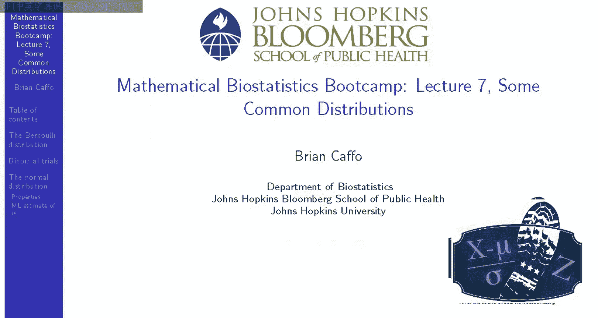
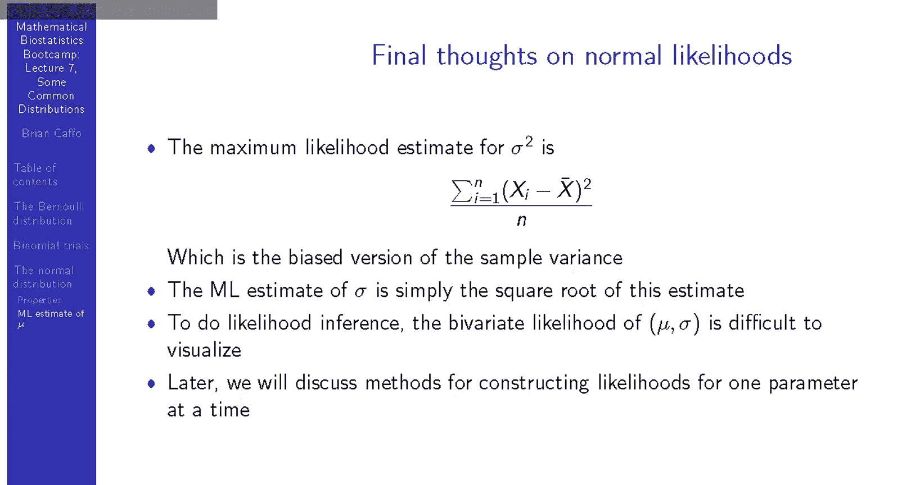

# 高级统计学：第17讲：正态分布

在本节课中，我们将要学习统计学中最著名、最常用的分布——正态分布（也称为高斯分布）。我们将了解其定义、性质、标准化的方法，以及如何利用它进行基本的概率计算和参数估计。

## 正态分布的定义与性质

上一节我们介绍了二项分布，本节中我们来看看正态分布。一个随机变量X如果服从参数为μ（均值）和σ²（方差）的正态分布，其概率密度函数如下：

**公式：** `f(x) = (2πσ²)^(-1/2) * e^(-(x-μ)²/(2σ²))`

这个密度函数的图形呈钟形，因此常被称为“钟形曲线”。它关于均值μ对称，方差σ²控制着曲线的宽窄（即离散程度）。μ和σ²恰好是该分布的均值和方差。

我们常用简写 `X ~ N(μ, σ²)` 来表示随机变量X服从均值为μ、方差为σ²的正态分布。

## 标准正态分布

所有正态分布都可以通过对一个“基准”分布进行平移和缩放得到，最方便的基准是标准正态分布。

**定义：** 当μ=0且σ=1时，我们得到标准正态分布，记作 `Z ~ N(0, 1)`。

标准正态分布的密度函数通常用希腊字母φ表示，其分布函数用Φ表示。标准正态随机变量也常用字母Z表示。

从任意正态分布转换到标准正态分布非常简单：

**公式：** 如果 `X ~ N(μ, σ²)`，那么 `Z = (X - μ) / σ` 服从标准正态分布。

反之，通过对标准正态变量进行线性变换，可以得到任意正态分布：`X = μ + σZ`。

## 正态分布的实用规则

以下是关于正态分布需要记住的几个基本事实。

正态分布关于均值μ对称。大约有固定比例的观测值落在均值特定倍数的标准差范围内。

以下是具体的经验法则：
*   大约68%的数据落在 `(μ - σ, μ + σ)` 区间内。
*   大约95%的数据落在 `(μ - 2σ, μ + 2σ)` 区间内。
*   大约99.7%的数据落在 `(μ - 3σ, μ + 3σ)` 区间内。

此外，标准正态分布的一些常用分位数也值得记忆，它们在构建置信区间和假设检验中非常有用。

以下是标准正态分布的关键分位数：
*   **1.645** 是95%分位数（即 `P(Z ≤ 1.645) = 0.95`）。
*   **1.96** 是97.5%分位数。由于对称性，`P(-1.96 ≤ Z ≤ 1.96) = 0.95`。这是构建95%置信区间的基础。
*   **2.33** 是99%分位数。

对应的左侧分位数可通过对称性得到（例如，-1.96是2.5%分位数）。

## 概率与分位数计算示例

让我们通过两个例子来演示如何利用标准化进行概率和分位数的计算。

**示例1：求正态分布的95%分位数**
问题：求 `X ~ N(μ, σ²)` 的95%分位数 `x₀`，即满足 `P(X ≤ x₀) = 0.95` 的值。
解法：
1.  将概率标准化：`P(X ≤ x₀) = P( (X-μ)/σ ≤ (x₀-μ)/σ ) = P(Z ≤ (x₀-μ)/σ ) = 0.95`。
2.  查表或记忆可知，标准正态的95%分位数 `z₀ = 1.645`。
3.  因此，`(x₀ - μ)/σ = 1.645`。
4.  解得：`x₀ = μ + 1.645σ`。

**通用公式：** 对于任意分位数，`x₀ = μ + σ * z₀`，其中 `z₀` 是标准正态的对应分位数。

**示例2：计算特定区间的概率**
问题：求 `X ~ N(μ, σ²)` 大于 `μ + 2σ` 的概率。
解法：
1.  `P(X > μ + 2σ) = P( (X-μ)/σ > 2 ) = P(Z > 2)`。
2.  根据经验法则或查表，`P(Z > 2) ≈ 0.025`（即2.5%）。

**核心思想：** 对于任何涉及正态变量X的概率计算，都可以通过 `Z = (X - μ) / σ` 将其转化为标准正态分布的计算。

## 正态分布的其他重要性质

正态分布拥有许多优良的数学性质，使其在统计学中占据核心地位。

以下是正态分布的一些关键性质：
1.  **线性变换：** 若 `X ~ N(μ, σ²)`，则 `aX + b ~ N(aμ + b, a²σ²)`。
2.  **可加性：** 独立（或联合正态）的正态随机变量之和仍服从正态分布。
3.  **样本均值：** 从正态总体中抽取的样本，其样本均值 `X̄` 也服从正态分布，`X̄ ~ N(μ, σ²/n)`。
4.  **中心极限定理：** 即使总体分布非正态，在样本量足够大时，样本均值的标准化形式也近似服从标准正态分布。这是统计学中最重要的定理之一。
5.  **衍生分布：** 标准正态变量的平方服从**卡方分布**。正态变量的指数 `e^X` 服从**对数正态分布**（注意：是X服从正态，而非lnX）。

## 正态分布的参数估计（极大似然法）

假设我们有一组独立同分布的数据 `X₁, X₂, ..., Xₙ`，且 `Xᵢ ~ N(μ, σ²)`。我们可以使用极大似然法来估计参数μ和σ²。

**似然函数**（关于μ，假设σ²已知）为：
`L(μ) ∝ exp{ -Σ(xᵢ - μ)²/(2σ²) }`

通过对数似然函数求导并令其为零，可以找到使似然函数最大的μ值。

**极大似然估计结果如下：**
*   **均值μ的MLE：** `μ̂_MLE = X̄`（样本均值）。
*   **方差σ²的MLE：** `σ̂²_MLE = (1/n) * Σ(Xᵢ - X̄)²`。

请注意，方差σ²的MLE是除以n的样本方差，而非通常无偏估计中除以的(n-1)。这是一个**有偏估计**，但随着样本量n增大，偏差会消失。在统计学中，经常需要在估计量的**偏差**和**方差**之间进行权衡。

---

本节课中我们一起学习了正态分布，它是统计学中最基础的连续分布。我们掌握了其定义、标准化的方法、实用的经验法则，以及如何计算概率和分位数。我们还了解了正态分布的一系列重要性质，如中心极限定理，并学习了如何对正态分布的参数进行极大似然估计。正态分布是许多高级统计方法的基石，深入理解它至关重要。下一讲，我们将前往一个名为“渐近乐园”的地方，在那里许多问题会变得更加简单。