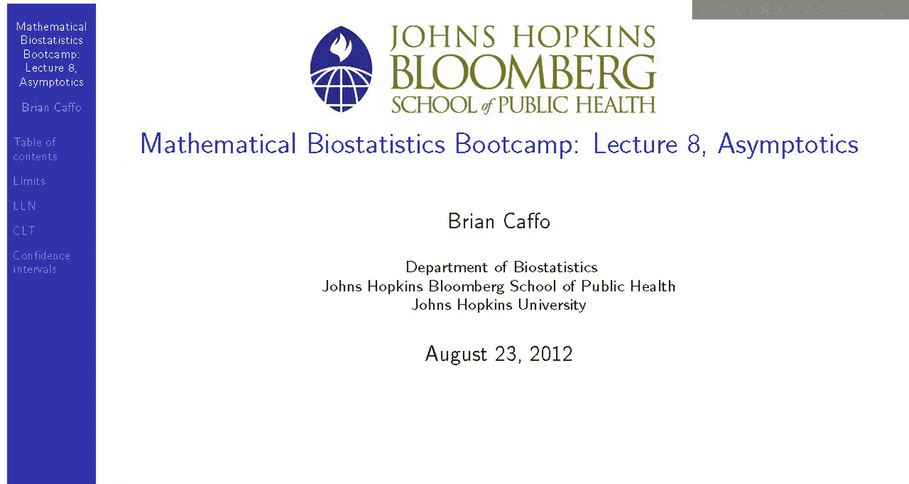
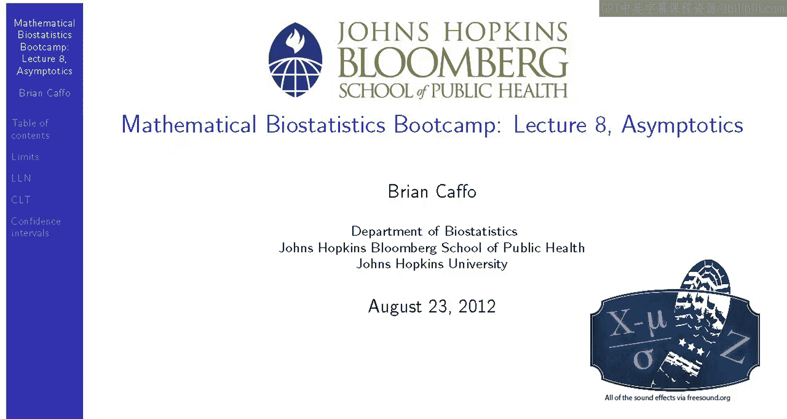
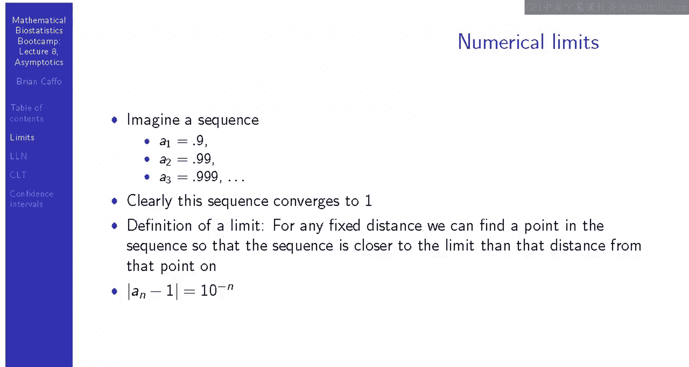
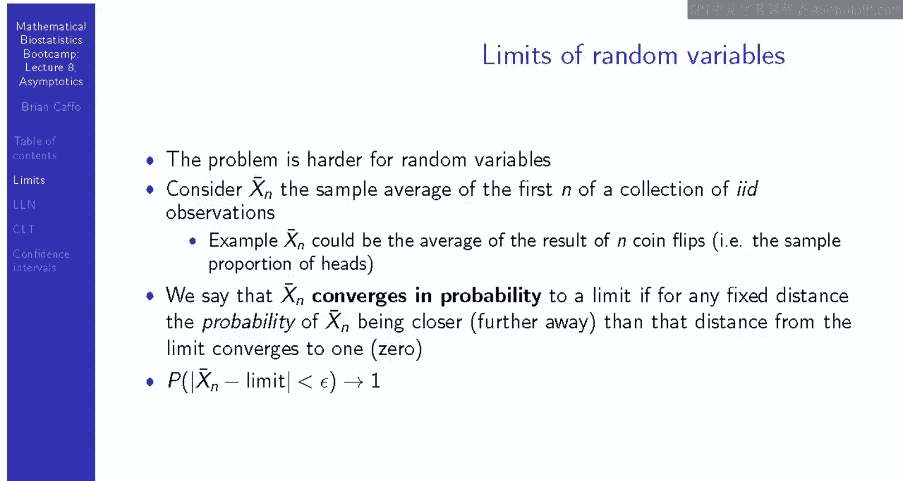
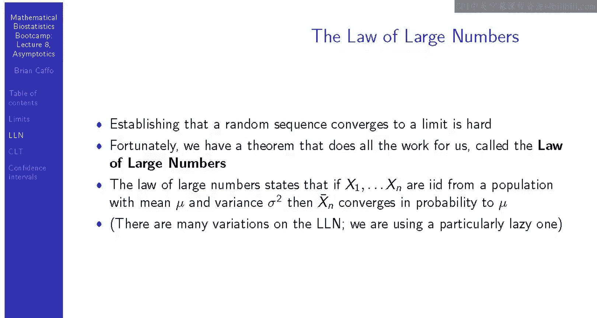
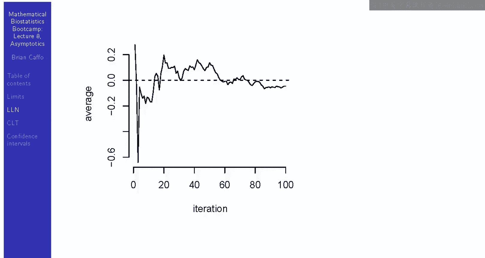
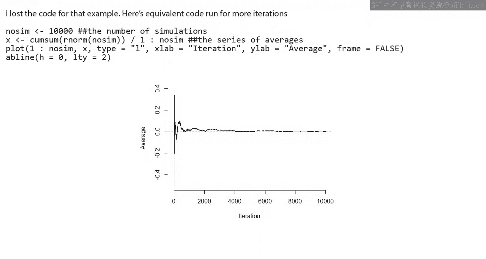
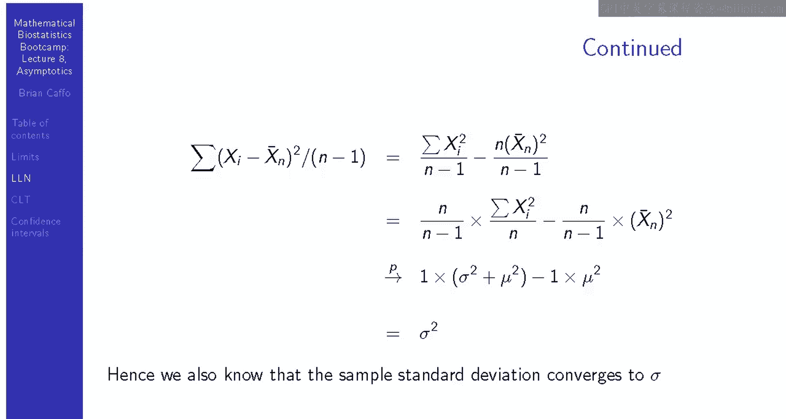
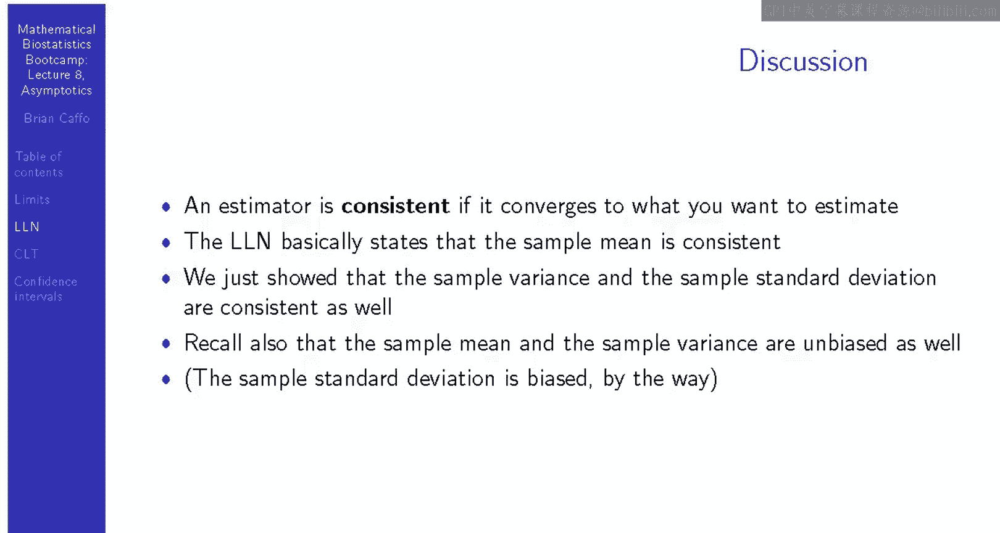

# 约翰霍普金斯大学《数据科学的高级统计｜Advanced Statistics for Data Science》中英字幕（deepseek p19 18_极限与大数定律.zh_en -BV1htPjeYEFH_p19-

Hi， my name is Brian Kaff I'm in the Department of Biostatistics at the Johns Hopkins Bloomberg School of Public Health。

 and this is Mathematical Biosstatistics Boot Camp lectureur8 on Asymptotics。

In this lecture we're going to take a trip to Asymptopia。

 Asymptopia is a land where we have an infinite amount of data so it should be fun。

We're going to talk about。Limits， but limits of random variables。

 and so there's intricacies that you have to account for when you consider random variables instead of standard mathematical limits。

And it's a quite difficult subject， but we're going to show that we have basically two tools。

 the law of large numbers and the central limit theorem that are going to be our primary methods for looking at limits of random variables。

So let me just review numerical limits first and I'm not going to go into too much detail and I'm going to kind of treat it heurically just to illustrate in case your asymptotics is a little bit rusty Sose I had a sequence where a1 was 0。

9 A2 was 0。99 and A3 was 0。999 and I hope you can get the pattern at this point。

So clearly this sequence in some sense of the word converges to 1， it converges to 0。

9999999 so that gets closer and closer to 1 as the element of the sequence gets larger and larger Well we can formalize this。

 the formal definition of a limit is for any fixed distance we can find a point in the sequence so that the sequence is closer to the limit than the distance from that point on so take for example。

 this sequence the distance between ann and 1 is 10 to the minus n where n is the point in the sequence and so if we pick any distance say epsilon we can find an n so that 10 to the minus n is smaller than epsilon and then because 10 to the minus n just keeps getting smaller as n gets larger then it's smaller than epsilon from that point onward so that satisfies our definition of a limit so clearly this converges to one and it's kind of an interesting fact that an infinite sequence of 09s and1 is the same number so that's kind of an interesting。

That if you ever take a class on real analysis， though it'll discuss that sort of thing at length。

 but anyway， I hope you get this basic sense of a limit as n goes to infinity。

 the sequence converges or looks more and more like its limit so that the distance just gets closer and closer and closer。

 never gets bigger again。

The problem with that。Is that that only works for just a series of numbers right now we want to talk about say limits of averages of coin flips and then it gets much harder。

 so take， for example， the average and now we're going to talk about an average comprised of n observations。

 So let's say x n bar and now instead of saying x bar like we typically do which is our average。

 we're going to annotate it by a subscript n to show that it's an average of the first n of a collection of IID observations So for example。

 X bar could be the average of the result of n coin flips which is the sample proportion of heads。

Well， there is a limit theorem for averages， and we would say that XN bar converges in probability to a limit。

And we relate this back to the ordinary definition of limit by saying， well。

 the probability that x is closer than any specific distance converges to1。 So in this case。

 probability xn bar minus the limit being less than any quantity epsilon that you fix。

Then that probability is a number PN right and the definition of converges and probability is that sequence of numbers Pn converges to one right so we've converted the problem of what does it mean for a random variable to converge。

 we've converted that back to the definition of convergence of a series of numbers we've said convergence and probability implies a convergence of the collection of probability numbers in the standard sense of the definition of convergence so now we have a way of talking about how random variables converge So establishing that a random sequence of variables actually converges is hard as you can imagine it's hard if you look back at the previous definition it's not the easiest thing in the world to think about so we have something that makes it a lot easier for us and that's called the law of large numbers so if you've heard people talk about the law of averages typically they don't know what they're talking about。

But probably they're referring to the law of large numbers and the law of averages or the law of large numbers basically says that if x n to x1 are IID from a population with mean mu invari sigma squared。

 so in this case we're going to assume that the random variables have a variance。

 it's interesting to note that there are distributions where there is no variance。

 you try and calculate the variance and you get infinity or something like that。

In this case we're going to assume that there is a variance and that it's finite then the sample average of IID observations always converges in probability to mu。

 and that's called the law of large numbers Probabilists make a lot of distinction over various kinds of the laws of large numbers and they've worked very very hard to get kind of minimal assumptions for the law of large numbers to work and in fact we're using a very lazy version of the law of large numbers。

 they would probably be upset at us for teaching this one。

 but it's okay we don't care the basic ID I want you to get is that averages converge to mu averages of IID observations converge to mu。

 the population mean that from which the observations were drawn This is a good thing right。

 this basically says if we go to the trouble of collecting an infinite amount of data Then we get the number that we want to estimate mu exactly right which is good because collecting an infinite amount of data takes a lot of time actually infinite amount of time。

If you're willing to make this many assumptions， the x's all have a finite variance。

It's pretty easy to prove the law of large numbers using chvychv's inequality。

 which chvyachev's inequality if you remember had a pretty simple little proof。

 so this kind of very complicated idea， it's amazing that it has a fairly simple little proof。

So remember that Chebuchev's inequality states that the probability that a random variable is more than k standard deviation from the mean is less than 1 over k squared。

 so therefore the probability that xm bar minus mu in absolute value is bigger than or equal to k standard deviation of x bar sub n is less than or equal to 1 over k squared。

Now let's pick an Epsilon， pick any distance epsilon because remember to establish the convergence of a limit numbers。

 we have to pick an epsilon， and now to establish convergence and probability。

 we have to show that the probability that XM bar minus mu being bigger than epsilon goes to zero。

Or being less than epsilon goes to1。 Those two statements are equivalent。

 And so let's let K from our previous definition be epsilon divided by standard deviation of xm bar。

 K is not a random variable， right， Epsilon is a number that we pick and standard deviation of Xm bar。

 Xm bar is a random variable， but the standard deviation of it is sigma over square root N。 Okay。

 so this is just a number， there's nothing random in our definition of K。

 So if you plug that back in for K。Right， you get the probability that XM bar minus mu being bigger than epsilon is less than or equal to the standard deviation of XM bar squared。

 which is the variance of XM bar divided by epsilon squared and we from a previous lecture already calculated what the variance of XM bar is it sigma squared over n。

 so this probability is less than or equal to sigma squared over n epsilon squared。Now。

 as n goes to infinity， sigma squared isn't changing and epsilon squared isn't changing and the ends in the denominator。

 So this whole thing goes to0 so the probability that the random average Xm bar is more than epsilon away from the mean goes to0 as n goes to infinity or restated the probability that Xm bar is less than epsilon from the mean goes to1 as n goes to infinity。

 So either of those statements equivalently say that Xm bar converges in probability to mu。

 I think it's kind of staggering that it's really basically two lines is all you need to establish this fairly complicated result。

Now in the next page I just have a simple example where I simulated random normals with a mean of0 and I show the cumulative sample mean so I took one random normal and then I took that random normal and generated a second random normal and then averaged it and then generated the third random normal and just averaged it with the remainder in the iteration on the bottom is the number of observations that goes into that mean and then on the vertical axis it shows the value of the average and you can see at first there's quite a bit of variability remember the variance of the average of sigma squared over n so the variability is going to zero and this dashed line is the asymptope right and as you can see this average as we include more observations in it is going to converge to this you can see it already converging a little bit by 100 iterations to this dashed line。

Play the law of large numbers。

So let's cover some useful facts about the law of large numbers。

 One interesting fact is functions of convergent random sequences converge to the function evaluated at the limit。

 So this includes sums products differences。 So for example。

 xm bar squared converges to mu squared right because X bar converges to mu。

 and so this is just a function of x bar So Xn bar square converges to mu squared something different is that average of the squared observations converges to a different entity。

 Okay right let's go through this a little bit carefully just because it's kind of a odd little point So Xm bar squared converges to mu squared。

 but if we sum up Xi squared， the individual observation squared and divided by n that no longer converges to mu squared Well why not？

 well it's the difference between the square of the average and the average of the squares So in this case it's the average。

Of the squares in this case， each X squared is a random variable。

 so we could just call it y instead of X squared， and then their average of thesexi squares or average of these y's is going to converge to the population mean of those y's Well we can calculate that。

 We know what the specta value of X squared is because we can use the shortcut formula for the variance。

Which recall was expect a value of Xi squared minus expect value of Xi quantity squared。

 We can just work that formula to solve for expect value of Xi squared and show that that's equal to sigma squared plus mu squared。

 So the average of the squared observations converges to sigma squared plus mu squared。

 whereas the square of the average converges to mu squared。 Its kind of an interesting little point。

 But just remember that those things are different。 And by the way。

 this little fact that we just showed we can use this to prove that the sample variance converges to sigma squared。

 and we'll do that on the next slide。 So let's actually go through this。

Proof that the sample average converges。To sigma squared。

 And I think you'll see in the process of the proof that it doesn't matter whether we divide by n or n -1。

 It's going to converge to sigma squared。 So here we have the definition of the sample average。

 summation X  X n bar squared。 All divided by n -1。

 We're going to use the unbiased estimate of the sample variance。 Well。

 recall there was a shortcut formula for the sample variance。

 And it worked out to then be the numerator had a shortcut formula that was summation X I squared n X bar squared。

 And so we're going to use that formula And then we get summation X squared over n 1 n bar squared over n -1。

 And let's just rearrange terms， and multiply and divide by some ns because that n1 is a little annoying。

 So we have n over n -1 times summation X I squared over n n over n 1 times X n bar squared。 Well。

 let's look at each of。These things in turn and remember from the previous slide I told you I didn't prove this and just to have to take it as true is that you know if you multiply convergence sequences。

 they converge to the product of the limits if you add and subtract convergence sequences。

 they converge to the difference of the limits and so on So let's look at each of these terms one at a time n over n minus1 clearly that converges to one if you don't believe me plug n over n minus1 in for a very big value of n in your computer and you'll see that it gets closer and closer to one。

Probably the easiest way to see this is it's1 over1 minus1 over n。

 and that one over n clearly goes to zero。Okay， we just on the previous slide talked about how summation Xi squared over n converges to sigma squared plus mu squared。

 so the second term converges to sigma squared plus mu squared。

 then we have minus n over n minus1 which again converges to 1。

And then Xm bar squared converges to mu squared， we talked about that on the previous slide。

 so we have this expression right here， sigma squared plus mu squared minus mu squared。

 which is just sigma squared。So that proves that the sample variance converges to sigma squared and then of course the sample variance。

 if we happen to divide by the bias sample variance。

 if we happen divide by n instead of n minus1 also converges to sigma squared。

 and then we can square root the sample variance and get the sample standard deviation and see that it converges to sigma as well。

 just by the rule from the previous page where we said that functions in this case the square root function of convergent random variables converge to the function of the limit。

 so what we've found is we have our law of large numbers。

 and with a couple of rules that we just stipulated。

 we've got that the sample mean of IID random variables converges to the population mean that it's trying to estimate the sample variance converges to the population variance that it's trying to estimate the sample standard deviation converges to the population standard deviation that it's trying to estimate。

And in all these cases， you see the pattern that the sample entity converges to the population quantity that it's trying to estimate。

 basically saying that if you go to the trouble of collecting an infinite amount of data。

 then you actually get the value that you want to estimate you don't get it with noise you get the actual value。

 we give this name a property and we say that an estimator is consistent if it converges to what you want to estimate。

 and the law of large numbers is basically saying that the sample mean is consistent。

 and then we know now know that the sample variance and the sample standard deviation are consistent and it doesn't matter whether you're dividing by n or n minus1 they're all consistent。

 but also remember the sample mean and the sample variance are unbiased as well。 and by the way。

 the sample standard deviation is not unbiased。 Con， by the way， is a very weak property。

 So the sample standard deviation is biased， unlike the sample mean and the sample variance。

 consistency is a very weak property saying。an estimator is consistent is not even really a necessary property。

 it seems like it should be necessary， but if something converges to mu plus epsilon where epsilon is a minuscule number that is of no importance。

 then that estimator is not consistent。 So it's fair to say that consistency is sort of a kind of a weakly necessary but definitely not sufficient property for an estimator to be useful。

 we've also seen that being unbiased is neither necessary nor sufficient for an estimator to be useful either。

 for example， we've talked about the bias variance tradeoff that estimators can be slightly biased and you can want that because you improve on the variance。

 So what we're winding up with is a collection of properties that describe estimators and you really need to think about the collection of properties as a whole to evaluate estimator and these various mathematical concepts are useful。

But they never in isolation tell the full story on the utility of estimator。

 they might be useful for eliminating really dumb things if something's definitely not consistent in a way that it doesn't converge anywhere near the estimate。

 probably that's not something that you want to use。

 but apart from those kind of stark circumstances， these properties you need to take as a collection to try and decide which estimators are the right ones to use。

So let me give an example of an estimator that's consistent but not very good。

 So take the data and only take the first half of the collected observations。

 So we have instead of x n bar， we have x n over2 bar right that estimator is of course consistent as n goes to infinity you know it just has fewer observations than if you took all of them。

 but still the n is going to infinity in this case， it's just n over 2。

 So that estimator consistent but it's got an obvious better estimator right in front view。

 basically the estimator using all of the data。 So there's a particular example of an estimator that's not consistent where there's a better estimator that comes to mind here you have to actually account for the fact that the estimate with all of the data has a lower variance than the  estimate with half of the data So that's enough discussion of limits in the law of large numbers Next we're going to go on to the。

Central limit theorem， a very important theorem in statistics。

