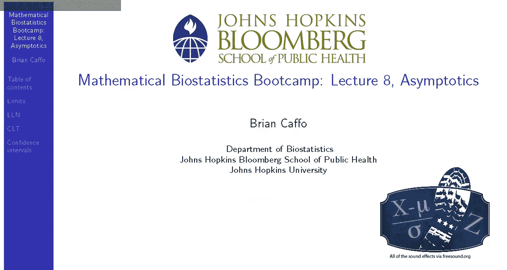
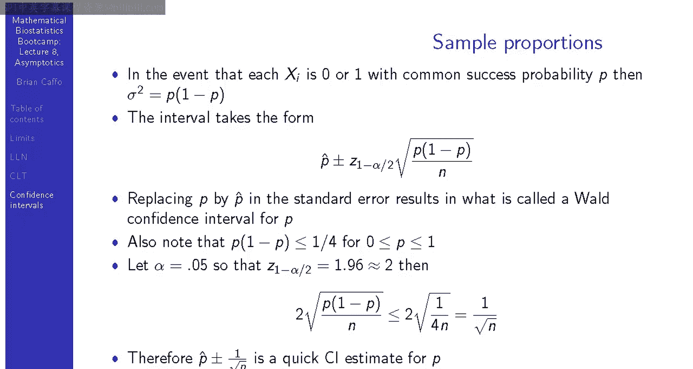

# 约翰霍普金斯大学《数据科学的高级统计｜Advanced Statistics for Data Science》中英字幕（deepseek p20 19_中心极限定理与置信区间.zh_en -BV1htPjeYEFH_p20-

Hi， welcome back to this lecture on asymptotics We're going to talk about the central limit theorem。

 one of the most important and celebrated theorems in statistics the idea behind the central limit theorem is very neat it gives you a way to perform inference with random variables we actually don't know what distribution they come from and basically what the CLT states is that the distribution of averages of IID variables properly normalized becomes that of a standard normal as the sample size increases it's basically saying is if you want to evaluate error rates associated with averages。

 it's often enough to only compare them relative to a normal distribution and the CLT applies in an endless variety of settings and with a collection of various asymptotic tools people have figured out a way to apply the central limit theorem in so many cases。

The majority of inferences you do if you've used statistical software and calculated a P value or a confidence interval。

 probably the underlying motivation of what you're doing is asymptototics。 in most cases。

 maybe not all cases， but definitely not all cases， but in most cases。

 you're probably appealing to some use of the central limit theorem。

 especially if you have larger sample sizes。 Let's actually just state the central limit theorem。

 at least as far as we're going to use it。 So let's let x1 to Xn be a collection of I random variables。

 they come from some population with mean mu and variant sigma square。

 And let's let Xm bar be their sample average。 Then probabilities， and in this case。

 let's look at the distribution function。 The distribution function of the normalized mean。

 So we take Xm bar subtract off its expected value mu and divide by its standard deviation Sigma over square root N。

 So this whole quantity here it has mean0 and variance1。

So this probability that this z random variable is less than or equal to the specific point z is the standard limits to the standard normal distribution evaluated at that point Z Okay so what does the say this basically says that probabilities associated with sample means look like probabilities associated with normals。

 and if you standardize the sample mean so that it has mean0 and variance 1。

 then the probabilities look like standard normal probabilities So I wanted to reiterate the form of this normalized quantity here。

 it's xm bar n estimate minus the population mean of the estimate divided by the standard error。Okay。

And this is something that， you can practically bank on is if you take any statistical estimate based on IID data。

And subtract off its population mean and divide by its standard error。

 that quantity is most likely going to wind up limiting to having a standard normal distribution。

 let's just go through an example and this is kind of a neat example， I'll explain why in a minute。

 imagine if you were stuck on a desert island。And bear with me。

 imagine if you needed a standard normal random variable。

 you had to generate a standard normal random variable because you were kind of going crazy and all you had was a die。

 So you were thinking I need a standard normal random variable and I have a die。

 Let's roll the die a bunch of times and then take the standardized sample mean and see how well that works as a standard normal by applying the central limit theorem。

So remember of that for a die， the expected value of a die roll is 3。5。

 if you don't remember we went through this calculation a couple lectures ago when we covered the variance。

 the variance of a die roll is 2。92， and the standard error is square root 2。

92 divided by the number of die rolls going into the average， so that's 1。

71 divided by square root n and so the standardized mean would just be the average of the die rolls minus 3。

5 divided by 1。7 when divided by square root n。On the next slide。

 basically what I've done is I rolled the dye， let's say one time。

And I did that over and over and over again。 So an average of one。

 and I standardized the average of one right So in this case， for an average of one。

 it would be a di roll -3。5 divided by 1。71。 So now we have a distribution that's centered at zero and has variance one and I plotted the standard normal density in gray in the back。

 and I plotted the histogram of my die rolls。 And of course， it can only take six possible values。

 and you see those six spikes at 1 to6。 and it's not perfectly discrete because the software I'm using to plot the histogram assumes the data is continuous。

 So you see the six spikes basically from the fact that one die roll if we plot a histogram of a bunch of one die rolls。

 they're going to。Looked like a bunch of spike at one to 6。

 And in this case because it was normalized。 they're going to look like the numbers 1 to 6 where you subtract off 3。

5 and divide by 1。71。 Okay， now imagine if I just took two die rolls。 I took a die。 I rolled it once。

 I rolled it a second time。 I got my average， I subtracted off 3。5， and I divided by 1。

71 divided by square root 2。 and I repeated that process over and over and over again。

 and I plotted a histogram of the result of a lot of averages of  two die rolls。

And so the histogram is going to give me a good sense of what the distribution of the average of two die rolls is the standardized average of two die rolls is。

And in the background we have the normal distribution and on top of it we have the distribution of the average of two dir rolls and I think you'll agree that it's already just by two di rolls looking pretty good。

 amazingly good and now imagine if you had six die rolls so I rolled the die six times right took the average subtracted 3。

5 and then divided by 1。71 divided by square root 6 and then I did that process over and over and over again and I got lots of normalized averages of 6 di rolls and I plotted a histogram and you can't even see the standard normal distribution in the background because the distribution of the average of 6 di rolls looks so similar so if I was on my desert island and if I needed a standard normal。

 I think it could probably get away with  six di rolls and taking an average subtracting by 3。

5 and div by 1。71 divided by square root 6。And the reason why I bring this up is because it's an interesting fact the famous statistician Francis Galton。

 who was quite a character， you should look up Francis Galton if you could get a chance。

 he was Charles Darwin's cousin and he's very brilliant guy he needed standard normals。

 but he was trying to get to simulate standard normals prior to having computers so how did he do it well he basically rolled dice and applied the central limit theorem to get standard normals。

 which is really quite clever and he had because it was a pain in the butt and he wasn't on a desert island so he had time constraints。

 he actually invented dice that made it a little bit easier for him to do I think he took standard dice and kind of rode on the corners and stuff like that so there was more values than one to6 but the basic idea is that the distribution of averages looks like that of a normal distribution and with kind of just about in any sense regardless of what the underlying distribution of the data is there's some assumption there we assume that the variance was finite and some other things like that。

But for the purpose of this class， it's basically any distribution that we can probably think of。

 so let's take another version of the central limit theorem or another instance of the central limit theorem from flipping coins。

So now instead of a die， I have a coin and I want to evaluate the average of a bunch of coin flips。

 So let's let Xi be0 or1 result of the I coin flip of a possibly unfair coin where the p is the true success probability of the coin and the sample proportion。

 say P hat is just the average of the coin flips right the P hat is in this case。

 the percentage of ones and the average of thexi is the same thing。 Of course。

 So remember that the expected value of the Xs is P right。

 the true success probability of the coin and the variance of the X' is works out to be p times 1 minus p and then the standard error of the mean in this case is the variance divided by square root n。

 So it's p times1 minus p divided by n square root the whole thing。

So then what this says is that if we take a sample proportion P hat。

 we subtract off the population proportion， the success probability。

 the probability of getting ahead and divided by square root p times 1 minus p divided by n。

 that'll be approximately normally distributed。And things look worse than the die roll in this case。

 let's take a fair coin and generate some plots so if you take a fair coin。

And flip the coin and record either either 0 or1， depending on whether it's heads or tails。

 subtract off 0。5 and divide by square root 0。5 times 1 minus 0。

5 and do that over and over again and get a histogram of the results。

 you only get two possible values right， they're not 01 because you normalize them。

 And here in this first plot you see it doesn't look normal at all， of course。After 10 coin flips。

 So here now we're flipping the coin 10 times taking the sample proportion of heads。

 subtracting off 0。5， and then dividing by 0。5 times 1。5。

 divided by 10 square root of that whole thing。 and we repeat that process over and over and over again and get a histogram of the results。

 we see that the distribution of the normalized average of 10 coin flips looks pretty normal distribution。

 but still it's very discrete compared to the normal distribution， Once you get the 20 coin flips。

 it's looking pretty good， It's overlaying the standard normal distribution pretty well。

 And it turns out in the coin flipping example， it converges to normality quick。 If the coin is fair。

 If the coin is unfair。 If you see the bottom row of plots here。

 we have a coin that's unfair where it's more likely to get a tail than a head。 I think it's 07。3。

 I believe， is what I used for the simulation。 Then you see that， you know， it's the start。

 it's much more likely to get the zero value than the head value。

One value these aren't zero and one because they' have been normalized if you look at the distribution of averages of 10 coin flips。

 it doesn't look very normal at all 20 coin flips， it still doesn't look very normal。

 so it takes a lot longer。So。This is this is a problem with the central limit theorem that generally doesn't get a lot of play。

 The central limit theorem says basically if you have IID random variables。And you take an average。

 the distribution of the normalized average converges to that of a Gaussian distribution。

 but it doesn't tell you how fast it does that， right， It just tells you that it does eventually。

 So for some distributions， you know， it might take thousands of observations going into to the sample mean for the distribution of sample means to behave like that of a Gaussian distribution And for others。

 like the di roll， we saw that it only took six and then it was nearly overlaying the standard normal distribution。

 So you know it's an unfortunate fact that the central limit theorem can't give you any guarantees on how quickly things converge to normality。

Oh， and I wanted to point out one last thing on this coin flipping example。

 so if you've ever been to a science museum。And you've seen these machines where say a ping pong ball is dropped and it goes through like kind of a pachko collection of left right decisions。

 kind of randomly。 that's exactly a binomial experiment every time the ping pong ball hits a nail basically it can either kind of with a 50% probability go left or right And so by the end of the process。

 it's had a bunch of coin flips And so the position it is at the bottom is exactly the sum of a bunch of Bernoulli trials in principle you have to actually create it so that it approximates the coin flipping well。

 for example， it is tilted to the side it wouldn't be a fair coin anymore。

 but as it gets towards the bottom where the ping pong balls are collected。

 it's a sum of a bunch of Bernoulli random variables。 Well。

 you know the distribution of averages is approximately Gaussian so of course。

distributionistribution of sums is then approximately Gaussian because sums are just averages multiplied by n。

 So what you'll see in the science museum is that in the bottom they'll have traced out a Gaussian distribution and you'll see that if they run this ping pong ball machine long enough the balls tend to fall in a bellshaped curve and that's just an application of the central limit theorem saying that for this particular value of n the central limit theorem approximation of the sum of a bunch of coin flips is pretty good and this ping pong ball device is actually called aquikunks and it was invented by Francis Galton who we talked about earlier the cousin of Charles Darwin So it's kind of very interesting little tidbit so the next time you're at the science museum you can explain this to where you're with So the reason we use the central limit theorem in practice it's useful as an approximation basically saying that the normalized mean it has a distribution that's approximately。

The standard normal distribution。So let me give you an example， so remember that 1。

96 is a good approximation to the 0。975th quantile of a standard normal， and so negative 1。

96 is a pretty good approximation to the 2。5 percentile。

So what the central limit theorem then says is that 95% is about the probability that a standardized mean lies between basically minus2 and plus 2。

So let me just repeat that， so it's about 95% the probability that a standardized mean lies between the values minus 2 and plus 2。

And then so let's like take the interior of this probability statement and just rearrange terms a little bit。

 making sure that if we multiply everything by a minus sign， we flip the inequalities。

 and we get that XM bar plus 1。96 sigma over square root n is bigger than or equal to mu。

which is gray than or equal to XM bar minus 1。96 sigma over root and that probability is about 0。95。

 what that's saying is that the random interval XM bar plus or minus2 standard errors contains mu。

 the nonran entity with about 95% probability。In this case， we wanted a， let's say a 95% interval。

 so we took 5%， divided it by  two and got 2。5 in the 97。5th quantiles。

Basically add and subtracted those Xm bar plus or minus that quantile times the standard error。

 So that's 95%。 But if we wanted something other than 95%。

 why don't we just say the standard normal quantile Z at 1 minus alpha over 2 so in this case it was 1 minus alpha is 0。

05 divided by 2 that's 0。025 so that would be 0。975 so that would be z。975 which is 1。

96 so that's where we got the 1。96 from but we could do it for another value Imagine if you wanted a 90% interval right then we would have Z the quantile for the probability1 minus alpha in this case which would be 0。

1 divided by 2 so 0。1 divided by 2 is 005 so we need the 95th。

Percentile to plug in there if we wanted a 90% interval。Okay。

 so this is the idea that we can create so-called confidence intervals。

 random intervals that contain the quantity that they're trying to estimate with 95% probability with one minus alpha over2% probability we can create such quantities by taking the estimate plus or minus a standard normal quantile times the standard error and in this case it's the sample mean but we'll find that we can kind of trick and play games with a central limit theorem in a law of large numbers and get this kind of interval to work in a lot of cases so tons of the intervals that you're going to look at in your statistics classes are going to be exactly of the form estimate plus or minus standard normal quantile times standard error anyway this is called a 95% confidence interval it's a mainstay of statistics and especially so-cal frequent statistics and it's basically an estimate from mu that has some。

Acknowledgement of the uncertainty from the fact that we have data that we're treating as if it's random。

 So that's what a confidence interval is。 If we just give XM bar。

 we just give the sample average as an estimate that has no acledgment that there is random variation and that we're not accounting for。

 So in this case， we're saying， well， if we take X M bar and we're willing to assume that the data is independent and identically distributed with a finite variance。

Then we can apply the central limit theorem and the central limit theorem says that well if the distribution is cooperating and n is large enough。

 then the interval contains mu with probability 95% now so unfortunately I'm going to pontificate a little bit it's an unfortunate fact that confidence intervals are kind of really horribly hard to interpret and this is just a byproduct of so-called frequentist inference so the interval if we actually get data and calculate a confidence interval。

 then we just have two numbers those two numbers either contains mu or they don't so the standard frequentist logic says that the probability that that interval contains mu or not is either zero or one it either contains it or it doesn't so what the real interpretation of confidence interval is is that this procedure when applied over and over again creates confidence intervals that will contain mu 95% of the time。

So that's actually the real interpretation of a confidence interval if you are a hardball frequentist。

And it's unfortunate that that interpretation is so hard。

 So let me just repeat it because it is kind of tricky。

 It's basically saying that the confidence interval procedure。

 given that the central limit theorem applies and all of our assumptions apply。

 the confidence interval procedure creates intervals that if we are to repeat the procedure over and over and over again on repeated experiments。

 let's say for 95% intervals， about 95% of the time the intervals will contain the value that they're trying to estimate that's a very confusing statement and that's one of the main criticisms of confidence intervals。

 that if you're strict about their interpretation， which not everyone's strict about it because the strict interpretation so hard that it's actually quite difficult。

 maybe I'll try and dig up some examples when a confidence interval makes its way into some very important problem and show you how the press is basically incapable of。

Interpreting intervals this way。 And to their credit。

 it's because it's hard and it's kind of a crazy interpretation。 There is， in fact。

 a different way of creating intervals that gives you a better interpretation。

There's another trick if you happen to be taking a statistics test。

 there's a trick to get around this mental games associated with fictitious repetitions of experiments and so on。

The trick is just to say we're 95% confident the interval contains mu and statisticians have said。

 well that's enough hedging to count as a legitimate instance of the strict definition。

 so if you're taking a statistics test don't say there's a 95% chance that the interval that I just calculated contains mu because your teacher might yell at you about that but if you say you're 95% confident they'll be grudgingly give you credit。

Let me give you another formula that I find super useful。

 a super useful instance of the CLT because it's kind of quick back of the envelope type calculation。

 so by the way， we're going to spend much more time calculating specific confidence intervals and so on right now we just wanted to give you the theory behind Y confidence intervals work but there's a specific instance of confidence intervals that's really quite useful so for sample proportions。

 remember the variance is p times 1 minus p and so the confidence interval just plugging in takes the form P hat。

 the sample proportion plus or minus the standard normal quantile times square root p times1 minus P over n。

Now， in all of the intervals， P is what we want to estimate。

 so we obviously can't plug into this formula。 We need to replace P with an estimate。

 if we replace P with the sample proportion P hat1 minus P hat， we get so calledled walled interval。

 And as I stated in this previous slide， but didn't really talk about generally replacing the unknown parameters in the standard error calculation with their estimates we usually work with something that's called sletsky's theorem。

 and that will usually work and we'll create an interval that's asymptically valid。

 let's try instead of doing that right now， we'll talk a lot more about walled intervals and that sort of thing。

 Let's actually talk right now about quick back of the envelope bounds。

 So remember that the worst that P times1 minus P can be the biggest it can be is if P is a half。

 So this thing is less than or equal to a quarter。 as long as P is between0 and1。

 which is our restrictions because we're talking about a proportion of probability。 So in this case。

 if we let。be 0。05 so that the standard normal quant is 1。96。

 which is close enough to two you know among friends。 let's just call it two。

 then the standard error， the whole kind of margin of error part of the confidence interval2 square root P1 minus P over n works out to be two times square root a quarter divided by n。

 And so you wind up with one over square root n。 So if you want a quick back of the envelope confidence interval estimate for a sample proportion just take the sample proportion and add subtract1 over square root n。

 and that's a really handy little formula。 and it kind of tells you sort of when you calculate a proportion about how it is。

 So for example， you if I have a proportion of 100 coin flips。

 we know that the accuracy is going to be about one over square root 100 or。1。

 So it's a very useful little back of the envelope calculation。

 just remember P hat plus or minus1 over square root n。

Well that's the end of today's lecture on Asymptopia， I hope you enjoyed your visit to Asymptopia。

 it's a very nice place when you have an infinite amount of data things tend to work out。

Would look forward to seeing you next time。🎼。

🎼嘀嘀哩嘀。