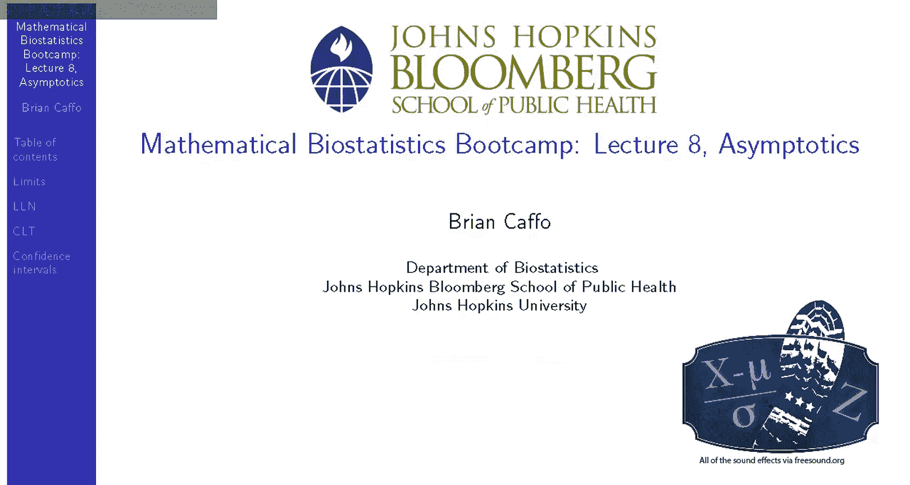
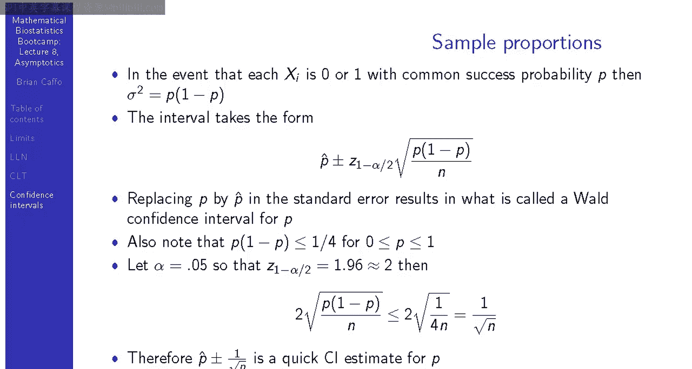

# 高级统计：第19讲：中心极限定理与置信区间

在本节课中，我们将要学习统计学中一个最重要且著名的定理——中心极限定理。我们将探讨其核心思想、应用场景，并学习如何利用它来构建置信区间，从而对未知参数进行统计推断。

## 中心极限定理的核心思想

中心极限定理的核心思想非常简洁。它提供了一种方法，让我们能够对来源分布未知的随机变量进行推断。中心极限定理指出，独立同分布随机变量的平均值，在经过适当的标准化处理后，其分布会随着样本量的增加而趋近于标准正态分布。这意味着，如果我们想评估与平均值相关的误差率，通常只需将其与正态分布进行比较即可。

中心极限定理适用于几乎无穷无尽的各种场景。结合各种渐近工具，人们已经找到了在许多情况下应用中心极限定理的方法。你所进行的大多数统计推断，例如使用统计软件计算P值或置信区间，其背后的基本动机很可能就是渐近理论。在大多数情况下，尤其是在样本量较大时，你很可能正在应用中心极限定理的某种形式。

## 中心极限定理的正式表述

现在，让我们正式地陈述中心极限定理。设 `X1, X2, ..., Xn` 为一组独立同分布的随机变量，它们来自某个均值为 `μ`、方差为 `σ²` 的总体。令 `X̄` 为它们的样本平均值。

那么，标准化均值 `(X̄ - μ) / (σ / √n)` 的分布函数，将随着 `n` 的增大而收敛于标准正态分布函数。用公式表示如下：

`P( (X̄ - μ) / (σ / √n) ≤ z ) → Φ(z)`

其中 `Φ(z)` 是标准正态分布在点 `z` 处的累积分布函数。

这说明了什么？它表明，与样本均值相关的概率看起来就像与正态分布相关的概率。如果你将样本均值标准化，使其均值为0、方差为1，那么这些概率就类似于标准正态概率。这里需要重申这个标准化量的形式：`(估计值 - 估计值的总体均值) / 标准误`。

实际上，你可以信赖的是：对于任何基于独立同分布数据的统计估计量，只要减去其总体均值并除以其标准误，该量最终很可能具有标准正态分布。

## 中心极限定理的直观示例

让我们通过一个有趣的例子来直观理解。想象你被困在一个荒岛上，需要生成一个标准正态随机变量，而你手头只有一个骰子。你可以通过反复掷骰子，计算标准化后的样本均值，并应用中心极限定理来近似标准正态分布。

对于一个均匀的六面骰子，单次掷骰的期望值是3.5，方差是2.92。因此，标准误是 `√(2.92 / n)`，标准化均值是 `(样本均值 - 3.5) / (√(2.92 / n))`。

*   **掷一次骰子**：标准化后，结果只有六个离散值，分布远非正态。
*   **掷两次骰子**：计算两次的平均值并标准化，其分布直方图已经开始呈现出类似正态分布的钟形。
*   **掷六次骰子**：计算六次的平均值并标准化，其分布直方图与背景中的标准正态分布曲线几乎完全重合，难以区分。

这个例子说明，即使原始数据（骰子点数）是离散且非正态的，其平均值的分布在样本量足够大时也会变得非常接近正态分布。历史上，著名统计学家弗朗西斯·高尔顿在计算机出现之前，就曾通过掷骰子并应用中心极限定理来模拟标准正态随机变量。

## 另一个例子：抛硬币

现在考虑抛硬币的例子。设 `Xi` 为第 `i` 次抛硬币的结果（0或1），`p` 是硬币的真实正面朝上概率。样本比例 `p̂` 就是正面朝上次数的平均值。

我们知道 `E[Xi] = p`，`Var(Xi) = p(1-p)`。根据中心极限定理，标准化后的样本比例 `(p̂ - p) / √(p(1-p)/n)` 近似服从标准正态分布。

然而，收敛速度取决于 `p` 的值：
*   **公平硬币 (p=0.5)**：当 `n=10` 时，标准化后的分布已初具正态雏形；`n=20` 时，已与标准正态分布贴合得很好。
*   **不公平硬币 (例如 p=0.3)**：即使 `n=20`，其分布看起来仍不太正态。收敛到正态分布需要更多的观测次数。

这个例子揭示了中心极限定理的一个重要局限：它只保证最终会收敛，但没有说明收敛的速度。对于某些分布（如均匀的骰子），可能只需要很少的样本量；而对于其他分布（如极端偏倚的硬币），可能需要成千上万的观测值。

## 中心极限定理的应用：构建置信区间

中心极限定理在实践中最主要的应用之一是构建置信区间。它告诉我们，标准化均值近似服从标准正态分布。

例如，我们知道标准正态分布的0.025分位数约为-1.96，0.975分位数约为1.96。因此，根据中心极限定理，标准化均值落在 `[-1.96, 1.96]` 之间的概率约为95%。

将这个概率陈述进行代数变换，我们可以得到：

`P( X̄ - 1.96 * (σ/√n) ≤ μ ≤ X̄ + 1.96 * (σ/√n) ) ≈ 0.95`

这意味着，随机区间 `X̄ ± 1.96 * (σ/√n)` 以大约95%的概率包含真实的总体均值 `μ`。这个区间被称为 **95% 置信区间**。

更一般地，对于任意置信水平 `1-α`，我们可以使用标准正态分位数 `z_{1-α/2}` 来构建区间：

`X̄ ± z_{1-α/2} * (σ/√n)`

例如，对于90%的置信区间，`α=0.1`，`z_{0.95} ≈ 1.645`。

## 置信区间的解释

置信区间是统计学，尤其是频率统计学的基石。它是对参数 `μ` 的一个估计，同时承认了由于数据随机性带来的不确定性。

然而，置信区间的解释颇具挑战性。根据严格的频率学派解释，我们不能说“计算出的这个具体区间有95%的概率包含 `μ`”，因为对于一个具体的区间，`μ` 要么在里面，要么不在，概率是0或1。

正确的解释是：**置信区间是一个过程**。如果我们能无限次重复整个实验（收集数据、计算区间），那么由这个过程产生的所有区间中，大约有95%会包含真实的 `μ`。这是一个关于**方法长期表现**的陈述，而非关于**单个具体区间**的陈述。

由于这种解释非常拗口，在实际交流中，人们常常说“我们有95%的信心认为该区间包含了 `μ`”。虽然这并非严格的频率学派表述，但通常被认为是可接受的简化。

## 一个实用的简化公式：样本比例

对于样本比例 `p̂`，其方差为 `p(1-p)`。因此，其95%置信区间的一般形式为：

`p̂ ± 1.96 * √( p(1-p) / n )`

但这里 `p` 是未知的。我们通常用 `p̂` 代替 `p`，得到所谓的 **Wald区间**。

此外，有一个非常实用的快速估算技巧。注意到 `p(1-p)` 在 `p=0.5` 时取得最大值 `0.25`。因此，`√(p(1-p)/n) ≤ √(0.25/n) = 0.5/√n`。同时，将1.96近似为2。于是，95%置信区间的误差范围可以近似为：

`2 * 0.5/√n = 1/√n`

所以，对于样本比例，一个简单易记的**快速95%置信区间**是：

`p̂ ± 1/√n`

例如，如果你抛了100次硬币得到一个比例，那么这个比例的精度大约在 `±0.1` 的范围内。这是一个非常有用的经验法则。

## 总结

本节课我们一起学习了中心极限定理及其核心应用——置信区间。

*   **中心极限定理**指出，独立同分布随机变量的标准化样本均值，其分布随着样本量增大而趋近于标准正态分布。这为许多统计推断提供了理论基础。
*   **收敛速度**因原始分布而异，定理本身不保证速度。
*   **置信区间**（如 `估计值 ± 分位数 × 标准误`）提供了一种在估计参数时量化不确定性的方法。
*   **区间解释**需要谨慎：频率学派的置信区间描述的是构造区间的方法的长期覆盖概率，而非单个区间的确定性。
*   **实用技巧**：对于样本比例，`p̂ ± 1/√n` 是一个方便的95%置信区间近似公式。

中心极限定理将我们带入了“渐近乐园”，这是一个当拥有大量数据时，许多事情都会变得清晰明了的美好领域。希望你对这次访问感到愉快！