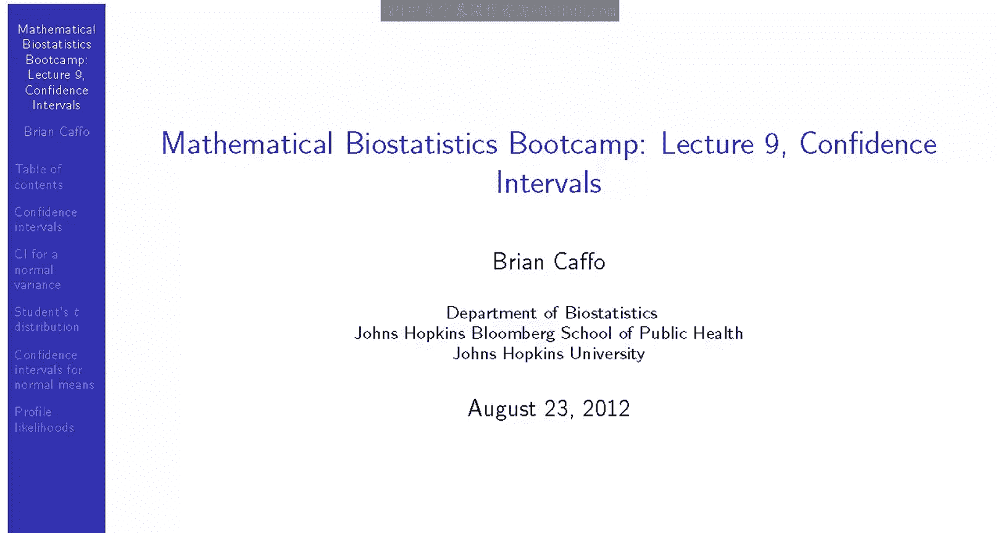
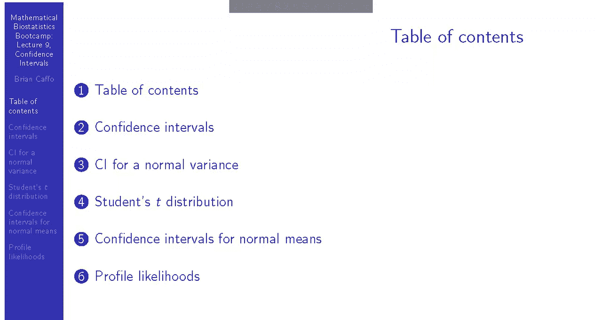
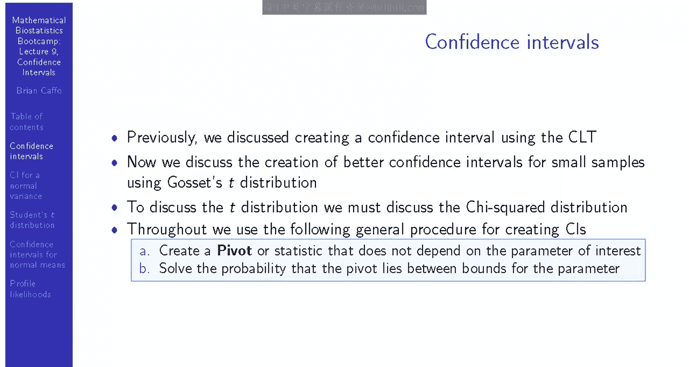
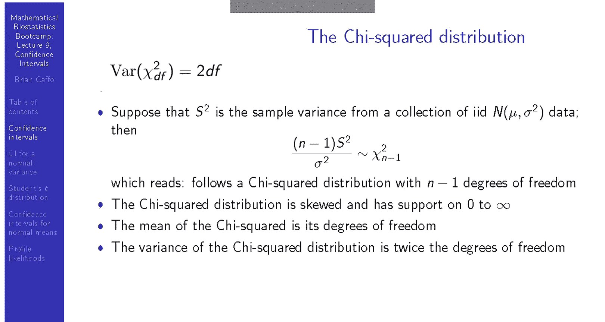
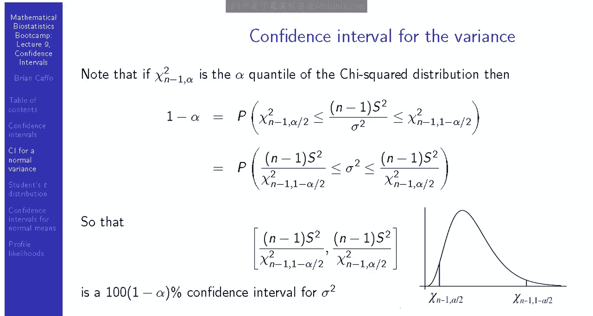
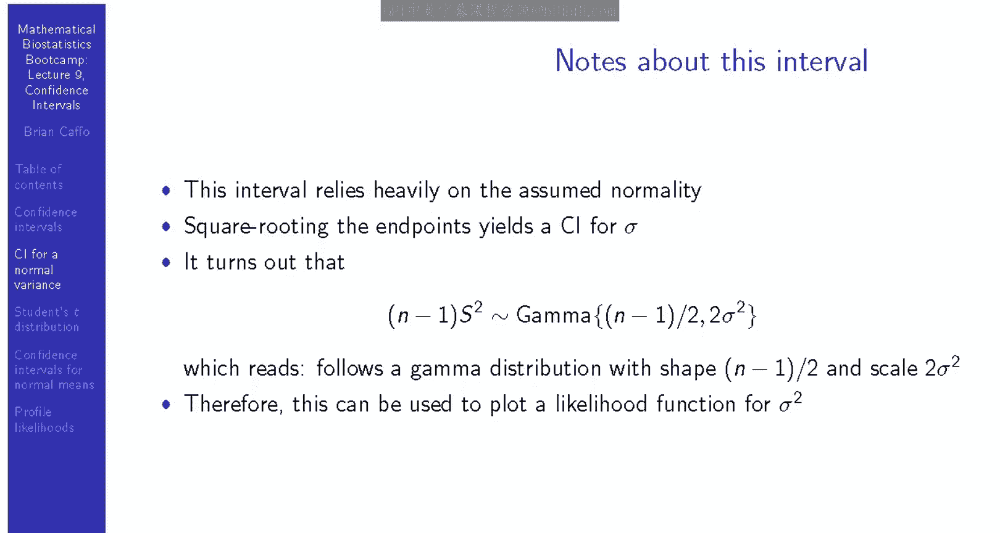
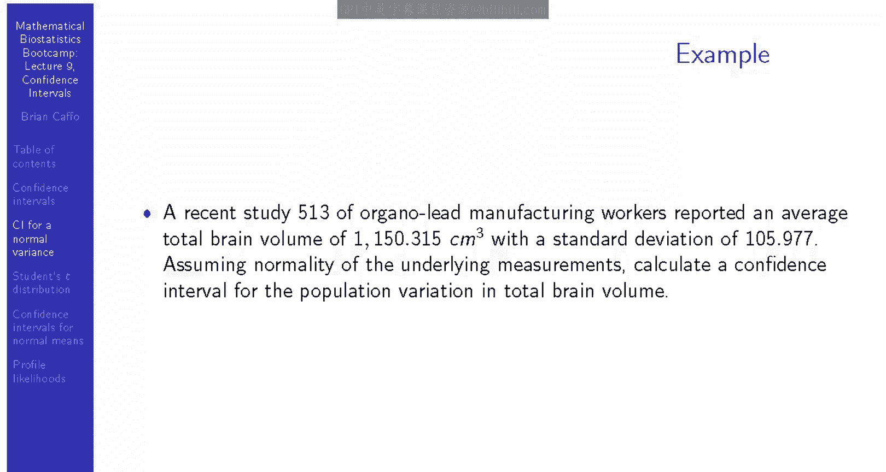
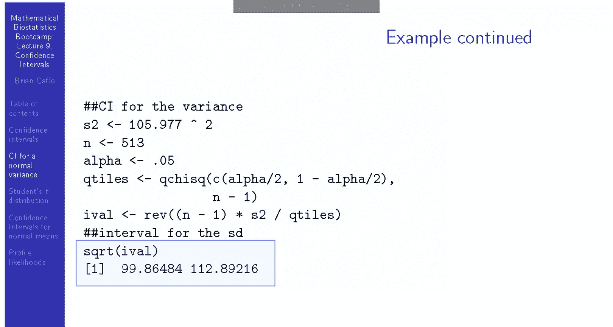
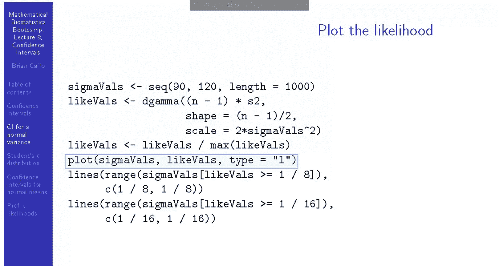
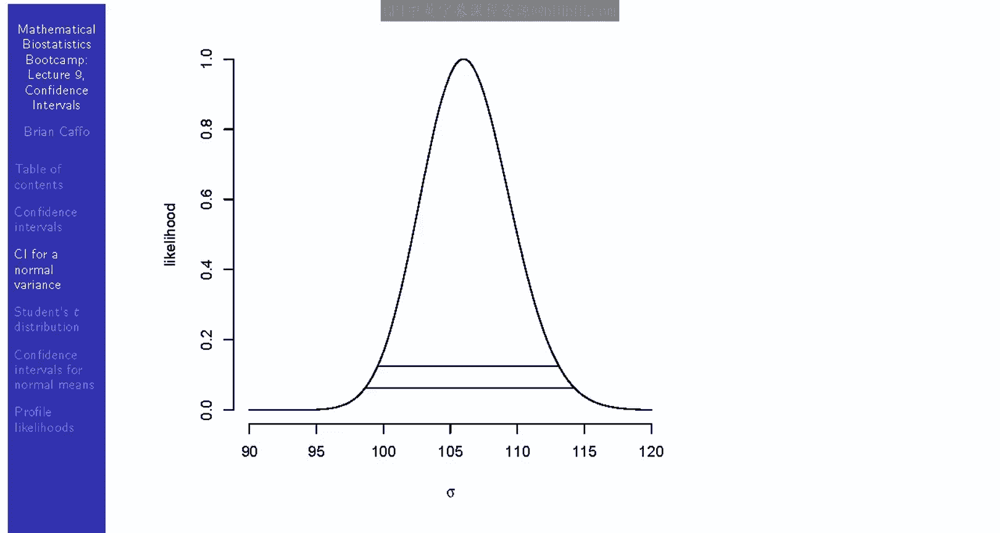

# 约翰霍普金斯大学《数据科学的高级统计｜Advanced Statistics for Data Science》中英字幕（deepseek p21 20_置信区间与正态方差的CI.zh_en -BV1htPjeYEFH_p21-

Hi， my name is Brian Kaho， and this is mathematical Biosstatistics bootcamp Le 9 on confidence intervals。

In this lecture， we're going to talk about confidence intervals。

 mostly in the setting where we're going to assume that our data come from a Gaussian distribution。

So we'll talk about confidence intervals， confidence intervals for variance。

 we'll talk about Gost's T distribution， and we'll use Gosst's T distribution to create confidence intervals for means。

And we'll touch on the subject of profile likelihoods。

In the last lecture， we talked a little bit about the central limit theorem and we talked about using the central limit theorem to create a confidence interval。

 I think in that example， we created a confidence interval for a binomial proportion。

Now we'll discuss the creation of better confidence intervals for small samples using Gosett' T distribution。

 small samples where we're willing to treat the data as if it's continuous。

So to get to that point and Gett's T distribution is often called students T distribution and we'll explain why in a little bit。

 so to discuss the T distribution， we first have to go through what the chi squared distribution is。

 and so we'll develop that first。And anyway， you'll probably hopefully have noticed whenever we create confidence intervals。

 there seems to be some kind of prevailing logic。That we use， Basically。

 we try to create a probability statement。And then we， in a sense。

 manipulate that probability statement to generate an interval。 Well。

 this strategy is codified it here。 So basically we create a pivot or a statistic that doesn't depend on the parameter of interest。

 I should say we create a pivot or a statistic whose distribution doesn't depend on the parameter of interest。

 So， for example， if you use the central limit theorem。 If you take a sample mean。

 subtract off the population mean that you're interested in and divide by the standard error。 Well。

 that statistic clearly depends on the parameter of interest。 but the distribution of that statistic。

 at least in the limit doesn't depend on the parameter that you're interested in the sample mean。

And then after we've created that pivot， we solve the probability that the pivot lies between bounds for the parameter。

 and so that's the kind of general strategy we'll go through。

 You don't have to really know or really understand this strategy at to a very general level。

 but know just in case you're wondering why does it always seem like we're generating confidence interval ruless using basically exactly the same technique。

 it's because we're employing a strategy kind of like this。

So let's talk about the chi square distribution。So remember。

 the S squared is the notation we've been using for the sample variance。

And let's further assume that the data that comprise the sample variance are all I I D normal with mean mu and variance sigma squared。

 Well， then n-1 times the sample variance divided by sigma squared is a random variable that we call a chi square distribution and the chi square distribution has an index。

 something that differentiates between different kinds of chi square distribution。

 And we call that index， the degrees of freedom。 So this statement right here will be read。

The normalized sample variance follows a chi squared distribution with n minus1 degrees of freedom。

So the chi square distribution is a skewed distribution and of course。

 since the sample variance has to be positive， it has support between0 and infinity。

 and the mean of the chi square distribution is its degrees of freedom。

And we can see that very directly because we recall the sample variance as an unbiased estimator。

 That's why we divide by n -1 instead of n。 So if you look at this equation。

 when you take the expected value， the expected value of S squared to sigma squared。

 you can see that n minus expected value of n minus-1 S squared divided by sigma squared。

 the sigma squareds would cancel out and you'll get the degrees of freedom are its expected value。

The variance of the chiis score， by the way， is that twice the degrees of freedom。

As an aside， we're not actually going to spend a lot of time doing this， but as an aside。

 you can use this idea to create a confidence interval for the variance。

 So imagine if I were to draw a chi square density。

And chi squared n minus1 alpha is the alpha quantile from that distribution。

 Then imagine taking the say alpha over 2， you know let's take alpha to be 0。05， for example， the 2。

5 percentile and the 97。5 percentile from the chi squared distribution and looking at the probability that this chi squared random variable n minus1 S squared over sigma squared is between those two quantiles。

 well that has to be 1 minus alpha just by the definition of those being the 2。5 and 97。

5 quantiles of the chi squared distribution。So this holds the equality that1 minus alpha equals this probability。

So this statistic n 1 S squared over sigma squared is our pivot。

 let's solve for the parameter that we're interested in Sigma squared， and you do that。

 keep track of your inequalities， being sure to flip them if you invert everything and that sort of thing and you wind up with the following probability statement。

There's a1 minus alpha probability that the random interval n-1 S squared divided by the upper quantile and n-1 S squared divided by the lower quantile contains sigma squared。

 So we call this interval。 the n-1 S squared divided by the two quantiles。 we call that interval。

 a confidence interval for sigma squared。 And because the probability that the random interval contains the parameter It's estimating is 1 minus alpha。

 we call it， say a 100 times 1 alpha per confidence interval。 So as an example， alpha might be 0。05。

 And so you then wind up with a 95% confidence interval for the parameter sigma squared。Now。

 we should talk a little bit about what this conference interval means。

 It's the interval that's random in the paradigm that we're sort of thinking about here。

 The interval is random。And the parameter sigma squared is fixed。

 So when you actually collect data and you form this confidence interval。

 it either contains sigma squared， which you don't know or not。

 There's no probability with that statement anymore。 It's either1 or0。

 it either contains sigma squared or not。 So what's the actual interpretation of a confidence interval。

 Well， if you take an intrott class， they make a lot of hay out of this point。

 And they basically say， okay， the confidence interval is a procedure that if you were to repeatedly do the experiment and form confidence intervals。

95% of the confidence intervals， say if you're creating 95% confidence intervals。

95% of the confidence intervals would contain the parameter that you're interested in。 and you could。

 as an example， do this in R， you could generate normal data。You could， from a normal。

 let's say mu is 0 from a normal0 sigma squared distribution。

You could formulate this confidence interval from the sample variance。

 You could check whether or not that interval contained the sigma squared that you used for simulation。

And then you could repeat that process over and over and over again。

 and you will find that about 95% of the intervals that you get if you construct 95% confidence intervals will contain the sigma squared that you used for simulation and that's the logic behind confidence intervals and they're a little notoriously hard to interpret if you go for this sort of hardball interpretation notoriously hard to interpret。

 kind of a much weaker interpretation of the confidence interval that's a little less specific is you get two numbers out and these two numbers are an interval estimate of the parameter that you want to estimate。

 but the interval estimate incorporates uncertainty。

So let's go through a couple of comments。About this interval。

So one thing is this interval is not terribly robust to departures from normality。

 So if your data is not normal， then this confidence interval tends to not be that great。 Also。

 if you want a confidence interval for the standard deviation instead of the confidence interval for the variance。

 you can just square root the endpoints of the interval。 the probability statement。

 one minus alpha equal to the probability that the random interval contains sigma squared， well。

 you can still say that that one minus alpha is equal to the probability that the square root of the endpoints of the interval contains sigma and you haven't mathematically changed anything。

 So if you want an interval for sigma， you just square root， the endpoints。So you might be wondering。

 okay， well， if this is heavily requires normality。

 do we have any other solutions other than this interval if we want a confidence interval for the variance。

 And it turns out the answer is yes。 and there's several ways。

 but bootstrapping is kind of the way that I prefer。

 but we're not going to talk about bootstrapping in today's lecture。 So today。

 we're only going to talk about this confidence interval when you happen to be willing to stomach the assumption that your data is exactly Gaussian and you are willing to live with the consequence that the interval that you obtained is not going to be terribly robust to debarture from that assumption。

 So the other thing I want to mention it's kind of a nifty little point is suppose you wanted to create a likelihood for Sigma。

 And in this case， the underlying data is Gaussian with mean mu and variant sigma squared。

 So it's hard because you have two parameters。 The likelihood is a bivariate function。

 It has mu on one axis。 Sigma in the other axis and then the likelihood on the vertical axis。

So there's a little trick you can use to create， I guess。

 what I would call marginal likelihood for sigma squared。 It turns out。

 and we're not going to cover the mathematics behind this。

 but that if you don't divide by sigma squared n -1 S squared and then don't divide by sigma squared。

 Well， first of all， that can't be chi squared。 Let me just logic through that real quick。

 That can't be chi squared because the chi squared density doesn't have any units。Right。

 so S squared has whatever units the original data has。 say it's in inches。

 It has inches squared units。 So you haven't divided by anything that's in inches squared。

 So n -1 S squared has inches squared units。 And so it can't follow a distribution that's unitless。

 like the chi squared distribution。 That's one of the reasons why you have to remember to divide by sigma squared to get the chi squared distribution is you get rid of the units。

 Well， let's suppose we don't divide by sigma squared。 Then you wind up with a gamma。

And a so called gamma distribution and the gamma is indexed by two parameters。

 its shape parameter and its scale parameter。 in this case， this shape parameter is n minus1 over 2。

 and the scale parameter is2 sigma squared。And either way， what you have is data。

 you have a single number and minus1 s squared， and if you're one to assume the data points that comprise that number are Gaussian。

 then you can take the gamma density and plug in the data and view it as a function of the parameters and plot a likelihood function。

So I'll go through an example of doing this。 So in our organo lead manufacturing work example that we looked at before。

There was an average total brain volume of 1150 cubic cent with a standard deviation of 105。977。

 And let's assume normality of the underlying measurements， which is not the case。 But let's do it。

 And let's calculate a confidence interval for the。

Population of variation in total brain volume。I give the R code here。

 So I gave the standard deviation。 So our variance is you know 105。106 squared。

 Our n in this case is 513。 confidence interval。 We want a 95% confidence interval。

 So our alpha is 0。05 the quantiles that we want。 We can just use the Q chi Sq function to grab those quantiles。

 This function right here just grabs the two quantiles。 and then our interval is just n-1 S squared。

 you know the S squared divided by the quantiles。 and then this puts it out from bigger to smaller。

 I want it from smaller to bigger。 So I use the RV function to reverse it。

 I think if I had just input my quantiles in the reverse direction。

 I would have been okay2 And then here just take the square root of that interval for an interval for the standard deviation。

 and we get the interval is about 100 to 113。So this interval 100 to 113 is created in a way such that if the assumptions of the interval are correct。

 namely that the underlying data are IID normal with a fixed variance sigma squared and a fixed mean mu。

 then the procedure if repeated over and over again， 95% of the intervals that we obtain。

 would be intervals containing the true standard deviation that we're trying to estimate。

Let's actually plot the likelihood as well， using this kind of likelihood trick that I gave。

 So I sigma valves is this sequence that I want to plot。 and actually。

 I don't have to guess this because I just created this confidence interval on the previous page that went from 100 to 113。

 So let's for good measure， go from 90 to 120 and I want to plot 1000 points。

 and are you kind of have to actually be pretty specific about the range that you want to plot and how many points you want going into your plot。

And then I just give you the code here for evaluating the gamma likelihood。

 It says basically plug in the data and -1 S squared， right。

 And remember the likelihood views that is fixed。The shape doesn't involve anything other than things we know and -1 over 2。

 And then the scale is the part that varies2 sigma squared。

 And here we're going to evaluate it over all the sigma vows that I assigned in the previous line。

 So this will evaluate that likelihood over 1000 points and return a vector of length，1000。

 I want to normalize my likelihood。 And I'll just kind of， you know。

 mostly approximately do that by taking this vector and dividing by its maximum value。

 And then I'll plot it。 type equals L means plotted as a line instead of as a bunch of points。

 And then these two lines commands adds the 18th and 1，16th reference lines。

And then on the next page， you actually see the marginal likelihood for Sigma。

That's a whirlwind tour of creating confidence intervals and likelihood plots for variances when you're willing to assume your data is exactly Gaussian。

I hesitates to say this， but kind of those slides aren't exactly terribly useful material。

 you won't find a lot of people plotting marginal likelihoodlis for Sigma。

 I just gave it to you because it's kind of a nifty little result。And to be honest。

 the Gaussian confidence interval for variances， you don't see them as much。

 people just would tend to do bootstrapping these days instead or some other more robust technique。

So this material it' neat and the primary thing to do was actually introduce the chi squared distribution。

So next we're going to talk about something that's incredibly useful。

 probably one of the single most used distributions and techniques in all of statistics。

