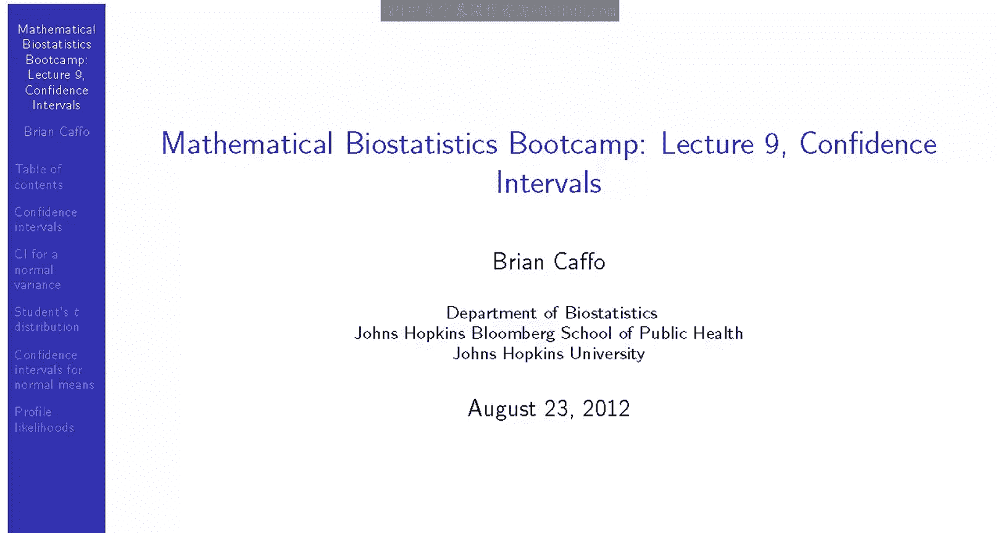
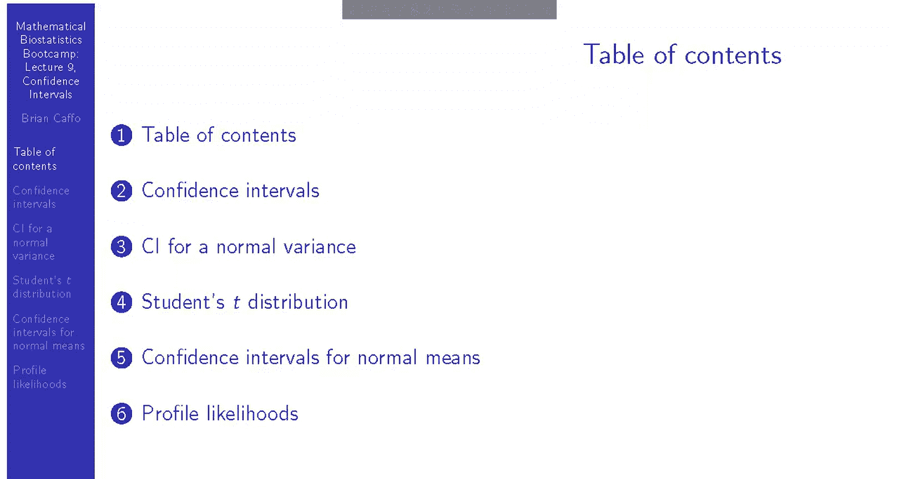
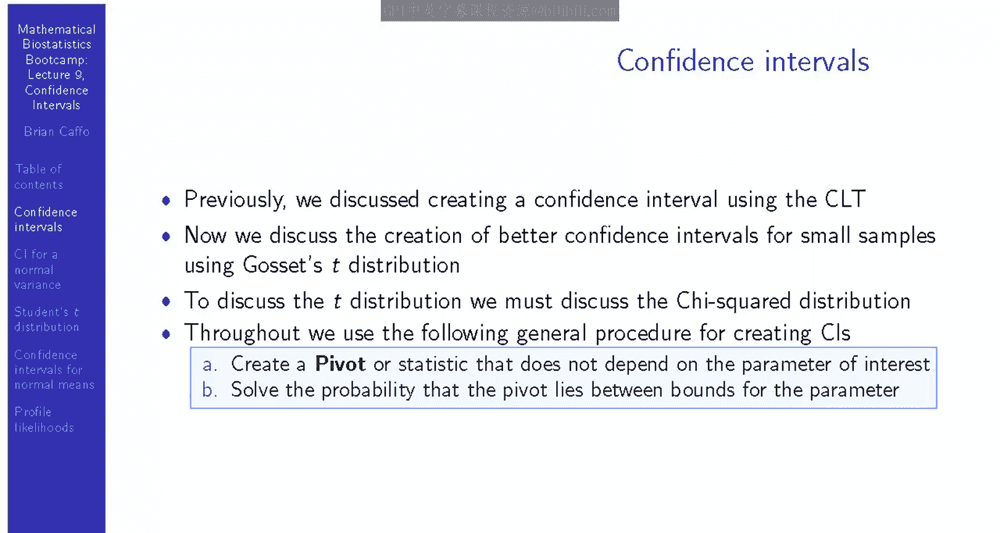
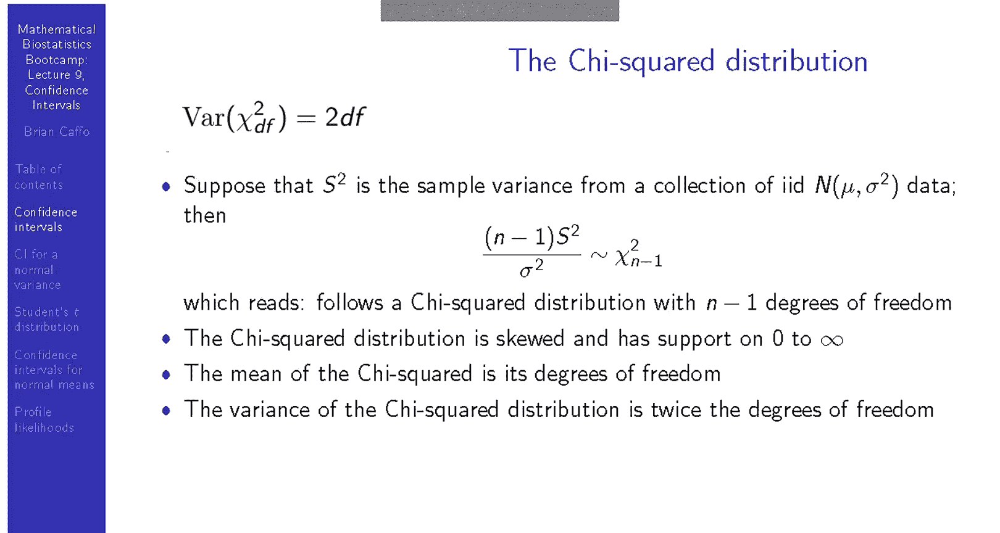
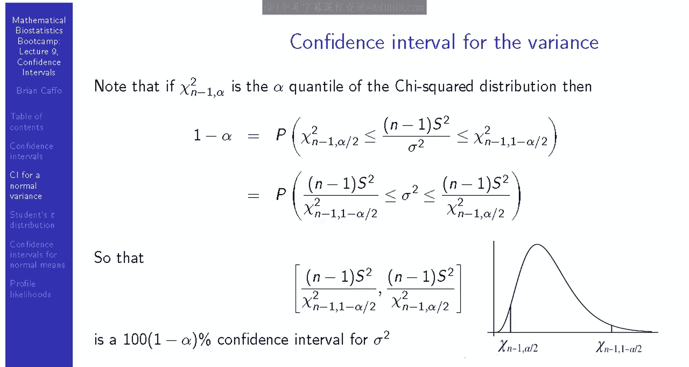
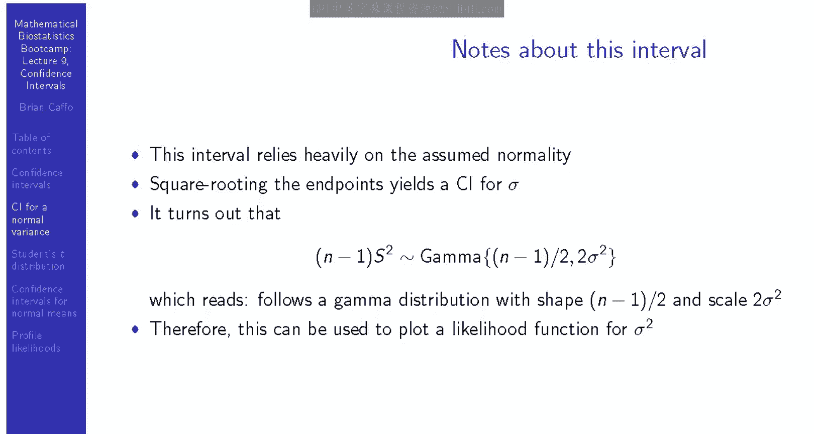
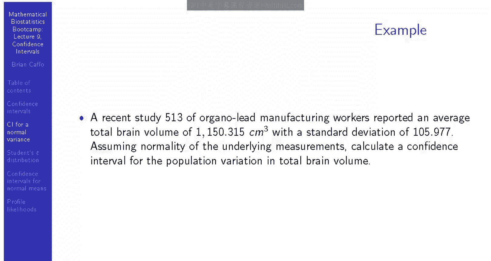
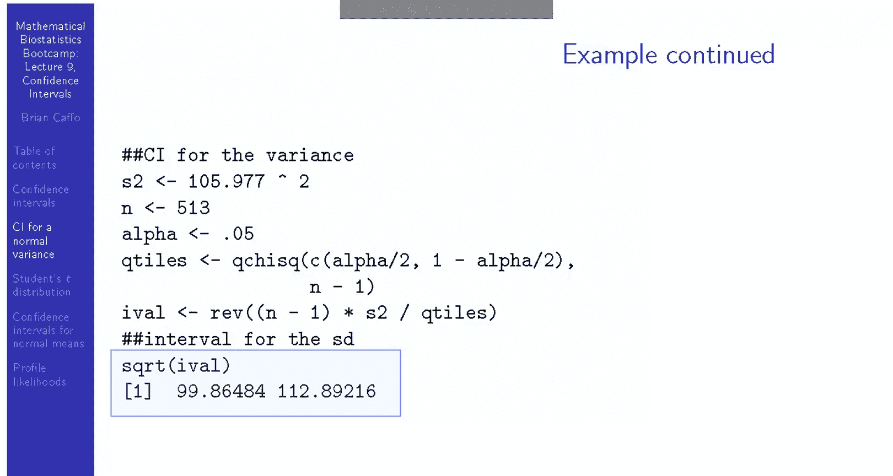
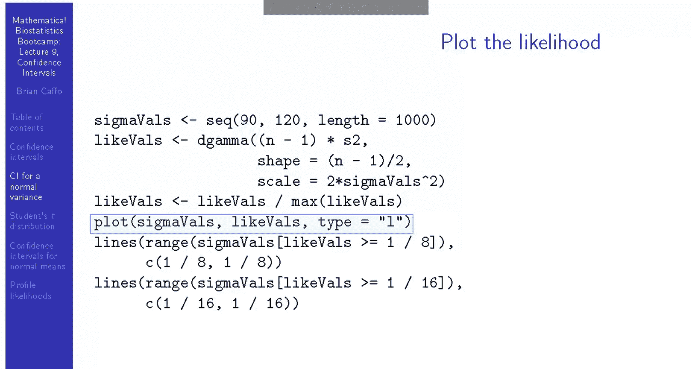
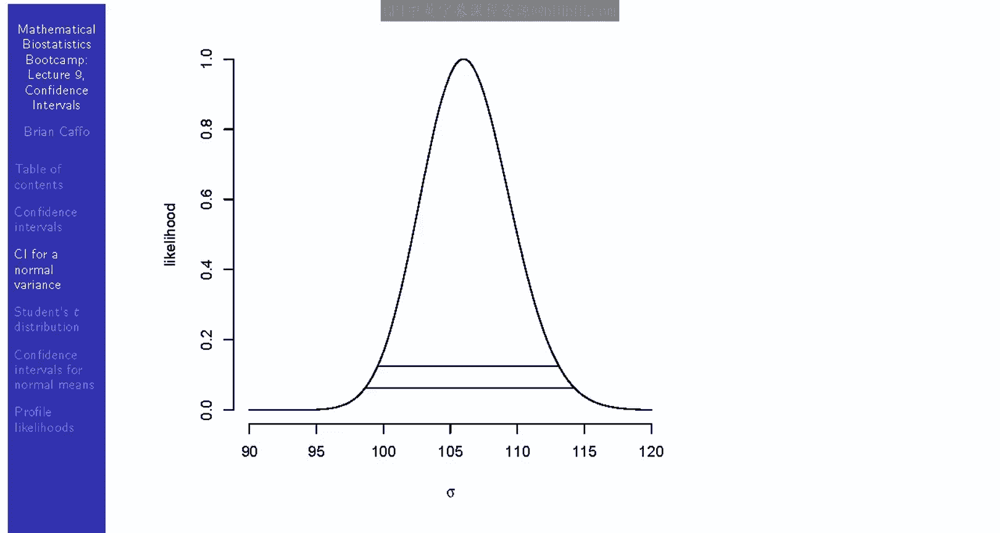

# 高级统计学：第9讲：置信区间 🎯



在本节课中，我们将要学习置信区间，主要是在数据服从高斯（正态）分布的设定下进行讨论。我们将介绍置信区间的基本概念、方差的置信区间、戈塞特（学生）t分布，并利用t分布构建均值的置信区间。最后，我们还会简要提及轮廓似然的概念。



## 置信区间简介

在上一讲中，我们讨论了中心极限定理，并介绍了如何利用它来构建置信区间，例如为二项比例构建置信区间。本节中，我们将讨论如何利用戈塞特的t分布为小样本数据构建更优的置信区间，这里的小样本数据是指我们可以将其视为连续数据的情况。

要理解t分布（通常被称为学生t分布，稍后会解释原因），我们首先需要了解卡方分布。因此，我们将首先推导卡方分布。

## 构建置信区间的通用策略

你可能已经注意到，我们构建置信区间似乎遵循着某种普遍的逻辑。基本上，我们尝试创建一个概率陈述，然后通过操作这个概率陈述来生成一个区间。这个策略在此被形式化。

以下是构建置信区间的一般策略：
1.  创建一个枢轴量，或者一个其分布不依赖于感兴趣参数的统计量。
2.  在创建枢轴量之后，我们求解枢轴量落在某个界限内的概率，从而得到参数的区间。



你不需要在非常一般的层面上理解这个策略，但要知道，如果你好奇为什么我们似乎总是使用基本相同的方法来生成置信区间规则，那是因为我们正在运用类似这样的策略。

## 卡方分布 📊

让我们来讨论卡方分布。记住，我们用 **S²** 表示样本方差。

进一步假设构成样本方差的数据都是独立同分布的正态数据，均值为 **μ**，方差为 **σ²**。那么，**n-1** 乘以样本方差再除以 **σ²** 是一个随机变量，我们称之为卡方分布。卡方分布有一个索引，用于区分不同类型的卡方分布，我们称这个索引为**自由度**。



因此，这个陈述可以解读为：归一化的样本方差服从自由度为 **n-1** 的卡方分布。

卡方分布是一个偏态分布。由于样本方差必须为正，其取值范围在0到无穷大之间。卡方分布的均值等于其自由度。我们可以直接看出这一点，因为我们记得样本方差是一个无偏估计量，这就是为什么我们除以 **n-1** 而不是 **n**。卡方分布的方差是其自由度的两倍。

## 方差的置信区间

我们可以利用这个思想来构建方差的置信区间。想象一下，我们绘制一个卡方密度函数。**χ²_{n-1, α}** 表示该分布的α分位数。

例如，取α为0.05，考虑卡方分布的2.5百分位数和97.5百分位数。那么，这个卡方随机变量 **((n-1)S²)/σ²** 落在这两个分位数之间的概率正好是 **1 - α**。

这个等式 **1 - α = P(χ²_{n-1, α/2} ≤ ((n-1)S²)/σ² ≤ χ²_{n-1, 1-α/2})** 成立。

这里的统计量 **((n-1)S²)/σ²** 就是我们的枢轴量。现在，我们求解感兴趣的参数 **σ²**。小心处理不等式，注意取倒数时要翻转不等号，最终得到以下概率陈述：

存在 **1 - α** 的概率，使得随机区间 **[ (n-1)S² / χ²_{n-1, 1-α/2} , (n-1)S² / χ²_{n-1, α/2} ]** 包含 **σ²**。

我们称这个区间为 **σ²** 的置信区间。因为这个随机区间包含其估计参数的概率是 **1 - α**，所以我们称之为 **100×(1-α)%** 置信区间。例如，α可能是0.05，那么你就得到了参数 **σ²** 的95%置信区间。

## 置信区间的解释

我们应该稍微讨论一下这个置信区间的含义。在我们目前思考的范式中，区间是随机的，而参数 **σ²** 是固定的。当你实际收集数据并形成这个置信区间时，它要么包含 **σ²**（你不知道），要么不包含。这个陈述不再有概率性，它要么是1（包含），要么是0（不包含）。



那么，置信区间的实际解释是什么？在入门课程中，他们会对这一点大做文章。基本上，置信区间是一个程序，如果你重复进行实验并构建置信区间，比如说你构建的是95%置信区间，那么大约95%的置信区间会包含你感兴趣的参数。

例如，你可以在R中模拟：从均值为0、方差为 **σ²** 的正态分布中生成正态数据，根据样本方差构建这个置信区间，检查该区间是否包含你用于模拟的 **σ²**。然后一遍又一遍地重复这个过程，你会发现，如果你构建的是95%置信区间，那么大约95%的区间会包含你用于模拟的 **σ²**。这就是置信区间背后的逻辑。

如果你坚持这种严格的解释，置信区间有点难以解释。一种不那么具体、但更弱的解释是：你得到两个数字，这两个数字构成了你想要估计的参数的一个区间估计，但这个区间估计包含了不确定性。

## 关于方差置信区间的说明

关于这个区间，有几点需要说明：
1.  这个区间对于偏离正态性的情况并不十分稳健。如果你的数据不是正态的，那么这个置信区间往往效果不佳。
2.  如果你想要标准差的置信区间，而不是方差的置信区间，你可以直接对区间的端点取平方根。概率陈述 **1 - α** 等于随机区间包含 **σ²** 的概率，你仍然可以说 **1 - α** 等于区间端点的平方根包含 **σ** 的概率。数学上没有任何改变。所以，如果你想要 **σ** 的区间，只需对端点取平方根即可。
3.  你可能会想，如果这个区间严重依赖正态性，那么除了这个区间之外，我们是否还有其他方法来获得方差的置信区间？答案是肯定的，有几种方法，但自助法是我更喜欢的方式。不过，我们不会在今天的讲座中讨论自助法。今天，我们只讨论当你恰好愿意接受数据完全服从高斯分布的假设，并且愿意承受由此得到的区间对该假设的偏离并不十分稳健的后果时，所使用的置信区间。

## 方差的轮廓似然

我想提到的另一点是，假设你想为 **σ** 创建一个似然函数。在这种情况下，基础数据是均值为 **μ**、方差为 **σ²** 的高斯分布。这很困难，因为你有两个参数。似然是一个双变量函数，一个轴是 **μ**，另一个轴是 **σ**，垂直轴是似然值。

有一个小技巧可以用来创建 **σ²** 的边际似然。事实证明，如果你不除以 **σ²**，那么 **n-1** 乘以 **S²** 服从一个伽马分布。伽马分布由两个参数索引：形状参数和尺度参数。在这种情况下，形状参数是 **(n-1)/2**，尺度参数是 **2σ²**。无论如何，你得到的是一个数据点：**n-1** 乘以 **S²**。如果你假设构成这个数字的数据点是高斯的，那么你可以取伽马密度，代入数据，将其视为参数的函数，并绘制似然函数图。

## 实例：脑容量方差的置信区间

让我们通过一个例子来做这件事。在我们之前看过的有机铅制造工作示例中，平均总脑容量为1150立方厘米，标准差为105.977。让我们假设基础测量值是正态的（实际情况并非如此），并计算总脑容量总体方差的置信区间。



以下是R代码：
```r
# 给定数据
sd <- 105.977
n <- 513
alpha <- 0.05
S2 <- sd^2

# 计算卡方分位数
quantiles <- qchisq(c(alpha/2, 1-alpha/2), df = n-1)



# 构建方差置信区间
ci_var <- ( (n-1) * S2 ) / quantiles
ci_var <- rev(ci_var) # 调整为从小到大

# 构建标准差置信区间
ci_sd <- sqrt(ci_var)
ci_sd
```
我们得到的区间大约是100到113。这个区间100到113的构建方式是：如果区间的假设正确（即基础数据是独立同分布的正态数据，具有固定的方差 **σ²** 和固定的均值 **μ**），那么重复执行此程序，我们获得的区间中约有95%会包含我们试图估计的真实标准差。

## 绘制边际似然图



让我们也使用我给出的这种似然技巧来绘制似然图。以下是在R中绘制 **σ** 的边际似然图的代码：
```r
# 定义要评估的sigma值序列
sigma_vals <- seq(90, 120, length = 1000)

# 计算伽马似然（作为sigma的函数）
# 形状参数 = (n-1)/2， 尺度参数 = 2*sigma^2
likelihood <- dgamma((n-1)*S2, shape = (n-1)/2, scale = 2*sigma_vals^2)

# 归一化似然（除以其最大值）
likelihood_norm <- likelihood / max(likelihood)

# 绘图
plot(sigma_vals, likelihood_norm, type = "l",
     xlab = expression(sigma), ylab = "Normalized Likelihood",
     main = "Marginal Likelihood for Sigma")
# 添加参考线（例如，似然比为1/8和1/16的线，常用于似然区间）
abline(h = 1/8, lty = 2, col = "gray")
abline(h = 1/16, lty = 3, col = "gray")
```
在下一页，你实际上可以看到 **σ** 的边际似然图。

## 本节小结



这就是当你愿意假设数据完全服从高斯分布时，为方差创建置信区间和似然图的快速导览。

我犹豫是否要说这一点，但这些幻灯片的内容并不完全是极其有用的材料。你不会发现有很多人为 **σ** 绘制边际似然图。我之所以介绍它，是因为这是一个巧妙的小结果。老实说，对于方差的Gaussian置信区间，你看到的并不多，如今人们更倾向于使用自助法或其他更稳健的技术。



这个材料很简洁，其主要目的实际上是介绍卡方分布。接下来，我们将讨论一些极其有用的内容，可能是整个统计学中最常用到的分布和技术之一——学生t分布及其在均值置信区间中的应用，我们将在下一节展开。