# 约翰霍普金斯大学《数据科学的高级统计｜Advanced Statistics for Data Science》中英字幕（deepseek p22 21_学生t分布与正态均值的CI.zh_en -BV1htPjeYEFH_p22-

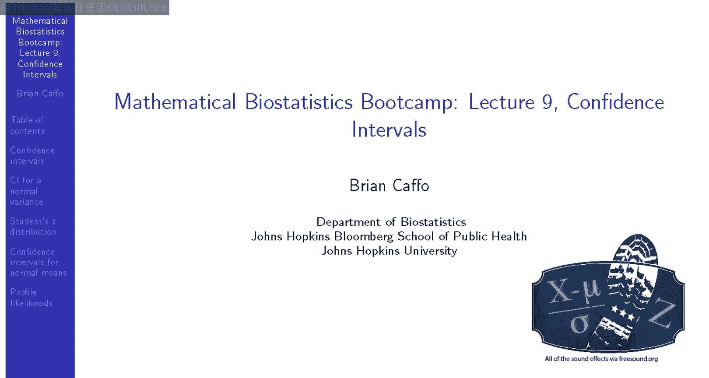

Okay， welcome back Tro， we're going to start talking about student or as I like to say。

 Gossett's T distribution。So the reason I call it Gossett's T distribution is it's usually called students T distribution because Gossett published under the pseudonym student in 1908。

 So it was actually Gossett's distribution。 He laid the foundwork for the actual distribution。

 and then I believe Fer actually prove the mathematics。 Some of the finer scale mathematics。

 But I wanted to talk a minute about Gosset because he's a pretty interesting character in the annals of statistics。

 So Gossett was a researcher and he worked at the Guinness brewweery in Ireland。

 when he created the T distribution。 he was actually working for Guinness And at the time。

 he had actually several really brilliant researchers working for him。

 and he wouldn't let them publish under their real name。

 So that's how Gossett wound up publishing under a pseudonym and made this sort of landmark discovery as a researcher。

 It's interesting。 So the reason he came up with this distribution is because for him。

 the central limit theorem just。Simply not rich enough to describe the problems he was looking at。

 So he was working with these small batches in the science of brewmaking。

 and it wasn't adequate to assume that things were heading to infinity。

 So he came up with this distribution and we all the more fortunate for it。

 One thing I really like about gossipsett is whenever you read about him。

 he was apparently a tremendously nice guy， extremely humble。

 he made several major discoveries and statistics， he came up with one of the first uses of the Poisson distribution。

And then he also in the Gus Company， he rose up pretty high。 He was a head brewmaster at its。

 I think it's London brewweery By the time he had retired。 So anyway。

 he's a really interesting character。 And if you get a chance， you should read about him。Anyway rate。

 so he came up with this wonderful distribution called as far as I'd like it to be called Gossett's T distribution。

And the T distribution is really kind of used when you have smaller sample sizes。

 it assumes your data is Gaussian， but it tends to work， even if your data is nongaussian。

 and so the t distribution， it has degrees of freedom。

 It's indexed by something called degrees of freedom， and the T distribution。

 which looks like a normal distribution where someone kind of squashed it down at its tip and all the extra mass went out into its tails。

 Well it looks more and more like a standard normal as the degrees of freedom get larger and larger。

So how do you get a T distribution， say you wants simulateimulated on a computer。

 you would take a standard normal， say Z here， and you would divide it by an independent chi squared divided by its degrees of freedom。

So where Z and chi squared here are independent standard normal and chi squared random variables。

 that's how you wind up with a T distribution。So how is this useful on the next slide。

 we'll look at how we apply this。

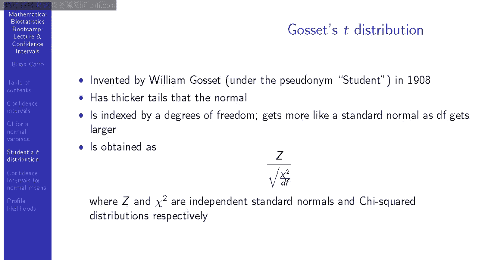

Well， let's suppose x1 to xn are I normal mu sigma squared。

Then x bar minus mu divided by sigma over square root n is， of course， standard normal， right。

 because a linear combinations of normal random variables are themselves normal。 So in this case。

 x bar is normal， and because their I， we know exactly what the standard deviation of x bar is it's sigma over square root n and we know that it's mean is mu。

 And so when we shift in scale are non standard normal by mu and divided by standard deviation。

 sigma over square root n， we get a standard normal。Hopefully。

 this should not be news to you at this point in the class。

And then we also know from earlier on in today's lecture that n -1 S squared over sigma squared is chi squared with n -1 degrees of freedom。

 So if we take n -1 S squared over sigma squared and divided by an additional n -1 and square root the whole thing。

 we get S over sigma and we've taken。A chi squared and divided it by its degrees of freedom。

 So S over sigma。Is the square root of a high square divided by its degrees of freedom。Therefore。

 if we take x bar minus mu divided by sigma over square root n。

 and then divide the whole thing by s over sigma。Which if we do the arithmetic works out to be x bar minus mu。

Divided by s over square root n， we wind up with a standard normal divided by a square root of a chi squared divided by its degrees of freedom。

Now there's one small thing that we're kind of fudging over。

 we haven't showed that the X bar and S are independent。They're from the same data。

 so it doesn't seem obvious that they're independent。 they are。

 it's just not immediately clear and let's sweep that under the rug。

So forget about that for the time being， take my word for it。X bar and S are independent。

 so this exactly has Gossett's t distribution with n minus1 degrees of freedom。

And notice what it basically accomplishes， so we saw previously in constructing confidence intervals that x bar minus mu divided by sigma over screw it in。

 that that's a nice kind of pivotal statistic to work with that's useful for generating confidence intervals we'll see that it's useful for doing hypothesis tests and all we've done is replace sigma by S。

And it's basically saying that we can take the unknown population variance。

And replace it with the known sample variance， and we get a statistic whose distribution we know okay？

And by the way， this statistic X bar minus mu S over square root n。

 it also limits to a standard normal as n goes to infinity， which， you know， of course。

 the Gass T distribution is the degrees of freedom goes to infinity。 If you look at it， you plot it。

 it looks more and more like a normal distribution as n goes to infinity。

 So we haven't violated the central limit theorem or anything like that in the process of doing this stuff。

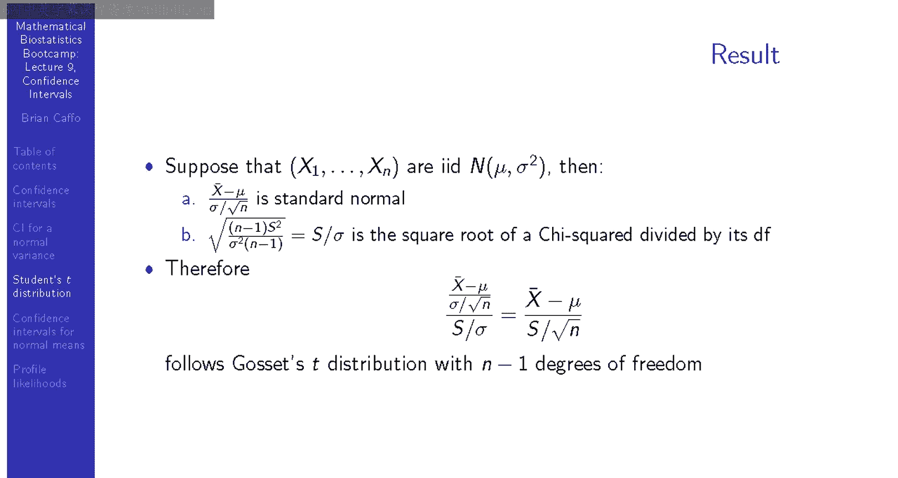

So let's actually use this distribution to create a conference interval。

It's a statistic who under the assumption of normality of the underlying data does not depend on the parameter mu that we're interested in。

 and therefore we can use it to create a confidence interval from mu。

 So let's let T Df alpha be the alpha quantile of the t distribution。

 So T n -11 minus alpha over 2 is say the upper quantile from the relevant t distribution in t n -1 alpha over 2 is the lower quantile from the relevant t distribution。

And so this probability statement here，1 minus alpha is equal to the probability that this statistic lies between those two conference intervals is then。

 of course， true。 right， So the probability that this T random variable lies between the alpha over2。

 lower quantile and the one minus alpha over 2 upper quantile is exactly one minus alpha。 Oh。

 and I should note here， by the way， because the t distribution is symmetric。 the alpha over2th。

 lower quantile is equal to the negative of the one minus alpha over2 upper quantile。

 This is because the t distribution is symmetric about 0。

 So that's why here instead of writing alpha over 2， I wrote negative t and -1。1 minus alpha over2。

 and you'll see why I do that in a second。So anyway， this probability statement applies here。

 so we can just rearrange terms and keep track of flipping our inequalities around when we multipied by a negative sign。

 and we get that x bar minus a t quantile times the standard error is less than mu。

An X bar plus a t quantile times the standard error is bigger than the mu。

 That random interval contains mu with probability 1 minus alpha。

 But if you look at the form of this interval when I wrote it out this way。

 that happens to be X bar plus and minus the upper quantile from the t distribution times the standard error。

 And that's why I took only the upper quantile that way， we can write it as plus minus。Okay。

 so that's how we wind up with these intervals， estimate plus or minus quantile times standard error。

And that's where it comes from。

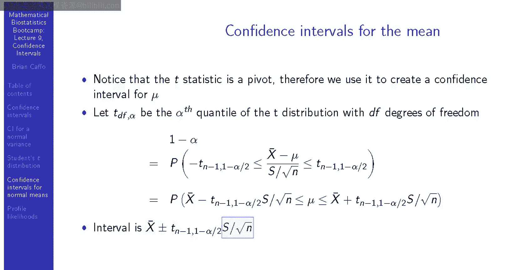

This interval assumes that the data are I I D normal， though it's very robust to this assumption。

 You know， whenever the data is kind of roughly symmetric and mo shaped。

 the tea comfort interval works amazingly well。 And if you want， you know。

 if you have paired observations， people before and after a treatment， for example。😊。

You can subtract them and then create a t confidence interval on the difference。

 So often paired observations are analyzed using this exact confidence interval technique by taking differences。

 and often differences tend to be much more Gaussian looking。

 They tend to be nice and symmetric about 0。 And then for large degrees of freedom。

 the t quantiles become the same as the standard normal quantiles。

 And so the interval just converges to the same interval that you get as the Ct。

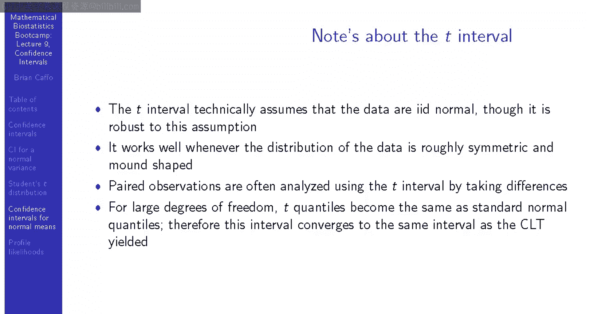

Some more notes。 for sked distributions， the kind of spirit of the T interval assumptions are violated。

 You could probably show that it still works kind of okay。

 And the reason is because those quantiles the t and-11 myself over too。

 The quantiles are so far out there。 You know， the T distributions of very heavy tail distribution that shoves those quantiles way out there that makes the interval a lot wider。

 and then it tends to work kind of conservatively in a broad variety of settings。

 But for skewed distributions， you're kind of violating the， you know， the spirit of the t interval。

 and you're often better off， you know trying some things like taking a natural log of your data if it's positive to get it to be more Gaussian looking before you do a t confidence interval。

 and we'll spend an entire lecture on the consequences of logging data。 So you can wait for that。

 But， you know， I would just say for skewed distribution。

 it kind of violates the intent of the T interval。 So maybe think of things like doing logs to consider it。

😊，And also， I would say for sked distributions， maybe it doesn't make as much sense to center to the interval around its mean in the way that we're doing with this T interval。

 we're centering it right around the mean。And then the other thing for discrete data。

 like binary data。You know， again， you could probably。

 I bet you could do simulation studies and show that the T interval， you know。

 actually probably works okay for discrete data like binary data。 But you know。

 we have lots of techniques for binary data that make direct use of the binary data and you're better off for those using。

 for example， things based on chi squares or exact binomial intervals and that sort of thing because。

 you know you're so far from kind of the spirit and intent of the T interval that is not worth using。

 regardless， the T interval is an incredibly handy tool。 And I'm sure actually。

 in some of these cases， it probably works fine。 but you're so far from the kind of assumptions at that point that you're better off using all these other techniques that have been developed for these other cases。

That's enough discussion about the Tea Conference interval， let's go through an example。

 so maybe take a break， go have a Guinness and we'll be back in a second。

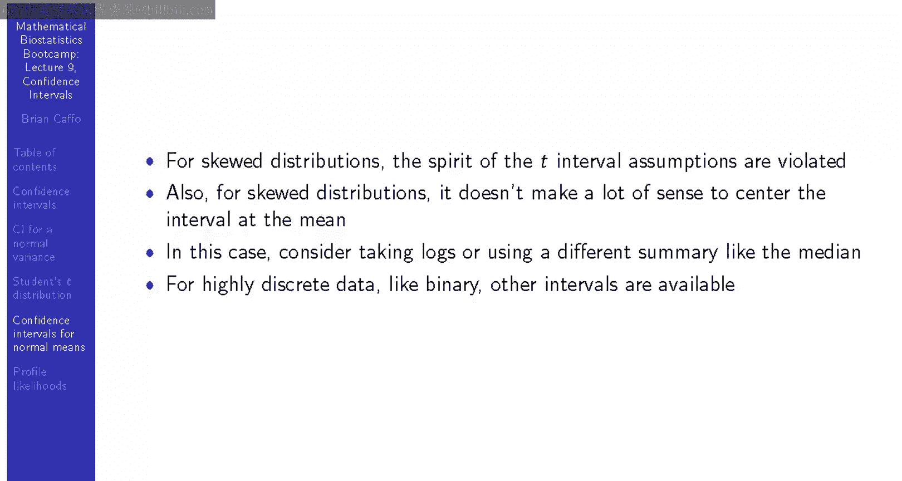

Okay， so welcome back。 So we're going to talk about Guinness's original data。

 which involve sleep data。 So try not to fall asleep while we're talking about it。

 So Gossett's original data appeared in this journal called Biiometricica with a K。And biometric。

 interestingly enough， was founded by a person called Francis Galton。

 So Gossett was an interesting character。 If you really want to read up on another， you know。

 absolutely brilliant， interesting character。 read up on Gosset。 He was Charles Darwin's cousin。

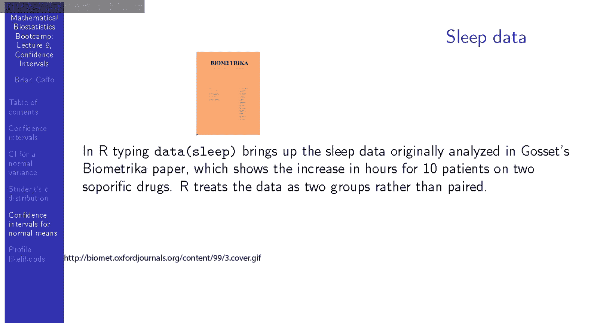

He invented the term in the concept regression。 He， you know。

 invented the term in the concept correlation， and he invented lots of other things， some good。

 some bad。 And it was just a generally rather interesting character。 So any rate。

 biometrica was founded by Francis Galton。 and that is where Gossett's original paper appeared。

 And that's where this sleep data occurred。

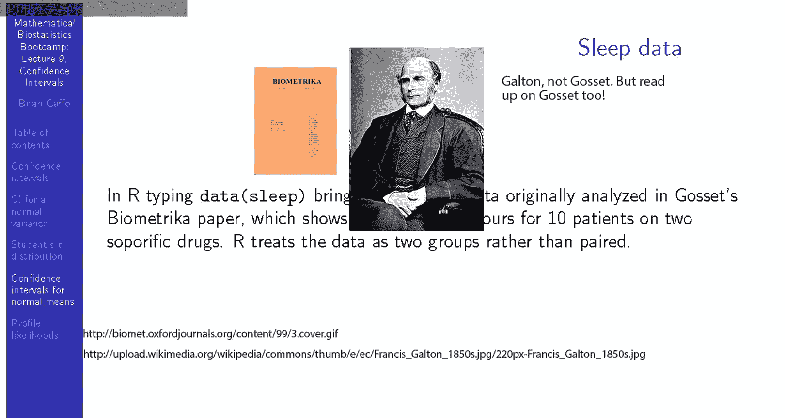

So any rate， the sleep data shows the increase in hours slap for 10 patients on two sleeping drugs。

 So R treats the data as two groups rather than impaired。

 and I have to admit I haven't taken the time to go through and figure out exactly why there's a discrepancy between when you read Goss's biometric of paper which treats the data as paired and R treats it as two groups。

 and anyway， I haven't gone through the details。 so I'm going to treat it exactly like Gossett's data。

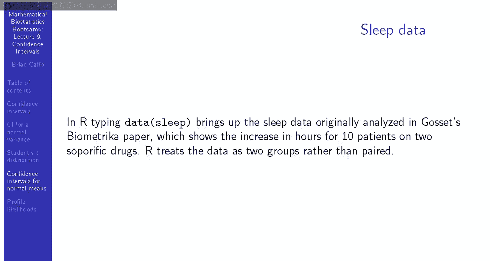

So here's what it looks like as GaSA status， so we have patient one two up to 10。

 we have the two drugs and the difference。

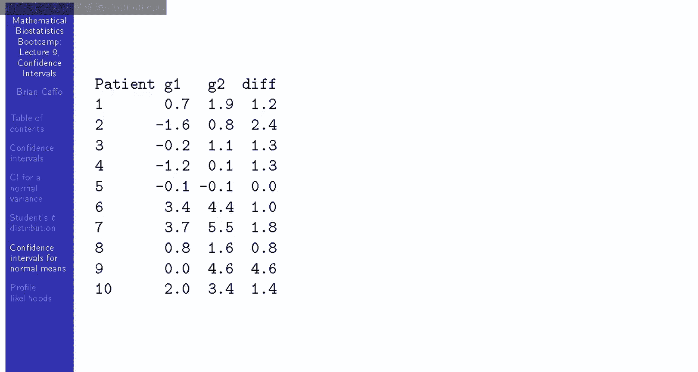

And here's the code I use to get it that way。So the mean would be the mean of the difference。

 and here I just put in a comment the value that it comes out to be， it turns out to be 1。67。

And this remember， everything' is normalized relative to 10 hours。 and then the standard deviation。

 was the standard deviation of the collection of differences is 1。13。And we had 10 subjects。

 So our confidence interval is the mean plus or minus。The T quantntile at 0。

975 if we want a 95% confidence interval because remember we put 2。5% in either tail。

Times the standard error， which is s divided by square root n。

And this will give you our confidence interval manually， but if you want to go the easier way。

 our actually has a function， of course， to do the t confidence intervals because it's one of the most popular statistical procedures。

 So if you do t dot test and here differences， the name of the vector that contains the differences and then this dollar sign here grabs the relevant output。

 So in this case I want the confidence intervals。 So it's dollar sign confidence do in if you omitted the dollar sign when you hit return。

 it would give you lots of information including the confidence interval here。

 it just returns exactly the confidence interval。 and you get 0。7 to 2。5 basically。

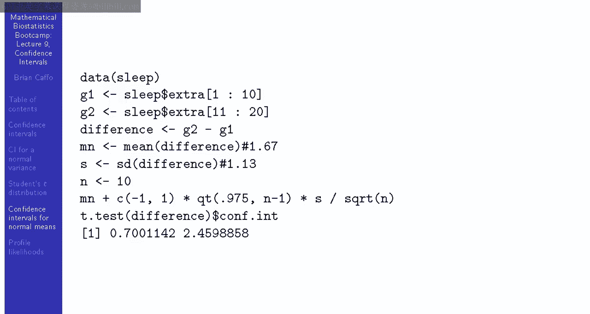

We've talked a lot about likelihood， so I wanted to talk about how you can use the T distribution to create a likelihood for not mute。

 So remember we're in this kind of hard setting where we have a data that have two parameters mu and sigma。

You know the likelihood inherently is a two dimensional object。 and we showed， oh， well。

 you can get a trick and figure out how to get a likelihood for sigma。And here I'm going to say。

 well， here you can do another trick and get another likelihood for a single parameter。

 but the single parameter is a function of the two parameters。 So in this。

 the single parameter is mu divided by sigma， which is actually quite an important parameter。

 mu divided by sigma is the mean in standard deviation units。So it's a unit free quantity。

 and it's often called the effect size。 And this is a nifty little trick to create a likelihood for the effect size。

 So if x is normal mu sigma squared。And then this chi squared random variable is a chi squared random variable with DF degrees of freedom。

Then if you take x divided by sigma divided by the square root of a chi squared divided by its degrees of freedom。

Then notice we forgot to subtract off mu in the top。 So x over sigma still has a mean。 In this case。

 its mean is specifically mu over sigma。 So we have not taken a standard normal and divided by an independent square root of an independent chi square divided by its degrees of freedom。

 We took a non standard normal and divided by a square root of an independent chi square divided by its degrees of freedom。

 Well， so it can't work out to be a t random variable because we haven't satisfied the definition of a t random variable。

 So it's what's called a non central t random variable。 And in the specific case when mu is 0。

 we wind up with a t random variable。And this non central T random variable also has degrees of freedom。

 but then it has a second parameter called the noncentity parameter。 in this case。

 the noncentity parameter is mu over sigma。So just to put this in context。

 x bar is normal mu with variance Sigma squared over n n 1 S squared over sigma squared is a chi squared with n1 over n -1 degrees of freedom。

 So square root n x bar divided by s works out to be a noncentral T with noncentity parameter square root n mu divided by sigma。

 Any rate， we can use this fact to create a likelihood from mu over sigma。

 the effects basically what is called the effect size。

And we can plot a onedial likelihood without having to do any further tricks。 and then after this。

 I'll talk about how you can do a trick to avoid all these little。

 you know figuring out likelihood for the effect size and figure out a likelihood for the variance or sort of you'd have to kind of take a mathstt class to figure those out what we'll talk about next and profile likelihood is a quick way to always generate a likelihood in any setting in a fairly automatic way。

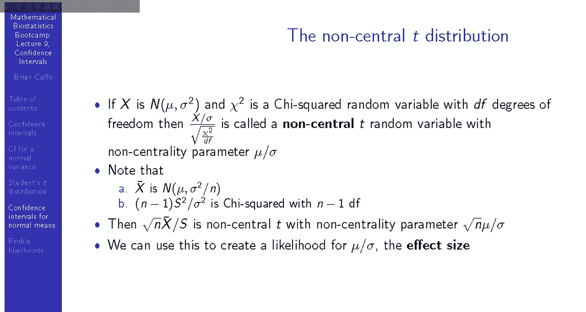

So anyway， here's how you would create the interval。

 so here our T statistic is square root n times the mean divided by S。

 just using the code from the sleep data。The effect size values that we want to plot is。

 let's say we go from 0 to 1 and our length is 1000。Our likelihood values are then the T density。

 In this case， Rs D T function。 T density function has an argument。 NCp。

 which stands for non centrality parameter。 So here we have our T density。

 We plug in our T statistic。 Our degrees of freedom are n -1。And then we loop over。

All of our noncentity effect sizes。And that creates a collection of likelihood values。

 And then we want our likelihood values to be peaked at one。

 So instead of figuring out with the exact maximum likely it is。

 let's just divide by the maximum when we grid searched over 1000 points and let's plot our effect size values by our likelihood values。

 Let's make sure it's aligned by doing type equals L and let's draw lines at 18 and 116th。

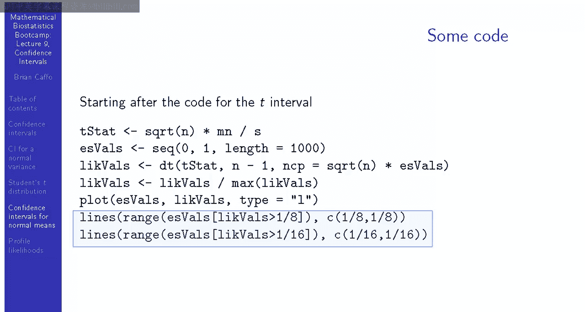

And we wind up with this plot。So this plot is a likelihood， not from mu。

 but from mu divided by sigma， and it has all of the same interpretations of any likelihood。

 High values indicate better supportive values of mu over sigma。

 lower values of likelihood indicate worse values and where the two lines intersect the likelihood represent intervals for the effect size。

So that's maybe enough about the effects。 and that's a fairly specific thing。

 That's not something you'll see in many， say introductory stats， textbooks。

 I just thought I'd give it because it's kind of neat。 Next。

 we'll talk about a way for creating a likelihood when you have a multivariate likelihood。

 creating a univevariate likelihood to look at。

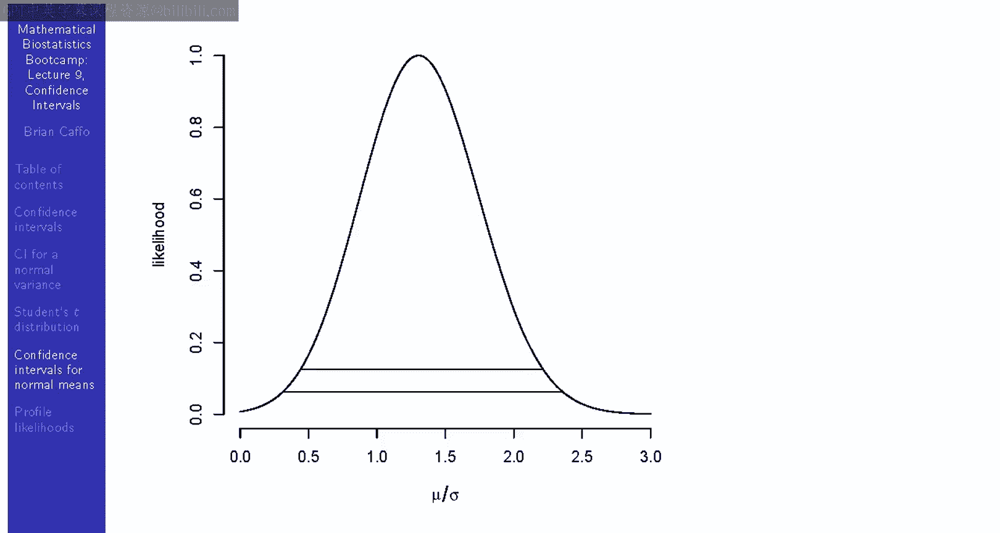