# 数据科学的高级统计：第21讲：学生t分布与正态均值的置信区间

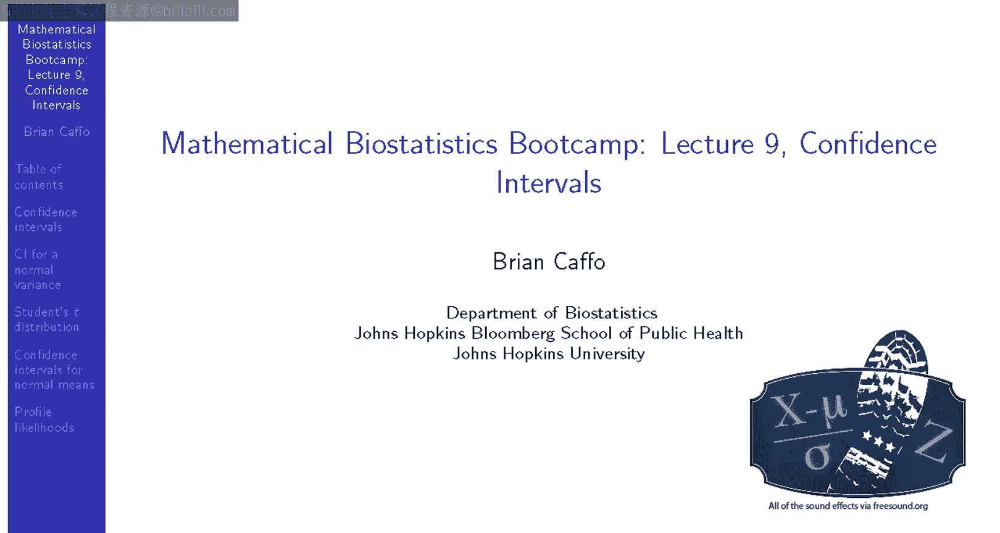

在本节课中，我们将学习学生t分布（也称为戈塞特t分布）及其在构建正态分布数据均值置信区间中的应用。我们将从该分布的历史背景讲起，逐步推导其公式，并通过一个实际数据示例演示如何计算置信区间。

## 🧑‍🔬 戈塞特与学生t分布

上一节我们讨论了正态分布和卡方分布。本节中，我们来看看一个在样本量较小时特别有用的分布——学生t分布。

该分布通常被称为“学生t分布”，但其真正的发明者是威廉·西利·戈塞特。1908年，他在爱尔兰的健力士啤酒厂工作时，以笔名“Student”发表了这项成果。他之所以使用笔名，是因为当时健力士公司不允许员工以真名发表研究。戈塞特需要处理啤酒酿造科学中的小批量数据，他发现中心极限定理（要求样本量趋于无穷大）不足以描述其问题，因此发明了t分布。

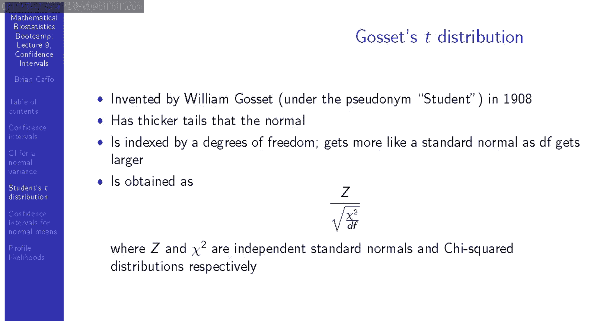

t分布的形状类似于正态分布，但峰顶更平，尾部更厚。它由一个称为“自由度”的参数索引。随着自由度增大，t分布越来越接近标准正态分布。

在计算机上模拟一个自由度为 `df` 的t分布随机变量的方法如下：
```
T = Z / sqrt(χ² / df)
```
其中，`Z` 是标准正态随机变量，`χ²` 是自由度为 `df` 的卡方随机变量，且两者相互独立。

## 📊 从正态样本到t统计量

现在，我们来看如何将t分布应用于实际的数据分析问题。

假设我们有一个独立同分布的正态样本：`X₁, X₂, ..., Xₙ ~ N(μ, σ²)`。我们知道样本均值 `X̄` 的分布是 `N(μ, σ²/n)`。因此，以下统计量服从标准正态分布：
```
Z = (X̄ - μ) / (σ / √n)
```
此外，根据之前的课程，我们知道样本方差 `S²` 满足：
```
(n-1)S² / σ² ~ χ²_{n-1}
```
即服从自由度为 `n-1` 的卡方分布。

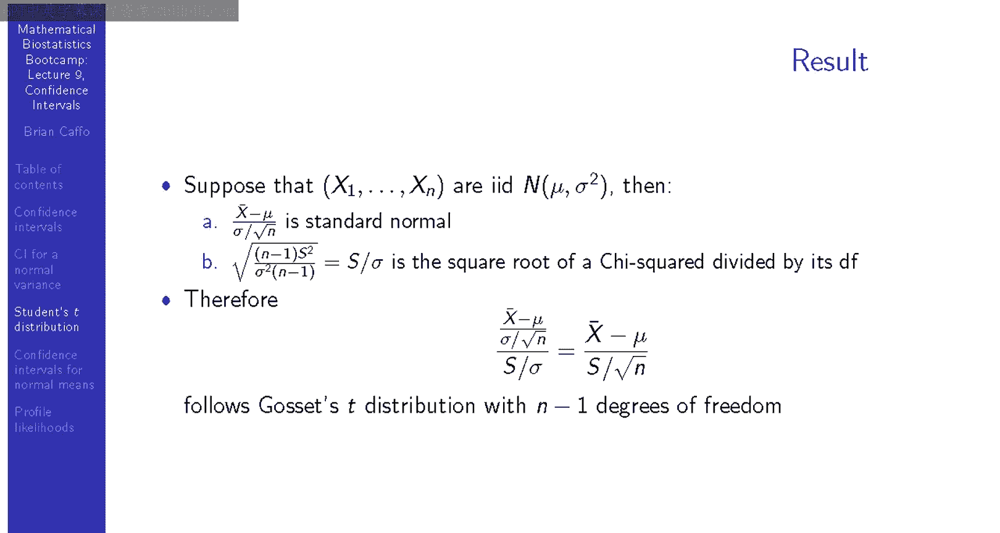

如果我们构造以下统计量：
```
T = (X̄ - μ) / (S / √n)
```
通过代数运算，可以发现 `T` 实际上等于 `Z / sqrt(χ²/(n-1))`。在 `X̄` 与 `S` 相互独立（对于正态样本成立）的假设下，`T` 恰好服从自由度为 `n-1` 的戈塞特t分布。

这个结果非常重要。它意味着，即使我们不知道总体标准差 `σ`，也可以用样本标准差 `S` 来替代，并且得到的统计量 `T` 的分布是已知的（t分布）。这为我们在 `σ` 未知时推断总体均值 `μ` 提供了基础。

## 🎯 构建均值的t置信区间

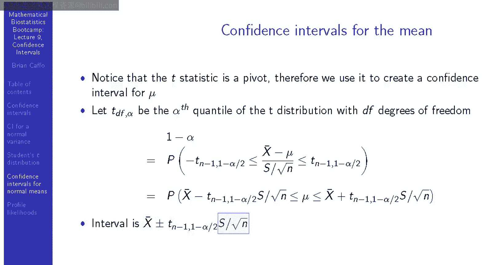

基于上述t统计量，我们可以为总体均值 `μ` 构建置信区间。

设 `t_{df, α}` 为自由度为 `df` 的t分布的 `α` 分位数。由于t分布关于0对称，其下 `α/2` 分位数等于负的上 `1-α/2` 分位数，即 `t_{n-1, α/2} = -t_{n-1, 1-α/2}`。

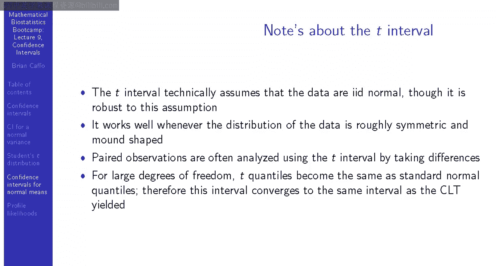

对于统计量 `T = (X̄ - μ) / (S / √n)`，有以下概率等式成立：
```
P( -t_{n-1, 1-α/2} ≤ T ≤ t_{n-1, 1-α/2} ) = 1 - α
```
将 `T` 的定义代入并整理不等式，我们可以得到：
```
P( X̄ - t_{n-1, 1-α/2} * (S/√n) ≤ μ ≤ X̄ + t_{n-1, 1-α/2} * (S/√n) ) = 1 - α
```
因此，`μ` 的 `100(1-α)%` 置信区间为：
```
CI = X̄ ± t_{n-1, 1-α/2} * (S / √n)
```
这个公式非常直观：点估计（`X̄`）加上或减去一个t分布分位数乘以标准误（`S/√n`）。

## 💡 t区间的前提条件与稳健性

在应用t置信区间时，了解其假设和局限性很重要。

t区间最初推导时假设数据来自正态分布。然而，在实际应用中，它对于偏离正态性的情况非常稳健。只要数据分布大致对称且呈单峰，t区间通常效果很好。

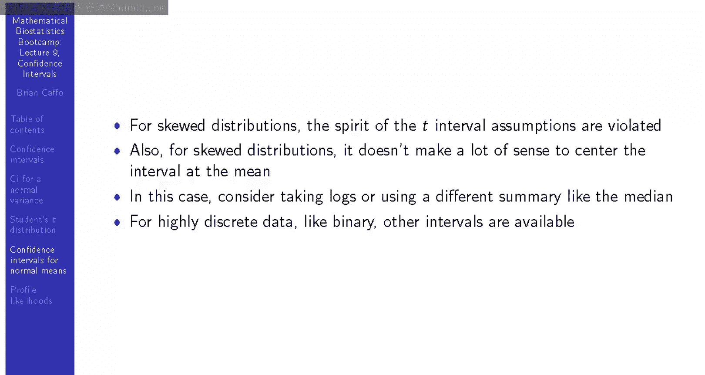

以下是关于t区间适用性的一些要点：

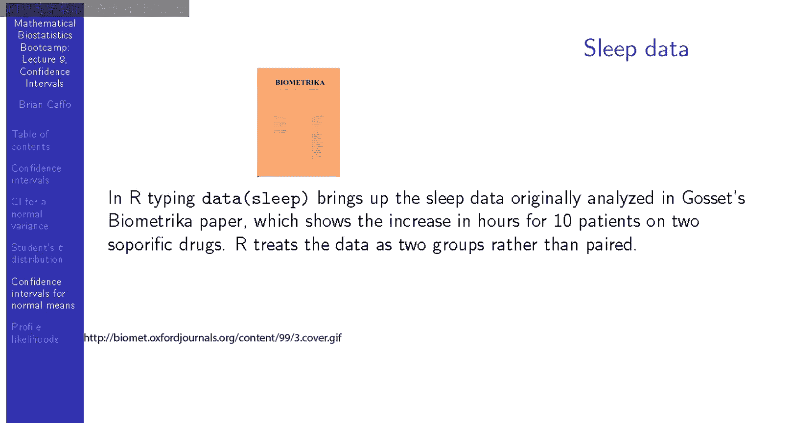

*   **配对数据**：对于治疗前后等配对观测，通常计算差值，然后对差值应用t区间。差值往往更接近正态分布。
*   **大样本**：当自由度很大时，t分布分位数接近标准正态分位数（Z分位数），此时t区间收敛于基于中心极限定理的Z区间。
*   **偏态分布**：对于严重偏态的数据，t区间的核心假设被违背。此时，考虑对正数数据取自然对数使其更接近正态分布，然后再应用t区间，可能是更好的选择。
*   **离散数据**：对于二项分布等离散数据，虽然模拟可能显示t区间“勉强可用”，但已有许多专门为此类数据设计的技术（如基于卡方检验或精确二项分布的方法），效果更优，应优先使用。

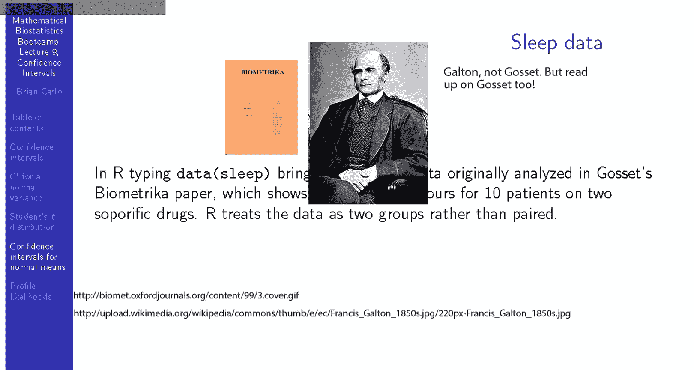

总的来说，t置信区间是一个极其方便且强大的工具，在满足其精神（近似对称、连续数据）的条件下，应作为首选方法之一。

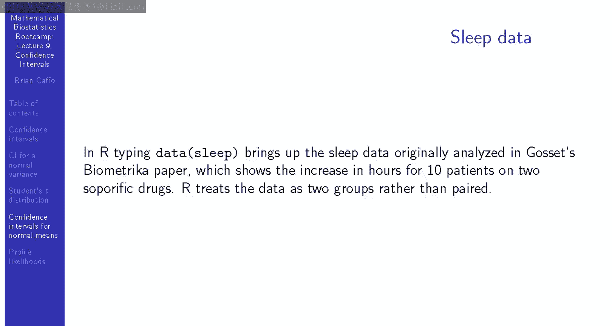

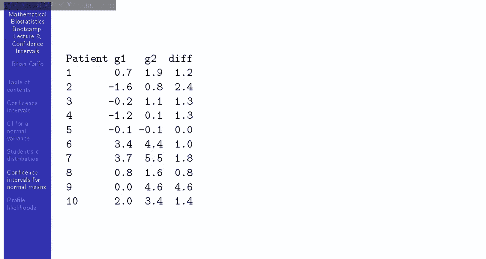

## 🍺 示例：戈塞特的睡眠数据

让我们通过戈塞特原始论文中的一个经典数据集来实践t区间的计算。

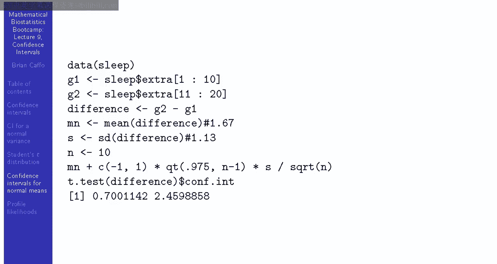

该数据记录了10名患者服用两种安眠药后睡眠时间的增加量（以小时为单位）。我们将分析两种药物效果的差值。

以下是计算差值均值和标准差的R代码概要：
```r
# 假设‘differences’是包含10个差值的向量
mean_diff <- mean(differences) # 计算结果约为 1.58
sd_diff <- sd(differences)     # 计算结果约为 1.23
n <- length(differences)       # n = 10
```
要手动计算95%置信区间，我们需要自由度为9的t分布的上97.5%分位数 `t_{9, 0.975}`，查表或计算可得约为2.262。
```r
se <- sd_diff / sqrt(n) # 标准误
t_quantile <- qt(0.975, df = n-1) # t分位数
ci_lower <- mean_diff - t_quantile * se
ci_upper <- mean_diff + t_quantile * se
```
更简单的方法是直接使用R的内置函数：
```r
t.test(differences)$conf.int
```
执行后将直接输出置信区间，结果大约在 `(0.70, 2.46)` 小时之间。这意味着，我们有95%的信心认为两种安眠药效果的真实平均差异在这个区间内。

## 📈 效应大小的似然函数

最后，我们探讨一个更深入的概念：为“效应大小”构建似然函数。效应大小定义为 `μ/σ`，即均值以标准差为单位，是一个无量纲的量。

当数据服从 `N(μ, σ²)` 时，统计量 `√n * X̄ / S` 服从一个“非中心t分布”，其非中心参数为 `√n * (μ/σ)`。当 `μ=0` 时，它就退化为普通的中心t分布。

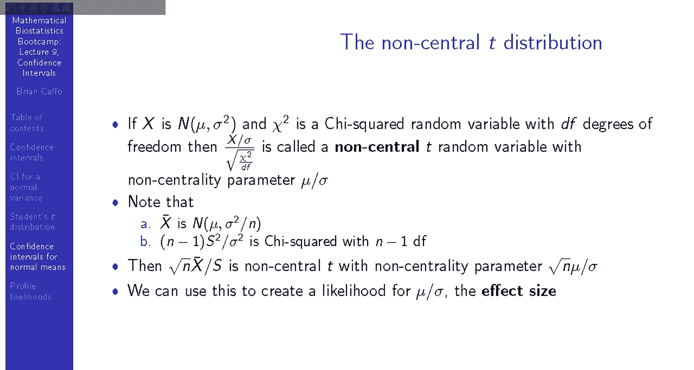

我们可以利用这个性质，为效应大小 `μ/σ` 绘制似然函数曲线，从而评估不同效应大小值的相对合理性。以下是R代码思路：
```r
t_stat <- sqrt(n) * mean_diff / sd_diff
df <- n - 1
effect_sizes <- seq(0, 2, length=1000) # 假设的效应大小范围
likelihood_vals <- dt(t_stat, df, ncp = sqrt(n) * effect_sizes)
# 将似然值归一化，使其峰值为1，然后绘图
plot(effect_sizes, likelihood_vals/max(likelihood_vals), type="l")
abline(h=c(1/8, 1/16), lty=2) # 添加似然比参考线
```
得到的图形中，似然函数峰值对应的效应大小最受数据支持，而似然比参考线（如1/8和1/16）可用于构造效应大小的区间估计。这为我们理解参数提供了另一种视角。

## 📝 总结

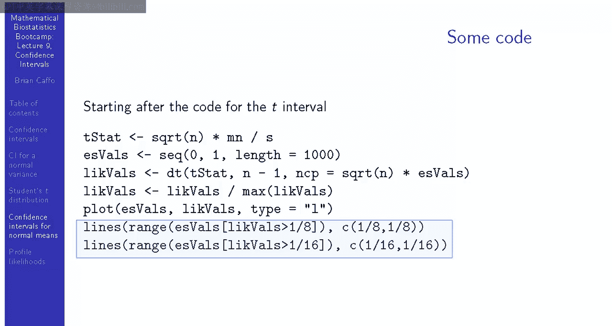

本节课中我们一起学习了：
1.  **学生t分布的历史与定义**：由戈塞特发明，适用于小样本推断，其形态比正态分布尾部更厚。
2.  **t统计量的推导**：在总体方差未知时，用样本方差替代，得到服从t分布的统计量 `(X̄ - μ)/(S/√n)`。
3.  **均值置信区间的构建**：利用t分布的分位数，得到了 `μ` 的区间估计公式：`X̄ ± t_{α/2, df} * (S/√n)`。
4.  **t区间的应用与局限**：该区间对正态假设稳健，但在处理偏态或离散数据时需谨慎，或考虑转换数据。
5.  **实际计算与软件实现**：通过戈塞特的睡眠数据示例，演示了手动和使用R软件计算t置信区间的方法。
6.  **效应大小的似然推断**：介绍了利用非中心t分布为标准化均值（效应大小）构建似然函数的概念。

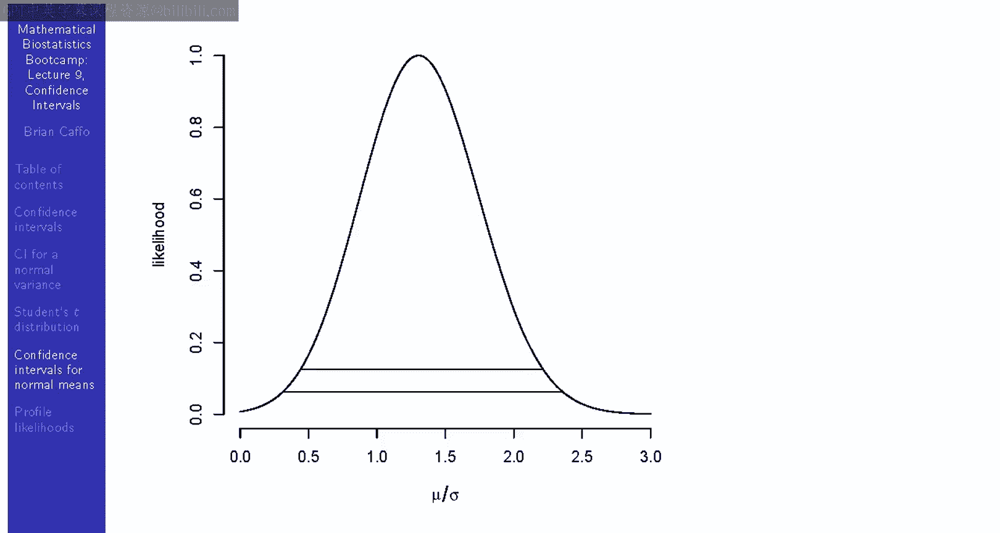

t分布及其相关的置信区间方法是统计学中基石性的工具，为我们在现实世界（通常总体方差未知）中进行统计推断提供了坚实的理论基础和实践路径。