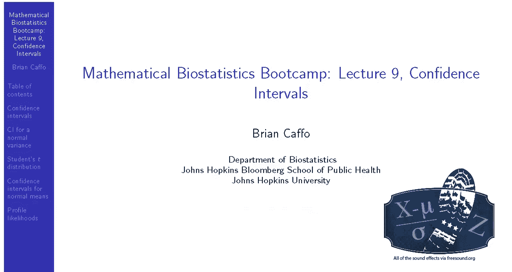
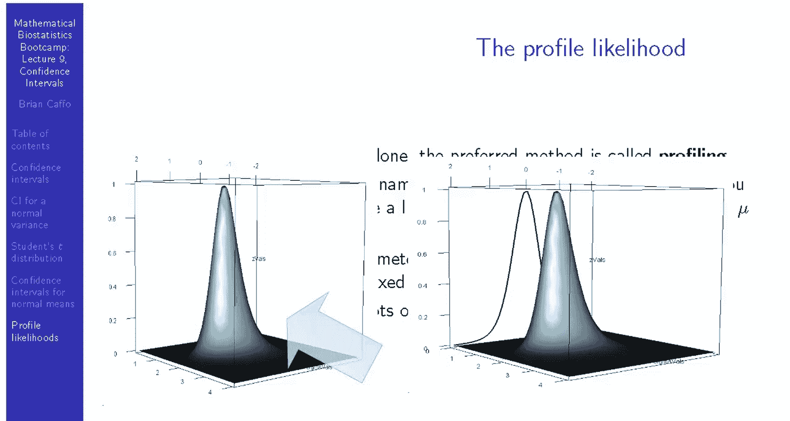
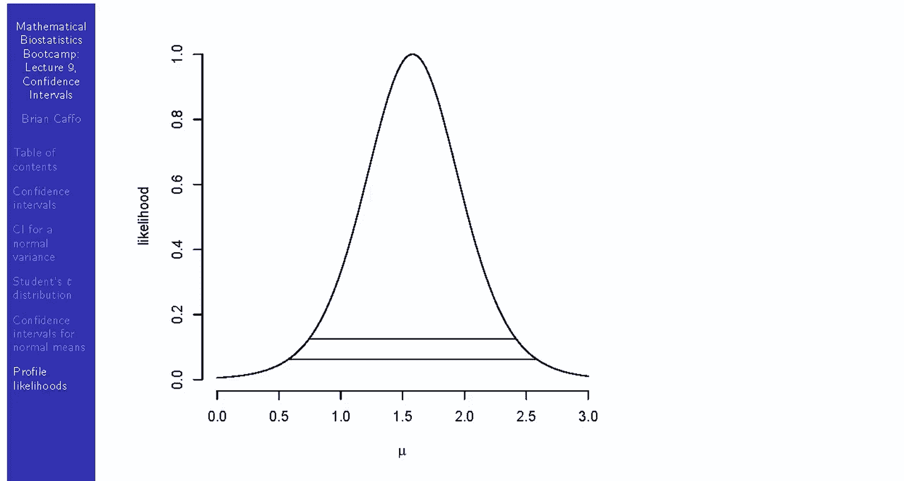

# 约翰霍普金斯大学《数据科学的高级统计｜Advanced Statistics for Data Science》中英字幕（deepseek p23 22_轮廓似然.zh_en -BV1htPjeYEFH_p23-

So welcome back， the final thing we're going to do in today's lecture is to talk about the profile likelihoodli。

 which is a method for creating univariate likelihoodlis from multivariate likelihoodlis and in this case we're going to look at the bivariate normal distribution。

Which has two parameters， mu and Sigma， and we're going to figure out how to get likelihoodlis for mu alone。

 and you could equivalently do it to get likelihoodlis for Sigma alone。And here's the idea。

 The multivariate likelihood is a。Byvariate surface， it has mu on one axis， sigma on another axis。

 and this surface above it。And to obtain a likelihood for mu profiling is basically like。

 let's imagine we took a lamp and shined it along the sigma direction。And looked at the shadow。

That the likelihood placed on the plane defined by the mu direction。 and that's exactly what it is。

 So its name is exactly indicative of the technique。

 And then now we'll just go through how do you actually execute the mathematics to do that。

So in other words， we want to shine a light on this bivariate likelihood。

And we want to get the function that you obtain on to say the wall where the shadow occurs。 Okay。

 so let's pick a particular value of mu n。 And we want to know what's the value of this curve in the shadow at mu not。

 Well， basically， the light will go through all values above the likelihood。

 and we'll get stopped anywhere on the likelihood and up until the maximum value。

 And so what we basically do is we maximize the joint likelihood for sigma with mu fixed at mu not。

 And then this process is repeated for lots of values at mu not。 So let's actually go through it。

So the joint likelihood with mu fixed at mu knot is just the Gaussian density。

 and then we have independent data。 So we take a product out front。

 So it's sigma squared to the minus12 E to the minus X I minus and we're fixing mu knot squared。

 divided by two sigma squared collect all the terms。 and you get the next line。With mu not fixed。

 then the maximum likelihood estimator for sigma squared。 And you can go through this。

 log the likelihood， take derivatives， solve for sigma squared。You know。

 so maybe just so you don't accidentally take the derivative respect to sigma， replace sigma squared。

 say by theta so that you remember that you're fixing sigma squared as the parameter。

 not sigma as the parameter few。Accidentally， take derivatives with respect to sigma。

 You'll get the square root of this answer， of course。

 So then you wind up with a summation equals 1 to n X I minus mu knot squared divided by n。

That's actually a nice result right if you fix mu at a particular value then your MLE for sigma squared is the sample variance。

 but instead of plugging in the sample mean and subtracting deviations around the sample mean。

 you're subtracting deviations around that specific value of the mean。So it's a nice little result。

So any rate， with mu not fixed， the maximum likelihood estimator for sigma squared is this generalization of the variance right there。

So that's the peak of our likelihood right that's the point where the light switches from being able to not go through the likelihood to the point right above it where the light is actually passes over the likelihood and that's that point that's that point that gets shadowed onto the wall at mu knot。

 And so we want to plug this back into the likelihood。 and we get this function right here。

S as Xi minus mu knot squared over n raised to the minus n over 2 power and then E to the negative n over 2。

 and this E to the negative n over 2 is irrelevant because it doesn't involve muot。

So that's for one mu knot。 and if we did that for every mu knot， we would get a function。

 and so here's our profile likelihood is this function。

 summation Xi minus muse squared race of the negative n over 2。

 That function is our profile likelihood。And then again。

 this functions is clearly maximized at a mu X bar。 You can， of course， solve it。 But in general。

 one nice property of the profile likelihood is that the maximizer of the profile likely。

 the maximum。Profile likelihood estimate is also your M L E for the parameter。 So in this case。

 the maximum of the profile likelihood for mu is going to be x bar。

 The same as the maximum likelihood for the complete value。

So if we wanted to divide this by its peak value， we would simply divide it by the same thing and with instead of mu there。

 plug X bar in， and then that would normalize this function so it tops out at one。

So let's actually go through the R code to generate this function。 our for the sleep data。

 So our mu vow， we're going to go from say 0 to3 and do 1000 of them。

 So we'll plot a function of 1000 mu not values are likelihood values and then so it would just be this sum X minus mu squared sum race to the minus n over two power。

 So that's this term right here race to the negative n over two power。

 but I want it to be maxed out at one。 So normally I create the likelihood and then divide by its maximum value。

 but in this case I know exactly what the exact maximum value is。

 it's when you replace mu by the mean。 So instead I divide it by the mean right here。

And this S apply is just a loop， it says loop over mu values and do this function。

And then I'll plot them and connect them together with type equals L。

 and then I'll put the likelihood values above 18th and above 116th， and then I get this plot。

So that is my profile likelihood from you。 That is the function that I get。

If I take the bivariate likelihood for mu and sigma。

 place a light along the direction of the sigma axis and look at the shadow on the wall。

 This is the outline of that shadow。 And that's called the profile likelihood。

 And there's many theoretical properties of the profile likelihood。 But most importantly。

 you can kind of treat them as if they were a standard univevariate likelihood。

 So you would treat this just like a regular likelihood for mu。

 The higher values are better supported。 The peak is where the maximum likelihood estimate occurs。

 and you could draw horizontal lines to get likelihood based intervals for mu。Well。

 that's the end of today's lecture。 We gave you many ways to create confidence intervals。

 We gave you methods for creating T confidence intervals。

 We gave you a method for creating a confidence interval for a variance。

 maybe not the most useful one， but we did it。 We also showed you lots of really neat kind of well known among statistics circles。

 but not generally well known techniques for generating likelihoodlis when you have Gaussian data。

And so all of these techniques you could use in practice if you have data and you're willing to assume that it's Gaussian。

 all of the techniques would apply， the specific technique of the T confidence interval is a very robust interval。

 as long as your data looks roughly moundshaped， then you're going to be okay。

The last thing I always mention is a question I always get about the t confidence interval is basically the t confidence interval in the standard normal confidence interval look the same。

 except with the t quantile replaced by a standard normal quantile。 And people always ask me。

 at what point do I switch。 What sample size do I switch between its t confidence interval and a standard normal confidence interval。

 But the point is is that the t confidence interval limits to the standard normal confidence interval。

 So my answer to that is just always do a t confidence interval。

 just never do a standard normal confidence interval。 And then you don't even have to worry about it。

 because if your sample size is big enough， that t quantile looks just like a normal quantile anyway。

So hopefully that answers that question。And I look forward to seeing you next time where we'll expand on confidence intervals for more general settings where we have multiple groups。

电。

🎼。

🎼。