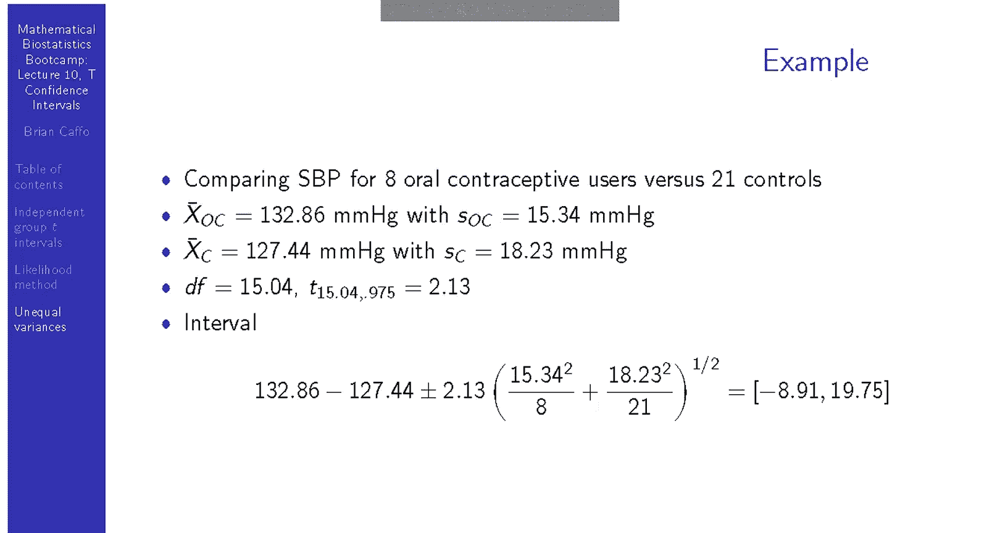

# 约翰霍普金斯大学《数据科学的高级统计｜Advanced Statistics for Data Science》中英字幕（deepseek p24 23_t置信区间.zh_en -BV1htPjeYEFH_p24-

Hi， my name is Brian Caffho。This is Matheal Biostatistics boototcamp。

 Le 10 on T confidence intervals。So in this lecture we're going to go through group T intervals。

 whereas the last lecture we did T intervals for a single mean。

 or you could do those intervals for a group where the observations were paired。

 but now we're going to talk about instances where we have two independent groups。

 we'll briefly talk about a method to construct a likelihood and then we'll talk about what you do if you have unequal variances。

Let me motivate the problem a little bit。Suppose that we want to compare the mean blood pressure between two groups in a randomized trial。

 those who receive treatment to those who received placebo。

Unlike last week where people would have had to match say comparing the same person before and after receiving a treatment。

 these groups are entirely independent， the group that received a treatment in the group that received the placebo so we can't use the same procedure we can't take pairwise differences between measurements in fact they might have different sample sizes in the two groups and then we definitely couldn't do it so this lecture we're going to talk about ways for investigating the differences in the population means between groups when we have independent samples。

 but we'll see that the methodology works out to be very similar to what we did last week。

 the motivating ideas will be nearly identical。So let's go through some assumptions that we're going to use for our first variation of the T interval。

 So our first collection is the x1 to x。N x is a collection of II random variables。

 they have some mean and they have some variance and y1 to n are IID normal and they have a different mean。

 but the same variance right now we're going to assume the variance between the two groups is the same。

 so we might think of x as the treated group and y is the control group or x is one group and y is another group。

So let's let x bar， y bar， Sx， and SY be the means and standard deviations for the two groups。

And where our goal is to estimate， say the difference， mu x minus mu y or of course。

 you could do mu y minus mu X。 I'm going to get the negative of the answer。

 We would like to estimate that， but we'd like to have a confidence interval to quantify our uncertainty in estimating that parameter。

So the obvious estimator of say mu y minus mu x is y bar minus x bar。

 I think everyone would agree that the interval needs to be centered at that point or that point has to be central in the construction of the interval。

But we also need to figure out some way to create a confidence interval to incorporate our uncertainty Well let's think can we do something that's along the lines of estimate plus or minus a t quantile times a standard deviation。

Well， we want a standard error of this estimator y bar minus x bar if you turn through the calculations and I would hope that everyone in this class could do this calculation at this point。

 under the assumptions that we've made， the variance of y bar minus x bar works out to be sigma squared times 1 over nx plus 1 over n。

And there's a really good estimator of that entity in this setting， in fact。

 it's a maximum likelihood estimator or close to it。

And that's the pool variance estimate S sub P squared。

 and that works out to be nx minus1 times sx squared plusny minus1 times sy squared divided by nx plus n minus2 and this works out to be a good estimator of sigma squared Let's talk about this estimator really quickly If you take nx minus1 and you divide it by nx plus n minus2。

 you get a number that's between 0 and 1。 And if you takeny minus1 and you divide it by nx plusny minus2 you get1 minus that number。

 you can check the calculations to make sure that I'm right about that， but I'm right。

So this estimator S sub P squared is nothing other than a weighted average of the two group variances。

 right， so it's a weighted average of the variance for group X plus the variance for group Y。

If Nx and Ny are equal， if you have the same sample size in both groups。

 then you can calculate nx minus1 over nx plusnyy minus2 works out to be 0。5。

 in which case the pooled variance estimate works out to be the arithmetic average of the two variances。

On the other hand， if the group X contains a lot more data。

Right Nx minus1 is a lot larger than ny minus1 then nx minus1 over this denominator is going to be much bigger and you'll get a much bigger weight on Sx squared over Sy squared and in that case the weighted average does exactly what you would hope is it takes whichever of the two groups。

That has more measurements associated with it and weights the variance estimate from that group more heavily。

 which is exactly what you would hope there's more data。

 This variance estimate is going to be estimated a little bit better since it has more data。

 So it makes sense that a good estimator would place more weight。

 And so that's basically what this pool variance estimate is， it's nothing other than an average。

 It's just say what we would call sial average rather than an arithmetic average。Okay。

 so just to reiterate some of these points， the pooled estimator is a mixture of the group variance is placing bigger weight on whichever one has a larger sample sizes。

 if the sample sizes are the same it's really easy all you have to do is average the two variances。

And then the pooled estimate is unbiased， we can show that really quickly if you take the expected value of S sub P squared。

 you just use the fact that both of the individual group variance estimators are unbiased and then you wind up with the result。

I'm not going to show this because it's kind of complicated to do but the pool variance estimate turns out to be independent of y bar minus x bar。

 but the reason is if you stomach this fact that I didn't show before that x bar is independent of Sx and y bar is independent of Sy。

 well then x bar minus y bar is going to be independent of xx minus Sy because all of the collections of things are independent。

 then because of that it should be independent of any function of Sx and Sy。

 which S sub P squared is a function of Sx and SY。So I'm not going to dwell on this point。

 but take it as given that y bar minus x bar is independent of the pool variance estimate。

And hopefully you can kind of get a sense of where I might be going。With this calculation。

 what I'd like to do is create a t confidence interval and remember what did I need to create a t confidence interval。

 I needed to figure out a way to get a standard normal and divide it by the square root of a chi squared divided by its degrees of freedom and independent chi squared。

 so I'm hoping that some function of the pool variance will be chi squared。

And I just stated without proof that itll be independent of the difference in the sample means。 Well。

 it turns out， you know another fact that I'm not going to prove。

 but one that you can certainly take to the bank is that the sum of independent chi squared random variables is again chi squared and the degrees of freedom just add up。

 So let's take nx plus n minus2 times the pooled variance divided by sigma squared。

 Well that works out to just be nx minus1 times the x group variance divided by sigma squared and y minus1 times the y group variance divided by sigma squared。

 And we know from before that this first term is chi squared with nx minus1 degrees of freedom。

 the second term is chi squared with ny minus1 degrees of freedom。

 And so if you believe my fact above that the sum of  two independent chi squared is again chi squared with the degrees of freedom added。

 that would mean that when we add this chi squared with nx minus1 degrees of freedom and this chi squared with n minus1 degrees of freedom we get a chi squared。

with Nx plus ny minus two degrees of freedom and of course we're happy assuming that the two chi squares are independent because the entire presumption of everything we're talking about is that the two groups we're looking at are independent。

 this is sort of independent group analysis， we're assuming that group X and group Y are independent。

Okay。So now we can construct our T statistic so we take y bar minus x bar。

 subtract off its mean mu y minus mu x， and divide by its standard error。

Sigma times 1 over Nx plus 1 overny square root。And then divide that whole thing by nx plus n minus2 S sub p squared over sigma squared。

 which is a chi squared， and then that is divided by its degrees of freedom， nx plus n minus2。

So if you look at that， that top part is a standard normal。

 so the original data for the two groups are Gaussian。

 so that we know that the sample means are Gaussian。

 so that we know that the difference in the sample means is Gaussian。

 and if we take a Gaussian and subtract off its mean and divide by its standard deviation。

 we wind up with a standard normal， so the top is a standard normal。

 we're stating that the top is independent of the bottom。

And then the bottom we know is the square root of a chi squared divided by two degrees of freedom。

 so the whole thing has to be a t random variable with nx plus n minus2 degrees of freedom。

 and then if you collect terms and work with the arithmetic a little bit。

 you see that this left hand side works out to be y bar minus x bar minus mu I minus mu x whole thing divided by S P times1 over nx plus1 overny square root。

 which is basically just the statistic we'd like to use。Whi is the observed difference in means。

 minus the population difference in means divided by the standard error。

 but with sigma replaced with our data estimate of sigma， so sigma replaced by S sub P。Okay。

 so it's just like before where we took our statistic that we normally had。

 replaced the unknown standard deviation with its estimate。

 and what would normally be a Gaussian random variable turns into a T random variable。And again。

 notice the form of this is estimator minus true value divided by standard error。

 estimated standard error again。And then I'm hoping that you should be able to use the same logic from the previous lecture and how we constructed that confidence interval to just say。

 okay， well the confidence interval for the difference it means is now just churn through these same calculations and we get y bar minus x bar plus or minus the appropriate t quantile times the standard error。

Okay， let me repeat that again， the estimate plus or minus the appropriate t quantile times the standard error。

 so again the interval works out to be the estimate plus or minus the appropriate quantile from the appropriate distribution times the standard error。

Okay， remember a big assumption in this is that there was equal variances in the groups and we'll talk about that later。

Yeah。I guess one thing I'd like to mention about the equal variance assumption now while we're on it is there are actual tests for equality of variances。

Between independent groups， they work out to be F tests。But those tests are kind of notoriously bad。

So I think some textbooks will do things like suggest testing and quality of the variances。

 if the variances are equal then do this confidence interval role and if they're unequal。

 do the confidence interval a role that we're going to talk about in a slide or two。

But I don't like that procedure at all， I think you should look at graphs。

 look at the data and make assessments as to whether or not the variants are equal or unequal and use that to decide if you really must estimate the ratio of the variances in the groups。

 then I would suggest using bootstrapping would be my suggested technique for doing it unless that maybe the sample sizes are very small。

But another safe thing to do is just always assume that the variances are unequal so if you're worried about this assumption。

 just always do the conservative thing and assume that the variances are unequal。

This little maybe above the discussion in this class and how to get a likelihood for mu y minus mu X。

But it turns out that getting a likelihood for mu y minus mux divided by sigma。

 which is still a single parameter is very easy， and the reason is that this statistic。

 y bar minus x bar divided by its standard error that follows a distribution which is called a noncentral t distribution in the noncentrality parameter depends on mu y minus muX over sigma and then something involving the ends that we know。

 and so you can use this fact to create a likelihood， not a profile likelihood or anything like that。

 just an honest to goodness likelihood。For mui minus mux over sigma。

 I should say what mui minus mux over sigma is I think of it as kind of an effect size type measurement。

 but it's the difference in the mean standardized relative to the intergroup standard deviation。

 So it's the difference in the means in standard deviation units。

 which is a very useful thing if you want to calibrate your difference in the means across studies right if you want to say。

 oh， well， this difference in the means is kind of big。 Well， what is big mean， you know in one case。

 it's measured in inches and the other cases it's measured in tons or something and and in other cases it's measured in centimeters So if you look at different experiments。

 the units are all different。 the context is very different and it's impossible to compare a say mu y minus mux across experiments。

 But there is some hope for comparing mu y minus mux over sigma across experiments because you've gotten rid of the units and everything is expressed in intragroup standard deviation units。

 So it's a meaningful parameter。And it's easy to create a likelihood。

 so I'll show you how to do it but。Say this is not a tremendously common technique。On the other hand。

 the comparison of the two groups using a standard T confidence interval with a pooled variance is an extremely common technique。

 so let's go through an example of actually constructing this interval。And by the way。

 this is just a special case of what's called a Nova estimation just where you happen to have two groups。

Rosner has this great book calledFamentals of Biostatistics。

 and I got this example from page 304 of his textbook。

And he looked at an example where they were comparing systolic blood pressure for eight oral contraceptive users versus 21 control。

 there was some concern， I guess， in the study over whether or not oral contraceptive use increased the systolic blood pressure measured in millimeters of mercury。

So the X bar for the oral contraceptive users was 132。86。

 the standard deviation for the oral contraceptive users was 15。34。

Means systolic blood pressure for the control subjects was 127。44 and so on。

So the pool variance estimate takes the weighted average of the two variances and so you'll see the formula right here it works out to be 307。

8 one of the most easiest mistakes if you happen to be doing these calculations by hand is to forget and to pool the standard deviations instead of the variances you should pool the variance not the standard deviations so if I took out these squares I would get the wrong answer I would get a pooled standard deviation instead of a pool variance。

 but it you'd really mess up if you treated that number as if it was a variance because it would be on the wrong order of magnitude even so the biggest mistake you can make is to not square those things one way to check when you do this by the way is it's an average right so in this case it's going to be an average of 15。

34 squared in 18。23 squared so it has to be between those two numbers the 15。34 squared and 18。

23 squared so so then when you square root it that number has to be between 15。34 and 18。23。

That hasn't happened， you've really screwed up。Okay。

 so we've got our pool variance and if we square root that we've got our pooled standard deviation and then we need the appropriate t quantile so we need the t quantile for 97。

5 if we want a 95% confidence interval and we need 27 degrees of freedom which is if I'm doing my arithmetic correctly 8 plus 21 minus2 and in R you can just get this number as the Qt Q standing for quantile and T standing for T distribution 0。

975 because we want the 97。5 percentile and degrees of freedom equals 27 ill just to return 2。

052 maybe plus some other decimal places。And so the interval is 132。86 minus 127。

44 plus or minus our t quantile times our pool variance。Times 1 over8 plus 1 over 21。

This works out to be negative 9。52 to 20。36。One of the most important things to look for because it's a difference in means is whether or not the interval contains zero。

 right， because if the interval contains zero， then that would say a reasonable estimate for the difference in blood pressures between the two groups is that they're identical。

And in this case， it does contain zeros， so you there's evidence to say that there is no difference。

 in other words， that this oral contraceptive use doesn't appear to be presenting evidence that there's an associated increase in blood pressure。

Turns out that evaluating whether or not zero in this interval turns out to be equivalent to a two-sided hypothesis test and we'll talk about a hypothesis test later on。

 so you have to be careful in how you interpret hypothesis test right now。

 we might as well just say negative 9。5 to 20。4 say is a reasonable estimate accounting for the uncertainty in the measurements for comparing the average systolic blood pressure between oral contraceptive users and controls Now by the way。

 another thing to keep track of whenever you create these intervals is what order you've subtracted things in right in this case。

 we did contraceptive users minus controls I think you should pick a rule and stick with it know so I always use say treated minus control and it doesn't matter。

 of course you just get the negative of the interval if you do at the other direction but in interpreting it。

 let's say this interval was entirely above zero， then you would be saying that oral contraceptive users had an estimated。

ystolic blood pressure and controls， but if you forgot the order and thought that you would subtract it controls minus oral contraceptives you would get the exact opposite interpretation so anyway my point being just remember what order you subtract things in because it's an easy mistake to make。

Here on the next slide， I just have a likelihood plot for the effect size using the non central T distribution。

And I got a rough idea of the range of values to plot by the way。

 I took my confidence interval negative 9。52 to 20。36。

 and I just divided it by the pooled standard deviation and that gives me about negative 0。54 to 1。

16 and so you know I plotted I think from negative 1。5 to positive 1。

5 so you I got at least a rough idea of the range of things to plot from looking at the interval this by the way negative 0。

54 to 1。16 is not a valid interval for the effect size because we haven't accounted for the uncertainty in estimating this S ofP here in the denominator later on we'll talk about an effective way for generating confidence intervals for nearly any statistic that you can dream up using bootstrapping。

So finally， I just want to briefly mention what do you do if you're not willing to assume the variances are equal Well。

 we can calculate the variant in the unequal case y bar minus x bar is still of course normal。

 its mean is still of course mu y minus mux， but now its variance has changed。

 we can't factor out the sigma squared， so it works out to just be sigma squared x divided by nx plus sigma squared y divided by ny。

And the statistic we'd like to use to generate our confidence interval would be y bar minus x bar minus mu y minus mu x divided by this variance。

With the estimated variances plugged in， Sx squared over Nx plus Sy squared over N all raised to the1 half power。

 unfortunately， that doesn't exactly follow a t distribution。

But there was a smart idea right and the idea was， well。

 it's maybe not a t distribution but people could simulate and kind of figure out what this distribution looks like and they said well it looks an awful lot like a t distribution but you know we can't seem to get the degrees of freedom exactly right to make it perfectly a t distribution and they said。

 well why don't we find like the best degrees of freedom to make this look like a t distribution and they said。

 well you know we could have that degrees of freedom depend on the data on the variances for example and we could have it be a fractional degrees not have to be a whole number and everyone said that's great。

 that's a great idea why don't we do that and so they came up with this crazy formula for the degrees of freedom by trying to figure out the best degrees of freedom that makes it look like a t distribution and that's what you can do you basically evaluate the statistic with the empirical variances plugged in in the denominator and then act like it's a T distribution with these kind of impossible to remember but easy to plug。

to degrees of freedom formula。And that's all you have to do and that conference interval works really。

 really well。So our confidence interval is just going to be y bar minus x bar plus or minus the appropriate t quantile with these crazy degrees of freedom 。

975 quantile for a 95% interval times the estimated standard error。

 and then we have a t interval So let's go through that really quickly for our example。

We're going to compare our eight oral contraceptive users versus our 21 controls。

 I just reput all the numbers here just to remind you in this case。

 if you directly plug S OC and sc into this formula from the previous page where you have。You know。

 Sx squared in this case would be SOC squared and SY squared would be SC squared and Nx would be NOC and N would be NC。

 just plug those directly into that formula and you get 15。04 degrees of freedom。

And that if I plugged into the formula correctly， maybe everyone double check me， I think with 10。

000 people double checking me， we should get it right。The T quantile for that turns out to be 2。13。

 so you just construct the interval difference in the means plus or minus the appropriate t quantile。

Plus the variance， 15。34 squared over 8 plus 18。23 squared over 21 square root the whole thing。

 and you get this confidence interval right here。So you interpret the confidence interval in the same way。

 you're obviously interested in whether zero in this case and whether zero is in the confidence interval。

And if you want kind of a safe thing to do， you just would always do this interval instead of assuming equal variance。

Well， that was a quick lecture today and I hope using the kind of thought process from this lecture in the previous one that you should be able to sort of create confidence intervals at a whim now if there's any case where you can figure out what the standard error is of a statistic。

 then you more or less think well I'll get a confidence interval by taking estimate plus or minus some quantile from some distribution times the standard error and maybe that quantile will usually either be a t quantile or a standard normal quantile and I think you'll notice that the vast majority of confidence intervals that we cover in this class and the vast majority of confidence intervals that you encounter in practice will be exactly of this form。

So I look forward to seeing you next time and next time we're going to have a very light lecture。

 we're going to talk about plotting。🎼。

