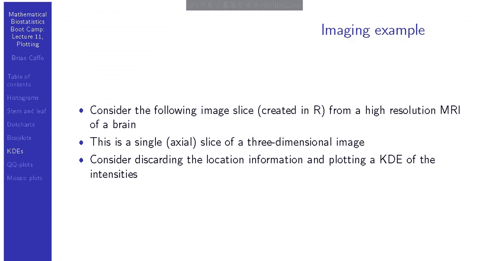
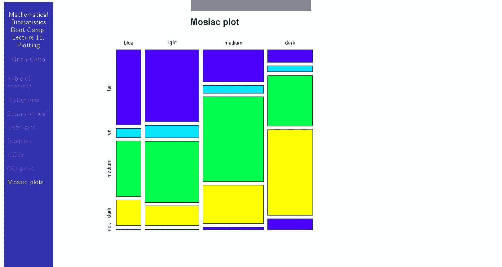

# 约翰霍普金斯大学《数据科学的高级统计｜Advanced Statistics for Data Science》中英字幕（deepseek p25 24_数据可视化.zh_en -BV1htPjeYEFH_p25-

Hi， my name is Brian Kaffho and this is Matheal Biosstatistics Boot Camp Lecture 11 on Plotting。

So in this lecture we're going to have kind of a very different sort of lecture than what we've been doing for the most of the class and we're just going to talk about plotting your data and the reason I held off on talking about plotting your data till now which might as well be the most important aspect of data analysis is because I wanted to demonstrate that some of these plots are estimators。

 they're multivariate estimators but they estimate things like densities and we couldn't really introduce plotting the est densities unless everyone knew what a density was so let's get right to it。

One of the most wellknow forms of plot is just simple histograms。

 histograms just display a sample of the estimate of a density or mass function and they're basically just bar graphs of the frequency or proportion of times that a variable take specific values or bins of values for continuous data。

 so I think it's probably easier to explain this with examples than with words。

So the data set islands in R is a package that contains the areas of all land masses and thousands of square miles。

 so you can just load it into R by just typing in data islands。

And you can view the data by typing islands and I'll just show you the list of numbers and we can create a histogram with a command hist of islands and if you just do question mark hist。

 it'll give you the options for the command hist which includes things like bin lengths and how you break up the histogram picture we see that we had 41 islands that had this range of area。

 you can see this is a very crummy histogram， it doesn't tell you much information and the reason is because most of the islands are really small。

And there's only a handful of big ones， and so maybe there's something more informative we can do well。

So here in this picture we see that we had 41 islands that had this range of area。

 you can see this is a very crummy histogram， it doesn't tell you much information and the reason is because most of the islands are really small。

And there's only a handful of big ones， and so maybe there's something more informative we can do。

 well， let's talk about the pros and cons of histograms first。So histograms are useful， they're easy。

 they make sense， they work on discrete， and even onor data。

 you can make a histogram of M&M colors or hair colors or whatever。

 they're just bar plots of frequencies。There's some problems with them。

 they use a lot of ink and space to display not so much information。

 you could replace them with the table of the frequencies pretty easily。

 and it's a little bit difficult to compare several at a time and then as I pointed out before。

 the specific use of the histogram for this data isn't very good。

 you should maybe log the data to spread things out a little bit。

 in this case I did log based 10 so it gives you orders of magnitude and then you look the histograms much better and so the numbers now on the horizontal axis are log 10 so you're looking at orders of magnitude which is probably a lot better to look at。

In this case。Stammon leaf plots are just another way of really quickly on the fly if you ever need to create a histogram and all you have is a pen piece of paper then a stemmin leaf plot is definitely what you want to do and it was created by John Tki who was a famous statistician that created lots of inventions he was one of the co-inventors of the fast discrete Fourier transform and many。

 many other statistical and signal processing techniques。

A stem and leaf plot is basically what you do is you have to pick a digit that you're going to kind of break the data on。

And then you put the digits to the right of that。 you stack them up。

 So here it's probably easier to just show this than to actually describe it。

 So I type in stem log 10 of islands and the decimal point is that the horizontal line here。

 which in this case a bunch of pipe characters So when we look at the one on the left。

 the one on the right means that's 1。1 one island had land area 10 to the 1。

1 because remember we took log 10 And then we can count， let's see how many is there。

 there's 1234561。 So there were six islands that had log area 1。

1 and then because there were so many in those bins。

 they broke the 1 bin up into those below5 in those above5。

 So any rate you could see how you could do this really quickly。

 you just pick the decimal place and then you just the rounded number immediately after the decimal place you just start stacking them up and then they wouldn't be in order so。

Maybe you do it again where you reshuffle the numbers on the right so that they're in order and it makes for a very convenient plot。

 it gives you a quick histogram， it's a quick density estimate and you can do it on the fly really easily。

Another useful plot is a dot chart。 dot charts just display the entire data set one dot per point。

 And you might say well， that seems like a pretty uninformative plot。

 but it's usually quite informative， especially if you can order the dots well。

 So the ordering of the dots and the labeling the axes can display a lot of information。

 And so the dot charts show up entire data， you could， in principle。

 reconstruct the data from a dot chart， So it has really high data density。

 but you know there's problems with them。 they may be difficult to construct and difficult to interpret for datas with lots of points。

 you may get overplloing and stuff like that。 So if you look at this dot chart where I did the dot chart for the。

Log 10 area。 So it's log 10 square miles。 You see it just plots all of the data。

 It's the same thing before， but it gives you a good idea of the density of points。

 And you could see you could probably make this chart a lot。 You could really improve on this chart。

 for example， by maybe grouping land masses together。 You know， Pacific Islands。

 maybe put all of those together， for example。And so on。

 so you could get a lot more information out of it， but any rate。

 that's a dot chart they're good to make。So yeah， just on the next slide。

 I mentioned that I ordered everything alphabetically， which is the default for the dot chart。

 but you could play around with it， playing around with plots is the key thing you want to do。

 you want to just keep doing them until you get kind of informative information。

Another nice thing about dot charts is you know， if you have kind of a small number of points。

 you can compare groups very easily， you can add horizontal lines and vertical lines to detect means and medians and spread and that sort of thing。

 and you can show confidence intervals and inter quartile ranges。And to avoid plotting。

 you can just jitter the points， add a little uniform noise， so let me give you an example。

The Ins sprays data set is a rather morbid data set that contains counts of insect deaths by insecticides。

 six insecticides labeled ABCD andF， unless it's mosquitoes， then they deserve what they got。

And you can obtain this data set with the command data insect sprays。

And then I give you the code for actually creating this plot there。

 you know maybe some of the fancier parts of the plots I omitted here。

 but this is the basic gist of how I create the plot if you can generate better code to do this。

 I'd love to see it but anyway then you look at the plot on the next page and the nice thing about these plots is it displays every single data point。

You get a very good sense of what's going on。 You can see that the spray C D and E appear to be different than the sprays A B and F。

 for example， you have the confidence intervals for each of the groups and you have the mean for each of the groups and they display a lot of information for example。

 you know for group F， you can see these kind of bimodality of the distribution。

 you can see this sort of outlier in group D or maybe it's not an outlier。

 but nonetheless you can visualize these things quite easily with a do chart and because every group only has you a handful of points。

It would be a shame to aggregate them into something else that obscured the data。

But what you might ask yourself， but what if instead of having like 10 or 15 or 20 points per group。

 what if I had 10000 points per group， what should I do。

 Well then maybe don't do a dot chart anymore because you're going get so much overping that you're not going to be able to see anything meaningful。

 maybe do something like a box plot。 So box plots were also。

invented by Tki and they basically just show the distribution in terms of quantiles。

 so the center line of the boxes in a box plot represent the median while the box edges correspond quartiles。

 so the boxes give you some information about the density represented there only by three numbers。

 and then the whiskers extend out to a constant times the inner quartile range。

 which is the difference between the 75th and 25th percentile of the data。

Or they cap them off at the max value and that constant was given Tki did it by kind of relating it relative to standard normal。

And then sometimes outliers are denoted by points beyond the so-called whiskers and you can see skewnet in the data by the center line being near one edge of the box or one of the other edge So if we just take the same insect spray data and did a box plot we get you know in this data set you probably don't want to do that but you do get the same relative picture you've lost some detail。

 you know you've lost information about that bimodality for the density for insect spray f。

 but you do notice you know maybe something's going on there。

 that distributions very skewed towards higher values so you might investigate it more and discover that kind of little twogroup clustering。

It does kind of catch these outliers for C&D， but sometimes you have so many data points that the outliers are just a constant mash of outliers and then there's no point in plotting them。

But anyway this is a box plot， I think for this particular data set you're better off doing the dot chart。

 but if you had lots and lots of observations， the box plot seems like a pretty reasonable thing to do。

 there's been improvements on box plots people say why do it as a box。

 why not do it as something that uses a lot less ink and and what's this constant times the IQR business that's maybe a little bit difficult to interpret and so there's been lots of kind of refinements but these are your plots ultimately when you create them so you can use them to investigate the things that you really want to look at buts a very reasonable idea to create。

In this case， vertical summaries of group data that are based on distributional properties like means。

 medians， quartiles and so on。 If your boxes get too squish， try logging your data if it's positive。

Or maybe you could do a cube brood if it's positive and negative。

For data with lots and lots of observations， you often want to omit the outliers because you get this big mash of black from overplloting that you can't see individual points and there's no point in calling them outliers anymore。

 if there's hundreds of them。 Here's an example of a bad box plot。

 I just give you some R code to generate a bad box plot It's all squish together， the outliers。

 there's too many outliers being displayed in the fact that there's so many outliers means that all the interesting aspects of the kind of meat of the data are obscured by handful of outliers。

 So thats box plots。 So box plots you kind of give you a density estimate by grabbing a bunch of quantiles and using them from the data。

 kernel density estimates， on the other hand are direct density estimates in the same way。

 histograms are direct density estimates， but kernel density estimates maybe are a little bit better。

 and the ideas that your weighting observations， according to a kernel in most cases that kernels a Gaussian density and then you have to pick a parameter that。

How kind of smooth or jigly your density estimate is going to be called the bandwidth and your density estimate is itself a statistical estimate。

 it has variability that you should probably investigate as well and you should investigate how the bandwidth impacts that variability and the estimate itself。

 but it's not like this is something that's just unique to kernel density estimate， for example。

 if you take a histogram， the width and construction of the bins in a histogram play the same role as the bandwidth so you still have that tuning parameter you have to work with and again the width and the number of bins in a histogram can impact what it looks like。

 but in addition， the histogram is also an estimate with noise so both kernel density estimates and histograms and so on they all are statistical estimates that have variation and's maybe unfortunate that I'm going to do this as well that when you plot these things you don't explicitly acknowledge the uncertainty in the density estimate so that is kind of a problem but。

Maybe the solutions to it are a little bit above the discussion from this class。 So anyway。

 the R function density can be used to just create density estimate。 So here's the。

The waiting in eruption times in minutes between eruptions of the old faithful Geyser and Yellowstone National Park。

 so you can grab this data by just doing data faithful in D is the density estimate。

And this bandwidth parameter here gives a specific rule for selecting the bandwidth of the density estimate and then the plot creates the plot。

 so there's our density estimate and it actually gives you this specific bandwidth it used and you can see there's an incredibly obvious feature in this data set at 4。

5 minutes， let's say that the eruptions seem to occur in two time periods。

But you also get a sense of the variation around those eruption times as well so anyway。

 kernel density estimates are nice ways to to estimate a density and maybe or an improvement over a histogram。

 I think， by smoothing out the data。Here's another example。

 I took an MRI and I took a single axial slice and then I disregarded the spatial location。

 so I just have a bunch of color intensities that are on a gray scale。

 so here's the image you can see this as an axial slice， here's the ventricles， here's gray matter。

 here's white matter， here's the skull and if you were to just take these collection of numbers where the intensities are the numbers and disregard where in the image they are and just treat them as a list of numbers and put that into a kernel density estimate you might get something like this where you can see kind of specifically where you have this lots of background voxels。

 you have kind of a hump for gray matter voxels， a hump for the white matter of voxels and so on。

And this is a pretty common technique， in fact it's so common that it's built into your camera right your digital camera if you have one often will have a histogram estimate built into it。

 you can actually look at the image histogram and if you don't do it on a digital camera。

 certainly whatever image processing software you have will actually give you a histogram of the intensity values from the image and this is exactly what they're doing and if they do a kernel density estimate they're smoothing out that histogram if they do boxes。

 then they're just discretizing the histogram。Quantile plots are extremely useful for comparing a distribution to a theoretical distribution。

 so a great example of this is if you want to suggest that your data is normally distributed。

 you might want to compare your empirical quantiles from your data to the theoretical quantiles of a normal distribution。

 so if there's a significant departure from a line。

Then that's going to tell you that the quantiles of your empirical data don't look like the quantiles from a theoretical normal distribution。

Then it's a useful diagnostic tool and the reason it's useful is unlike histograms。

You could do a histogram plot of your data and then compare that overlay it say。

 on a standard normal plot。 The reason is that Q Q plots are good is that they kind of focus exactly in on the comparison between the two distributions。

 you know quantile by quantile and they really tend to highlight the differences much more effectively than say overlaying two histograms。

 It's kind of hard to tell。 So here you know， here's why you want to check for whether or not it's a aligned。

 So let's let X of P be the。Peith quantile from a normal mu sigma squared。

Distribution as non standard normal， then by definition。

 probability x being less than or equal to x of P is P。Then clearly。

 the probability that Z standard normal is less than or equal to x of p minus mu over sigma is also p by rules that we've talked about at length in the class already。

So we've just basically converted the x random variable to a z random variable so then you can go back and forth between the x quantile x sub P is mu plus the z quantile z sub p times sigma so again I put here this should not be used to you that you can convert between nonstandard quantiles and standard quantiles by either standardizing the nonstandard quantiles or by doing mu plus sigma times the standard quantiles。

So any rate， the result is quantiles from any non-standard normal distribution should be linearly related to standard normal quantiles。

 so what a normal QQ plot does， for example， is it plots the empirical quantiles of your data versus theoretical standard normal quantiles and in our QQ norm does a QQ plot and then QQ plot just basically plots your empirical quantiles versus theoretical quantiles from any distribution and here's an example of a normal QQ plot and in this plot it's basically saying that at the high end。

Your sample quantiles are too large。 and at the low end。

 your sample quantiles are too small negative。 So in this case。

 it means that your data is heavier tailed than a standard normal。 It has excessively large。

Upper quantiles and executively small negative lower quantiles。In this example。

 your upper quantiles are too large， right， and your lower quantiles are all smooushed up at zero。

And that would be indicative of an instance where your data follow some right skewed distribution rather than standard distribution。

 I think in this case to generate this plot I used a gamma and compared it to the standard normal and then here's an example where I generated data from a normal distribution and plotted the quantile quantile plot versus the actual normal distribution and then of course it looks pretty good again。

 with the QQ plot the theoretical quantiles are of course exactly right。

 but the sample quantiles are measured with noise so that the normal QQ plot again doesn't account for the uncertainty in estimating those quantiles and so really you should have for these QQ plots maybe some gray lines to indicate the uncertainty around the plot itself。

And later on in the class， we'll talk about some methods to actually generate lines like those。

Almost everything we've talked about up to this point was continuous data。And for discrete data。

 we've basically given you one。Technique， which is a histogram， but what if you had two variables。

 not a single variable？And you wanted some plot of the bivariate distribution for two discrete random variables well here's Fisher's data on hair and eye color right so we want to talk about the distribution of hair and eye color I mean Fisher was looking at people from a particular area and here's the contingency table down here。

And you see the different。Hair and eye colors。And one plot that you could do to look at this is a so-called mosaic plot mosaic plot just sort of breaks everything up into squares and rectangles where the size of the rectangles represents the size of the counts and so it gives you a pretty immediate way to look at the bivariate distribution of the two variables。

 it's sort of like getting at a twodiional bar chart。

 it's a quick display you know another thing you could do perhaps is some sort of 3D bar chart。

 but what's nice about this is it doesn't require extending it out to a third dimension and gives you a quick way to look you can see the low counts for red hair for example across all eye colors and you can see that really quickly and obviously in the large green being very consistent across eye colors for example。

 but that fair hair seems to change with eye color quite a bit。So you can pick out these patterns。

Really quickly。 And so mosaic pots are nice， if maybe a little underused techniques in plotting。

So that was a whirlwind tour of some basic plotting techniques that you can use and hopefully willll get you up to speed and running really quickly with plotting I wanted to mention at the end though that you should really not constrain yourself when you're plotting your data you think of these techniques or anything's fair game plotting exploratory data analysis as an essential component of applied statistics and you can't really do any of the probability modeling that I'm suggesting unless you dive into the data a little bit first it'll give you a sense of whether you probability modeling is ridiculous before you even start So it's an essential part and today we just give you a handful of techniques but when confronted with a problem you should attack the data with as many plots as you can think of and they tend to be very informative I think Tki called it intraocular content and in other words that the conclusion sort of hit you right between the eyes and that's what plots can do for you that probability models can't do anywhere near。

As well。So I hope you like today's lecture， maybe a little bit lighter on the math than usual。

 but next time we'll pick right back up。

嗯。🎼。

