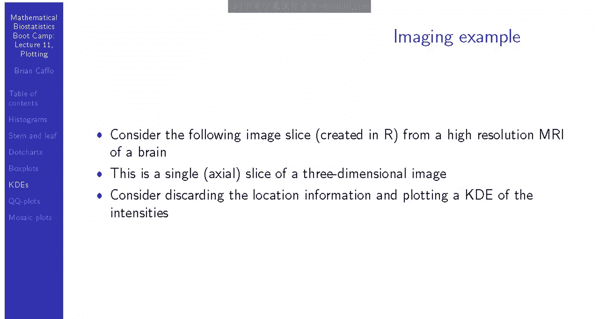
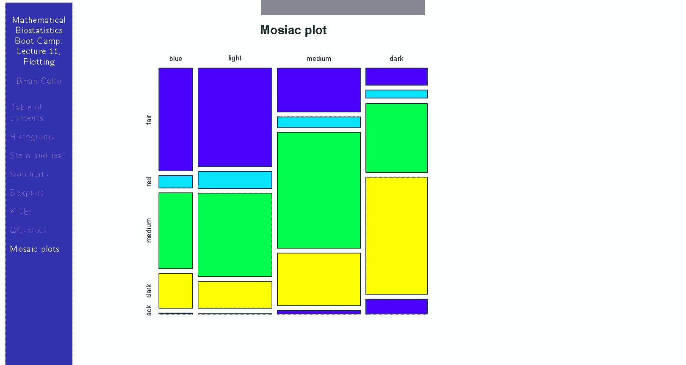

# 数据科学的高级统计：11：数据可视化 🎨

在本节课中，我们将学习如何通过绘图来可视化数据。数据可视化是数据分析中至关重要的一环，它能帮助我们直观地理解数据的分布、关系和模式。我们将介绍几种基础的绘图方法，包括直方图、茎叶图、点图、箱线图、核密度估计图、分位数-分位数图以及马赛克图。

## 直方图 📊

直方图是最常见的绘图形式之一，它通过条形图来展示样本数据，以估计密度函数或质量函数。本质上，它是变量取特定值或连续数据分箱值的频率或比例的条形图。

以下是创建直方图的步骤：

1.  加载数据集。例如，在R中可以使用 `data(islands)` 加载 `islands` 数据集，该数据集包含了各大洲的面积数据。
2.  使用 `hist()` 函数创建直方图。例如，`hist(islands)`。
3.  如果数据分布不均（例如大部分值很小，少数值很大），直方图可能不够清晰。此时可以对数据进行对数变换（如 `log10`）以改善可视化效果，例如 `hist(log10(islands))`。

直方图的优点在于简单易懂，适用于离散和连续数据。但其缺点是用墨量和空间较多，信息密度相对较低，且难以同时比较多个直方图。

## 茎叶图 🍃

茎叶图是另一种快速创建直方图的方法，尤其适用于只有纸笔的情况。它由统计学家约翰·图基发明。

创建茎叶图的步骤如下：

1.  选择一个数字位（如小数点后一位）作为“茎”。
2.  将数据按“茎”分组，并将剩余的数字作为“叶”排列在右侧。
3.  在R中，可以使用 `stem()` 函数，例如 `stem(log10(islands))`。

茎叶图能快速提供数据的分布概览，是一种便捷的密度估计方法。

## 点图 🔵

点图将数据集中的每一个数据点都用一个点表示出来。虽然看似简单，但如果能对点进行良好的排序和标记，它可以传达丰富的信息。

点图的优点在于数据密度高，理论上可以从图中重建原始数据。它非常适合比较不同组的数据，可以轻松添加水平线或垂直线来标示均值、中位数或置信区间。

例如，使用 `InsectSprays` 数据集（记录了不同杀虫剂导致的昆虫死亡数）创建点图，可以清晰地比较不同杀虫剂（A-F组）的效果，观察每组的分布形态（如双峰分布）和可能的异常值。

然而，当每组数据点过多时（例如成千上万个），点图会因为过度绘制而变得难以解读。

## 箱线图 📦

箱线图同样由约翰·图基发明，它通过分位数来展示数据的分布。

箱线图的构成如下：
*   箱体中间的线代表**中位数**。
*   箱体的上下边缘分别代表**上四分位数（Q3）** 和**下四分位数（Q1）**。
*   从箱体延伸出的“须”通常延伸到 **1.5倍四分位距（IQR = Q3 - Q1）** 范围内的最远端数据点，之外的点被视为异常值单独标出。

箱线图适用于数据量大的情况，能快速比较多组数据的分布中心、展布和偏态。如果数据为正数且分布范围很广，可以先进行对数变换再绘制箱线图。

需要注意的是，当异常值过多时，它们会形成一片黑点，反而掩盖了主体数据的信息，此时可以考虑在图中省略异常值的显示。

## 核密度估计图 📈

核密度估计是一种直接的密度估计方法，它通过一个核函数（通常是高斯核）对每个观测值进行加权平均，从而生成一条平滑的密度曲线。

与直方图类似，核密度估计也有一个关键的平滑参数——**带宽（bandwidth）**。带宽的选择会影响估计曲线的平滑程度。在R中，可以使用 `density()` 函数进行核密度估计。

例如，对黄石公园老忠实间歇泉的喷发间隔时间数据（`faithful` 数据集）进行核密度估计，可以清晰地看到喷发时间集中在两个主要区间。

核密度估计图比直方图更平滑，能更好地揭示数据的整体分布形状。在图像处理中，对灰度图像的像素强度进行核密度估计，可以区分出背景、灰质、白质等不同组织。

## 分位数-分位数图（Q-Q图） 📐

Q-Q图用于比较数据的经验分布与某个理论分布（如正态分布）是否一致。其原理是将数据的经验分位数与理论分布的分位数进行对比绘图。

如果数据服从该理论分布，则点应大致落在一条直线上。若有显著偏离，则说明数据分布与理论分布不同。

在R中，`qqnorm()` 函数用于绘制正态Q-Q图，`qqplot()` 函数可用于与其他分布比较。

Q-Q图能有效突出数据分布与理论分布之间的差异，例如：
*   如果数据点在高分位数处过高，在低分位数处过低，则表明数据比正态分布具有更厚的尾部。
*   如果数据点在高分位数处过高，而低分位数处聚集在零点附近，则表明数据是右偏的。

## 马赛克图 🧩

以上方法主要针对连续或单变量数据。对于两个离散变量的联合分布，可以使用马赛克图。

马赛克图通过矩形的大小来表示列联表中每个组合的频数。例如，使用费舍尔的头发颜色与眼睛颜色数据，可以快速看出不同组合的频率模式，例如红发在所有眼睛颜色中计数都较低，而金发在不同眼睛颜色中分布差异较大。

马赛克图是可视化二维列联表的一种直观方法，无需借助三维图形。

## 总结 📝

本节课我们一起学习了多种基础的数据可视化技术：
1.  **直方图**和**茎叶图**用于展示单变量数据的分布。
2.  **点图**适用于展示所有数据点，便于详细比较。
3.  **箱线图**通过分位数概括数据分布，适合大数据集和多组比较。
4.  **核密度估计图**提供平滑的密度曲线。
5.  **Q-Q图**用于检验数据是否服从特定理论分布。
6.  **马赛克图**用于可视化两个离散变量的联合分布。

数据可视化是探索性数据分析的核心部分。在实际分析中，不应局限于某一种技术，而应尝试多种图形来从不同角度理解数据。正如约翰·图基所说，好的图形能带来“眼内冲击”，让结论一目了然，这是概率模型难以直接做到的。通过可视化，我们可以在建立复杂模型之前，先对数据有一个直观的认识，从而避免不合理的建模假设。