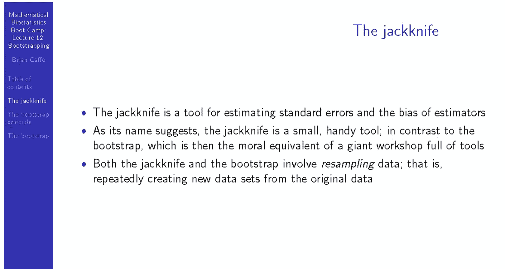
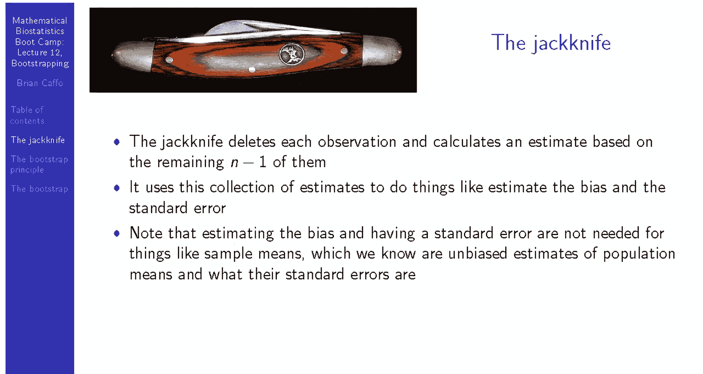
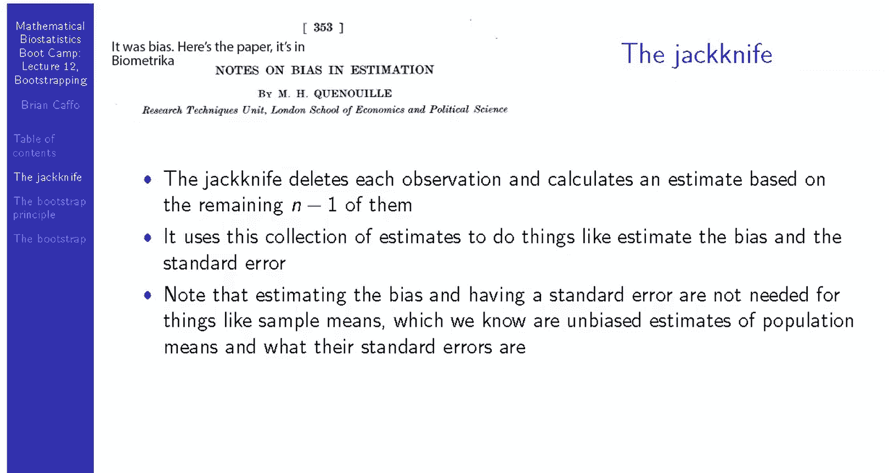
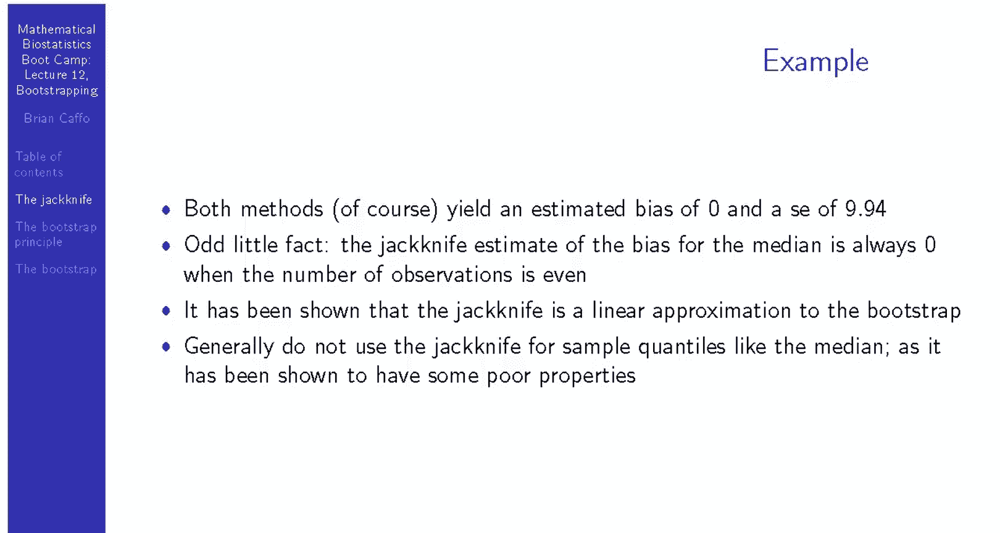
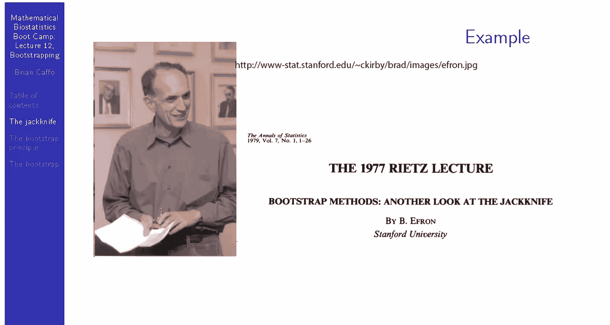
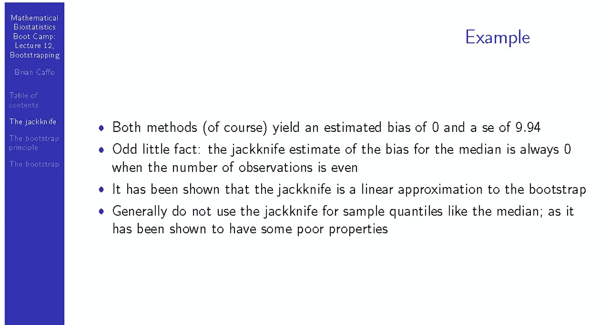
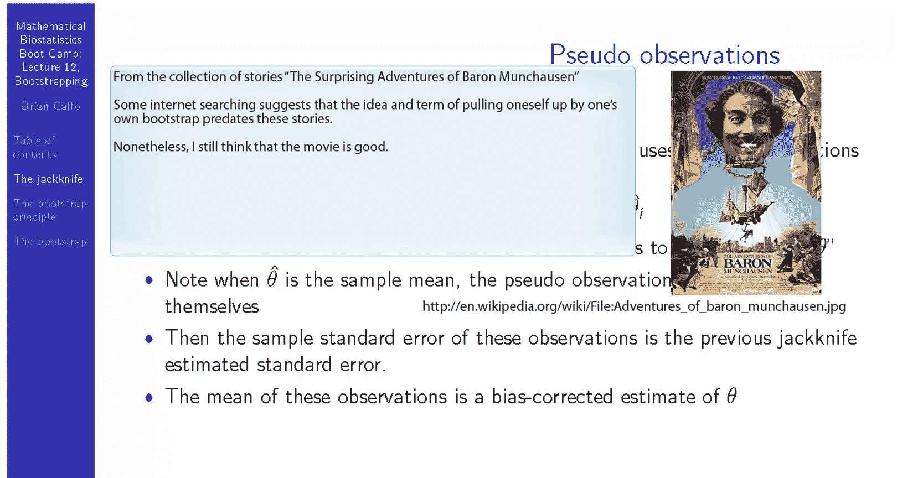
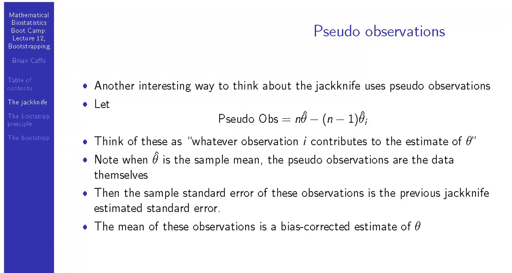

# 约翰霍普金斯大学《数据科学的高级统计｜Advanced Statistics for Data Science》中英字幕（deepseek p26 25_刀切法.zh_en -BV1htPjeYEFH_p26-

Hi， my name is Brian Kaho and this is Mathematical Biosstatistics Boot Camp。

 Lecture 12 on Boottrapping。Today we're going to talk about the tool of bootstrapping。

 which is an incredibly useful handy result in statistics that you can use in a variety of settings it was made sort of coincided with a personal computer revolution and so it gives us a way to avoid an awful lot of mathematics in biostatistics before we talk about the bootstrap。

 we're going to talk about the jackknife， which is a precursor to the bootstrap that is as its name suggests a handy little tool。

So let's talk about the jackknife here briefly before we go into the bootsottrap。

 the jackknife is exactly as its name to suggest a handy little tool。

 the bootstrap on the other hand is like an entire workshop of tools。

The key idea in both the jackknife and the bootstrap is to use the data。

 so called resampling of the data to get at quantities that are difficult to get at otherwise。

 for example， variances and biases and that sort of thing。

 Now we don't need either the bootstrap or the jackknife for something like the sample mean where we know all of its theoretical properties。

But for other less obvious statistics， we need something that does it for us。

You know it' would be preferable if that something didn't require a year of mathematics just to get us to the starting point and in contrast。

 the bootstrap is you dream up of a statistic or something like that and you want to estimate a standard error with it。

 you can start bootstrapping it immediately。

So let's talk a little bit about what the jackknife does before we begin with the bootsottrap because sort of historically the jackkni came first。

 the first use of the jackni was by the statistician， I'm in a butcher his name。

 but I think it's pronouncedquinui。

And he used the jackknife to estimate bias， I believe。

 then the jackknife was really popularized and further refined by the extremely well knownn statistician John Tki。

 who we talked about a little bit in the lecture on plotting。 Tki had numerous inventions。

 including the fast discrete Fourier transform。 He coined the term bit for binary digit。

 He was the first person to do that。 he did lots of things invented the box plot。

 I think when you see it， you'll conclude along with me。

 the Jackns a handy in an incredibly clever thing for someone to think of。

So the idea behind the jackknife and similar to the idea behind the bootstrap is you have something that you don't know like the bias in a statistics or the standard error of a statistic and the idea is to use the data to get a sense of it well what the jackknife does is it says。

 okay well one way to get at these quantities is to take one of the observations out and then formulate the statistic on the remainder and see how well the statistic does you know at estimating that one pulled out observation and this is very related to the idea that you frequently hear of in machine learning and statistical prediction of so-cal crossval。

 the jackknife tends to have a different goal in that the goal of the jackknife tends to be bias estimation or variance estimation but the principle is very similar in that your deleting observations。

 leave one out crossval is typically used as an estimate of prediction error。So anyway。

 let's just focus on the jacknife and if you take classes in machine learning or something like that。

 you'll talk about cross validation。The jackn deletes one observation and calculates whatever estimate you're thinking of based on the remaining n minus one of them。

And then it uses this estimate based on n minus one of them in which you get n estimates。

 having left out one observation one at a time， it uses these n estimates to do something like estimate biases and standard error。

And again， no， we don't need this for the sample mean。

 we know that the sample mean is unbiased under certain assumptions and we know exactly what the standard error of the sample mean is under the standard settings。

 so the jackknife isn't necessary for those settings， but it's maybe necessary for other ones。

So let's just consider the jacknife for Uniivariate data and let's let x1 to xn be a collection of Uniivariate data points where we want to estimate a parameter theta。

 and so let's let theta be the estimate based on the full data set and then let's let theta hat subi be the estimate of theta that you obtain where you use the n minus1 observations obtained by deleting observation I。

 and then let's let theta bar be the average of the leave1 out estimate。

So with that notation in mind， the jackknife estimate of the bias of our statistic theta hat is just n minus1 theta bar minus theta hat。

 So let's kind of consider the principle of this before we get to why in the world that n minus1 is there so theta hat is our estimate looking at how close it is to the averages of estimates where we deleted an observation each time is exactly going to give us a sense of kind of population level bias and then you might wonder where in the world does this n minus1 come from。

 It's factor that's based on the。For example， the sample variance where you would estimate the bias of the sample variance。

 It would give you the correct answer。 The n -1 is sort of calibrated by statistics that we actually know。

 So， again， this estimate is really related to how far the average delete one estimate is from the actual estimate。

And then this n minus1 is just a factor that was sort of a good estimate of what is the appropriate multiplier to have to get the bias to be an estimate of the true bias。

And then the jackni estimate of the standard error is n 1 over n times the some of the squared deviations of the leave1 o estimates around the average of the leave1 o estimate。

 So it's sort of like the square root of n minus1 times the variance of the。Leave one out estimates。

So again， the rationale for this factor out front， the extra n -1， why not just。

 why not just take the variance of the leave one out estimates as an estimate of the standard error of the statistic。

 Well， it turns out that the leave one out estimates。Because they have the majority of the data。

 they have n minus one of the data points included。

 they tend to be quite close to one another and excessively close to one another。

 So the variance by itself is not a good estimate of the standard error of the statistic。

 So we need a fact and they calibrated that n -1 is a reasonable factor to do that。

 And the same thing is true with the bias that the leave one out。

 Staistics tend to be a little too close to one another unless you sort of multiply this bias estimate by a little bit。

 you don't get reasonable estimate。So let's go through an example。

 so we had 630 measurements of gray matter volume from workers from a lead manufacturing plant。

 the gray matter volume wound up to be about 589 cubic centimeters and we want to estimate the bias and the standard error of the median and then I'll come back to this discussion of jackknifing the median because that's where we're going to move forward to the bootstrap so for example the gist of the code to do this now you don't actually have to execute the code。

I'll show you in a page how to do it， but you can do it in any language， not just R。

 you just have to figure out how to delete observations one at a time。

So let's let n just be the number of observations we have theta hat is the median of these gray matter volumes。

And then the jackni estimates are the median that I obtain each time where I delete the Ih observation and this S apply function is exactly that。

Then theta bar just exactly from the notation from the previous couple of slides is just the mean of these leave one out jackknife estimates。

 then my bias estimate is going to be n minus1 times the difference between theta bar and theta hat。

 and the standard error is going to be the square root of n minus1 times the average squared deviation of the jackknife estimates around the average of the jackknife estimates。

And then on the next page， it's a lot easier to do this if you want to just use the software in the Boottrap library。

 you can jacknife out is the jackknife function of my list of gray matter volumes and the function I want to calculate the jackKnife estimate of is the median and then I assign that to a variable out。

 and I pick out the standard error and the bias calculation。

Both methods yield an estimated bias of 0 in a standard error of 9。94。

And there's an odd little fact the jackknife tends to work well for sort of smooth functions。

 and empirical quantiles often don't satisfy that requirement， the median is an example。

So as's an odd little fact， the jackknife estimate of the bias for the median is always zero when the number of observations is even。

So the medians an example where the jackknife isn't that good of a thing to do in general if you're。

Function of the data is a nice smooth function， the estimate that you're getting is a nice smooth function of the data。

 then the jackKnife will work fine， but if not， then it tends to work pretty poorly and that there was a very wellknown paper by Ephron。

 the inventor of the Boottap that illustrated this quite starkly。

And the jackknife has been shown to be a linear approximation of the bootstrap so if you're in some setting where it's going to be difficult to program up the bootstrap。

 then doing a jackknife， which is a pretty simple thing to do is a handy little tool to use And then just to remind you you know don't use the jackknife for sample quantiles。

 it's a handy procedure and it works in a lot of settings but maybe not for sample quantiles like the median is as it's been shown to have some poor properties and what could you possibly use then well why not try to use the bootstrap。

So let's move on to the bootstrap， which is maybe a little bit。More of a complete toolbox。

 but is certainly a little less compact of a tool than the jacknife and exactly the way the analogy to the tools sounds like by the way。

 the term bootstap comes from this idea of pulling one up by one's own bootstraps， right you know。

 of course。

This has been discussed a lot， it's kind of an unfortunate。

Title for a statistical procedure because it makes it sound like the information is coming from nowhere。

 right， because you can't pull yourself up from your own bootstraps。 It's physically impossible。

 But you know， there's been plenty of theoretical work that shows where the information is coming from from the bootstrap and sort of when it is applicable Another thing I would note is this idea of pulling one's self up from one's own bootstap is from the fable of Baron Moonnchausen And so there's a great movie called the Advures of Baron Moonnchausen。

 and it was done by some of the people who made the Moni Python series to get a chance you should you know in honor of this lecture。

 watch the Baron Moonnchausen movie。 But anyway， from that fable is where the term pulling oneself up one's own bootstrap comes from。

 And then that's where they got the idea for the name for this procedure。 Anyway。

 back to the jackknife。

So another way to think about the jackknife is this idea of so called pseudo observations。

 so if you take。N times theta hat minus n minus1 times theta hats sub I。

You can kind of think of these as whatever observation I contributes to the estimate of theta and then notice if theta hat is the sample mean。

 then these pseudo observations are exactly the data themselves。

 so it's sort of this idea of taking what worked in a very neat and tidy sense for the sample mean and trying to extend the idea to other statistics。

And then the sample standard error of these observations is the jackknife standard error。

 and the mean of these observations is a sort of bias corrected estimate of the parameter that you're interested in。

 so it takes your ordinary estimate and attempts to correct the bias。

 I have to admit for my thinking about the jackknife。

 I kind of prefer to think about it this way in terms of the pseudo observations than in the sort of classical development of it。

