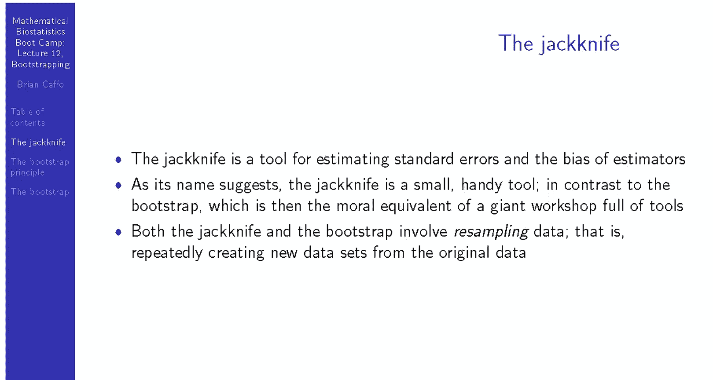
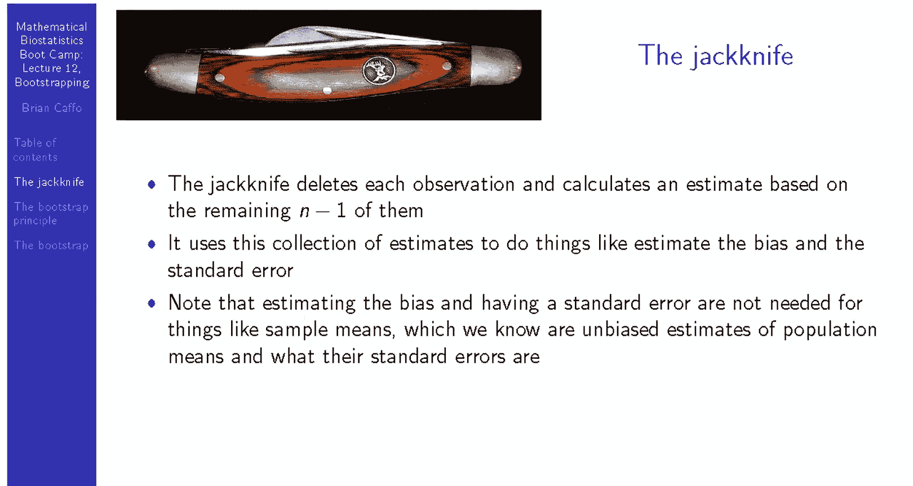
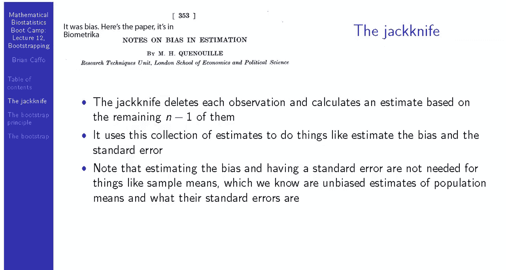
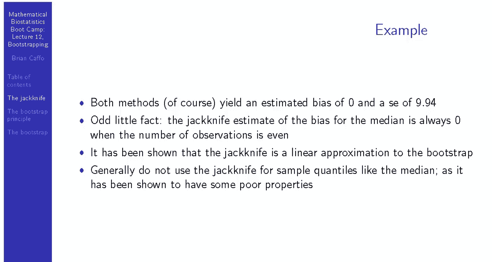
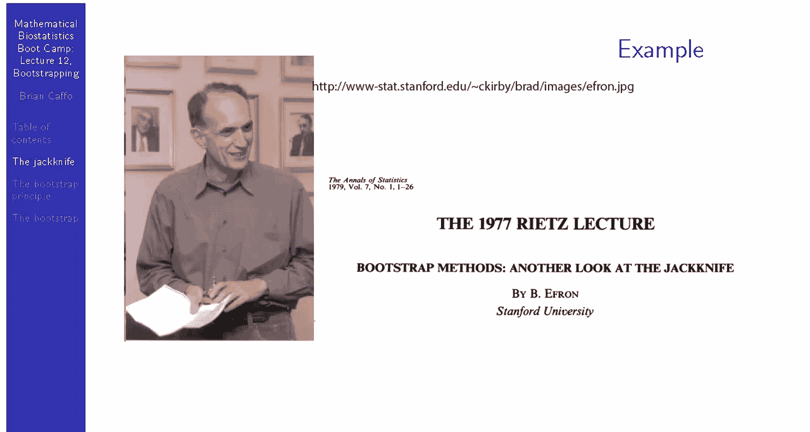
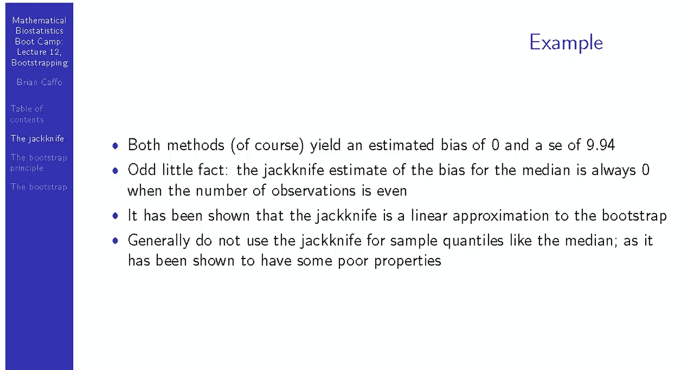
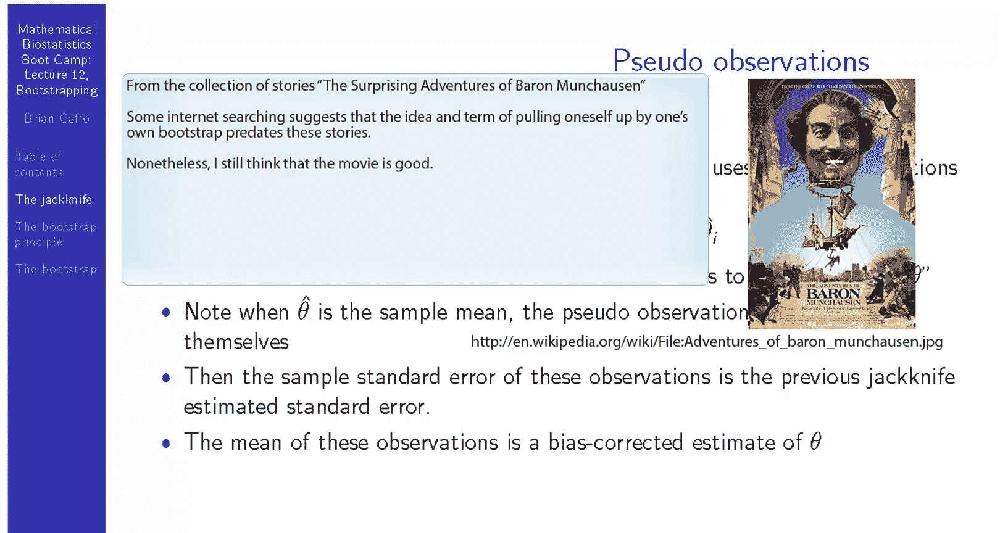
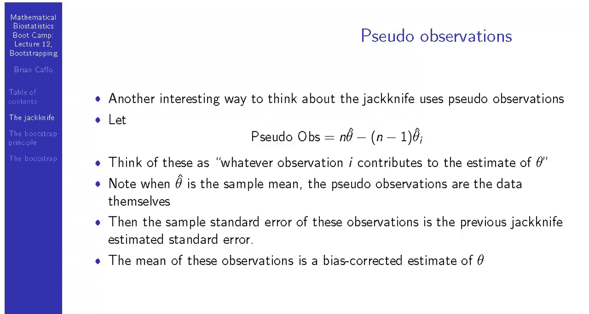

# 高级统计：12：刀切法与自助法 🛠️

在本节课中，我们将学习两种重要的统计工具：刀切法和自助法。这两种方法都通过“重抽样”技术，利用数据本身来估计统计量的性质，例如偏差和标准误，从而避免复杂的数学推导。我们将首先介绍刀切法，然后深入探讨功能更强大的自助法。

## 刀切法简介

上一节我们概述了本节课的目标。本节中，我们来看看刀切法。刀切法正如其名，是一个方便的小工具。它的核心思想是：通过系统地删除一个观测值，然后基于剩余数据重新计算统计量，以此来评估该统计量的性质（如偏差和方差）。这与机器学习中常用的交叉验证思想非常相似。



刀切法的首次使用由统计学家 Quenouille 提出，主要用于估计偏差。随后，著名统计学家 John Tukey 推广并完善了该方法，并为其命名。Tukey 还发明了箱线图、提出了“比特”（bit）一词，并参与了快速傅里叶变换算法等工作。



### 刀切法的原理与公式



假设我们有一组单变量数据点 `x1, x2, ..., xn`，我们希望估计参数 θ。
*   令 `θ_hat` 为基于全部数据得到的估计值。
*   令 `θ_hat(-i)` 为删除第 `i` 个观测值后，基于剩余 `n-1` 个数据得到的估计值。
*   令 `θ_bar` 为所有 `θ_hat(-i)` 的平均值。

基于此，刀切法估计的统计量 `θ_hat` 的偏差和标准误公式如下：

**刀切法偏差估计**：
`Bias_jack = (n - 1) * (θ_bar - θ_hat)`

**刀切法标准误估计**：
`SE_jack = sqrt( [(n-1)/n] * Σ(θ_hat(-i) - θ_bar)^2 )`

公式中的 `(n-1)` 因子是为了校准。因为“留一”估计基于大部分数据，它们彼此过于接近，直接使用其方差会低估真实的标准误，因此需要这个乘数进行调整。

### 刀切法实例：脑灰质体积中位数

我们有一个包含630名铅制造工人脑灰质体积测量值的数据集。中位数约为589立方厘米。我们希望估计该中位数的偏差和标准误。

以下是执行刀切法的R代码逻辑：

```r
# 假设 `gmVol` 是包含所有观测值的向量
n <- length(gmVol)               # 样本量
theta_hat <- median(gmVol)       # 基于全样本的中位数

# 计算所有留一估计值
jack_estimates <- sapply(1:n, function(i) {
    median(gmVol[-i])            # 删除第i个观测值后计算中位数
})

theta_bar <- mean(jack_estimates) # 留一估计值的均值

# 计算刀切法偏差和标准误
bias_jack <- (n - 1) * (theta_bar - theta_hat)
se_jack <- sqrt( ( (n-1)/n ) * sum( (jack_estimates - theta_bar)^2 ) )
```

实际上，我们可以使用 `boot` 库中的 `jackknife` 函数更简便地完成：

```r
library(boot)
out <- jackknife(gmVol, median)
bias_jack <- out$jack.bias
se_jack <- out$jack.se
```

两种方法得出的估计偏差均为0，标准误约为9.94。

### 刀切法的局限性

刀切法对于数据的光滑函数（如均值）效果很好。然而，对于像中位数这样的样本分位数，其表现可能不佳。一个有趣的事实是：当样本量为偶数时，中位数的刀切法偏差估计总是为零。Efron（自助法的发明者）曾有一篇著名论文清晰地阐述了这一点。

刀切法可以看作是自助法的一种线性近似。在难以实现自助法的情况下，刀切法是一个方便的替代工具。但请记住，**不要对样本分位数使用刀切法**。

## 过渡到自助法



既然刀切法在处理中位数等统计量时存在局限，我们该怎么办呢？答案就是尝试使用自助法。如果说刀切法是一个方便的小刀，那么自助法就像是一个完整的工具箱，功能更强大，但也稍欠紧凑。

“自助法”这个名字来源于“靠自身力量提升”这个理念，最初出自《吹牛大王历险记》中闵希豪生男爵拉着自己的靴襻把自己提起来的故事。虽然这个名字听起来像是无中生有，但大量理论研究已经阐明了自助法有效的条件和信息根源。



### 刀切法的另一种视角：伪观测值



在深入自助法之前，我们再看一下刀切法的另一种理解方式，即“伪观测值”的概念。

定义伪观测值：`θ_tilde_i = n * θ_hat - (n-1) * θ_hat(-i)`

可以将其理解为第 `i` 个观测值对参数估计 θ 的贡献。如果 `θ_hat` 是样本均值，那么这些伪观测值恰好就是原始数据本身。因此，刀切法是将样本均值中运作良好的思想推广到其他统计量的一种尝试。



这些伪观测值的样本标准误就是刀切法标准误。这些伪观测值的均值则是对原始参数估计 `θ_hat` 进行偏差校正后的估计值。就个人而言，我认为从伪观测值的角度来理解刀切法比经典推导方式更直观。

## 本节课总结



本节课我们一起学习了两种重要的重抽样技术：刀切法与自助法。我们首先详细介绍了刀切法的原理、计算公式，并通过一个估计中位数的实例演示了其应用，同时也指出了它对非光滑统计量（如分位数）的局限性。接着，我们引入了功能更强大的自助法，并介绍了理解刀切法的另一种视角——伪观测值。下一讲，我们将深入探讨自助法的具体思想和实现。