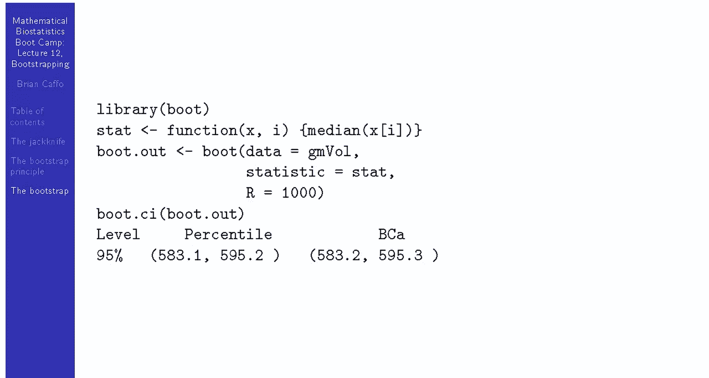

# 约翰霍普金斯大学《数据科学的高级统计｜Advanced Statistics for Data Science》中英字幕（deepseek p27 26_自助法.zh_en -BV1htPjeYEFH_p27-

So now let's get to the bootstrap so the bootsottrap is this tremendously useful tool it's useful for creating conference intervals。

 standard errors， basically anything that's involved in the distribution。😊。

Of a statistic where you don't know that distribution。

 the bootstrap is an incredibly useful thing to use。As an example， we've said before in the previous。

Page that well the kind of jackknife standard error calculation for the median doesn't appear to be working that well or the bias didn't seem to be working that well。

 and maybe that raises some question about the standard error calculation for the median using the jackknife。

 well how about deriving a confidence interval for the median？

Or you come up with a generic statistic， you want to look at the log difference of two variances。

 how do you come up with a confidence interval for the log difference in two variances Well。

 the bootstrap procedure follows from the socal bootstrap principle and you can do things like create confidence intervals for parameters based on kind of difficult to work with statistics。

And the Botrap principle basically follows along the following lines。

Suppose that I have a statistic that estimates some population parameter。

 but I don't know that it's sampling distribution。 So take the median。

 We actually know a lot about the sampling distribution of the median。

 but let's suppose you don't know anything about it。 then you would say， well， I'm stuck。 Well。

 the bootsstr principle says， well， why don't we just take the distribution defined by the data。

 to approximate the sampling distribution of the median。

 So what's the distribution defined by the data。 The distribution defined by the data。

 if you're not putting any constraints on it， puts probability one over n on every data point。

 That is a distribution， it's a discrete distribution。

It's a discrete distribution that it puts probability one over n on each data point and it's a weird distribution because the data points of course。

 generally have fractional amounts and it's a weird kind of discrete distribution in that it's not sort of like a di roll or it's on the integers but nonetheless it's a nice discrete distribution and it's mean is of course the sample mean so it's kind of any rate this empirical distribution is a reasonable distribution to work with。

 And so why don't we look at the sampling distribution of the median based on the empirical distribution from our data where we place probability one over n on each data point and that's the bootstrap principle It's saying well。

 I don't know what the population distribution is。And so I without that and without some tool like the central limit theorem。

 I can't figure out what the distribution of my test statistic is。

 well why don't I take my distribution given by my empirical distribution and figure out what the distribution of sample medians are like from that distribution because I know that right it's just a distribution that's one over around on each data point and I can work with that。

So that's a really nifty principle and it can be executed in a kind of parametric way or a nonparmetric way today we'll be talking about the nonparmetric bootstrap where the empirical distribution that we work with is just places one over n on each data point。

If we want to figure out things about this distribution。

 it's actually not very convenient to work with， say you have 100 observation and you're saying。

 well。The distribution I'm working with now places probably  one over 100 on every data point。

 and I want to know what the distribution of medians of 100 observations from that distribution is。

It's actually kind of a hard thing to work with， you couldn't actually work that on a pen and paper。

 maybe if you had。you know， five observations， then there's only 32 combinations to work with。

 but in general it's a little hard to work with， people said， well why don't we just use simulation。

 forget about it， why don't we just use simulation。

And then the process of bootstropping has this kind of interesting resampling interpretation。

So what do people wind up doing， the general procedure follows by。

Taking the data set and simulating complete data sets。With replacement。

 So we put all of our data points in a bag。 let's say we have 100 data points。

 and we pull out a new data set of 100 data points， but we sample with replacement。

 So once we pull out a point and record it。 Then we put that observation back in the bag。

 mix it up again and pull out another point and it could possibly be that same point again。

 if we sample without replacement， we would just get a permutation of our original data set。

 So the bootstrap distribution is sampling with replacement。 So what is that。

 that is exactly drawing Iid samples from a distribution that places probability one over n on each data point。

 And so for every one of these。Reamples right， that's the idea it's resampling from the observed data。

 you're creating fictitious data sets。By resampling from the observed data。

 that's why it's called a resampling procedure。So let's say we have 100 observations。

 we draw with replacement， complete data sets of size 100 from our observed data from each of those complete data sets of size 100。

 we calculate the statistic that we're interested in。

 say for example the median we would calculate the median then for every resample so we draw sample size 100。

 calculate the median， redraw sample of size 100， calculate the median， redraw sample of size 100。

 calculate me and we repeat that process over and over and over again， let's say we did that 10。

000 times we would get 10，000 resampled sample medians。

 and we would use those 10000 resampled sample medians to talk about the empirical distribution of the sample median and that seems to make a lot of sense the first time you encounter this you might think this is the strangest thing I have ever heard in terms of a statistical procedure but it does make a lot of sense So let me drone on about this for another couple minutes。

So think about if you actually knew the distribution and could sample from it。

 how you would get to know the distribution of say something like the median。

 if you couldn't do the math， which， you know， for most statistics you can't do the math。

 even mathematicians can't do the math， so let's say for example， I create a distribution。

 let's say I have1 hundred sided die。And that 1 hundred sided die has probability one over 100 for each side of the die。

 And let's make it at least a little bit interesting。 So the dies shaped a little bit funny。

 So it's not exactly probability  one over 100 for every number。

 So you have a distribution on the numbers between  one and 100 And you wanted to know10 What's the sampling distribution of the median of 10 die rolls from this hundred0 sided die。

 that's a hard problem。 It's difficult to think about how you would work that out on pen and paper。

But what you could do is roll the die 10 times， get a sample median。Record it。

 Then roll the die 10 times again， get a sample meaning and record it。

 and then roll the die 10 times again， get a sample media and record it。

 And you could do that thousands of times if you had patience， let's say， you know。

 you were waiting for something。And then if you did it enough。

 you would get exactly the distribution of。The sample median。Okay。

 so you would get exactly the distribution of the sample median of 10 di rolls and if you wanted to know what the sample distribution of the median of 20 di rolls。

 well， you'd have to roll the die 20 times， get a sample median and repeat that process over and over again and that would do it for you Okay。

 so now we know if we can actually sample from the population distribution over and over and over again。

 how we would get the sampling distribution of a statistic， but when confronted with real data。

 we can't roll the die right， we don't know what the population distribution is so we can't do it。

But what we can do is roll from a die where every side of the die we've put on the number associated with an observed data point。

 then we're not drawing from the population distribution we're drawing from the empirical distribution and if we had 10 data points and we want to know what the distribution of the sample meaning of 10 observations is what we can't draw from the population distribution。

 but what we can do is draw samples of size 10 from the distribution defined by the data we observed and look at what the distribution of the sample meaning is for those and that is exactly what the bootstrap does is it basically says well you know the bootstrap in practice via reampling it basically says well we know exactly what we would do if we actually knew what the population distribution was why don't we just do that and use the sample distribution and see how that works and it's sort of a really nifty idea。

So again， let's just take our 630 measurements of gray matter volume from workers at a lead manufacturing plant。

 then the median gray matter volume is about 589 cubic centimeters and we want a confidence interval for the median of these measurements how do we do that so here's our bootstrap procedure for calculating confidence interval for the median of a data of n observations where we know nothing about the sampling distribution of medians of 10 observations so we would sample n observations with replacement from the observed data resulting in one simulated complete data set we would take the median of this simulated complete data set that would give us one bootstrap resample and one bootstrap resampled sample media。

Then we would repeat this step B times， let's say resulting in B simulated medians of n observations。

 those n observations having been drawn with replacement from the collection of observed data then these medians。

 well， let's say they're approximately draws from the sampling distribution of the median of n observations and they're exactly draws from the sampling distribution of the median of n observations from the distribution of the observed data。

 but we're going to say that's approximately equal to the sampling distribution of the median of n observations drawn from the population distribution。

 that's the leap of faith we're making is that this bootstrap process approximatelys if we instead of drawing from the observed data we're drawing from the actual population distribution。

Then we could take these B sample medians and draw a histogram of them and then say we wanted to know you know a confidence interval。

 why not take the 2。95% confidence interval， why not take the 2。5th and 97。

5th percentiles and call that a confidence interval for the median and that's exactly a so-called bootstrap percentile confidence interval so it's hard to describe and I know I'm butchering it and if I were ephron I'd be doing a much better job at doing this but unfortunately you have me and not ephron。

And it's difficult to describe for me at least on the next page I'm showing the R code for doing this。

 and even I've neatened up the R code a little bit。

 so it's probably a little bit longer than it needs to be。 you could do this in about four lines。

 So here B is my number of bootstrap resamples I said let's just do it a thousand times but you know you want to set this number B to be big enough so you don't have to worry about the error in your Monte Carlo resampmbling you don't want the number of times that you've rolled the die to be a factor in what you're doing。

 you want to do it a ton So here I did  a thousand but you know crank it up until you're tired of waiting at least there is a science to how you pick B but we're not going talk about in the class。

So n is the length of the number of observations that I have okay。

 then our resamples is this code right here just draws with replacement。

From the collection of n observations， it draws B complete data sets of size n from that distribution。

 the replace equals true means that we're sampling with the replacement and then here this reamples。

 I dump them all into a matrix so that every row is a complete data sets so there's B rows and n columns and then I go up for every row and I calculate the median in this next line。

 and that's then B medians where each median was obtained from resample of n observations from the observed data and then if you take the standard deviation of these medians。

 then that is a bootstrap estimate of the standard deviation of the distribution of the sampling mean if you take the quantiles。

 the 2。5th and 97。5th quantile， you get 582 to 595 that is a bootstrap confidence interval for the median of gray matter volumes conducted in。

A non parametric way。And it's always informative in the bootstrap to plot a histogram of your resampled in this case。

 medians Okay so in here is my histogram of my resampled medians and then the 2。5th and 97。

5th quantiles of my bootstrap resampled medians are drawn here in dashed lines and so that 95% of my resampled medians lie between these two lines and so we're gonna to call that a bootstrap confidence interval Now I'm going to give you some notes on the bootsottrapap So for both the bootstrap and the jackknife today's lecture is really just a teaser as you can probably guess from my description they're sufficiently difficult techniques to where you know you don't want to take these lectures and view them as enough knowledge to just run out and use them will nily I just wanted to give you a teaser so that if you hear the terms you know what people are talking about So the bootstrap。

 the one that I described today as nonparmetric it makes very little assumptions about the population distribution。

うん。And the kind of theoretical arguments proving the validity of the bootstrap tend to rely on large samples。

 So there's a question about when and how you can apply it。

 but I find it to be a very handy tool in general， the confidence interval measure that I gave you these percentile confidence intervals。

 they're not very good。 you can improve on bootstrap confidence intervals by correcting the endpoints of the intervals and the bootstrap procedure。

 the one I would recommend is the so-called BCca confidence interval。

 the bootstrap package in R will calculate these for you directly if you'd like。

 that's what better when I say here better percentile bootstrap confidence intervals correct for bias。

And then there's lots and lots of variations in the bootstrap procedures。

 there's parametric bootstrapping， there's bootstrapping for time series。

 you have to do something different for bootstrapping for time series。

 there's all sorts of different ways to think about the bootstrap and data resampling in general and the book called an introduction to the Boottrap by Ephron and Trai for anyone who's taken this class absorb the material and it is at a level that you should be able to understand it's beautifully written。

 it's a wonderful treatment of the subject and then in addition to this there's lots and lots of other books on the topic of the bootstrap。

 probably too many good ones to name some of them unbelievably theoretical and other ones quite accessible。

 I think this Ephron and Ttuani book makes a very nice balance between you know given you the why things work and the how to do things combination。

And it also covers the jackknife and other data reampling procedures。

The last thing I wanted to mention is I gave you the exact code that you could use to generate for yourself the bootstrap sampling distribution。

 you could of course use the bootstrap package in R。

 which takes about as many lines of code in this case is programming it up yourself and just on this last side I go through actually using the bootstrap package。

 but the nice thing about the bootstrap package is that it will actually give you this biascorrected interval in this case you can see that the biascorred intervals is nearly identical to the percentile interval so it didn't make a big difference。

 but you can of course come up with instances where the biascorred intervals a little bit better。

So that's the end of today's lecture that was a teaser on the idea of bootsstrap resampling and a little bit on the use of the jackKnife you know I hope this inspired you to go learn a little bit more about these tools they are among the kind of a wide class of tools that became available as modern computing came about and the idea of being able to use our data especially when we have large data sets to use the data more fully and to use the data to come up with things like sampling distributions instead of using mathematics and assumptions and that sort of thing so it was a neat idea brought about by the computational revolution and it's a very nifty technique。

Well， next time will be our last lecture and I look forward to talking about it with you。

Yeah。🎼。

