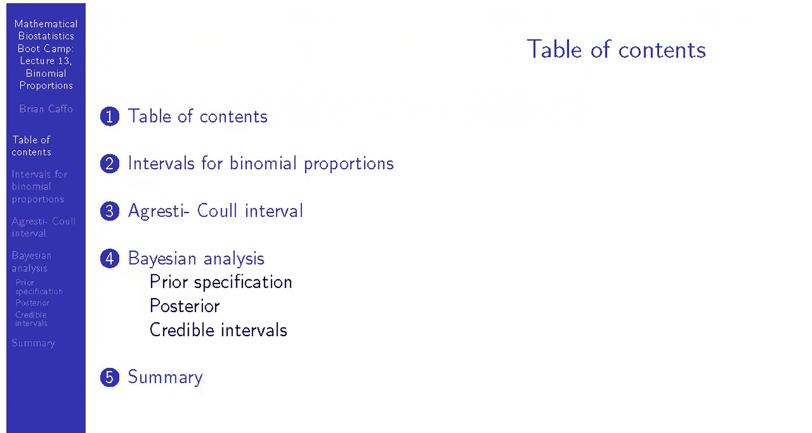
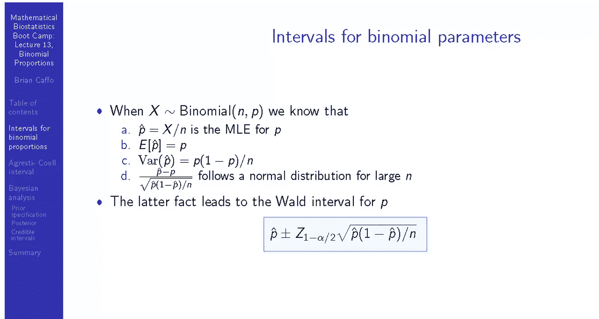
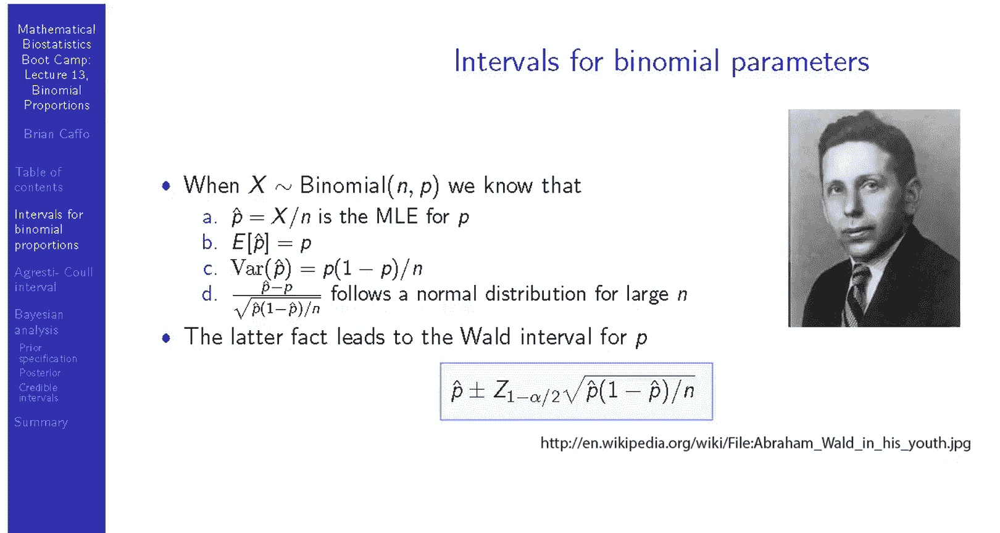
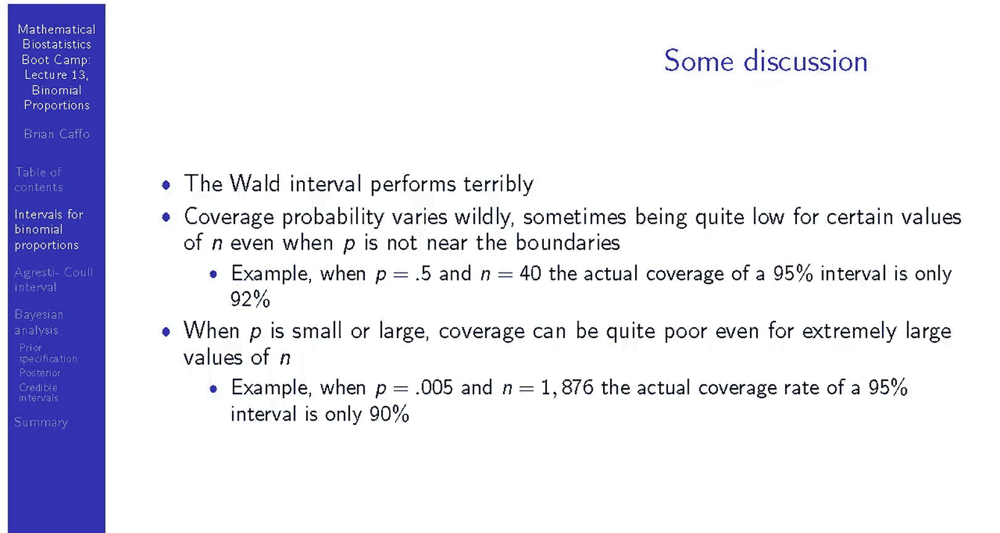
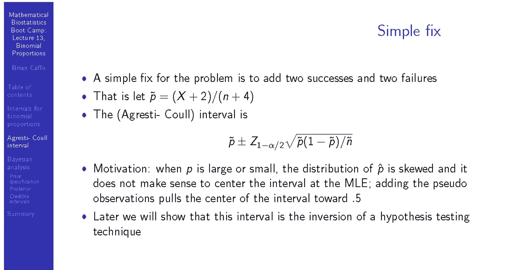
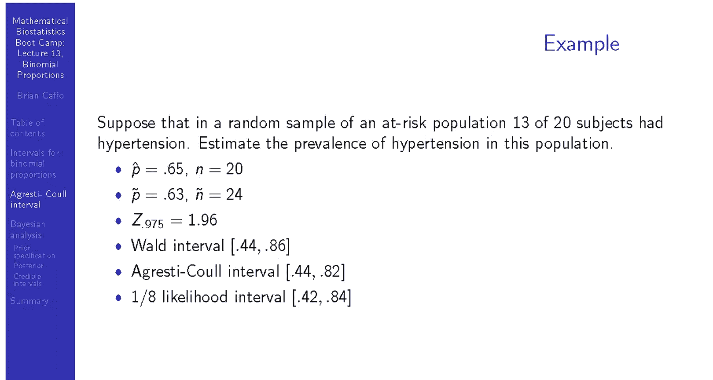
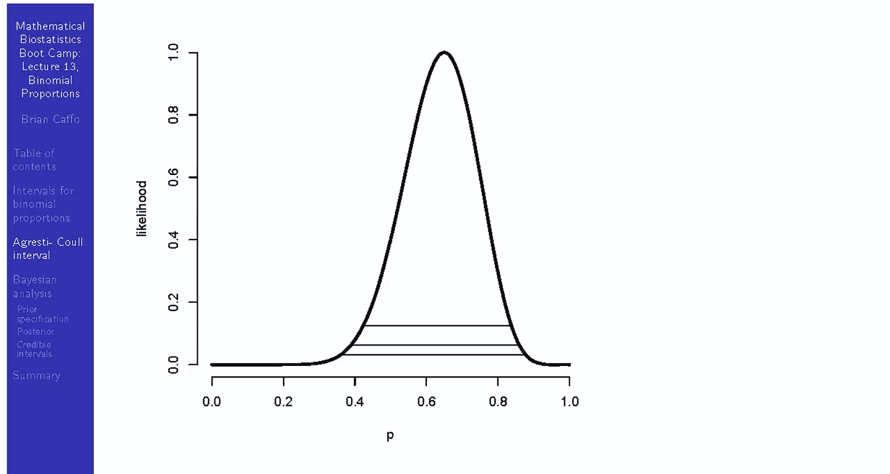

# 约翰霍普金斯大学《数据科学的高级统计｜Advanced Statistics for Data Science》中英字幕（deepseek p28 27_二项比例推断A部分.zh_en -BV1htPjeYEFH_p28-

Hi， my name is Brian Kaho， and this is Mathematical Biosstatistics boot Camp， Le 13 on binomial Pros。

In this lecture we're going to talk about confidence intervals for binomial proportions using frequentous techniques。

 we're going to talk about why the standard frequentous interval has a little bit of problems and we're going to give you a simple fix for it。

 and then we're going to use confidence intervals for binomial proportions to motivate Bayesian analysis and we'll go through very simple conjugate Bayesian analysis as it relates to estimating the success probability of a coin flip。

So when variable x is binomial with n trials and success probability P。

 we've learned several things in the class so far， the first is that the MLLE for the success probability of the coin from the Bernoulli trials is P hat。

 the sample proportion of successes， so x over n is the MLE for P。

 we know that the MLE is unbiased in this case， expected a value of P hat is P。

 and we know that the variance of P hat is p times 1 minus P over n。

We also know from the central limit theorem because P hat is simply an average of Bernoulli trials that P hat minus its mean P divided by its standard error。

 square root P hat 1 minus P hat divided by n， that this follows a normal distribution for large values of n。

In a previous lecture， we inverted this statement。 We said the probability this test statistic lies below the upper and lower alpha over tooth quantile leads to a confidence interval for P。

 that is of the form P hat plus or minus the relevant normal quantile times the standard error。

 This interval is so called walled interval named after a mathematical statistician named walled。

 of course。

There is one problem with this interval is that it performs very badly。So remember。

The fact that we grab the appropriate normal quantile means that asymptically via the central limit theorem。

The coverage of the interval is say 95% when alpha equals 0。05。

But coverage varies wildly for finite sample sizes， and it can be very low for certain values of n。

 especially when P is near the boundaries。And it can even happen when P is near 0。5。

 though the coverage is best when p is exactly 0。5 for values quite close to P equal 0。5。

 and in fact， I give you an example here when P is 0。5 and n is 40。

 the actual coverage of a 95% interval is only 92%。Then it's also true when P is small or large。

 meaning small near 0 or large Ne 1， the coverage can be very， very poor。

 even for extremely large values of n。 And I give an example here， when P is 05% and N is 1876。

 the actual coverage rate of a 95% interval is 90%。

I got these numbers from a paper in the journal Statistical Science by Brown Kai and Akptta。

 and you can see the reference here。

So because the walled interval performs poorly， we need some sort of fix。

 There's quite a few fixes you can actually use。 I'm going to present a particularly easy one。

 And the idea is to add two successes in two failures。

 and simply then create the interval as if that were the data。 So in specific。

 let P tilde B x plus 2 over n plus 4。 Then the interval I'm proposing is P tilde plus or minus the standard normal quantile times square root P tilde1 minus P tilde over n。

 And I call this the ay cool interval。 Some textbooks call it the Wilson score interval。

 But I like to call it agressy and cool because those guys are my friends。

 though I'm sure Wilson's quite nice， too。 So why do we do the interval this way。

 It turns out that there's a reason related to hypothesis testing as to why we can construct the interval this way。

 It turns out this interval is exactly。Socal inverse of a score test。

 but I don't think in this class we're going to get a chance to cover hypothesis testing or score test to cover that a more heuristic motivation is when p is large or small。

 we saw an example in the lecture on the central limit theorem that the distribution of P hat winds up being very skewed。

 it's not a symmetric distribution， the distribution is very symmetric when P is 0。5。

 but as P heads towards 0 or1， the distribution is skewed and then at that point it doesn't necessarily make sense anymore to center the interval right at the MLE。

 we might want to pull it towards 0。5 because if p is close to 0 or close to 1。

 then the distribution will be skewed high， if the p is near 0 or skewed towards low value is if P is high so it makes sense in either case to shrink it towards 0。

5。So later on， we'll show that this interval is related to something we do with Bayesian posterior intervals。

 and it's often the case that Bayesian procedures perform very well in terms of their frequent performance。

 if this confidence interval is an example of Bayesian thinking that it has reasonable frequentist properties。

So let's go through an example。Suppose that in a random sample of an at risk population。

 30 out of 20 subjects had hypertension， and you wanted to estimate the prevalence of hypertension in this population。

In this case， P hat is 0。65，13 divided by 20， and is of course， 20。

P Tilde from the a cool intervals 0。63。 So that's 15 divided by 24， and N tilde is 24。The 97。

5th quantile from the normal distribution is 1。96。 Of course。

 then you wind up with a walled interval of 0。44 to 086。 You wind up with an ay cool interval of 0。

44 to 0。82， and you wind up with a likelihood interval of 0。42 to 084。 So in this case。

 any of the techniques seems to give roughly about the same value， which is good。

And here on the next slide。I show you the likelihood for P and draw the 1/8th。

 116th and 132nd likelihood reference lines， but we see the likelihood is of course peaked right at the MLE of about 0。

65 and we get a rough sense of the spread in our uncertainty in estimating P。

