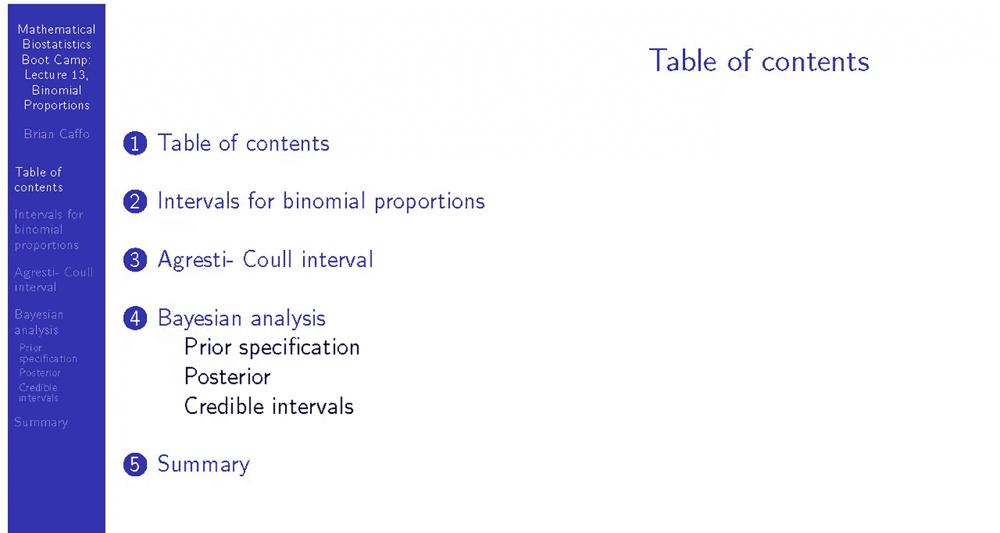
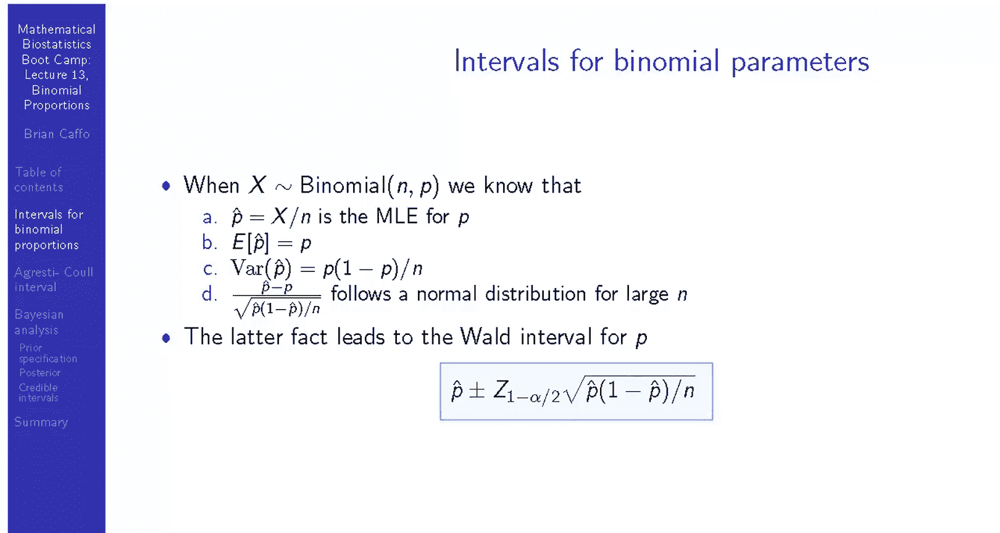
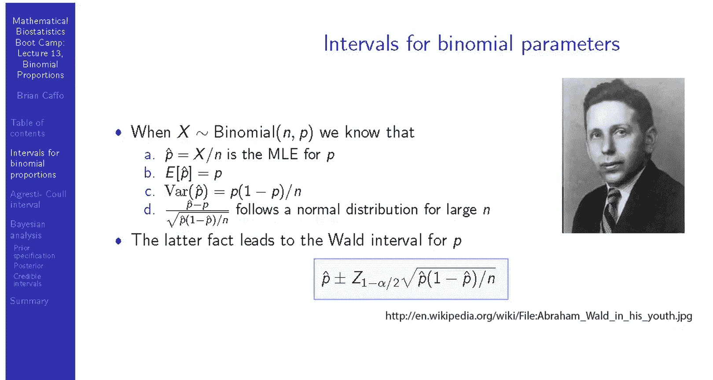
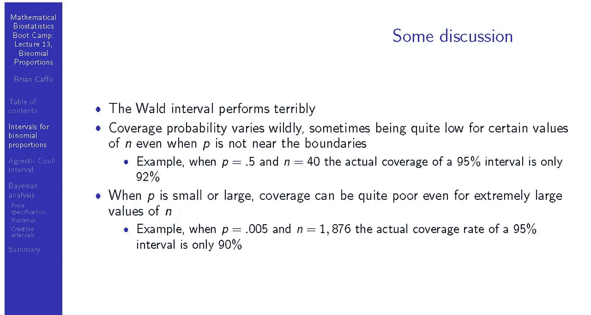
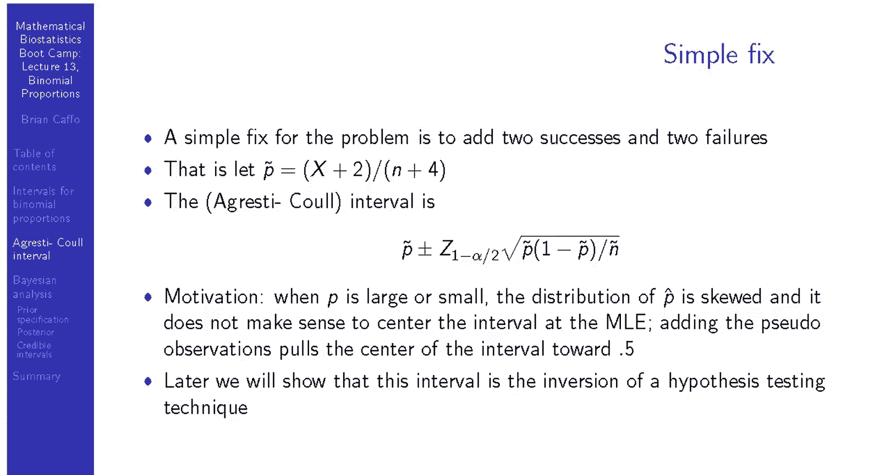
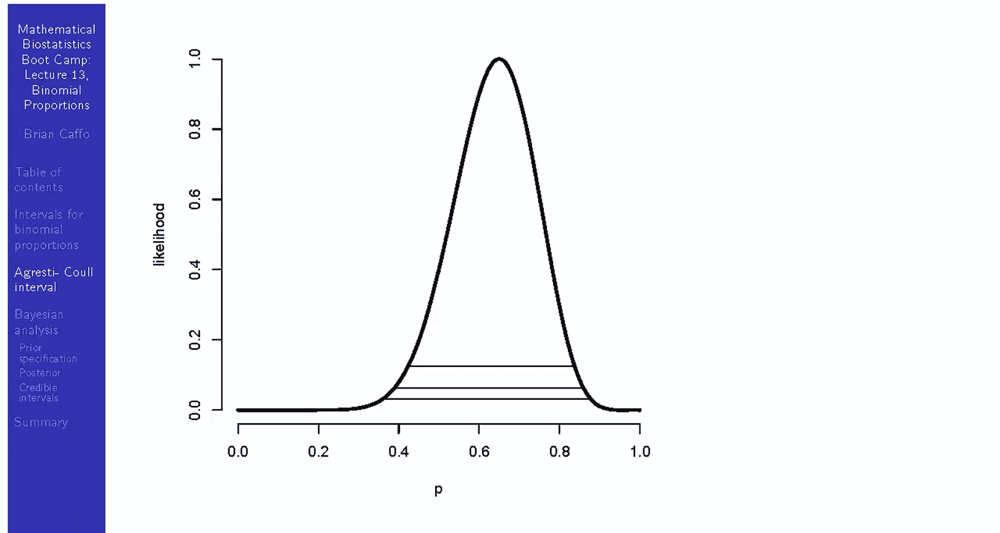
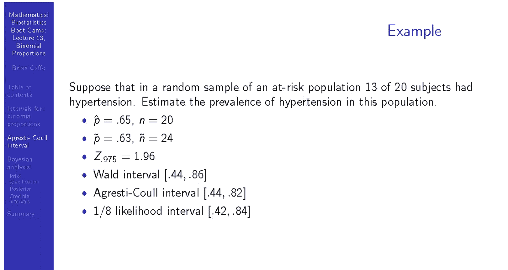

# 数据科学的高级统计：13：二项比例推断 🎯

在本节课中，我们将学习如何使用频率学派的置信区间方法来估计二项比例。我们将探讨标准方法存在的问题，介绍一个简单的修正方案，并以此为契机，初步了解贝叶斯分析在估计硬币投掷成功概率中的应用。

## 标准置信区间（Wald区间）及其问题

上一节我们介绍了二项分布的基本概念。本节中我们来看看如何为二项比例构建置信区间。

当变量 **X** 服从二项分布，即 `X ~ Binomial(n, p)` 时，我们已知以下几点：
*   最大似然估计量是样本成功比例：`p_hat = X / n`
*   该估计量是无偏的：`E[p_hat] = p`
*   其方差为：`Var(p_hat) = p * (1 - p) / n`
*   根据中心极限定理，对于大样本量 **n**，标准化统计量 `(p_hat - p) / sqrt(p_hat * (1 - p_hat) / n)` 近似服从标准正态分布。

基于此，我们可以构建一个置信区间，其形式为：
`p_hat ± Z * sqrt(p_hat * (1 - p_hat) / n)`
这个区间被称为 **Wald区间**。

然而，Wald区间存在一个显著问题：它在有限样本下的覆盖概率表现很差。即使渐近地看，其覆盖率能达到95%（当α=0.05时），但对于特定的样本量 **n**，尤其是当真实比例 **p** 接近0或1时，实际覆盖率可能远低于名义水平。例如：
*   当 `p = 0.5`， `n = 40` 时，一个名义95%的区间实际覆盖率仅为92%。
*   当 `p = 0.005`， `n = 1876` 时，名义95%的区间实际覆盖率仅为90%。

## Agresti-Coull区间：一个简单的修正方案

由于Wald区间表现不佳，我们需要进行修正。以下是几种修正方法之一，它非常简单有效。

其核心思想是：在数据中“添加”两次成功和两次失败，然后基于这个调整后的数据构建区间。具体步骤如下：
1.  计算调整后的估计值：`p_tilde = (X + 2) / (n + 4)`
2.  构建区间：`p_tilde ± Z * sqrt(p_tilde * (1 - p_tilde) / n)`

这个区间被称为 **Agresti-Coull区间**（有时也称为Wilson得分区间）。这种调整的启发式动机在于，当 **p** 接近0或1时，`p_hat` 的分布是高度偏斜的，将区间中心向0.5方向“收缩”是合理的。后续我们也会看到，这个区间与贝叶斯后验区间有联系。

## 实例分析：高血压患病率估计

让我们通过一个例子来比较这些区间。

假设在一个高危人群中，随机抽取20名受试者，其中13人患有高血压。我们想估计该人群的高血压患病率 **p**。
*   `p_hat = 13 / 20 = 0.65`
*   `n = 20`
*   对于Agresti-Coull区间：`p_tilde = (13 + 2) / (20 + 4) = 15 / 24 ≈ 0.63`， `n_tilde = 24`
*   标准正态分布的97.5%分位数 `Z = 1.96`

以下是不同方法得到的95%置信区间：
*   **Wald区间**：`0.44 到 0.86`
*   **Agresti-Coull区间**：`0.44 到 0.82`
*   **似然区间**：`0.42 到 0.84`

在这个例子中，各种方法给出的结果大致相同。

## 似然函数可视化

下图展示了参数 **p** 的似然函数曲线，并绘制了1/8、1/16和1/32似然参考线。我们可以看到，似然函数在最大似然估计值 `p_hat ≈ 0.65` 处达到峰值，这直观地反映了我们估计 **p** 时的不确定性范围。

## 总结

本节课中我们一起学习了二项比例推断的频率学派方法。我们首先回顾了基于中心极限定理的标准Wald置信区间，并指出了其在有限样本下、特别是真实比例接近边界时覆盖率不佳的问题。接着，我们介绍了一个简单有效的修正方案——Agresti-Coull区间，它通过“添加”两次成功和失败来改善区间性能。最后，我们通过一个估计高血压患病率的实例，比较了不同区间估计方法的结果。这些内容为我们后续理解贝叶斯分析方法打下了基础。