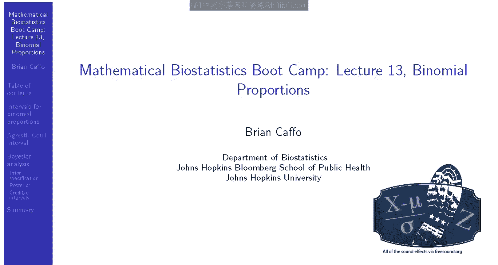
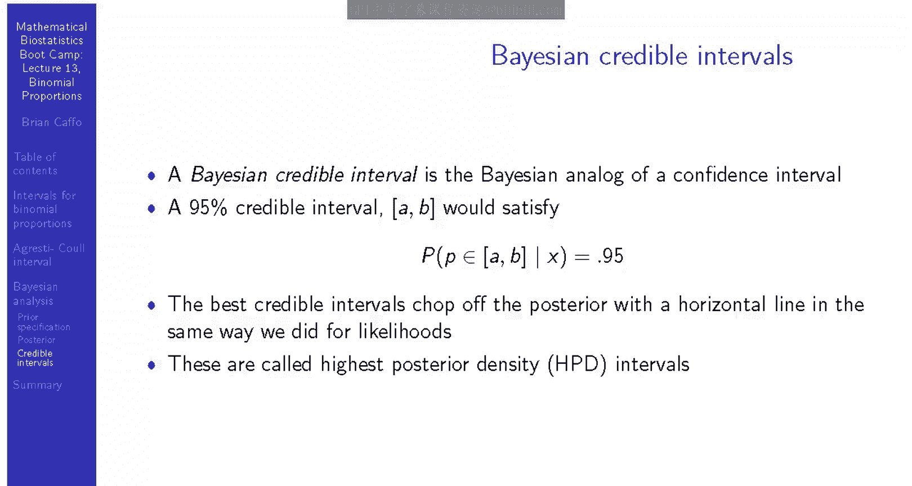
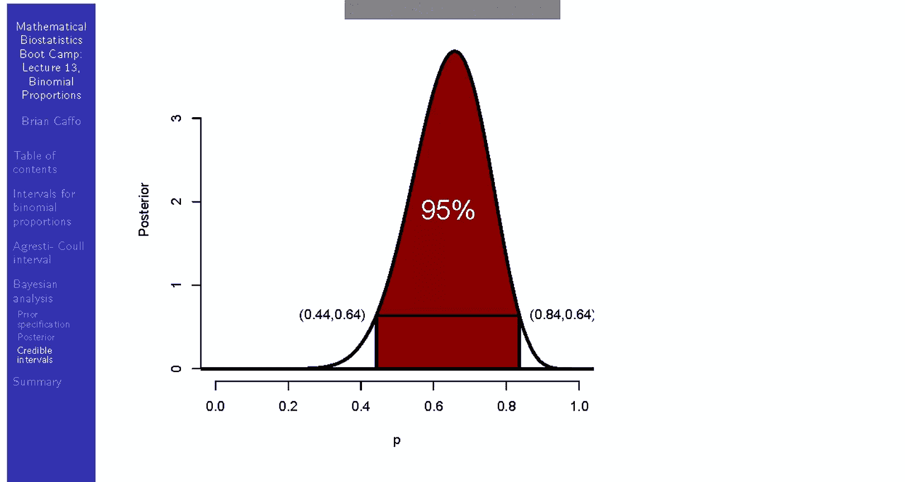
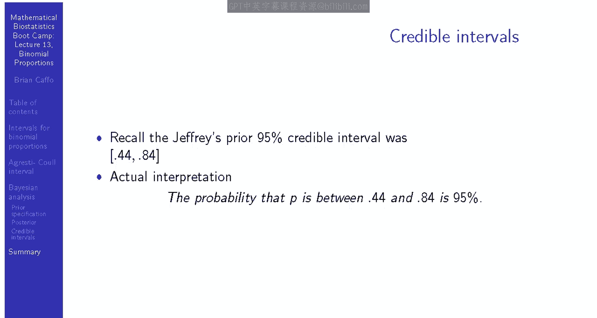

# 约翰霍普金斯大学《数据科学的高级统计｜Advanced Statistics for Data Science》中英字幕（deepseek p29 28_二项比例推断B部分.zh_en -BV1htPjeYEFH_p29-

So this problem is particularly useful for motivating socal Bayesian analysis and we've spent a lot of time in this class talking about frequentist analysis in the form of confidence intervals。

 and we've spent a fair amount of time talking about the likelihood。

 probably more time devoted to the likelihood than most introductory statistics courses do。

 so we need to give at least some time to talk about Bayesian statistics。

 So here's how Bayesian statistics works。 So Bayesians have to pose it a prior on the parameter of interest。

 The prior is a density or mass function。 It's a probability distribution on the parameter where the probabilities。

 at least in the classical Bayesian sense represent our beliefs about that parameter。

And then the likelihood is the component of the Bayes equation that depends on the data。

 the objective part， and then the posterior we're going to obtain as the likelihood times the prior。

 So this is exactly like if you remember back when we were thinking about diagnostic test。

 we had say， for example， some prior belief that a person had the condition that the test was trying to diagnose。

 We have the data， which is the result of the test。

 and the posterior odds of the person having the disease or whatever the test is testing wound up being related to the likelihood ratio。

Times the prior odds。 And so there's the same exact sort of relationship here。

 Posterior equals likelihood times prior。 Now I have to put a proportional two sign here because it's not exactly equal to。

 We're off by a constant of proportionality， but it's easiest to think of as this way。

 We take our likelihood。 We multiply it by our prior， and we get our posterior。

The rub in Bayesian statistics， Bayesian statistics is a very neat and conceptually clean way to think about statistics。

 The rub is really in here specifying the prior。 That's where we get into trouble in Bayesian statistics。

 And we'll talk maybe a little bit about that。 But mostly in this class。

 we're just going to talk about the mechanics of how you go about performing a Bayesian inference。

 And then you can take later classes to delve into the specifics of all the different ways in which Bayesians can think about doing analysis。

So let's talk about how we can specify a prior for our binomial proportion。

So remember our binomial data is discrete， it can take only values between 0 and n。

 but the proportion that we're trying to estimate is a number that let's say we're going to treat as if it's continuous。

So if we're going to specify a probability distribution on that parameter。

 it's going to have to be a continuous distribution。

So we need a continuous distribution that's bounded from below by 0 and bounded from above by1。

 And ideally， it would be a nice distribution that's easy to work with。 Well。

 there is one such distribution。 It's called the beta distribution。

 So the beta distribution winds up being kind of a default prior for binomial proportions。

 and the beta density depends on two parameters。 Al and beta don't confuse the alpha here from the alpha earlier on in the lecture that was related to the coverage rate of the confidence interval。

 So it depends on two parameters， Al and beta and the beta density looks like this。

 It's this so called gamma function， gamma of alpha plus beta divided by gamma of alpha times gamma of beta and then p raised to the alpha 1 times1 minus p raised to the beta -1。

 And here P is allowed to range between 0 and 1。 This constant term out front gamma of alpha plus beta divided by gamma of alpha times。

Samma of beta。That's simply the constant proportionality that you have to obtain to get this integral integral p to the alpha -11 minus p to the beta -1 to integrate to 1。

 So you had some problems very early on in the class where if you had a kernel of a density In this case。

 P to the alpha -11  p to the beta -1 that had a finite integral。

 What you had to do was divide that function by its integral over the whole range of values and you get a proper density。

 and that's exactly what people did。To get the bed density。So here is this density。

 It does integrate to one。 and maybe it's a little bit beyond the scope of this class to verify that it integrates to one。

 So let's talk about some of the properties of the beta density。

 So the mean of the beta density is alpha over alpha plus beta。 And remember。

 alpha and beta are positive。So alpha over alpha plus beta has to be a number between 0 and 1。

 So we're good that the mean of the density lies in the range of values for which the density is greater than 0。

The variance of the density works out to be alpha times beta divided by alpha plus beta squared to alpha plus beta plus 1。

And we've seen special cases of the beta density before。

 take the special case when alpha equals beta equals beta equals 1。

 well then pta the alpha minus11 minus pta the beta minus1。

 that all just goes away and this density is just a constant between 0 and 1 and we may not know what the gamma function of alpha plus beta over gamma of alpha times gamma of beta is。

 but you don't need to because you know that the density is a constant density between 0 and 1。

 it has to be exactly the uniform density then so the uniform density is exactly a special case of the beta density。

Here on the next slide， I plug in a bunch of different values of alpha and beta。

 and I show you the shape of the uniform density。 So if I plug in alpha equal to beta equal to 0。5。

 then I get something that looks like a U shape and it heads off to infinity height of infinity at both the0 as it heads towards 0 and 1。

 If allks 0。5 and beta equals 1， it looks like this shape right here。

And then as beta gets larger and larger， the rate at which it drops down to 0 as P approaches 1 gets faster。

And then of course， it just reverses itself if beta is 0。5 and alpha is 1 or alpha is 2。Again。

 here's the uniform distribution when alpha and beta are both one。

 If you plug in an alpha of 1 and a beta of 2， you just get a line pointing downward。

 If you plug in an alpha 2， beta of 1， you get a line pointing upward。

 probably the most kind of typical looking cases of the beta is when alpha and beta are both greater than 1。

 and then you get a hump shapeped density if they're equal， it's centered right at 0。

5 and as alpha beta get bigger and bigger， it gets more peaked around 0。5。

 but by allowing alpha to be bigger than beta or beta to be bigger than alpha。

 you can get this to be a distribution that's skewed towards 0 or skewed towards one。

So you can get quite a few shapes from the beta density by playing around with alpha and beta。

 so if you're a Bayesian， what you need to do is you need to pick values of alpha and beta that represent where the shape of the density represents your beliefs about the parameter P。

 and then once you do that then you can start doing Bayesian analysis。So here on the next slide。

 we need to choose values of alpha from beta so that the beta prior is indicative of our degree of belief regarding P in the absence of data。

 and then we're going to use the rule that the posterior is the likelihood times the prior。And again。

 because we're talking about constants of proportionality。

 we'll throw out anything that doesn't depend on P。So in this case。

 the posterior is proportional to the likelihood which is p to the x1 minus p to the n minus x and here when I say proportional to。

 I mean proportional to in the parameter p， so p to the x1 minus p to the n minus x。

 that's the likelihood， and we throw out the binomial constant n choose x because that doesn't depend on p。

And then we have p to the alpha minus11 minus p to the beta minus1。

 and we threw out the ratio of gamma functions because that doesn't depend on P。

Then we multiply those together and we get p to the x plus alpha 1。

1 minus p to the n minus x plus beta -1， and the posterior is a density that has this form。

 Now we know it's proportional of that。But remember， it's proportional to that。 But look。

 this density that we see here is exactly just a beta density， right， It's p raised to some power -1。

1 p raised to another power -1。 In fact， the alpha is just now x plus the prior alpha。

 and the beta is just the number of failures plus the prior beta。

 So we can even tell you what the ratio gamma functions you would have to have to make this posterior proper density to normalize the posterior。

 But we don't need to do any calculations or integrals to do that。

 We can do that just by looking at it and saying， oh， well， if I take a binomial likelihood。

And multiply at times a beta prior and think of that as a posterior density。

Then that posterior density has exactly the form of the kind of core part of a beta density so that I know that it's a beta density。

So if the posterior is a beta density with parameter alpha tilde equal to x plus alpha and beta tilde equal to n minus x plus beta。

 we know lots of its properties。As an example， we know what the posterior mean is。

 So what do I mean by posterior means。 So the posterior is the distribution of the parameter given the data Right the likelihood is the probability of the data given the parameter。

 The prior is the probability of the parameter disregarding the data。

 So the posterior winds up being the probability of the parameter given the data So we can calculate as an example。

 the expected value of the parameter p given the data， and because p is in the posterior。

 a beta density， this works out to just be the expected value of a beta distribution。

 which we learned earlier as being the alpha parameter divided by alpha plus beta。 So in this case。

 it's alpha tilde divided by alpha tilde plus beta tilde。 Well。

 let's just plug n alpha tilde equal to x plus alpha， and beta tilde equal to n minus x plus beta。

And here I do some manipulations and show that you can get down to the point where it works out to be x over n times n divided by n plus alpha plus beta plus alpha over alpha plus beta times alpha plus beta divided by n plus alpha plus beta。

 which is a mouthful， but let me go through each term。X over n is the sample proportion。

 It's the MLE。 It's P hat。 So x over n is P hat。 Let's take this second term n over n plus alpha plus beta。

 That's a number that has to be between 0 and 1 because n is positive and alpha and beta are positive。

 So we have n divided by something that's bigger than n。And then notice。

 okay so we have this number that's between 0 and 1， let's call it pi。

 and then alpha over alpha plus beta is the prior meanme。Okay， and then this term right here。

 Al plus beta over n plus alpha plus beta。 you can check yourself。

 That's one minus pi where we defined pi just a second ago。

 So this equation works out to be an average of the M E and the prior mean。 Okay。

 now it's not an average in the sense that it's 0。5 on both things， right， It's a sial average。

 So pi can be between 0 and 1。 and then hence one minus pi is the opposite。

 but that's exactly an average。 It's an average of the Mle。So let me try to state that in English。

The posterior mean is the average of the MLe and the prior mean。

Now the average is a very specific kind of average。

 where it weights the MLLE different than the prior meme， so let's look at these weights。So here。

 let's suppose n is really big。Then what happens to n over n plus alpha plus beta Well this term pi gets very big。

 gets much closer to 1， and hence1 minus pi gets much closer to 0。 So then when n is very big。

This mixture weights the ML L E a lot more than it weights the prior mean， in other words。

As you collect more data， your prior means less， and the data means more。What happens。

 on the other hand， as alpha and beta get very big and n remains constant。

Was Al and beta get really big？Then we get alpha plus beta over n plus alpha plus beta。

 This one minus pi part goes to1。 that gets very big。 So1 minus pi gets very big。

 and pi gets very small。 So what happens as alpha beta get big。

 What does that mean in terms of our prior。 Well， if you remember back from a couple of slides ago。

 the shape of the beta density as alpha beta got bigger and bigger。

 the shape of the beta density got more concentrated around the mean。

 And what that entails is that it's saying that our prior belief was a lot more confidence in a specific value of P。

 And so what that implies is if we're incredibly certain in our prior than that swamps the data。😊。

Right， if we're incredibly certain in our prior that swamps the data。

 our Emily has very little weight， and our prior has a lot of weight。

 And this actually explains a lot of politics for you， for example， right， So here。

 your opinion is a mixture of the data and your prior beliefs。

If you're immovable off your prior beliefs， then it doesn't matter how much data you collect， right。

 On the other hand， of course， if you're in this case， if your alpha beta are quite low。

 then you wind up that the MLE dominates the posterior mean。

So let me just rehash this because it's an important point。

 The posterior mean is a mixture of the MLE P hat and the prior mean as pi goes to one is n gets large。

 and for large end， the data swamps the prior in the MLLE dominates。For small N。

 then the prior mean dominates。 So when you have very little information。

 you rely on your prior knowledge。The idea behind Bayesian statistics is that it should sort of generalize how science is ideally working as data becomes increasingly available。

 prior beliefs should matter less and less。And then again， a prior that is degenerate at a value。

 so as alpha beta go to an infinity， you wind up with a prior that is 100% on a specific value of P。

 then no amount of data can overcome that prior。So let's also look at the posterior variance。

 the posterior variance takes a nifty form as well。 So let's look at the variance of P。

 the posterior variance given the data， so P in absence of the data was beta with parameters。

 alpha and beta P given the data via the Bayesian calculation was also from a beta distribution with parameters。

 alpha tilde and beta tilde。So we can just calculate the variances directly the variance from a beta with alpha tilde and beta tilde plugged in for alpha beta。

 and here you see I plug in for alpha beta x plus alpha for alpha tilde and n minus x plus beta for beta tilde。

 and you get this form。So let me let p tilde equal x plus alpha over n plus alpha plus beta and n tilde equal n plus alpha plus beta。

 then you wind up with the variance of p given x works out to be p tilde1 minus p tilde divided by n tilde plus 1。

 which is interesting because it's not quite but very similar to the binomial variance。

 the binomial variance being p times 1 minus p over n。

And so the sample binomial variance would be P hat1 minus P hatAT over n。

 so it's an awful lot like that。So it takes this very， very convenient form。And in fact。

 let's go back to an earlier point if alpha and beta were both two。

Then the posterior mean works out to be P tilde x plus 2 divided by n plus4。

 and the posterior variance works out to be p tilde 1 minus p tilde divided by n tilde plus1。

 So this is exactly the sample proportion that we used in the agress d cool interval。

 And the posterior variance is almost the same with the exception of this plus1。

 So what's a plus one among friends。 So we'll just say it's roughly the same variance as the agress d cool interval。

 So this is one way to motivate the agress d cool interval。 It is centered at the posterior mean。

 And its standard error is not exactly but almost the posterior variance。

 So you could view it as a normal approximation to a posterior interval。

 And so that's one way to motivate the a d cool interval is just to say alpha and beta equals 2 from a Bayesian analysis。

 and you get something that's very， very similar。So let's go back to our previous example and just do some of the baesing calculations。

 Let's say x equals 13 and n equals 20。So now let's consider a uniform prior alpha equal beta equal1 in that case the prior is just1。

 a constant between 0 and 1。 what's interesting in this case about the uniform prior is that the posterior is equal to the likelihood right because you have posterior equals likelihood times prior in this case the prior is just a constant one so the posterior equals the likelihood now you can't always get away with doing this。

This is particular to the fact that the parameter that we're interested in is bounded between 0 and 1。

 For example， if your parameter was anything between minus infinity and plus infinity。

 you can't put a prior of1 on that and have a finite integral。Now， people have looked into that。

 actually， and they said， well， maybe you can do it。 And that's for parter classes。 For this class。

 it's kind of nice to note that in this case， if we set alpha equal to beta equal to 1。

 we get a proper density， exactly a uniform density。

 and our posterior is exactly equal to the likelihood， which is interesting。

 If instead we were to set alpha equal to beta equal to 2。 Remember。

 this prior just looks like a hump right at 0。5， then the posterior works out to be p to the x plus 11 minus p to the n minus x plus1。

😊，And so the very classical way to do Bayesian analysis is you say that the prior is sort of governed by expert knowledge。

 And the likelihood then， is， of course， the objective part that's governed by the data。

 And of course， say that it's the objective part is a little bit misleading。

 because someone had to subjectively elect to model the data as if it's binomial。 So there is。

 of course， of subjective part to the likelihood itself。 But you know， let's put that aside。

 We have the supposedly objective part。 In the likelihood。

 We have the subjective part in the prior and then the posterior is the mixture of how you update your subjective beliefs with your objective prior knowledge。

 That's the kind of classical Bayesian inference。 But people said， well， it's in many cases， many。

 many cases。 people don't want statistics that depend on expert opinions to start with。

So this idea of a subjective prior is really just not palatable to the idea of science。

 So then Bayesians went back and thought hard about it。 And they said， well。

 maybe we can come up with priors that are sort of go to priors for us。

 things that we can just use where we don't have to think about how to specify the prior。

 so called objective priors。And because of that， the collection of Bayesian techniques then sort of ballooned into a variety of different ways of thinking about how to be a Bayesian。

 The only thing in common they have is that they utilize the Bayesian machinery that the posterior is equal to the likely at times the prior。

 But then they have lots of different ways of thinking about it。

 And one way of thinking about is the socalled Jeffrey's prior where people said， well。

 maybe we could pick a prior that has these specific mathematical properties。

 And for this particular problem。 the Jeffreyries prior sets alpha equal to Bay equal to 0。5。

 The uniform priors， another nice one that somewhat objective， because you could say， well。

 why don't we put a constant prior。 that way， the likelihood is the posterior that seems pretty objective to me。

 There are problems with doing that。 The point is， is that uniformity on one scale is not uniformity on another scale。

 So it's the fact that the prior's uniform for P means that it's not uniform for P squared。

 for example， you calculate the distribution of P。Sd it's no longer uniform。

 So a uniform distribution doesn't adequately represent absence of belief。

 The The problem with that is there's no probability density that measures absence of belief about a parameter if if you've written down a density。

 You've specified belief， you've completely characterized its probabilistic behavior。

 So these are a very technical problems with Bayesian analysis。

 And they all kind of revolve around how in the world do we set this prior。 But in this case。

 I think people would say the uniform prior seems pretty reasonable。

 that Jeffrey's prior seems pretty reasonable and putting a prior that's humped at 0。

5 because you know shrinking everything towards 0。5 also seems pretty reasonable。

 all those things don't seem so bad。 And the benefit is， no matter what you choose。

 someone else could pick a different prior as long as you gave them the likelihood。

 someone else could pick a different prior than you。

 So the idea that you could just pass around the likelihood and everyone could pick their own prior is also quite palatable way to do。

Baesian inference。So I'm going to go through some pictures just to show you。

 and I fudged a little bit。 I'll tell you how I fud a little bit on the pictures。

 So here I normalized everything so that it's one。 But then here in this first one， the problem is。

 is that the prior heads off to infinity near 0 and near1。 So if I were to normalize it。

 I'd just get a。I can't divide by infinity， so I。I fudged a little bit。

 So this U shaped curve looks different than the U shaped curve that I'm plotting here。

 So in order to get it on the same plot。 I fudged a little bit。 So if you try and do this。

 you'll see how I fudged。 But okay， so the U shaped curve isn't to the right scale。

 but I put it on the same scale as the posterior and the likelihood， which both of those。

 I normalize。 So its peak was at one。 So the blue is the prior in this case。

 the Jeffreys prior to alpha equal to beta equal to 0。5。 the green is the likelihood。

 And the red is the posterior。 So you see what happens when you multiply the green times the blue and then renormalize。

 you get a red curve that looks an awful lot like the likelihood。 So in this case。

 the Jeffreys prior doesn't move us off our likelihood very much。 And the posterior inference。

 which is entirely based on this red curve is pretty much exactly identical to the likelihood。Then。

 of course， on the next slide。If。🤢，The prior is completely flat。

 the posterior and the likelihood are identical， so there is no green curve in this case it's exactly underneath the red curve。

Now， let's look at alpha equal be equal 2。 Then my prior is this hump shape at 0。5。

 You can see that my likelihood is the green shape and my posterior is the red shape。

 And you can see it's ever so much shifted towards 0。5。

 So the red shape is the mathematical compromise between the knowledge codified by my blue prior and the objective part codified by the likelihood。

 Again， I should put objective in quotes。Now let's make it more extreme to kind of show you what's happening。

 let's put alpha equal to 2 and beta equal to 10。And then the blue curve gets shifted a lot towards 0。

 as beta gets much bigger than alpha， the prior becomes more pushed up towards 0。

 as alpha becomes much bigger than beta， it becomes pushed up towards one。

And then as if alpha beta equal and they get larger and larger， gets more peaked around 0。5。

 So anyway rate now we're all pushed up towards 0。And you can see here we have the blue curve is the prior pushed up towards zero because beta is much larger than alpha。

 and it has a finite maximum because both of them are bigger than one。

And then we have the green likelihood， which has been constant through every one of these pictures。

 And then we have the red posterior， which is the compromise between the evidence represented by our data and the assumed likelihood and our blue prior。

 which represent our knowledge。 our prior knowledge。

 And so the red curve is the appropriate mathematical compromise between these two opposing positions。

 In this case， let's say you had a prior belief that prevalence of hypertension was very low。

 You thought it was on the order of 01。Your data says no， no， no， it's very high。

 It's on the order of 0。65， right。 And so your likelihood is that compromise to say， well。

 your data has moved me very far away from my prior towards the M E of 0。65。

 And that's how the mathematics works out。 And if as n goes to infinity， this green curve。

 The likelihood will get more and more peaked around whatever the true value is。

 and it'll just grab this red curve and pull it increasingly towards it。So what happens in politics。

 for example， while people have their blue curve is very spiked， right。

 they dead set in their opinions and no amount of data is going to move them off of it。

 So here is an example where a alpha equal to 100 and beta equal to 100。 What happens then。

 alpha be equals。 So the beta distribution centered at exactly 05。But as alpha beta goes to infinity。

 the variance of the beta distribution gets really small。 So our prior， we're quite sure。

 according to our prior， that beta is exactly 0。5。 So then we collect our data。

 And it says I don't think so。 Beta is not 0。5。 It's somewhere above 0。6 more likely， right。

 And then what happens to our posterior。 Our posterior says， well， I don't know。

 You are very sure I'm not I'm going to kind of ignore the data because of how sure you were。

 So this is， of course， the problem with extremely informative priors。 right。

 No amount of data is going to knock you off them here。

 The red curve almost overlaps with the blue curve。

So the red curve in the previous examples is the posterior。

 the posterior is the distribution of the parameter given the data in Bayesian statistics。

 that's everything if you give someone the posterior， that's it。😡。

You've given them everything that that's the summary of evidence as far as a Bayesian is concerned。

 But it's a curve。 It's hard to work with。 You can only look at it in graphs。

 And then if you have multiple dimensions， it gets even worse。So， you know we want to summarize it。

 well， one way to summarize that curve is by its mean， right， the associatedsociative mean。

 the posterior mean， another way to summarize it is by its variance， the posterior variance。

But we might want something analogous to a confidence interval。

 but a confidence interval is a frequentous property。

 It talks about supposed fictitious repetitions of experiments。

 That's not within the Bayesian ideology， really， So we need something that's analogous to a confidence interval for a likelihood。

 We had something that was analogous to a confidence interval。 We called it a likelihood interval。

 So the Bayesians created something and they called it a credible interval。

 So the Bayesian credible interval is just an analog of a confidence interval。

 So a 95% cent credible interval， A to B， just satisfies that the probability that the parameter lies in that interval。

 Given the data is 95%。😊，Really simple。 you know， if you believe in the Bayesian inference。

 higher values of the posterior represent kind of better supportive values of the parameter。

 So just like the likelihood， you're better off chopping off the posterior with a horizontal line and figuring out exactly what values of A and B that entails to force it to be 95%。

And that's called the highest posterior density interval。

 And I have a picture here where I kind of do that。 So if you can imagine this horizontal line。

 the red area would vary as we moved it up and down as we moved it down。

 the red area would get bigger and bigger as we moved it up and up。

 the red area would get smaller and smaller。 So you want to keep moving that horizontal line up and down until the red area is exactly 95% right。

 And this is a density。 So that would be the area under the curve is exactly 0。95。

 So once you hit that perfect point where it's exactly 0。95。

 then see where it intersects the curve and then drop down to the horizontal axis。

 and those two points are your A and B。 So the probability P lies between that A and B， is。

 of course， just the integral between those points。

 which is exactly the red area So you wind up with the credible interval。 In this case。

 it works out to be 044 to 084， which should be no surprise。

And in R， you can do that with the bynome package in this case， Bnome do Bays 1320。

13 successes 20 trials， and you have to do type equals highest。

 and that gives you the 95% credible interval and used a Jeffreys prior， as I said earlier。

 Bayesian credible intervals， even though they're constructed using Bayesian thinking。

 if you turn around and evaluate them with frequentest performance， they tend to perform very well。

 just like our a cool interval， which wasn't exactly a Bayesian confidence interval。

 but was close enough among friends， that actually has much better performance than the directly Ct constructed walled interval。

The other thing I want to mention before I go through the final bit of this lecture is that another way to create a conference interval would be to pick a to be the lower 2。

5th percentile of the posterior distribution and pick B to be the 97。

5th percentile of the posterior distribution and that would give you exactly a 95% interval。

 for example， but the posterior height of the lower point and the posterior height of the upper point would be different。

 So that is potentially a problem on the other hand， if you do the HPD interval。

 you got to vary this line， you have to solve a root equation to obtain them so it's a little bit annoying and finding the percentile interval。

 the so-called percentile interval， the lower 2。5th percentile and the upper 97。

5th percentile as an example to get a 95% credible interval is very easy So another way to construct a Bayesing credible intervals just to take the lower and upper percentile and run with it that way。

 I think you're better off doing the H。De generaler if you can。

So I want to end with one nice aspect of the Bayesian credible interval。

 if you're hardcore about these things。 So let me just say for a minute about what I mean by being hardcore。

 So probably many of you have taken an introductory statistics class。

 and probably many of you have seen the baffling interpretation associated with frequentest confidence intervals presented as a test question。

 And that is just you know kind of hardball frequent and it's accurate。

 know I don't want to criticize it it's accurate。 And so here is an example。

 we have a walled interval it works out to be 0。44 to 0。86。

 And let's assume that the 95% coverage of the walled interval is good enough。

 the CLT is kicked in in this case and we're fine。 and we're not worried about the mathematical performance of the confidence interval。

 we're interested in just the strict interpretation， assuming that the coverage is correct。

Then the fuzzy interpretation is that we're 95% confident that P lies between 0。44 to 086。

 but that's not the actual interpretation。 The actual interpretation is the interval 0。

44 to 086 was constructed such that in repeated independent experiments。

95% of the intervals obtained would contain P。 That's the actual confidence interval interpretation。

 It's this idea， performance frequency refers to frequency I。e。

 the definition of probability of being entirely entwined with。

Fictitious repetitions of experiments or， you know。

 lifetime batting averages for success probabilities and that sort of thing。

 That's what frequency interpretation is that the actual interpretation is。Almost exactly。

 no one interprets frequent as confidence intervals this way， because it's such a mouthful。

 Everyone just kind of thinks， well， my interval 0。44， a 。

86 is an interval that accounts for uncertainty at a kind of control rate of about 95 per cent where that control rate has a contextual meaning with respect to frequent as statistics。

 And， and I understand that， but I don't spit it out every time I interpret the confidence interval。

 Every now and then a confidence interval makes its way into the news。

 And news peoplele never interpret it right， because it's hard to interpret。

So the likelihood interval， let's go on to the next when the likelihood interval was 0。42 to 0。84。

 the 18 likelihood interval。And the fuzzy interpretation for the likely interval is that the interval 0。

42 to 084 represents plausible values of P here plausible defined by the eightfold likelihood ratio associated with the endpoints relative to the MLLE。

So， yeah， that's okay。 So the fuzzy interpretation is okay。

 It's no worse than the frequent as fuzzy interpretation。 But the actual interpretation。

 let's go through at the interval 0。42 to 0。84 represents plausible values for P。

 In the sense that for each point in the interval， there is no other point that is more than 8 times better supported given the data。

 Again， yikes， you know， this is a mouthful。 And， you know。

 anyone who constructs a likelihood interval is not going to interpret that way。

 They're going to say， you know， it's an interval。 it accounts for uncertainty。

 It's based on the likelihood。 The calibration is based on sort of 8fold likelihood ratios。

 And I understand what it means， but I don't spit it out every time I use the interval。

 The nice thing about the Bayesian interval is you could spit out the actual interpretation every single time you use it。

 because the interpretation is very easy。 So the Jeffreys 95% credible interval was 044 to 084。

 the actual interpretation is the probability that P lies between 0。44 and 。84 is 95% Full stop。

 So that's super easy。Now there's a lot loaded in this word probability here because it's the Bayesian version of the word probability that maybe not everyone would like to agree with and not everyone would like something that's more objective or something like that。

 But nonetheless， if you're willing to buy into the Bayesian way of thinking the simple interpretation of the credible intervals is quite nice。

 And this interpretation。Is you know if you see a confidence interval in the news or you present a confidence interval to people who have just a little bit of statistics。

 this is how they want to interpret confidence intervals。

And you can't say this statement for a frequentist interval。 The probability that P is between 。

4 and 。84 is 95%， because in a frequentest way of thinking the P is just a fixed parameter。

 It's either in the specific interval or not it's not random。 So the probability is either 0 or 1。

 I mean， if you're being a hardball frequentous， you can't make the statement。

 I've had you know people who have frequent as leaning， say， yeah。

 you can just go ahead and make the statement because frequentous intervals can approximate Bayesian intervals of sorts。

 And they're fine with that。 So I think in all the cases。

 the kind of fuzzy interpretation that all the intervals。 you know， they agree for one thing。

 And then second of all， all of them measure some amount of uncertainty associated with our point estimate。

 they're calibrated in some way in the likely interval you know calibrated relative to likelihood ratios and the frequentest interval calibrated relative to frequentish coverage rate and in the Bayesian interval calibrated relative to posterior coverage。

So that gives you a sense of Bayesian interval likely at an interval in frequent intervals for the exact same problem。

 this is an interesting area， Bayesian statistics is quite popular and it's a good thing to know about Bayesian statistics。

 even if you are a frequentist use of the Bayesian manipulations。

 frequently turns out to be a very good way to create say confidence intervals or hypothesis test。

 it's just a very useful way to think about statistics。Well， that's the end of today's lecture。

 And I hope you enjoyed it。 And if you're interested in reading about Bayesian statistics。

 there is tons of good stuff on the Web， and it's a very interesting area。 And I hope you do so。

 I look forward to seeing you next time for our very last lecture。😊。

The。

🎼。

🎼。