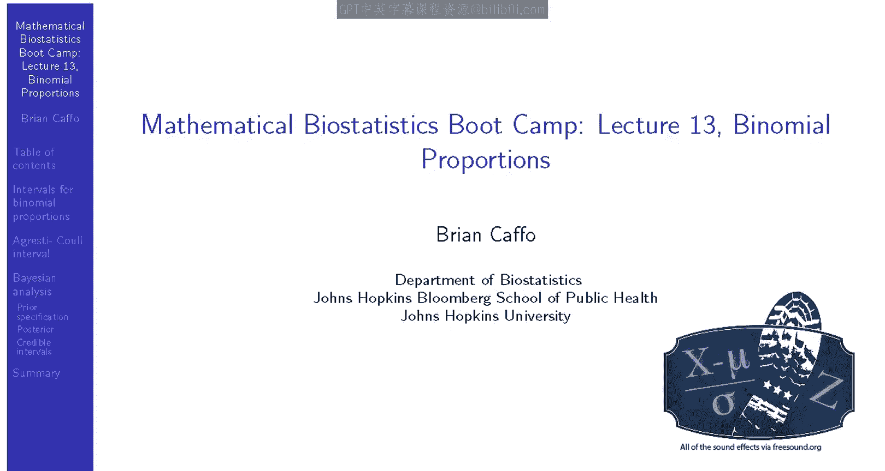
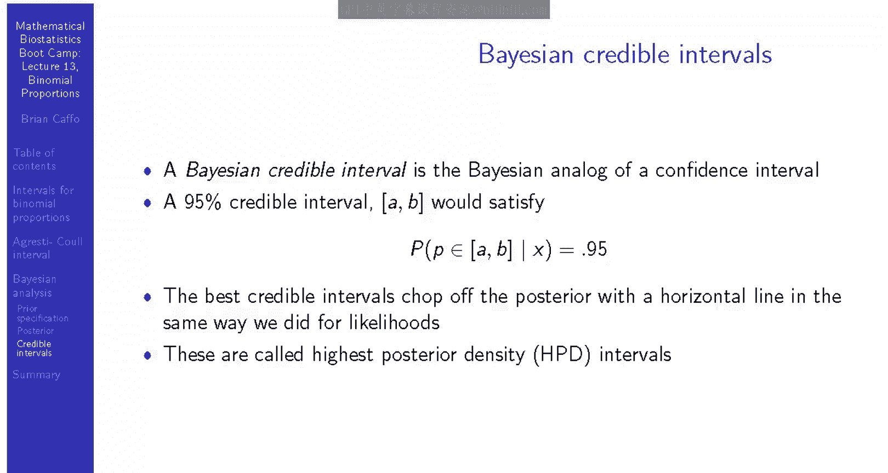
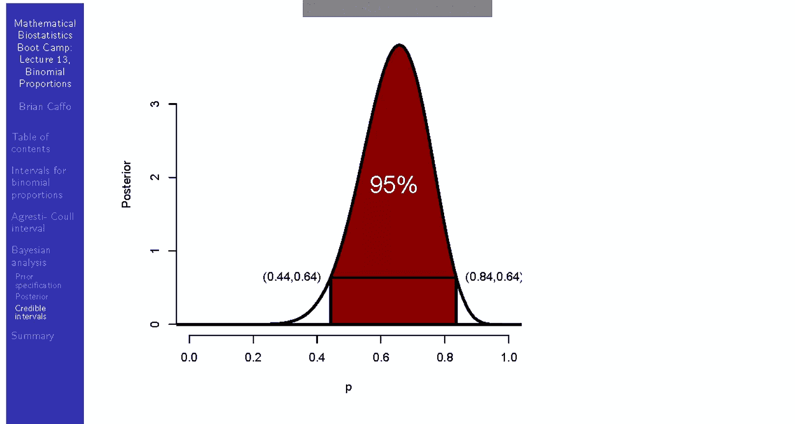
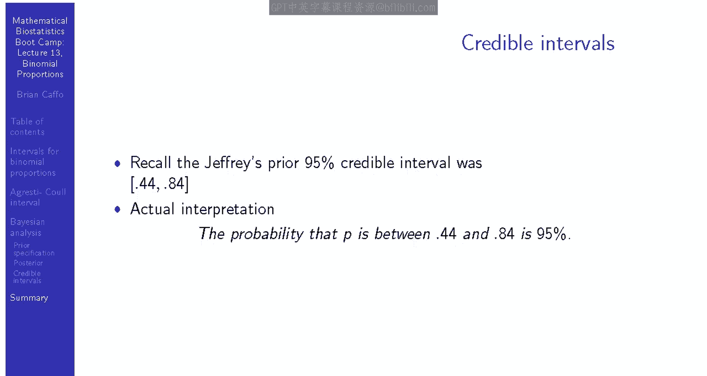

# 高级统计：P29：二项比例推断（B部分）



在本节课中，我们将要学习贝叶斯统计推断，特别是如何将其应用于二项比例问题。我们将探讨贝叶斯分析的核心思想、先验分布的选择、后验分布的计算，以及如何构建贝叶斯可信区间。

## 贝叶斯统计简介

上一节我们介绍了频率学派的置信区间。本节中我们来看看贝叶斯分析。贝叶斯统计对于推动社会科学的分析特别有用。我们在这门课上花了很多时间讨论频率学派的分析（以置信区间的形式），也花了相当多的时间讨论似然函数（可能比大多数入门统计课程花的时间都多）。因此，我们至少需要花一些时间来谈谈贝叶斯统计。

以下是贝叶斯统计的工作原理。贝叶斯学派需要为感兴趣的参数设定一个先验分布。先验是一个密度或质量函数。它是参数上的一个概率分布，其中的概率（至少在经典贝叶斯意义上）代表我们对该参数的信念。

然后，似然函数是贝叶斯方程中依赖于数据的部分，是客观的部分。而后验分布我们将通过似然函数乘以先验分布得到。这就像我们之前思考诊断测试时一样：我们有一个先验信念（例如，一个人患有某种疾病），我们有数据（测试结果），而这个人患病的后验概率最终与似然比乘以先验概率相关。这里存在完全相同的关系：后验正比于似然乘以先验。

这里我必须放一个正比符号，因为它并不完全相等，我们差一个比例常数。但最容易的理解方式是：我们取似然函数，乘以先验分布，就得到后验分布。

贝叶斯统计的难点在于指定先验分布。这是贝叶斯统计中我们遇到麻烦的地方。我们可能会稍微讨论一下这个问题，但在这门课中，我们主要讨论如何进行贝叶斯推断的机制。之后你可以选修其他课程来深入研究贝叶斯分析的各种具体方法。

## 为二项比例指定先验分布

我们的二项数据是离散的，只能取0到n之间的值，但我们试图估计的比例是一个我们将视为连续的数。因此，如果我们要为该参数指定一个概率分布，它必须是一个连续分布。

我们需要一个在0到1之间有界的连续分布，并且最好是一个易于处理的分布。确实存在这样一个分布，它被称为Beta分布。因此，Beta分布最终成为二项比例的一种默认先验。

Beta密度依赖于两个参数α和β（不要将此处的α与之前讲座中与置信区间覆盖率相关的α混淆）。Beta密度如下所示：

```
f(p | α, β) = [Γ(α + β) / (Γ(α)Γ(β))] * p^(α-1) * (1-p)^(β-1)
```

其中p的取值范围在0到1之间。前面的常数项Γ(α + β) / (Γ(α)Γ(β))只是为了确保积分∫ p^(α-1) * (1-p)^(β-1) dp 等于1而引入的比例常数。这就像课程早期的一些问题：如果你有一个密度核（例如p^(α-1) * (1-p)^(β-1)）且其积分有限，你需要做的就是将该函数除以其在整个值域上的积分，从而得到一个适当的密度函数。这正是人们得到Beta密度的方法。

以下是Beta密度的一些性质：
*   Beta分布的均值是 **α / (α + β)**。
*   Beta分布的方差是 **(αβ) / [(α+β)^2 (α+β+1)]**。

我们之前见过Beta分布的特殊情况。取α = β = 1的特殊情况，那么p^(α-1) * (1-p)^(β-1)项都消失了，这个密度在0到1之间只是一个常数。这就是均匀分布。因此，均匀分布正是Beta分布的一个特例。

在下一张幻灯片中，我插入了许多不同的α和β值，并向你展示了Beta密度的形状。通过调整α和β，你可以得到多种形状。因此，如果你是贝叶斯学派，你需要选择α和β的值，使得密度的形状代表你对参数p的信念。一旦你做到了这一点，你就可以开始进行贝叶斯分析了。

## 后验分布的计算

接下来，我们需要选择α和β的值，使得Beta先验能够反映我们在没有数据时对p的信念程度。然后我们将使用后验正比于似然乘以先验的规则。同样，因为我们讨论的是比例常数，我们将丢弃任何不依赖于p的部分。

在这种情况下，后验分布正比于似然函数p^x * (1-p)^(n-x)（我们丢弃了二项式常数C(n, x)，因为它不依赖于p）乘以先验分布p^(α-1) * (1-p)^(β-1)（我们丢弃了Gamma函数的比值，因为它不依赖于p）。将它们相乘，我们得到p^(x+α-1) * (1-p)^(n-x+β-1)。后验分布是一个具有这种形式的密度。

我们注意到，这里看到的密度正好就是一个Beta密度。实际上，新的α是x加上先验的α，新的β是失败次数(n-x)加上先验的β。因此，后验分布是一个参数为α̃ = x + α 和 β̃ = n - x + β 的Beta分布。

作为一个例子，我们知道后验均值。后验均值是给定数据后参数p的期望值。因为p在后验中服从Beta分布，这正好就是Beta分布的期望值，即α̃ / (α̃ + β̃)。代入α̃ = x + α 和 β̃ = n - x + β，经过一些推导，可以将其表示为：

```
后验均值 = (x/n) * [n/(n+α+β)] + [α/(α+β)] * [(α+β)/(n+α+β)]
```

这是一个加权平均。x/n是样本比例，即极大似然估计p̂。α/(α+β)是先验均值。因此，**后验均值是MLE和先验均值的加权平均**。

让我们看看这些权重。假设n非常大，那么权重n/(n+α+β)会非常接近1，而(α+β)/(n+α+β)会非常接近0。这意味着当数据量很大时，后验均值会更多地加权MLE，而先验均值的影响变小。换句话说，随着收集更多数据，你的先验变得不那么重要，数据变得更重要。

另一方面，如果α和β变得非常大而n保持不变，那么权重(α+β)/(n+α+β)会接近1。这意味着如果我们在先验中非常确定一个特定的p值（即先验分布非常集中），那么它会压倒数据。这解释了许多政治现象：如果你的先验信念非常坚定，那么无论收集多少数据，都很难改变你的看法。

## 后验方差与Agresti-Coull区间

后验方差也有一个简洁的形式。令p̃ = (x+α)/(n+α+β)，ñ = n+α+β，则给定数据后p的方差为：

```
Var(p | x) = p̃(1-p̃) / (ñ + 1)
```

这非常有趣，因为它与二项方差p(1-p)/n非常相似。样本二项方差将是p̂(1-p̂)/n。所以它的形式非常方便。

让我们回到之前的一个点，如果α和β都等于2，那么后验均值变为p̃ = (x+2)/(n+4)，后验方差约为p̃(1-p̃)/(ñ+1)。这正是我们在Agresti-Coull区间中使用的样本比例。后验方差几乎相同（除了分母的+1）。因此，这可以看作是Agresti-Coull区间的一种贝叶斯动机：它以贝叶斯后验均值为中心，其标准误几乎就是后验标准差。你可以将其视为后验区间的正态近似。

## 具体计算示例

让我们回到之前的例子，x=13，n=20，并进行一些贝叶斯计算。

首先考虑均匀先验（α=β=1）。在这种情况下，先验只是0到1之间的常数1。有趣的是，此时后验等于似然函数，因为后验正比于似然乘以先验，而先验是常数。但请注意，这只有在参数有界（如0到1之间）时才可能实现。

如果我们设定α=β=2，这个先验看起来像是在0.5处有一个凸起。那么后验变为p^(x+1) * (1-p)^(n-x+1)。

经典的贝叶斯分析方式是：先验由专家知识决定，似然函数是客观的（由数据决定），而后验则是你如何用客观的先验知识更新主观信念的混合。但人们常常不希望统计结果依赖于初始的专家意见。因此，贝叶斯学者提出了“客观先验”的概念，即无需思考如何指定的默认先验。



对于这个问题，Jeffreys先验设定α=β=0.5。均匀先验是另一个看似客观的选择（因为它使后验等于似然）。但均匀性在一个尺度上成立，在另一个尺度（如p²）上则不成立，因此它并不能完全代表“无信念”。这些是贝叶斯分析中非常技术性的问题，都围绕着如何设定先验展开。但在本例中，均匀先验、Jeffreys先验以及一个在0.5处有凸起的先验似乎都是合理的选择。好处是，无论你选择什么，只要给出似然函数，别人就可以选择不同的先验。这种传递似然函数、让每个人选择自己先验的想法也是进行贝叶斯推断的一种可取方式。

## 贝叶斯可信区间



后验分布是给定数据后参数的分布。在贝叶斯统计中，这就是一切。但它是曲线，难以处理。我们想要总结它。一种总结方式是其后验均值，另一种是后验方差。但我们可能想要类似于置信区间的东西。置信区间是频率学派的性质，谈论的是假想的重复实验，这不完全符合贝叶斯思想。因此，我们需要一个类似于置信区间的东西，贝叶斯学派称之为可信区间。

一个95%的中心可信区间[A, B]满足：给定数据，参数落在该区间内的概率是95%。这非常简单。如果你相信贝叶斯推断，后验的较高值代表了参数更好的支持值。就像似然函数一样，你最好用一条水平线切割后验，并找出使面积为95%的A和B值。这被称为最高后验密度区间。

在R中，你可以使用binom包来计算。例如，`binom.bayes(13, 20, type=“highest”)` 会给出95%的可信区间（使用Jeffreys先验）。有趣的是，贝叶斯可信区间即使是用贝叶斯思想构建的，如果用频率学派的性能来评估，它们往往表现得很好。

另一种构建可信区间的方法是取后验分布的2.5%分位数作为下限A，取97.5%分位数作为上限B，这将给出一个95%区间（称为分位数区间）。但此时下限和上限处的后验高度可能不同。而HPD区间需要解方程来寻找，稍微麻烦一些。分位数区间则非常容易计算。

## 区间解释的比较

最后，我们谈谈贝叶斯可信区间的一个优点。你可能在入门统计课上学过频率学派置信区间那令人困惑的解释。例如，对于一个Wald区间（0.44, 0.86），其模糊解释是“我们有95%的信心认为p在0.44到0.86之间”。但实际解释是：“区间(0.44, 0.86)是以这样的方式构建的：在重复的独立实验中，95%的这样构建的区间会包含p。”几乎没有人这样解释置信区间，因为它太拗口了。

似然区间（例如0.42到0.84，1/8似然区间）的模糊解释是：“该区间代表了p的合理值，这里‘合理’定义为端点相对于MLE的似然比不超过8倍。”实际解释同样拗口。

贝叶斯区间（例如Jeffreys 95%可信区间0.44到0.84）的优点在于，你每次都可以直接说出其实际解释：“p落在0.44和0.84之间的概率是95%。”这非常简单。当然，这里“概率”一词承载了贝叶斯世界观，并非所有人都同意。但如果你愿意接受贝叶斯思维方式，可信区间的简单解释是非常好的。这也是当人们在新闻中看到置信区间或向只有一点统计知识的人展示置信区间时，他们想要的那种解释。对于频率学派的区间，你不能做出这样的概率陈述，因为在频率学派看来，p是一个固定参数，它要么在特定区间内，要么不在，不是随机的。

在所有情况下，这些区间都提供了某种围绕点估计的不确定性度量，只是校准方式不同：似然区间相对于似然比校准，频率学派区间相对于频率覆盖率校准，贝叶斯区间相对于后验覆盖概率校准。

## 总结




本节课中我们一起学习了贝叶斯统计推断。我们探讨了贝叶斯分析的核心公式——后验正比于似然乘以先验，并介绍了如何为二项比例选择Beta先验分布。我们计算了后验分布及其均值与方差，了解到后验均值是MLE和先验均值的加权平均。我们还学习了如何构建和解释贝叶斯可信区间，并将其与频率学派的置信区间和似然区间进行了比较。贝叶斯统计是一个非常有用的领域，即使你是频率学派，了解贝叶斯方法也常常是构建置信区间或假设检验的有效途径。