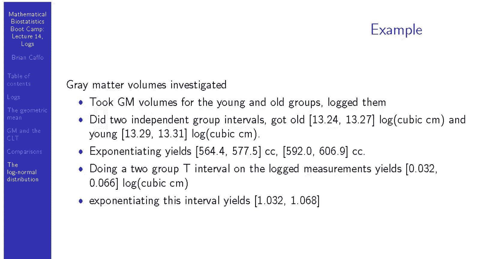

# 约翰霍普金斯大学《数据科学的高级统计｜Advanced Statistics for Data Science》中英字幕（deepseek p30 29_对数变换.zh_en -BV1htPjeYEFH_p30-

Hi， my name is Brian Caffho， and this is Mathematical Biosstatistics Boot camp Leture 14 on logs。

In this lecture， we're going to talk about what it means to log data and what impact that has when you do things like take arithmetic means of logged data and create confidence intervals and this sort of thing。

So we'll talk about logs， we'll talk about the geometric mean which is intrinsically related to taking logs of data and taking arithmetic means。

We'll talk about the geometric mean and its relationship with the law of large numbers in the central limit theorem。

 and then we'll go through some of the existing techniques that we've already gone through like creating T confidence intervals。

But just go over how they're interpreted with respect to log data。

And then we'll finish talking about the log normal distribution。

So just to remind everyone a little bit about logs。

 log based b of the number x is the number y such that b to the y equals x and log base B of 1 is always going to be0。

Because b to the0 is going to equal 1。 and then this log base B will always travel to minus infinity as x travels to 0。

And then you know for the class we've always been writing just log as when the base is E for Uer's number and sometimes people tend to write LN in that case。

 there's basically only three bases for logs that people ever use B E has a lot of nice mathematical properties。

 B 10 is nice because then log speaks of orders of magnitude right log basease 10 of 10 is1 log base 10 of 100 is two log base 10 of 1000 is3 and so on。

 and then log basease two is often very useful as well。Because it's a smaller number than 10。

 you get lower powers， it's often useful。 And just to remind everyone， log A B is log A plus log B。

 log A raised to the B powers B log A， and log A divided by B is log A minus log B。 In other words。

 log turns multiplication into addition division into subtraction and powers into multiplication。

So hopefully none of this is news to you。So that's sort of the mathematical properties of log。

 but statistically why do we take logs of data the most common reason to take a log of data is if the data is sort of skewed high and what I mean by that。

 for example， incomes are a great traditional example of things that tend to be skewed high you have a lot of people making very little money and handful of people making a lot of money and so that distribution looks like a hump towards zero and it spreads out with a long tail towards high values and sometimes people you might take logs of income data to try and make it look more bellshaped this occurs frequently in biostatistics。

 for example， health expenditures， a lot of people tend to spend very little on healthcare until healthcare becomes a problem then they spend a lot so distributions like healthcare expenditures and other things like that tend to be right skewed especially because they're bounded from below by zero in settings where errors are feasibly multiplicative when dealing in things like concentrations and rates。

Then it's natural to take logs because then it turns that multiplication into addition whenever you're considering ratios。

 it's useful to take logs because then instead you have differences rather than ratios and then if you're dealing with something where you're not so concerned about the specific number but more concerned about the orders of magnitude。

 say something like using log based 10 as an example if you're considering astronomical distances。

 you might be just more concerned with the orders of magnitude rather than the actual specific number then you might often take logs and then counts are often logged if your data are the number of say infections at a hospital or something like that you might log data like that。

 notice if you have lots of several counts and one of them zero then you have a problem with taking logs so you have to come up with some solution for that。

So。Let me talk a little bit about the geometric mean， the sample。

 I say the sample geometric mean just so we're using the same notation when we talked about the sample mean of data。

 the sample geometric mean of data set X1 to Xn is you take the product of the observations pi i equals1 to n Xi。

 and then you raise it to the 1 over n power。And notice if all the x's are positive。

 which is generally the case if you're thinking about geometric means。

 then the log of the geometric mean is then the arithmetic mean one over n summation log Xi。

 So it's the arithmetic mean of the loggged observations Okay so let me just repeat that the log of the geometric mean is the arithmetic mean of the log observations。

 So because the log of the geometric mean is the arithmetic mean of the log observations on the log scale。

 the geometric mean has all these properties that we already talked about associated with sample means sample arithmetic mean。

 So the log of large numbers applies and the central limit theorem applies。

 I have a parentheses here that says under what assumptions but under whatever the assumptions applied for the arithmetic mean to have the log of large numbers and the central limit theorem。

 the geometric mean， by the way， is always less than or equal to the sample or arithmetic mean as a just general property So let me just give you a quick。

Example of using geometric means in some domains， people use the geometric mean so frequently that when they talk about mean they're referring to the geometric mean。

 not the arithmetic mean。 So as an example， when what you're thinking about is inherently multiplicative。

 you would often think of the geometric mean。 So suppose that in a population of interest。

 the prevalence of a disease rose 2% one year。And then the next year it fell 1%。

 and then the year after that it rose 2%， and then it rose 1% again。 Well。

 if you' were thinking about what's the end prevalence of the disease after the starting prevalence。

 inherently you would multiply the starting prevalence times 1。02 times 0。99 times 1。02 times 1。

01 and you would get the ending prevalence。So the geometric mean of these collection of increases in decreases would be a relevant quantity to study。

 And so that geometric mean would be the product of them raised to the one fourthth power。

 And what's interesting about that， then is if you take the starting prevalence and you multiply at times 1。

02。991。02 and 1。01， you get the ending prevalence after the four years。

 If you take the geometric mean and multiply at times the starting prevalence four times you get the same number。

 So that's what the geometric mean is considered in the sense of the arithmetic mean。

 the arithmetic mean is the number you would have to add four times to get the same end result。

 the geometric mean is the one you have to multiply four times to get the same result。

 And that's why it's useful。 So if you're thinking about things that are inherently multiplicative like percent increases in decreases。

 then it's common to take the geometric mean。 So if you work in certain financial sectors。

 for example， if they say mean they are referring to the geometric mean because it's obviously more natural to talk about。

 so just。ash some of these points， multiplying the initial prevalence by 1。

01 to the fourth power and otherwise， multiplying at four times is the same thing as multiplying by the original four numbers in sequence。

 So 1。01 is the constant factor by which you would need to multiply the initial prevalence each year to achieve the same overall increase or decrease in prevalence over a fouryear period。

 take that in contrast to the arithmetic mean。 And that's the factor by which you would have to add to achieve the same total increase。

 And in this case， it's clearer to me， at least that the geometric mean makes a lot more sense than the arithmetic mean to talk about。

On the next slide， I was thinking about how to explain this。

 I Googled the geometric mean and the arithmetic mean。

 and I found this great example at the University of Toronto's website。

 and it has a really fun geometric interpretation of the arithmetic mean and the geometric mean。

 So if you have a rectangle and A and B are the lengths of the sides of a rectangle。

 then the arithmetic mean， A plus B over2 is the length of the sides of the square that has the same perimeter as the rectangle。

 The geometric mean a times B to the one half is the length of the sides of the square that has the same area。

 So if you're sort of interested in multiplicative things like areas you want the geometric mean of the sides。

 if you're interested in additive things like perimeters。

 you want the arithmetic mean So I thought that was really cool when I read that。😊。

So back to statistics， the log of the sample geometric mean is just an average and so provided the expected value of log x exists。

 then that average has to converge just by the log of the large numbers to what I'm defining here is mu equal to the expected value of log x so remember the log of the geometric mean is itself just an arithmetic mean。

 we have the log of large numbers which tells us what the arithmetic mean converges to it converges to the population mean。

 so therefore the log geometric mean converges to expect a value of log x where x is a draw from the original population on the natural unit scale not on the log scale therefore if you want to know what the geometric mean converges to the geometric mean is the exponential of the log of the geometric mean of course because E to the log x is x。

 so it would be nice if that worked out。To be expected value of x。

 but it doesn't because E to the expected value of log x。

 the exponent can't move inside this expected value。

 so we get something which I'm going to just call e to the mu is is exactly e to the mu and this is not expected value of x and this quantity E to the mu。

Which is the exponent of the expected value of log X。 It doesn't really have a name。

 but I like to call it the population geometric mean because you know if you have that the sample arithmetic mean converges to the population mean。

 the sample variance converges to the population variance。

 the sample median converges to the population median， then by that logic。

 the sample geometric mean should converge to something that's called the population geometric mean。

 so I'm going to call it that， I don't see that too often in books。

 but what the heck I'm going to do it。So to reiterate。

 the exponent of the expected value of log x is not equal the expected value of the exponent of log x。

 which is equal to e to the x， so what I'm referring to as the population geometric mean is not equal to the population mean that we defined earlier。

It is， however interesting to note that if the distribution of log X is symmetric。Which remember。

 that was one of the reasons at the beginning of the lecture we stated for taking logs of data is to turn skewed data to data that's more symmetric。

 then if the distribution of log X is symmetric， then consider the median。

 The median is the point where 0。5 is equal to probability that log X being less than or equal to mu。

 and in this case， because log X is symmetric mu， the mean on the log scale is in fact also the median。

 So this first statement 0。5 equal to the probability log X less or equal to mu is just reiterating the statement that for this distribution thats symmetric on the log scale。

 the mean and the median on the log scale are equal。

But now on the interior of this probability statement， we can because everything's positive。

And because the E function is monoonic， we can take an exponent on both sides of this inequality and get that the probability the X on the natural scale。

 not on the log scale， but X on the natural scale， the probability that X is less and or equal to E than you is also 50%。

 So the conclusion is that for log symmetric distributions。

 the geometric mean is estimating the median。 So why am I saying all this。

 I'm making fairly simple ideas rather complicated。 The idea is you have data， you log it。

 and you just do all the normal stuff you do with your data， youre just using it on log data。

 And what I'm trying to say is I'm trying to relate the quantities that you get from doing that。

 they have interpretations back on the natural scale。

 that's what we're trying to say you don't have to discard the natural scale units when you log data。

 you get a lot of interesting interpretations back on the natural scale。So any rate。

 if you use the central limit theorem to create a confidence interval for the log measurements。

Then your interval is estimating mu the expected value of the log measurements。

 the expected value of log X for log units。Then if you expentiate the interval。

 then you're estimating e to the mu， the population geometric mean as I'm calling it。

And then in the event， the distribution of the log data is itself symmetric。

 then your expentiated interval is also estimating the median。

 so this is kind of a backhanded way of getting a confidence interval for the median if you're willing to assume that your data is symmetric。

 the population from which your data is drawn as symmetric on the log scale then when you take the log of the data。

 create the confidence interval and then expentiate the endpoints。

 then you wind up with a confidence interval for the median and remember we also talked about getting a confidence interval for the median using bootstrapping but this is a lot easier。

 it just uses the ordinary T confidence interval。And then this is especially useful for pair data when their ratio is of interest。

 so let's just quickly go through an example。 So remember I quoted before this book by Rosner Fundamentals of bioosstatistics。

 which I like， it's very thorough and covers a huge chunk of biostatistical topics。

 any rate on page 298 of the version that I have， which unfortunately I think was the previous version than the current one。

It gives a paired design where it compares systolic blood pressure for people taking oral contraceptives and matched controls。

 and so paired design is where you have a person and you have a bunch of covariates that you're concerned with when you want to compare say oral contraceptive use to controls。

 you're worried that the group of people that take oral contraceptives are different than the group of people who don't take oral contraceptives so what you might do is you might take this list of things that you think might explain that difference and match on them so that the person taking oral contraceptive。

 they have a twin in a sense， in the control group that at least in soof far as the other variables that you can measure they're very close。

 that's this idea of matching。The matching to the extreme， you know。

 you couldn't do it in this experiment。 But imagine if you were investigating aspirin。

 you would give， say a person in aspirin。 and then after a suitable washout period。

 give them a placebo。 And then that person would be perfectly match to themselves as their own control。

 So that's the extreme version of this case。 But let's suppose you're in a circumstance like this where you can't really randomize people to contraceptive use。

 you couldn't do a crossover experiment like that。 So you could match people as closely as you could on all these other things that you think might differentiate contraceptive users from controls and match them as closely as possible。

 Anyway that's a match design。 But the point for our discussion is that person one who is in the oral contraceptive group and person one who's in the control group they are tied together。

 And so we want to utilize that information that they're similar。

So what we might do is take the blood pressure for person one from the oral contraceptive use and the sassog blood pressure from person one in the control group and analyze their ratios and so we might be interested in ratios because we just might be interested in the interpretation of well what percent increase in decrease does a person in the contraceptive group have over their associated controls so imagine if we took ratios and then logged the ratio well that would just be the log difference of the two measurements then we could just do an ordinary one sample t confidence interval for the log of the ratios done matched pair by matched pair and so in this case the geometric mean of the ratios works out to be 1。

04 which in this case the order in which I was dividing implied a 4% increase in cisag blood pressure for the oral contraceptive users and the T interval on the log scale so when I took。

Each an oral contraceptive user logged the control user。

 took the difference pair by pair I wound up with then end measurements where I started with two n total measurements each in pairs I had my end measurements on the log scale I did an ordinary T interval and I calculated it I got 0。

010 and 0。067 in this case the units would be in log millimeters of mercury。

What we're interested in on the log scale is whether zero is in this interval or not right zero is the important thing on the log scale If we expentiate the interval。

 we get 1。01 to 1。069 so an estimated via 95% confidence interval 1% to 7% increase in systolic bread pressure for the oral contraceptive users relative to the controls and so on the expentd scale we're interested in whether one is in the interval on the log scale we're interested in whether 0 is in the interval by the way。

 if your numbers are kind of small like in this case， 0。01 and 0。

067 expentiating is about like1 plus and if you're a math person you take the Tayloror expansion of E to the x and go out one term and you see that it's pretty close to 1 plus you can actually expentiate things very quickly but just by taking1 plus and then obviously if your number that you're looking at is pretty close to 1 and you want to log it。

 you can do 1 minus and say。take the tail expansion for log and go out one term you can see if the number is close to zero and you want to exponentiate at1 plus works pretty well as an approximation if the numbers pretty close to one and you want to log it one minus does pretty well as well that's a trick that's very useful like when you do logistic regression and things like this where you need to take exponents quickly。

So let me just talk about this example。 just a little bit more。 this estimate 1。01 to 1。07。

 this 1% to 7% estimated increase between the two groups。

 that is a confidence interval for this sort of paired ratio of geometric means。

 and that's why it's useful in that we're estimating a ratio here。

 So now let's just go through the same exact exercise。

 but instead of when we have paired observation and we have two independent groups。

 if you log the data from group1， log the data from group 2。

 create a confidence interval for the difference in the group means on the log scale and then expentiate then what your're estimating that confidence interval is an estimate of E to the mu 1 divided by E to the mu 2。

 that confidence interval is exactly an estimate of the ratio of the population geometric means。

 Of course， it's an estimate on the log scale of the difference。

the expected values on the mean on the log scale， but if you exponentiate it。

 then you get exactly an interval for the ratio of the population geometric means。

 and if you're willing to assume that the data is symmetric in the log scale。

 then this is also equal to a ratio in the population medians。

There's one distribution where take logs of things and they wind up as Gaussian is so important that we give it a name we call it the log normalmal distribution。

 and a random variable is log normally distributed if its log is a normally distributed random variable。

Note， it's not the log of a normal random variable， as its name kind of implies。

 you can't take the log of a normal random variable because those can be negative and you can't take the log of them。

So if you want to remember， what's a log normal random variable？Remember this phrase。

 I am log normal means take logs of me， then I'll be normal。

 and then you'll remember the correct order， but then also think when you're assuming what the log normal is。

 if you're taking the log of something that's possibly negative， then you're doing it wrong， okay。

So again， log normal random variables are not logs of normal random variables as I stay here。

 you can't even take the log of a normal random variable because it can be negative。So formally。

 x is log normal and it depends on two parameters mu and sigma squared if log of x is normal mu comma sigma squared。

 and again， that mirrors kind of what we're often doing with logs。

 we're trying to take logs of things。So that on the log scale。

 the data is symmetric and then hopefully the population distribution is also symmetric and if log of x is normal for x being log normal。

 then if y is normal mu comma sigma squared， then E to the y is log normal。

 so you can generate a log normal by generating a normal random variable and expentiating it。

I give you the log normal density here。 If you want to， it depends on the mu in the sigma squared。

 Its mean is e to the mu plus sigma squared over 2。

 where mu and sigma squared are these mean invari on the log scale and the variance is 2 mu plus sigma squared times e to the sigma squared minus1。

 and its median is e to the mu， and of course， it's geometric， what I'm calling its population。

 geometric mean is e to the mu as well。 So you can see here。

 this gives you an exact example where expected value of x。

 and E to the expected value of log x are two different things。

 expect value of x in this case when x is log normal is e to the mu plus sigma squared over 2。

 E to the expected value of log x is e to the mu。 so if x1 to xn our log normal mu sigma squared。

 then log x1 to log x n。Where I'm calling those yN。

 y1 up to yn are normally distributed with mean mu and variance sigma squared。

 so they satisfy the conditions to create a t confidence interval。

 and then mu is the log of the median of the X E to the mu then gives the median on the original scale it also gives you the population geometric mean and then again。

 assuming log normality and exponentiating t confidence intervals for the difference in twos two logs again implies that your confidence interval as estimating ratios of geometric means。

So let's just go through a quick example of doing this now I'm assuming you can do the arithmetic of this because you already know how to create two group T conference intervals。

 so all that we're doing is logging the data and doing something you already know how to do so I just want to go through the interpretation real quick so imagine if you took gray matter volumes。

 I actually did this for some data that I have I have brain gray matter volumes for a young and an old group defined as younger than 65 and older than 65 but of course this doesn't account for being young at heart or whatever young and old as per my definition。

 but if you're 65 rest assured I don't think you're old。It'sJust the definition I'm doing here。

 So we did two separate group intervals and for the old group， got 13。24 to 13。

27 and for the younger group， got 13。29 to 13。31。 Both of them are in the units of log cubic centimeters。

 If you exponentiate those intervals， you get 564 for one group and 578 about for the other one and 592 to 606 cubic centimeters for both for old and young。

 respectively。So both of these。Intervals estimate the population geometric mean gray matter volume among the older and younger groups respectively。

 If we're willing to assume that the population of brain volumes on the log scale are symmetric than both of these intervals estimate the population median gray matter volume for old and young respectively。

 then if we were to take the two groups and do a two group T interval on the log measurements yields 0。

032 to 0。066 log cubic centimeters expentiate this， you get an interval of 1。032 to 1。068。

 know again， remember the trick， you add one when you expiate close to 0。

You wind up with about a 3% to 7% higher geometric mean brain volume among the younger group than the older group。

 or if we're talking about medias if we're willing to assume that individual populations are symmetrically distributed。

 then that would be estimated between 3 and 7% increase in gray matter volume for the younger group。

 this of course being the case because as we age， we start to lose a little bit of gray matter volume over time。

 of course you develop more neuronal connections， so you get wiser。

 so you have maybe more neuronal connections but decrease in volume。So at any rate。

 what I hope you learned from this was when you take logs of measurements and do what we talked about in terms of creating confidence intervals and expentiate the intervals。

 I hope you know what the estimates are then referring to and it's a common problem people do this all the time but I'm not sure people always understand exactly what they're doing and that's why I devote an entire lecture to the subject of logging which is in practice is a trivial extension of what we've already done。

 take logs of your data， do what we already do and then exponentiate the intervals。

 so no change in what we're doing but I wanted everyone to understand exactly what the implications of those things were and why log is sort of special in the sense that yields uniquely interpretable results as opposed to doing other functions。

 you could take say cube root of the data， create the confidence interval in the Q rootot scale and then raise the interval to the third power and you wouldn't get the same nice interpretations like you do with log log is special that way。

Al right， well， thanks， troops。 this was our last lecture。

 I hope you enjoyed the class and hope you survived the intense biostatistical training。

 and I hope you go on to do great things with this knowledge and all the other courses you take from Coursera。

😊。

🎼。🎼。

