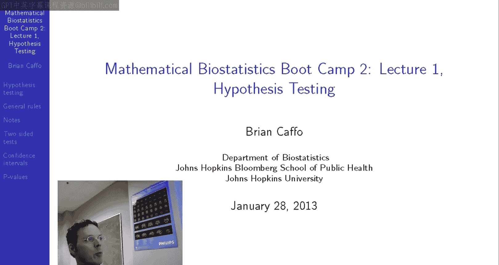
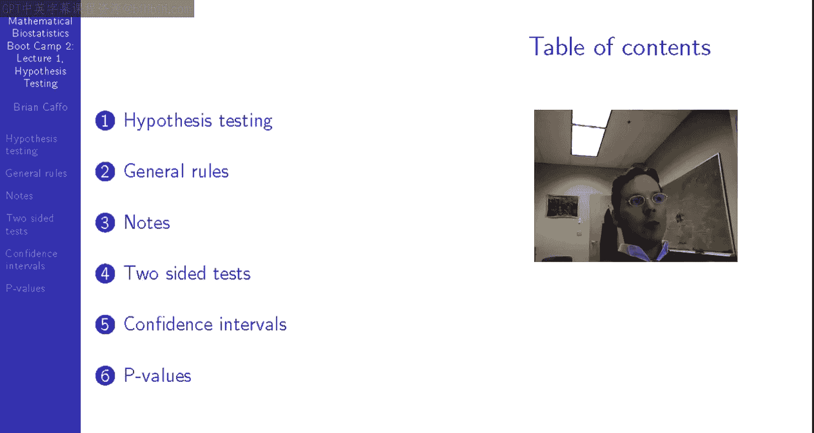
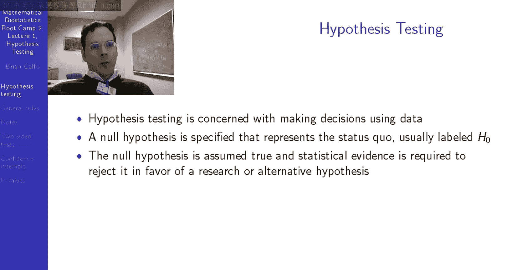
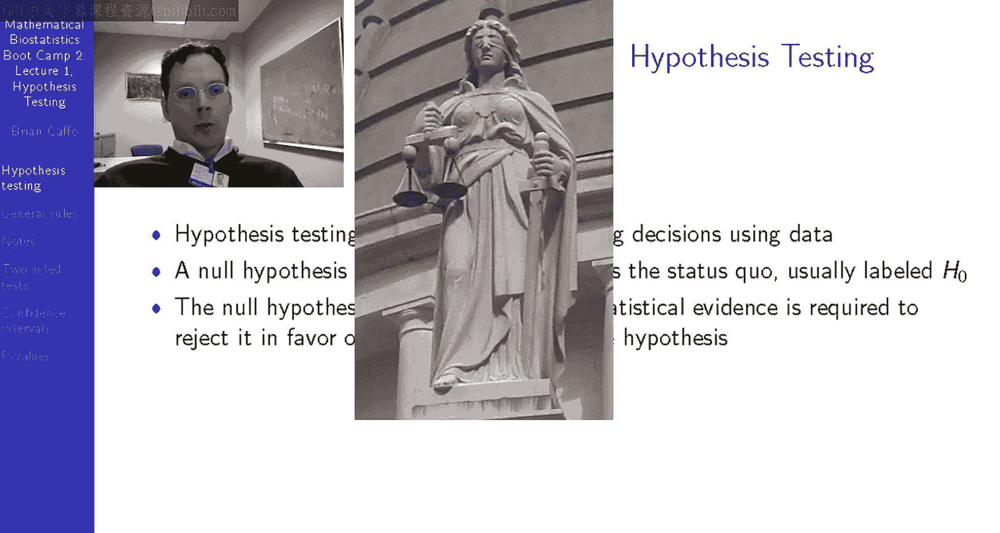

# 约翰霍普金斯大学《数据科学的高级统计｜Advanced Statistics for Data Science》中英字幕（deepseek p31 0_假设检验.zh_en -BV1htPjeYEFH_p31-

Hi， my name is Brian Kafo and this is Matheal Biostatistics bootot Camp2， Le one on Hy testing。

So in this lecture we'll talk about hypothesis testing。

 we'll go over some general rules for hypothesis tests mostly in the context of one sided hypothesis tests。

 we'll cover briefly two sided hypothesis tests which show that there's a duality and a connection between hypothesis test and conference intervals。

And then we'll briefly cover P values。

Hypothesis testing is concerned with making decisions using data。

A no hypothesis is specified that represents the status quo， usually this is labeled H9。

The no hypothesis assume true and statistical evidence is required to reject it in favor of a research or alternative hypothesis。

So one might think of this in terms of a court of law where a person is presumed innocent until evidence is presented to convict them。

 in this case the no hypothesis is presumed。

True， and then evidence is required to， in this case， convicted or reject it。

