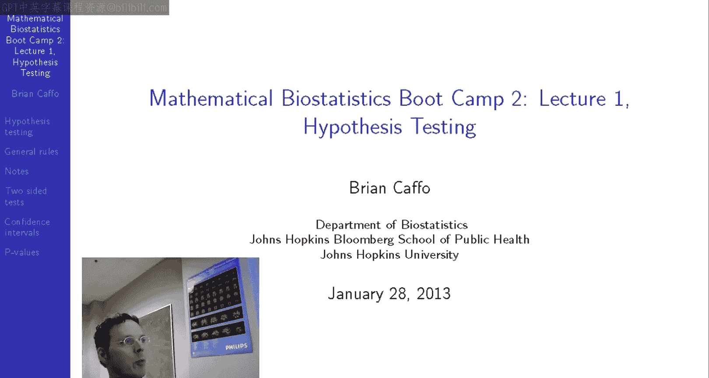
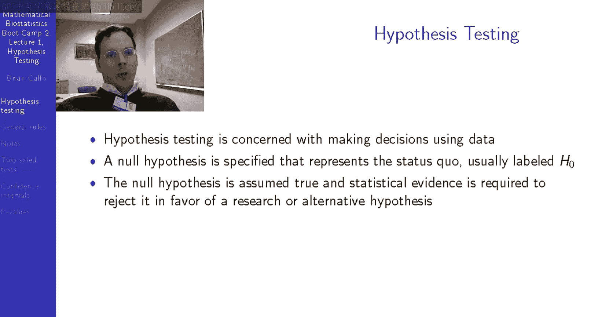
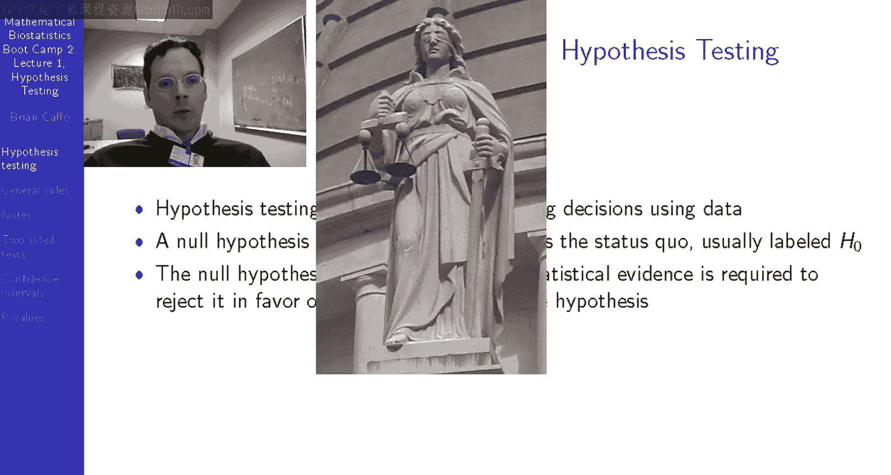

# 数据科学的高级统计：P31：假设检验 👨‍🏫

在本节课中，我们将要学习假设检验。我们将介绍假设检验的一些通用规则，主要围绕单侧假设检验展开。我们会简要介绍双侧假设检验，并展示假设检验与置信区间之间的对偶性和联系。最后，我们将简要介绍P值。

## 什么是假设检验？ 🧐

上一节我们介绍了课程概述，本节中我们来看看假设检验的基本概念。

假设检验关注的是利用数据做出决策。首先会设定一个代表现状的原假设，通常标记为 **H₀**。原假设被假定为真，需要统计证据才能拒绝它，转而支持研究假设或备择假设。

我们可以将其类比于法庭：一个人在被证明有罪之前被假定为无罪。在这个类比中，原假设就是被假定为真的状态，需要证据来“定罪”或拒绝它。

## 假设检验的通用规则 📜

上一节我们定义了假设检验，本节中我们来看看进行假设检验时的一些通用规则。

以下是进行假设检验时通常遵循的步骤：

1.  首先，设定原假设 **H₀** 和备择假设 **Hₐ**。
2.  选择一个检验统计量，用于根据数据衡量证据与原假设的偏离程度。
3.  确定一个拒绝域，即当检验统计量落入此区域时，我们将拒绝原假设。
4.  根据收集到的数据计算检验统计量的值。
5.  做出决策：如果统计量值落入拒绝域，则拒绝 **H₀**；否则，不拒绝 **H₀**。

## 单侧与双侧检验 ↔️

上一节我们介绍了假设检验的通用步骤，本节中我们重点区分单侧和双侧检验。

在单侧检验中，备择假设的方向是明确的（例如，μ > μ₀ 或 μ < μ₀）。而在双侧检验中，备择假设只关心参数是否不等于某个值（例如，μ ≠ μ₀），不指定方向。

双侧检验与置信区间存在紧密的对偶关系：一个水平为 α 的双侧检验，其不拒绝域恰好对应于一个置信水平为 1 - α 的置信区间。也就是说，如果参数的原假设值落在置信区间内，我们就不会拒绝原假设。

## 理解P值 🔍

上一节我们探讨了不同类型的假设检验，本节中我们来看看一个关键的量化工具——P值。

P值是在原假设 **H₀** 为真的假设下，观察到与当前样本一样极端或更极端结果的概率。它提供了反对原假设的证据强度的度量。

一个较小的P值（通常小于预先设定的显著性水平 α，如 0.05）意味着观察到的数据在原假设下不太可能发生，从而成为拒绝 **H₀** 的证据。

## 总结 🎯

本节课中我们一起学习了假设检验的核心内容。我们首先了解了假设检验是用于基于数据做出统计决策的框架，其核心是原假设与备择假设。接着，我们梳理了进行假设检验的标准步骤。然后，我们区分了单侧检验和双侧检验，并指出了双侧检验与置信区间之间的重要对偶关系。最后，我们介绍了P值的概念，它是量化证据反对原假设强度的关键指标。掌握这些概念是理解和应用更复杂统计方法的基础。