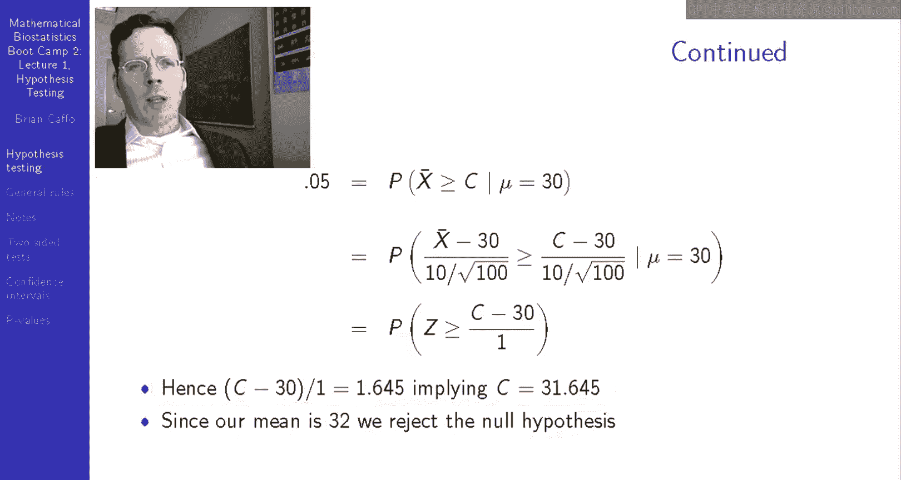
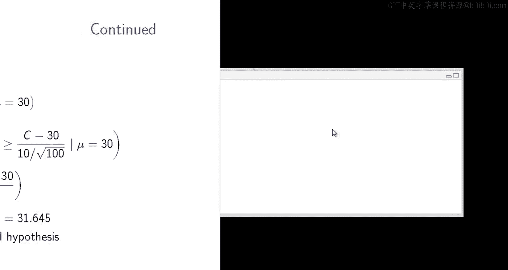
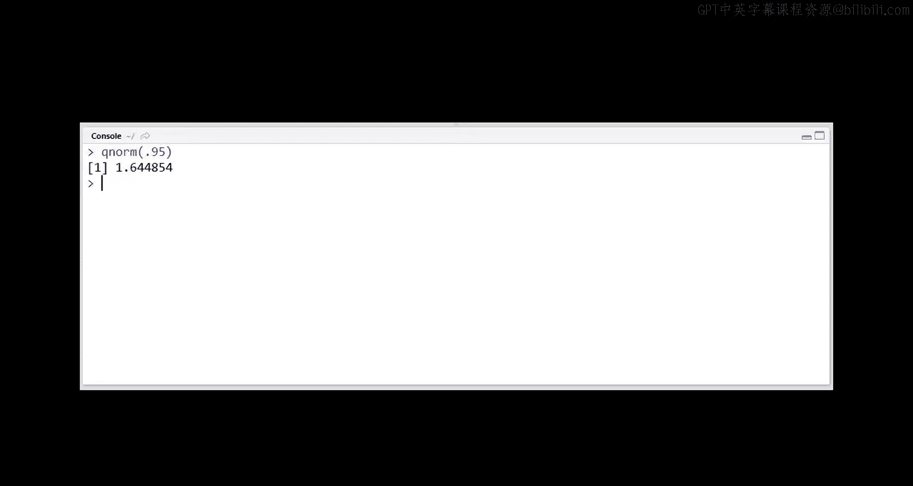
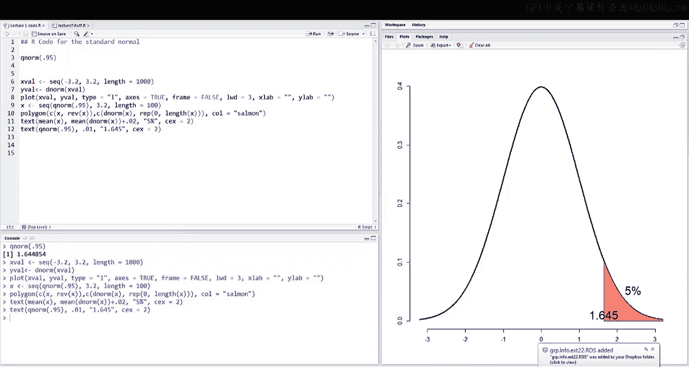

# 约翰霍普金斯大学《数据科学的高级统计｜Advanced Statistics for Data Science》中英字幕（deepseek p32 1_更多假设检验.zh_en -BV1htPjeYEFH_p32-

So let's go through an example， a respiratory disturbance index of more than 30 events per hour is considered evidence of severe sleep disordered breathing here。

 the respiratory disturbance index is usually abbreviated RDI 30 events per hour is quite a bit what this means is that a person's upper airway either collapses or partially collapses while they're sleeping 30 times in an and on average or 30 times in an hour over the night of sleeping which is quite a bit because they're being deprived of oxygen every time this happens and then they wake up a little bit and then they fall back asleep。

 this is a disease called sleep disordered breathing。

Suppose that and let's assume 30 events per hour is some sort of cutoff for severe sleep disorder breathing Now actually just in case you're interested in this。

 the cutoff for diagnosed sleep disorder breathing is far lower I pick 30 for whatever the reason here but so keep that in mind So imagine if you add let's say overweight subjects and you were interested in whether these overweight subjects were drawn from a population that has an RDI a population RDI greater than 30 So your no hypothesis is that the RDI average R RdiI for this population is 30 versus the alternative that the RdiI is greater than 30。

 Now notice this mu that we're talking about here refers to the population mean not the sample mean here we're assuming that the sample mean was 32 events per hour so we want to test whether with respect to the model of。

IID sampling from this population。And we're going to make Gaussian assumptions and with respect to Gaussian assumptions about the respiratory disturbance index。

 is there enough evidence in the fact that the mean was 32 events per hour and the standard deviation was 10 events per hour？

To conclude that the population mean is in fact bigger than 30， that's what we'd like to test。

The alternative hypothesis that we specified on the previous page was that muU was particularly greater than 30。

 but could there's different versions of the hypothesis test for our purposes where we could test less than greater than or not equal to and there's maybe some philosophical discussion about whether or not testing whether the muu is exactly 30 versus not equal to 30 is a sensible thing to do and we'll talk about that a little bit later。

But for the time being， we'll think that the alternative is going to come in three varieties greater than less than or not equal to。

And then you there's basically we could create this two by two table of the kinds of decisions that we could make。

 so we could， if the truth was， in fact the null hypothesis and we could decide the null hypothesis and that in that case we correctly accept the null。

 if the truth was the null hypothesis and we decide the alternative hypothesis then we will have made what is called a type1 error。

嗯。If the falsely rejecting the null hypothesis， if the truth is the alternative hypothesis。

And we decide where we fail to reject the OIpo system， we've made a so called type 2 error。

And then if the truth is the alternative and we reject an nonpo system。

 we will correctly reject the null。encapsulates the decision space for hypothesis testing。

So let's revisit this Court of law example again。So in general， in most courts。

 the no hypothesis is that the defendant is innocent。

 and then we're going to require evidence to reject the no hypothesis or convict the person。

If we require very little evidence， then what happens， well。

 we increase the percentage of innocent people convicted。Which in this case would be type 1 errors。

However， we would also increase the percentage of guilty people convicted。

 so this would be correctly rejecting the null。On the other hand。

 if the court requires a lot of evidence to convict someone。

 then we increase the percentage of innocent people let free in this case that's correctly accepting the null。

But then we would also increase the percentage of guilty people set free this case would be type 2 error。

 so this also goes to show you basically in all decision spaces。

 not just in statistical decision spaces， but certainly the same thing happens in policies for law。

Is that the type1 and type 2 errors are associated as you increase one。

 you decrease another and vice versa。And what we'll see is we'll kind of set up our statistical decision making in a particular way to minimize the chance of type 1 errors and as doing so。

 then we've kind of hamstrung ourselves a lot about what kind of type2 errors we can make。

And so that's that'll cloud， I think a lot of our kind of framework and rubric that we talk about for hypothesis testing is that we're going to very specifically control type1 errors and then we'll talk maybe later on about how we can control type type two errors and try and minimize them now obviously。

knowTo control type two errors while also keeping type1 errors low， you have to do something。

 you have to get better evidence， not just more or less。

 but better evidence and we'll talk about that。So let's talk a little bit about what's the kind of standard way to implement hypothesis testing。

 and we'll go back to our example with the respiratorypiratory disturbance index。

And the kind of obvious strategy， we want to test whether or not the mean。

 the population mean is bigger than 30， the obvious thing strategy would be to say， well。

 is the sample mean larger than some constant？Where we picked the constant in some reasonable way。

Well， the traditional way to do this now。Is to pick the constant so that the probability of a type1 error is low。

 and there's a standard benchmark that occurs very commonly， which is 5%。

But the idea is that the type 1 error rate is controlled so that the probability of making a type 1 error is low。

And there's a couple of reasons why people do this。

 one is maybe there's some logic to it right that we you know we want to。

 you the null hypothesis is our status quo hypothesis。

 so we want to make sure that we don't reject that hypothesis idly， and so if it's true。

And so that maybe there's some scientific sense of conservatism。

 scientific conservatism built into it。It's also， I think。

 rather practical in terms of the mathematics。In that the fact that under the nu hypothesis。

 the mean is sharply specified at mu equals 30。That makes the math a little easier as well。

 and it turns out you can also say whether that mu is not just strictly equal to 30。

 but less than or equal to 30， you wind up with the same test。

 but the fact that the null is the sharp null hypothesis also helps with the mathematics a little bit。

 which maybe isn't the best reason to do it， but still nonetheless it's a good reason it's a part of the reason why I think people do it。

 but maybe the main reason is this idea that we want to control for type1 errors and have that probability below。

So the type 1 error rate we usually assign the letter alpha， the Greek letter alpha。

 and that's the probability of a type1 error， so the probability of rejecting the null hypothesis when in fact is true and we want the type 1 error rate to be 5%。

So what we're going to do is we're going to choose this constant C in such a way that it factors in the uncertainty associated with the sample mean and in such a way that our type 1 error rate。

 probability of a type 1 error rate is 5%， so let's go ahead and do that。Okay。

 so we want this value C here to be chosen so that the probability of getting sample mean larger than it。

 given that the mean is the population mean is it actually 30 to be 5%。

 that would be the probability of a type 1 error if we're going to observe the rule that we're going to reject for an x bar larger than this constant。

Okay。Well。So either by the central limit theorem or supposing our data is Gaussian。

 we can normalize X bar so that it's zero mean unit variance under the null。Okay， so in this case。

 we can subtract off 30 from both sides of this equation because that's the actual population mean。

And then we can divide by the standard error of the mean。

 which in this case is 10 over square root 10010 because that's。

 let's assume known standard deviation。Of the population and then square root 100 because of 100 observations。

 the mean is comprised of 100 observations， so this quantity right here。

 x bar minus 30 over 10 divided by square root 100 that's a standard normal now or know it limits to a standard normal if the data are IID。

And so we can just take this whole quantity here and replace it with a Z， okay。

 and on the right hand side， we have C minus 30。And we want to calculate this。

 remember the reason that this quantity is a Z random variable is because we're calculating this probability under the condition that the nu hypothesispo is true。

 So mu equal 30。 You'll see here this point that I was making earlier that when the。Nll is true。

 we have a sharply specified parameter helps， right， because we can actually plug in exactly 30 here。

Okay， so we want 5% to be equal to the probability a z random variable is bigger than c minus 30 so we could just set c minus 30 well I put divided by1 here just to remind ourselves this standard error in the denominator。

 we want it to be set to a value that has the probability of a Z being larger than it 5% well we know what that value is it's the 95th percentile of the standard normal which is 1。

645 we can solve for C and C is 31。645 since our mean is 32 in this case we would reject an O hypothesis。

Okay， very briefly， I'd like to just show how to get this normal quant in R here I have a cutout of our studio and I'm just typing in the appropriate command。

Okay， so very briefly， let's just illustrate with the picture what that calculation is giving for us。

 So here I have my our studio window just to remind ourselves the 95th percentile of normal It's about 1。

645。 We do that with a Q norm function。 so let's visualize it let's。

Create some grid points to plot and so this is just sequence from minus3 to plus 3。

2 and that covers most of the normal distribution the y value here is evaluated at the normal density of the x values so let's plot that so we see a plot of the bell shape curve from minus3 to plus3 about let me define the sequence that we want to shade in that represents 5% of this I'll shade it in with a。

Polygon， there it is now shaded in salmon colored。And then just remind us， that's 5% of the curve。

And then。The number that represents that 5 percent is 1。645。

