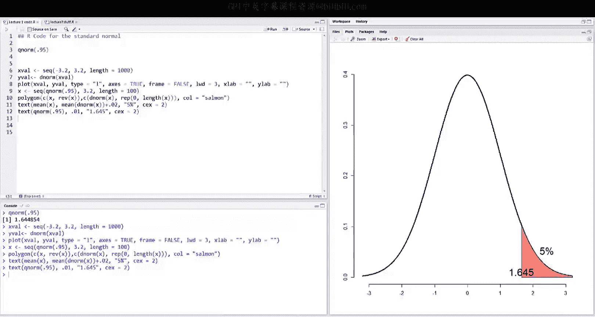
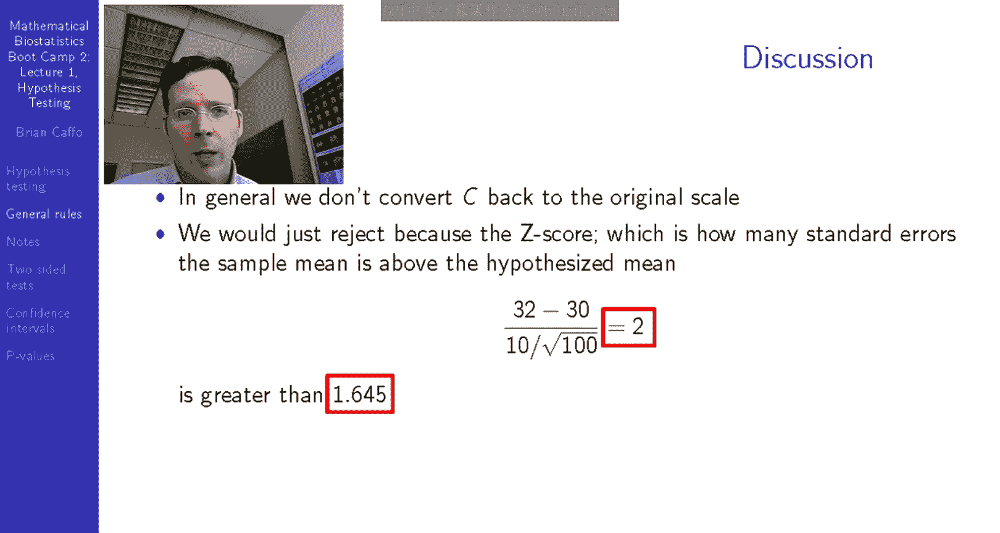
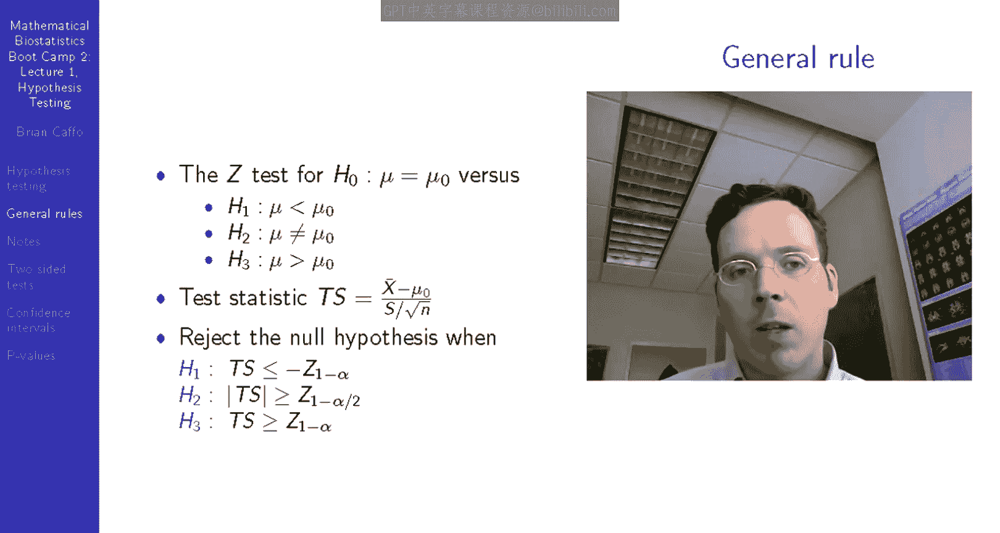
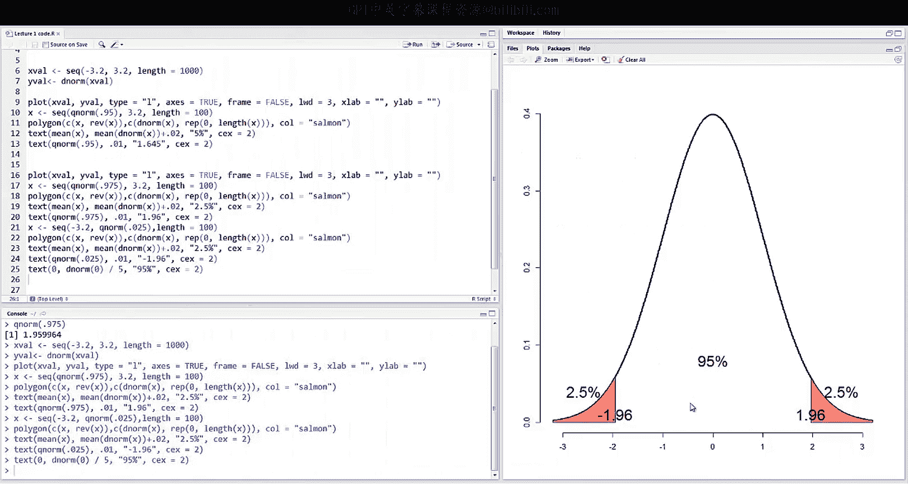
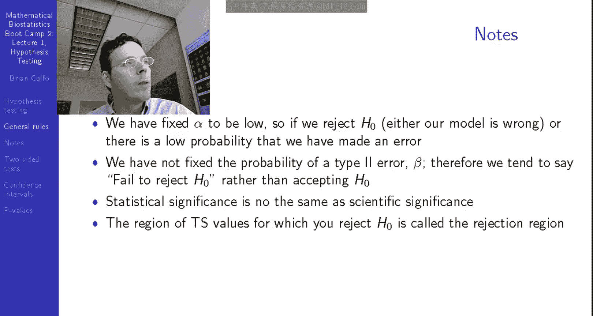

# 约翰霍普金斯大学《数据科学的高级统计｜Advanced Statistics for Data Science》中英字幕（deepseek p33 2_假设检验的一般规则.zh_en -BV1htPjeYEFH_p33-

Okay， so。We went through some extra steps there in general we don't。Convert our。

Constant that we're interested in back to the original scale right。

 we just take the standardized mean and compare it to standard normal quantiles。 So in this example。

 remember 32 was our empirical mean 30 is the mean under the nu hypothesis and then the standard error of the mean in this case was 10 divided by square root 100 so the mean expressed in standard standard error units from the hypothesisthesized mean works out to be two 32 minus-30 divided by the standard error 2 so our mean is two standard error units away from the hypothesisthesized mean。

Then we would compare that to the。95th percentile from the standard normal distribution， which is 1。

645， so we would directly compare two and 1。645 so that's just a quicker way to do it。

So we can codify these rules for a normal test for a single mean into a couple of simple rules。

 so let's just call this the Z test because we're talking about testing a single mean we're either assuming that our data we're willing to assume that our data is Gaussian or that our data or that the central limit theorem is a good enough approximation to apply。

Suppose we want to test the null hypothesispo that mu equals mu not h is that mu equals mu not versus one of the three alternatives。

 the mu being less than mu not mu being greater than mu not and the middle one here。

 mu not equal to mu not in that one we'll have to talk a little bit about in all three cases we're going to say。

 well we're going to reject for H1 and say if our sample mean is small enough right and if it's enough below mu not we're going to reject in the case of H3 if our sample mean is enough above mu not and then in the second case we're going to just reject if our sample mean is enough different from mu not either too large or too small and again just like before the logical way to do this is to express the mean。

And standard error units and standardized units。 So when we calculate our test statistic。

 it's X bar minus the hypothesized mean under the null value mu not divided by the standard error S over square root n。

 That then is a z score。 it is a sample mean expressed in standard error units。So if we get。

 for example， a three， we would know that the sample mean is。

Three standard deviations above the hypothesized meanme。

Right and so we observed a sample mean that is three standard errors above the hypothesized mean which would be unlikely right。

 so that maybe cast some doubt on the hypothesized mean if we observe a sample mean that is say four standard deviations below the hypothesized mean again。

 that would be evidence in favor of H1 if it was four standard deviations above the hypothesized mean that would be evidence in favor of H3 and so we can actually force if we wanted an alpha level error rate。

 so in our previous example， alpha was 5%， so alpha again remembers the probability of a type 1 error falsely rejecting the no hypothesis when in fact it is true。

Then under H1 our we would reject if our test statistic was less than negative z1 minus alpha。

 So in this case， if you know alpha is 0。05， then we would look up the 95th percentile and then take the negative of it。

 we could equivalently look up the fifth percentile because the fifth percentile is the negative of the 95th percentile。

 but I want to just say use the same quantile every time。 So in that case it would be negative 1。

645 okay in H3， then we're going to do exactly what we did in our example。

 we would compare it to the positive。The positive upper quantile Z1 minus alpha is so the 95th percentile if our alpha。

 if the error rate we want to control for is 5%， and then for the second case， H2。

 we would reject if our test statistic is either too large。

 bigger than Z1 minus alpha over2 or too small， smaller than z1 minus alpha over 2。

And the reason we divide alpha by two is because we remember we want a five well。

 alpha percent chance of rejecting the null hypothesis falsely。So if the no hypothesis is true。

 we want only a alpha percent 100 times alpha percent chance of rejecting the no hypothesis。

 so the way that we're going to do this now is we're going to say okay we'll divide that probability into half of it being accidentally rejecting too large and the other half being accidentally rejecting too small and that seems like a pretty sensible sensible rule to do and the execution of that rule is just to say well take my test statistic if it's negative I throw out the negative sign if it's positive I just leave it alone and then I compare it to the upper quantile from the normal distribution but instead of looking at the 5% error rate I look at the 2。

5th percent error rate if I want a 10% type1 error rate then I would look at a 5% the 95th percentile and so on。

Okay。So let me just describe briefly more of this two tail test idea。

 So just to let you know that you know the alpha over two in this case， you know。

You know if alpha is 0。05。You know1 minus。05 divided by 2 that works out to be 0。975。

97 fifth quant of the normal distribution works out to be about 1。96。 and what we're doing let's。

Let me嘅。Some x and Y values。Ploot the standard normal again， which you can see over there。

And then so what we have is we have a test statistic that we calculate and then we're going to reject if it's too large or too small。

 so take， for example， what we're going to do is take 1。96 and that puts 2。5% in the upper tail。

And then we're going to take。ANegative 1。96， and that's puts 2。5% in the lower tail。Of course。

 then that puts 95% in the middle。So we're going to reject if our test statistic is above positive 1。

96， which has a 2。5% chance under the null hypothesis， or if our test statistic is below negative 1。

96， which has a 2。5% chance under the null hypothesis。

 so the union of those two events yields a 5% chance under the nu hypothesis and rejecting whether something is bigger than positive 1。

6 is the same thing as rejecting if the absolute value is bigger than 1。96。

So。In the way that we're executing hypothesis testing。

 we've forced the typeype 1 error rate to be small， it's usually 5% or so。

So if we reject the no hypothesis， you know， either our model is wrong or several other things maybe could have gone wrong or there's a low probability that we've made in error。

On the other hand， we have not fixed anything to do with the type 2 error rate。

Which is usually big called beta。So therefore we tend to say fail to reject H not rather than accepting H not the kind of you know to give you kind of a classical example of this is。

Imagine if you have a very small sample size and you want to test some scientific hypothesis and you fail to reject the null hypothesis Well you've controlled there's a you know regardless of your sample size。

 you've controlled the type1 error rate so that there's only a 5% chance that you will have rejected the null incorrectly。

 but if the alternative is true。It's possible that your small sample size。

leads to variability in the mean。🤢，Right， because remember the standard error of the mean is sigma divided by square root n。

 so if n is small， our variability of the mean is going to be larger。

So if your sample size is small and you fail to reject H。

 it's not fair to say that you should conclude H if you only have， say， a sample of size3。

 then maybe you didn't have a good chance of rejecting the non hypothesispo anyway because you didn't collect enough data to really evaluate it。

So at any rate that's a bit of nomenclature， so that's why we there's a tendency in basically every statistics textbook that teaches hypothesis testing to say fail to reject HO rather than accept H if you want to say that you want to accept HO there's an implicit notion that the type 2 error rate is small。

 which usually in most problems less is known about the type 2 error rate and we'll talk this goes to the subject of things like power。

Which we'll talk about later on in study design， one of the ways to try and combat this problem。

Issues like this is prior to the conducting the study to design it in such a way that。

You will have a high probability of rejecting the hypothesis if in fact the alternative is true。

 and one of the things you have under your control for doing that is to create to have a large sample size。

So that's one point then so anyway so the tendency is to say fail to reject H not rather than than rejecting H not。

 you know， I think a classic phrase to that people always say is。

Absence of evidence is not evidence of absence is another way to put that。

So that's one point the other point I'm making on this slide is that statistical significance is not the same thing as scientific significance from from in the context of hypothesis testing so the most common。

Argument in favor of this point， is。You know we have these。

 for most of our hypothesis testing procedures， we have very you know sharply specified nullles。

 you know H0 is that mu is exactly five or something like that， you know， depending on the problem。

And so it's possible is let's say you have an enormous sample size to get a sample mean that's 5。

01 with an incredibly small standard error because you have an enormous sample size and still reject the null hypothesis。

 even though 5。01 isn't in any scientific sense different from five。

 and so that's a point that's often made is that just because you reject the null hypothesis in the terms of in the terms of executing a statistical test。

 that doesn't mean that the difference。That you've detected is in fact meaningful。Now。

 I read an argument。At one point by a person saying that in some instances， for example。

 when you have randomized。Comparative trials that sharp null hypothesises are still meaningful and even small deviations are are important。

 but you know these are kind of subtle issues， I think that the main basic issue that that's sort of at least generally understood is that it's not always the case that statistical significance and scientific significance of the same thing。

 so I would like you to at least be aware of that and you can read more about it， but。

And then before in the previous slide， we said， well。

 we'll reject if our test statistic is above this value in the case where we're testing H1。

 we'll reject if it's either。If its absolute value is above this particular value in the case of H2 and then we' reject it's below this value in the case of H3 that was our rules that we came up in the previous slide so in H1 the upper normal quantile and above that's called the rejection region and in case H2 the upper quantile and above or the negative quant below in other words the absolute value being above a large value is the。

The the rejection region in that case and in the third case the normal quantum below is the rejection region。

 so just the collection of values of test statistics for which you reject the no hypothesis is called the rejection region。

 just a bit of nomenclature there。

