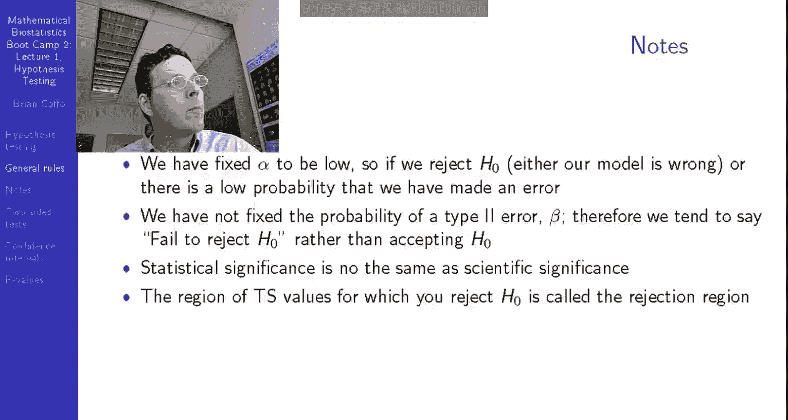
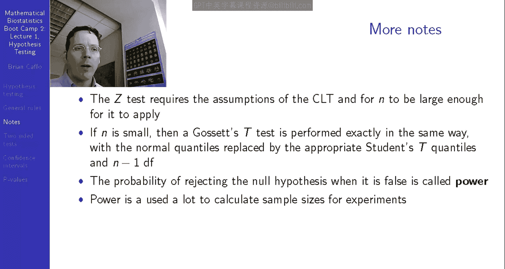
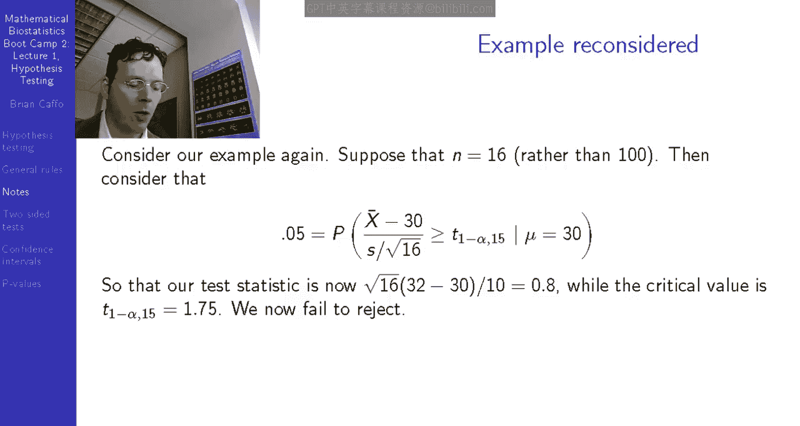
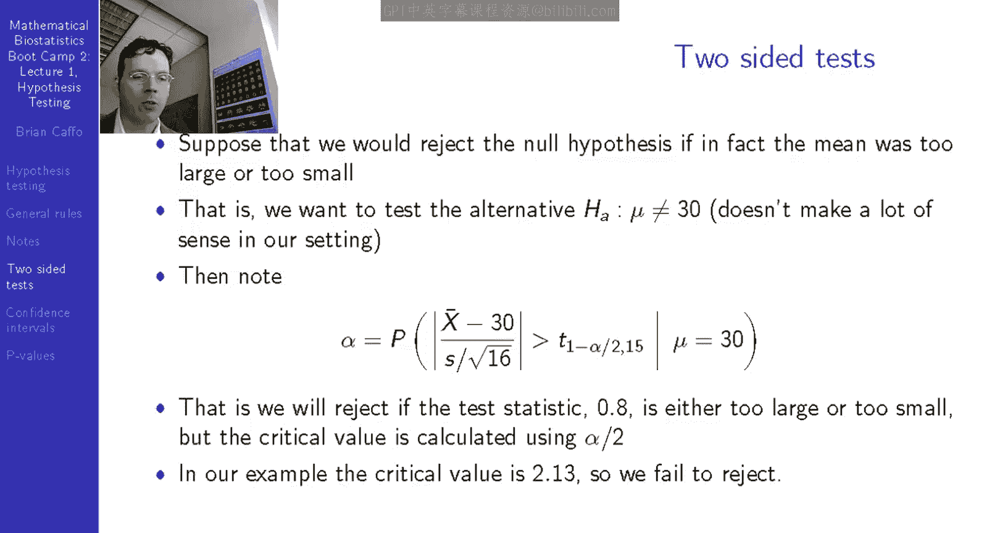
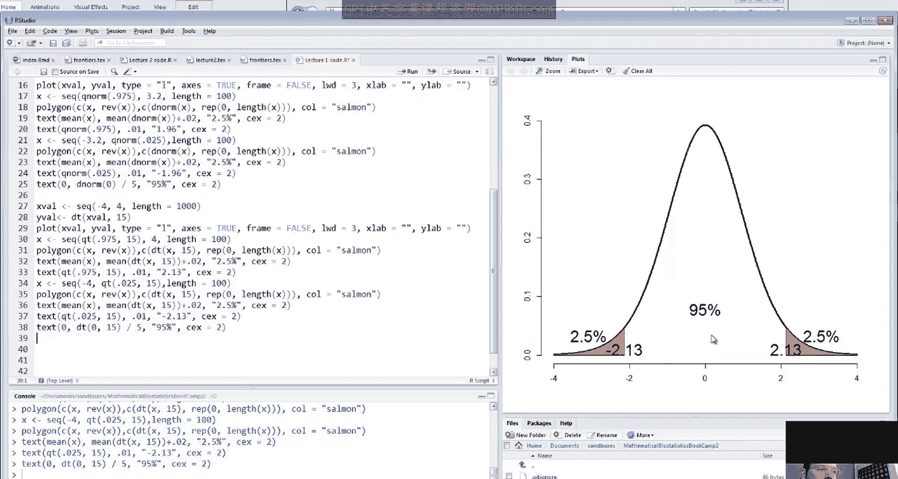

# 约翰霍普金斯大学《数据科学的高级统计｜Advanced Statistics for Data Science》中英字幕（deepseek p34 3_双侧检验.zh_en -BV1htPjeYEFH_p34-

So the。The Z test that we're talking about requires the assumptions of the CLT and for n to be large enough for it to be applicable。

 If n is small， then you can just do gossip students T test in the same way you're just replacing the normal quantile with the students T quantile The probability of rejecting the nu hypothesis when it's false is called power。

 remember we set the type1 error rate， which is the probability of rejecting the nu when it's true So we force the type 1 error rate to be small。

 The type2 error rate， which is the probability of rejecting。

OfFai to reject the no hypothesis when in fact the no hypothesis is false iss called a type 2 error rate power is 1 minus that it's the probability of rejecting the no hypothesis when it is false。

 and so power is a good thing you want to reject the no hypothesis when it's false and unfortunately power is not typically under our control after the experiment has been conducted so the way that people combat this is prior to conducting this study。

They do a power calculation where they vary the sample size or if it's simple enough。

 just calculate the sample size needed to obtain a certain level of power using guesses for what they think the。

standardandard error and hypothesized significant effect would be。

And that's what we'll talk about next lecture。

Okay， so let's actually go through the T calculation for this example。

Suppose that n is 16 rather than 100 as we were considering before。

 have to so we're going to use a T test。Then look at this equation right here。

We want 5% to be the probability that x bar-30， the value under the null hypothesis divided by the estimated standard error now S over square root 16。

We want to be the probability that that quantity is larger than the T quantile now instead of a z quantile。

 again， the one minus alpha quantile with 15 degrees of freedom。

So our test statistic now is the standardized observed mean。

 so 32 are observed mean minus the hypothesized value。Divided by the standard air。

10 over square root 16 square root 16 then moves up in the numerator。And that works out to be 0。8。

And the T critical value is 1。75 and so now we fail to reject and it shouldn't be surprising right。

 we're changing what used to be multiplication by a square root 100 to now square root 16 and so the test statistic went down substantially while the quantile that we're comparing it to went up because remember the T is a heavier tail distribution than the normal。

 so it shouldn't be surprising that we now failed to reject。

Okay， so in the previous slide we did the one sided test。

 let's now do the two sided test and we're going to move through these things quickly because I'm hoping that this point in the class that you'll be getting used to these kinds of calculations。

So let's we want to now test whether muU is different from 30 as the alternative and maybe you can say that doesn't make a lot of sense in this case because the way I framed the problem was that we're looking at a particularly susceptible population to having a high RDI。

 so why don't we just test mu greater than 30？And well， let's just for the sake of argument。

 just to show you the calculations do different from 30， but also I would say。

That in many journals and avenues of scientific inquiry， they demand two ci a test。

 even if the one side to test is the natural direction to consider。So let's do a two sided test。

 so what we want is to test whether or not our observed mean x bar is significantly different from our null hypothesized value of for the population mean 30。

So that would be if it's significantly larger than 30 or significantly smaller than 30。

 so we could just say， well， maybe we will look at the absolute value x bar minus 30。

 which would look at whether it's small， too small below 30 or too large above 30。

And then of course because we want to standardize our statistics。

 we're going to divide by the standard error of the mean s over square root 16。

 and we know that x bar minus 30 over s over square root 16， if the data IID Gaussian。

 that follows a T distribution。And so if we want alpha。

 the type 1 error rate to be specified so that the probability that this test statistic is too large。

Or too small， the probability of that occurrence is exactly alpha。 Well。

 what we could then pick is the t quantile t1 minus alpha over 2 and 15 degrees of freedom And what this does is this says this random T statistic。

 the probability of it being larger than this quantile is alpha over2 probability。

 the positive part of the statistic， the probability of it being larger than t1 minus alpha over 2 quantile gives alpha over 2 probability。

 The probability that this test statistic on the negative end is less than the t alpha over2 quantile with 15 degrees of freedom。

 which is a negative value。Is also alpha over two， so we put alpha over two in the lower tail。

 alpha over two in the upper tail， and that yields a total probability of alpha。

And in the next slide， I'll describe that a little bit， and this calculation is of course。

 all done under the no hypothesis that mus 30。So we'll reject if our test statistic。

 which in this case x bar minus 30 over s over square root 16 is 0。8。

 so when we take the absolute value it remains 0。8。

 we're going to reject if it's either too large or too small， but again。

 remember the critical value is calculated now using alpha over 2 rather than alpha。

Because we want alphalf over2 probability rejecting for too large and an alphalf over2 probability for rejecting if the test statistic is too small。

Small negative so in this case the critical value is 2。

13 and notice of course that's a larger value than when we just used alpha because we're going further out into the tail so it's harder to reject for the two sided test than it is for the one sided test so since we reject it for the one sided test we're of course going to reject for the two sided test。

Okay， let's just briefly again show you the two side of calculation and where the alpha over two comes from。

So here I'm setting a sequence of x values from minus four to plus full。

 I'm evaluating the T density with 15 degrees of freedom at those points and then let me plot and there's my T distribution。

Okay， now I'm going to shade in that area right there。That's 2。5%， let's say my alpha。

 my type1 error rate that I want is 5%。AndThat value right there is 2。13， so for the T distribution。

 the 97。5th quantile is 2。13 when you have 15 degrees of freedom。And。

Let's do the same thing for the lower quantile。不诶。There we go， that's better。And that's 2。

5% right there， and that's negative 2。1。3 and then that's 95% so what we're saying is we calculate our normalized test statistic X bar minus 30 over S over square root 16 and the probability that the absolute value of that statistic is bigger than 2。

13 or in other words the positive the probability that that statistic is too large positive above 2。

13 is 2。5% or too small negative is negative too small negative in the form of being less than negative 2。

13 is 2。5% so that the probability that it's absolute value is bigger than 2。

13 is 5% including the upper tail 2。5% in the lower tail 2。

5% so that the probability the test statistic lies in the rejection region is 5%。

