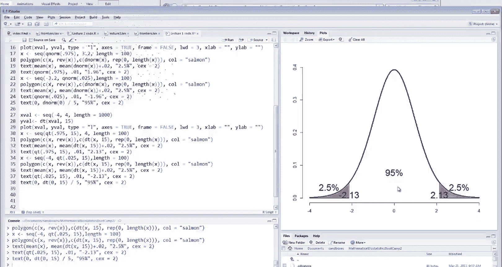
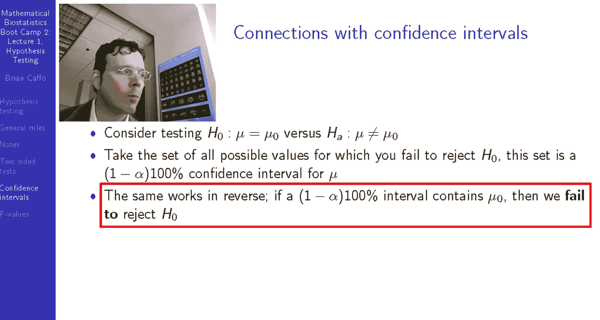
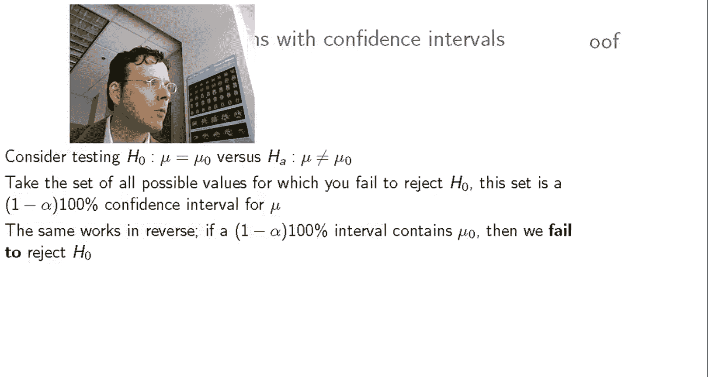
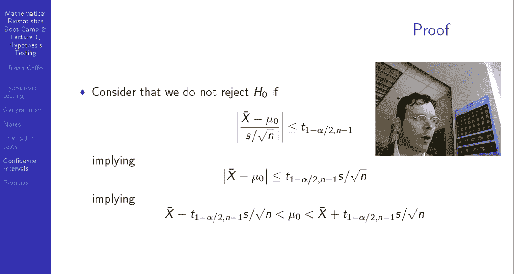
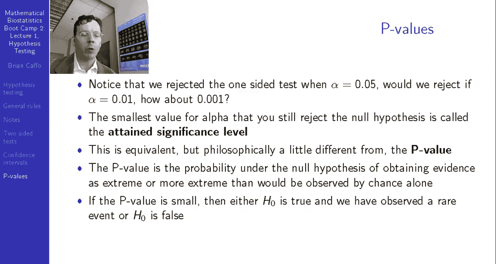
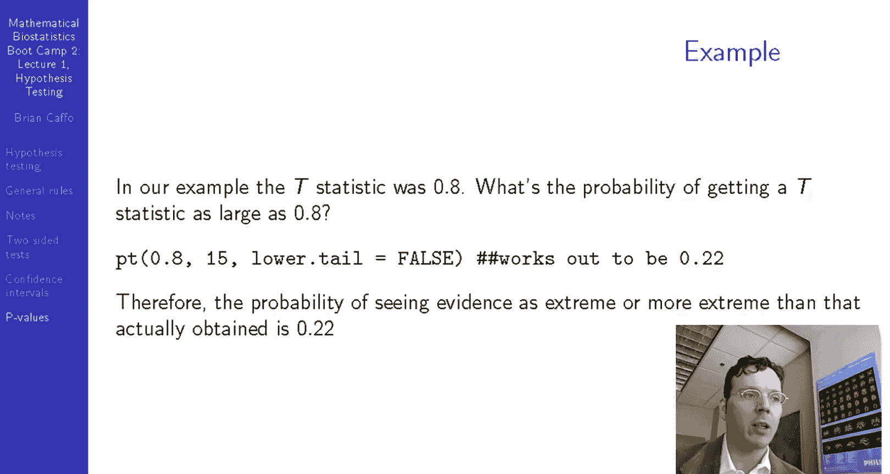
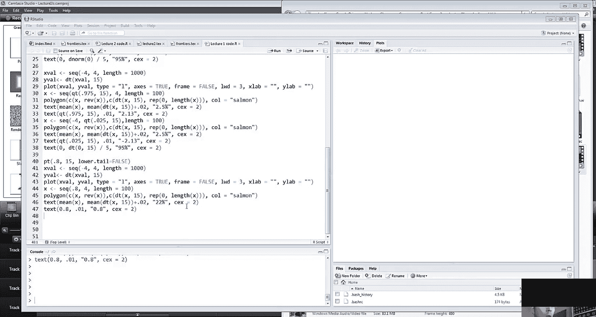
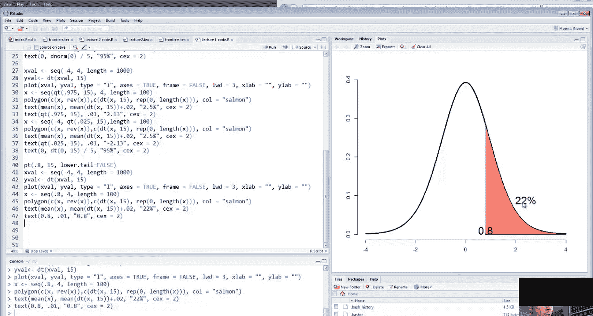
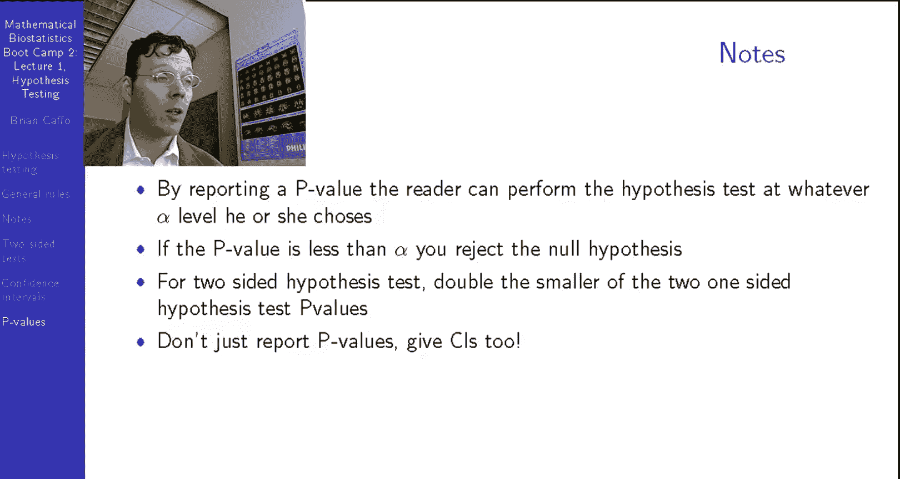
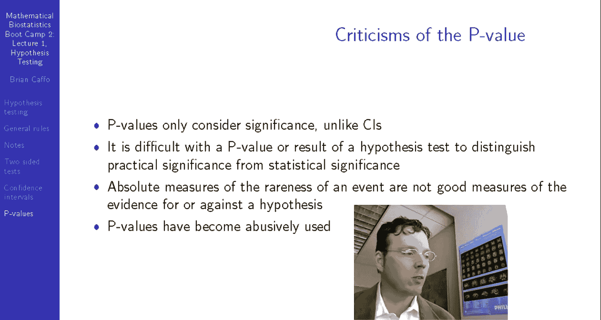

# 约翰霍普金斯大学《数据科学的高级统计｜Advanced Statistics for Data Science》中英字幕（deepseek p35 4_置信区间与P值.zh_en -BV1htPjeYEFH_p35-

Okay， so now is a good time to talk about confidence interval。

Confidence intervals in their connection to hypothesis testing since we've talked about hypothesis testing and two side hypothesis tests。

 so now consider testing H not mu equal to some value versus HA mu different from some value like we just discussed in the previous slide with respect to their respiratory disturbance index。

And then take the set of all possible values for which you fail to reject H not。

Now think about this set， these are in some level the values of mu。

That are supportable as null hypotheses， so they're reasonable values of mu。

And so it isn't that big of a stretch to acknowledge or to guess that this will form a confidence interval for you。

What's interesting is that it forms exactly a 1 minus alpha percent confidence interval from you。

 so if you have a 5% type1 error rate for the set of tests， then you have a 95% confidence interval。

 which is nice。And then the same works in reverse， which is probably even the more useful direction for us。

If a 95% interval say contains mu not， then we fail to reject mu not right， which makes sense right。

 the value of mu n was supported as a potential value when we created the confidence interval。

 so it would make sense that we'd elect to fail to reject H0 than to conclude that mu was different from mu not。

And in the next slide， we'll go through the argument。

Okay， let's just briefly go through this argument， so consider that we do not reject H0。

For a two sided test of mu equal to mu n versus mu different from mu n。

 if our test statistic absolute value x bar minus mu n divided by the standard error S over square root n。

 if that's less than the t quantile evaluated at1 minus at n minus1 degrees of freedom and1 minus alpha over 2 quantile。

So you remember， when we reject if it's bigger than that particular t quantile okay so we can just the s over square root n is positive so we can just move it over to the right hand side and we haven't done anything to the inequality and this inequality here。

 absolute value x bar minus mu not less than or equal to this t quantile times S over square root n。

 that's exactly equivalent to the statement below that muot lies in between x bar minus t times the standard error and x bar plus t times the standard error。

And so。And so that is exactly the same as saying mu not lies inside the confidence interval。

 So this is equivalent to saying。If mu not lies inside the confidence interval。

 then we would have failed to reject H not and then you can obviously reverse this argument to get the other direction。

 So that proves the statements we've made from the previous slide and it shows that this sort of inherent duality between confidence intervals and two sided hypothesis test and this has several uses。

 first of all， it tells you if you create， say a 95% confidence interval。

 it conveys a little bit more information than the result of hypothesis test because A you can do the hypothesis test。

but B， it also gives you a sense of what values of mu are sort of well supported。

 and this helps to combat things like the difference between scientific significance and statistical significance where statistical significance。

 you know， if you， you know， if we have a giant giant sample size。

And our x bar is from our respiratory disturbance index example， if our x bar is 30。01。

 well that isn't very different from 30 and it may not be scientifically meaningful。

 the confidence interval would both show us what values of mu。

 what range of values of mu are estimated and that in fact our interval is quite close to 30。

 even if 30 isn't right in it。Plus we can actually mechanically perform the hypothesis test。

 so that's why I think in general people have a preference if when you can。

 if you could report a confidence interval rather than simply the result of a hypothesis test。

Okay， let's introduce the concept of P values。So。When we had a sample of size 100 and we were doing the Z test。

We rejected the one sided hypothesis test when alpha was 0。05。

Would we have rejected if Alpha was 1% or how about 0。1%？OkayNow， of course， at some point。

 we're going to get to the point where the Z quantile。Is larger than our observed test statistic。

And that will correspond to a specific alpha level and that value。

 the smallest alpha for which you still reject an hypothesis is called attain that's exactly called the attained significance level。

And this is equivalent， but philosophically， I guess a little bit different from an entity called the P value。

The P value on the other hand， which again is the same number， but conceptually is a different thing。

 in my opinion， the P value is the probability under the null hypothesis of obtaining evidence as are more extreme than would be observed by chance alone。

 where here chances governed by the null distribution， the null probability distribution。

So P values were invented by the great statistician Fishcher。And here's the logic。

 but so the attained significance level has a kind of an easy logic there to it， right， you know。

 it would just say。You knowWhy don't we just report the smallest significance level for which you fail to reject。

 then if I give someone that number then they'll know whatever their alpha level is。

 whether or not they reject if their alpha happens to be bigger than the smallest significance level than they would reject if it's smaller than the smallest significance level then they would fail to reject they attain thinking about the Pvalue and attain significance level at that level。

 it's merely just a convenient thing。To report， because regardless of a person's alpha level。

 then they can compare it to the P value and tell you whether or not they reject。

The P value on the other hand， has a more interesting。Interpretation。

 because the idea is that at some level， people claim that it's a measure of evidence。

So here here's the logic， if the P value is small。Then either。The null hypothesis is true。

 and we've observed something that's very unlikely given that the null hypothesis is true or that the null hypothesis is false。

 And that's why Fisher introduced the P value， the P value he thought was was a convenient。

 calibrated entity because it was a probability。That would tell you sort of in a sense。

Whether or not getting a test statistic as or more extreme than you observed was rare under the no hypothesis and if it was rare。

 then that cast some doubt on the veracity of the no hypothesispo and you know I think this use of the P value as a measure of evidence is a little bit more controversial of an entity。

 the attained significance level， which is again the same exact number it's just a different interpretation。

The attained significance level is maybe a。A less controversial entity。

 it's merely just telling you it's the mere mathematical answer to the question。

 what's the smallest alpha level for which I would have rejected the no hypothesis？

Okay， so let's calculate our P value from our。From our example， let's do it for our T statistic。

 So we're thinking that the sample size is 16。 Our test statistic was 0。8。

 What's the probability of getting a T statistic as or larger than 08 Well， this is。

P T stands for T probability，08，15 degrees of freedom。

 And this lower tail equals false just means that it。We want above。8 not below 0。8。

 so this works out to be 22%。 of course it's larger than say 5%。

 which we knew because we failed to reject an null hypothesis if the P values is larger than alpha。

 you're going to fail to reject if it's smaller than alpha， you will reject。Okay。

 so the probability of seeing evidence as are more extreme than actually obtained。

That probability calculated under the no hypothesis is 22%。

Okay， let's just show the the。

Computing of the P value in this case， so our test statistic X bar minus-30 over S over square root 16 worked out to be 0。

8。 So the probability， let's just see the probability of being 0。

8 or larger from the T distribution with 15 degrees of freedom works out to be 22%。

 So here let's draw a picture， So there's our t distribution。嗯。And then。

So right here is where our test statistic is 0。8， the probability of lying above it from the T distribution is 22% and so you can see this area right here。

 obviously 0。8 then is below the fifth。Upper quantntile， which would be up here somewhere。

And so we would know that we would reject， but we also know that because 22% is larger than 5%。

 just given our P value that we would fail to reject。

Okay， let's do some notes so by reporting a P value the reader or whomever can perform the hypothesis test of whatever alpha level he or she chooses to that's because the P value is mathematically equivalent to the attained significance level so if the P value is less than alpha you reject the no hypothesispo if the P value is bigger than alpha you' fail to reject。

Anng。So for two sided hypothesis tests。My recommended P value calculation is just going to be to double the smaller the two one sided hypothesis test P values。

 that's an easy procedure evidence。Generally right。嗯。So don't just report P values， by the way。

 just give confidence intervals， and it's a little hard when the problem is higher than one。

Dimenssional， but if it's a one dimensional problem， then you have no excuse。 give a。

Give a confidence interval， not just a P value。Okay。

 some final thoughts about the P values so you know one of the problems with P values is they only consider significance unlike confidence intervals which。

So。P values it's difficult to distinguish practical significance from statistical significance。

 by itself it's just a little bit too crude of a summary of your data。

 it's a tremendously useful quantity but needs to be used with care there's quite a bit of work on the philosophy of whether whether P values measure evidence and the argument against the P values that absolute measures of the rareness of an event are not necessarily good measure of evidence for against hypothesis and that's the intrinsic philosophy behind the Pvalue is that it's a measure of evidence by virtue of being a measure of the rareness of the no hypothesispo in a certain sense。

 and certainly P values have become somewhat abusively used and。

And frequently misinterpreted and that's one of the main issues is that the actual interpretation of a P value is kind of hard。

 it's the probability of obtaining a test statistic as or more extreme in favor of the alternative。

Where the calculation is done under the no hypothesispo。

 that's the actual interpretation of a P value， and then people try to interpret P values in all sorts of different ways because that interpretation sounds a little complicated。

 but that is the actual interpretation。So the P values is a confusing quantity。

 sort of get used to just regurgitating the whole definition correctly so that you don't take shortcuts and give incorrect definitions because you know。

 let me also say people love the complain about P values as well。

So you should get your P value interpretations correct。

