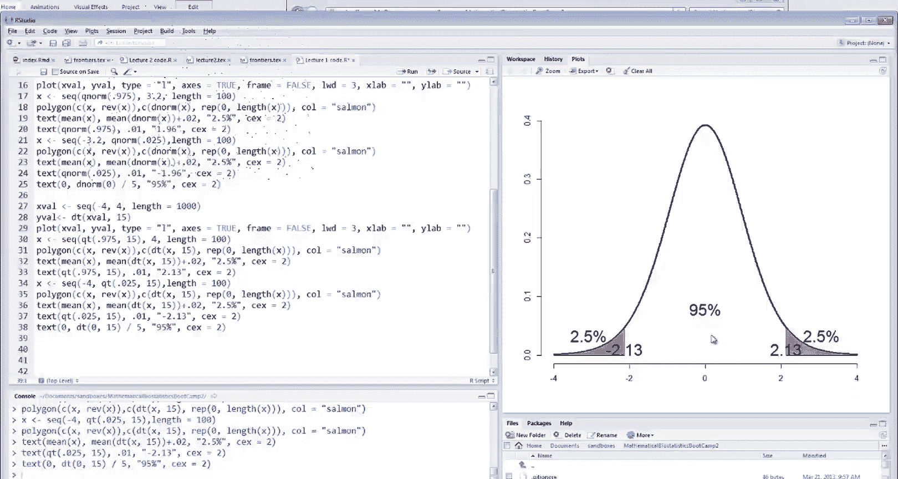
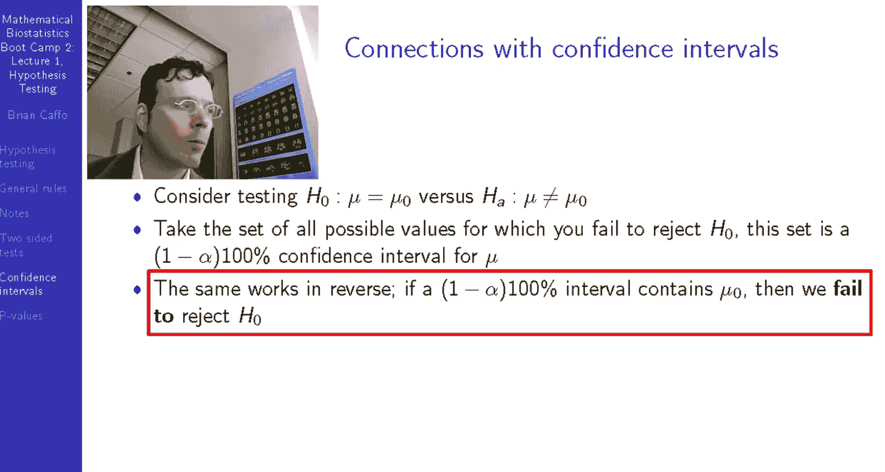
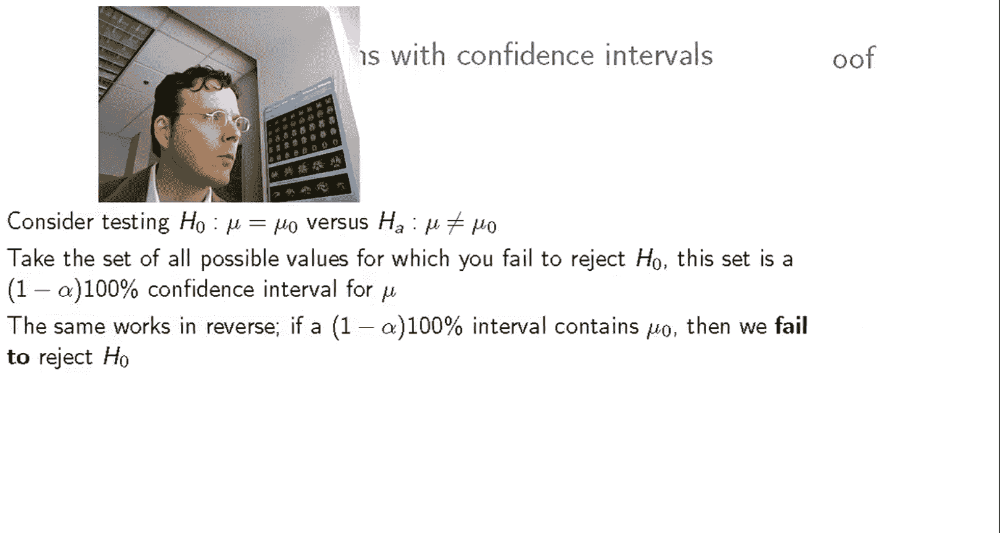
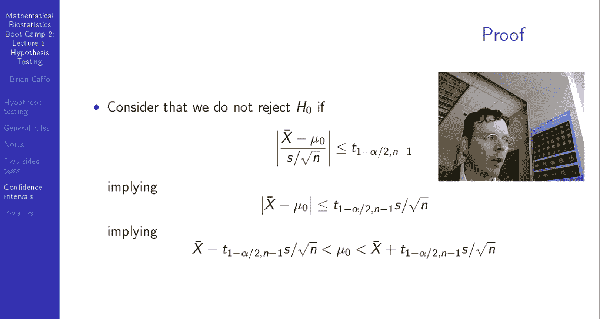
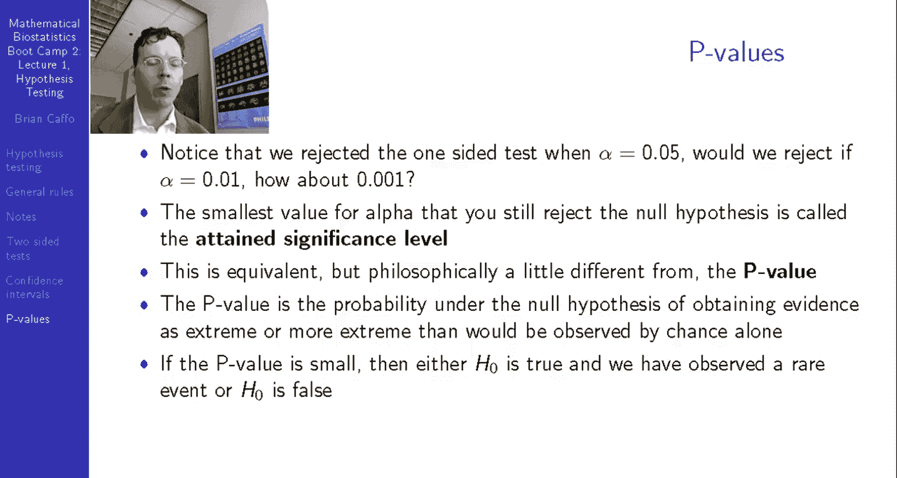
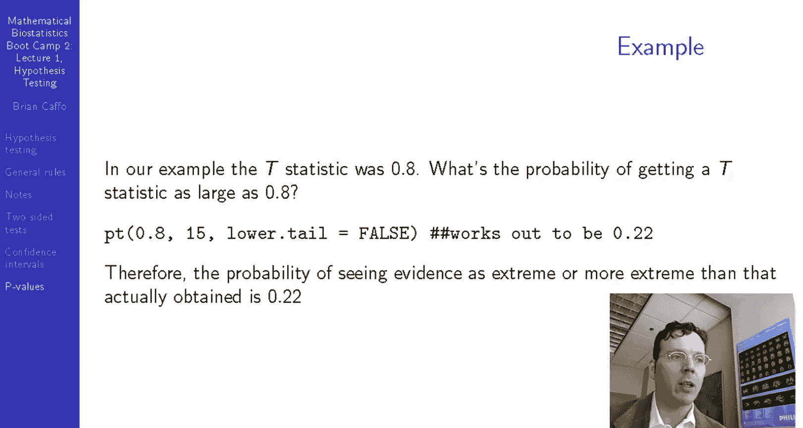
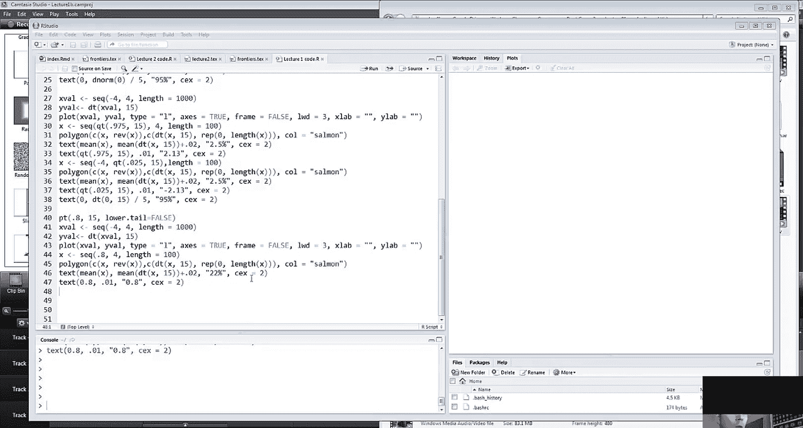
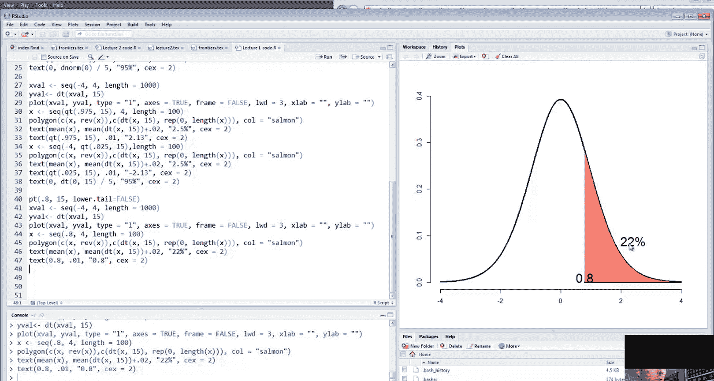
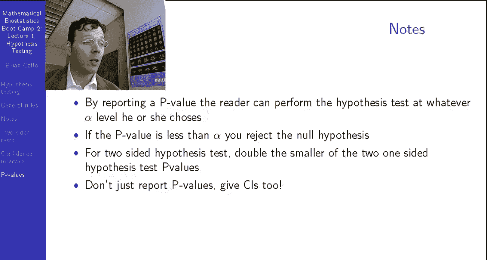
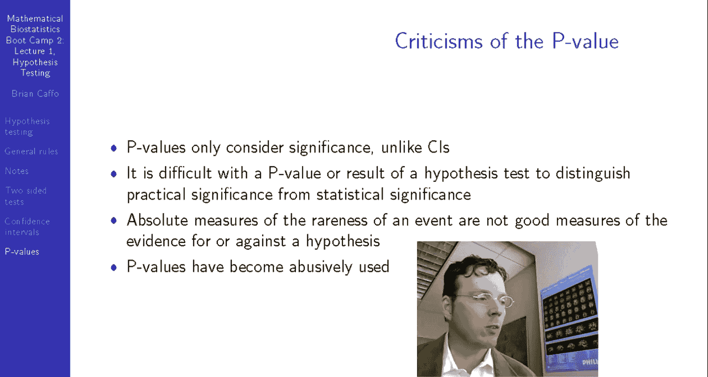

# 高级统计学：4：置信区间与P值



在本节课中，我们将要学习置信区间及其与假设检验的联系，并介绍P值的概念。我们将看到置信区间如何提供比单一假设检验结果更丰富的信息，并理解P值的定义、计算及其在统计推断中的作用。

上一节我们讨论了双侧假设检验，本节中我们来看看如何从这些检验中构建置信区间。

## 置信区间与假设检验的对偶性





考虑检验原假设 **H₀: μ = μ₀** 与备择假设 **Hₐ: μ ≠ μ₀**。取所有无法拒绝原假设 **H₀** 的 **μ₀** 值所构成的集合。

这个集合在某种程度上是作为原假设可被支持的 **μ** 值，因此它们是 **μ** 的合理取值。不难理解，这个集合将构成一个置信区间。

有趣的是，它恰好构成一个 **1 - α** 百分比的置信区间。如果你有一组检验的I类错误率为5%，那么你就得到了一个95%的置信区间。

反之亦然，这对我们来说可能更有用。如果一个95%的区间包含了 **μ₀**，那么我们就无法拒绝 **μ₀**。这很合理，因为 **μ₀** 在我们构建置信区间时是作为一个潜在值被支持的，因此我们选择不拒绝 **H₀**，而不是得出 **μ** 与 **μ₀** 不同的结论。

接下来，我们将详细阐述这个论证过程。

## 论证过程

让我们简要地过一遍这个论证。考虑我们无法拒绝 **H₀** 的情况，即针对 **μ = μ₀** 与 **μ ≠ μ₀** 的双侧检验。



如果我们的检验统计量满足以下不等式：
```
|X̄ - μ₀| / (S / √n) ≤ t_{1 - α/2, n-1}
```
其中 `t_{1 - α/2, n-1}` 是自由度为 `n-1` 的 t 分布在 `1 - α/2` 处的分位数。

由于 `S / √n` 为正，我们可以将其移到不等式右边，得到：
```
|X̄ - μ₀| ≤ t_{1 - α/2, n-1} * (S / √n)
```
这完全等价于以下陈述：
```
X̄ - t_{1 - α/2, n-1} * (S / √n) ≤ μ₀ ≤ X̄ + t_{1 - α/2, n-1} * (S / √n)
```
也就是说，**μ₀** 位于置信区间内。因此，如果 **μ₀** 位于置信区间内，我们就无法拒绝 **H₀**。显然，这个论证也可以反向进行。

这证明了上一张幻灯片的陈述，并展示了置信区间与双侧假设检验之间固有的对偶性。这有几个用途：
*   首先，它告诉你，如果你创建一个（例如）95%的置信区间，它传达的信息比假设检验的结果多一点，因为A）你可以进行假设检验，B）它还让你了解哪些 **μ** 值是得到较好支持的。
*   这有助于对抗科学显著性与统计显著性之间的差异。在统计显著性中，如果我们有非常大的样本量，即使样本均值 **X̄** 与 **μ₀** 的差异在科学上可能没有意义，也可能导致拒绝原假设。而置信区间既能显示我们估计的 **μ** 值范围，也能表明我们的区间实际上非常接近 **μ₀**，即使 **μ₀** 不在其中。
*   此外，我们实际上可以机械地执行假设检验。

因此，我认为一般来说，如果可能，人们更倾向于报告置信区间，而不是仅仅报告假设检验的结果。

在理解了置信区间与假设检验的关系后，我们引入另一个核心概念：P值。

## P值的概念

当我们有一个样本量为100的样本并进行Z检验时，当α为0.05时，我们拒绝了单侧假设检验。如果α是1%或0.1%，我们还会拒绝吗？当然，在某个点上，Z分位数会大于我们观察到的检验统计量，这将对应一个特定的α水平。这个“你仍然会拒绝原假设的最小α值”被称为**达到的显著性水平**。

这与一个叫做**P值**的实体在数值上等价，但在哲学概念上略有不同。P值是在原假设下，获得与观察到的证据一样极端或更极端证据的概率，这里的“机会”由原假设的概率分布所支配。



P值是由伟大的统计学家费希尔发明的。达到的显著性水平的逻辑很简单：报告无法拒绝原假设的最小显著性水平，这样无论他人的α水平是多少，他们都可以将其与这个数比较，从而知道是否拒绝。从这个层面思考P值和达到的显著性水平，它只是一个方便报告的数字。

而P值则有一个更有趣的解释，因为在一定程度上，人们声称它是证据的度量。逻辑如下：如果P值很小，那么要么原假设为真，但我们观察到了在原假设下非常不可能的事情；要么原假设为假。费希尔引入P值，认为它是一个方便的、经过校准的实体，因为它是一个概率，能在某种意义上告诉你，获得与你观察到的检验统计量一样或更极端的情况在原假设下是否罕见。如果是罕见的，那就对原假设的真实性产生了一些怀疑。我认为，将P值用作证据的度量是一个更有争议的实体，而达到的显著性水平（尽管是同一个数字）争议可能较小，它仅仅是对“我会拒绝原假设的最小α水平是多少？”这个问题的数学答案。

## P值的计算





让我们用我们的例子来计算P值，针对我们的T统计量。我们假设样本量为16，检验统计量为0.8。那么，获得一个T统计量大于或等于0.8的概率是多少呢？这由以下公式计算：
```
P(T ≥ 0.8)，其中T服从自由度为15的t分布。
```
这个概率计算出来是22%。当然，它大于5%（我们知道这一点，因为我们未能拒绝原假设）。如果P值大于α，你将无法拒绝原假设；如果小于α，你将拒绝。因此，在原假设下，观察到与实际获得的一样极端或更极端证据的概率是22%。

以下是P值计算的图示：我们的t分布图上，检验统计量0.8的位置右侧的面积（概率）是22%。显然，0.8低于上5%分位数（大概在图上更高的某个位置），因此我们知道会拒绝（如果α是5%的话），但我们也知道因为22%大于5%，根据我们的P值，我们会无法拒绝。



## 关于P值的注意事项

以下是关于P值的一些重要说明。



通过报告P值，读者或任何人可以按照他或她选择的任何α水平执行假设检验。这是因为P值在数学上等同于达到的显著性水平。如果P值小于α，则拒绝原假设；如果P值大于α，则无法拒绝。

对于双侧假设检验，我推荐的P值计算方法是：将两个单侧假设检验的P值中较小的那个乘以2。这是一个简单通用的程序。

不要只报告P值。给出置信区间。当问题维度高于一维时有点困难，但如果是一维问题，你没有借口，请给出置信区间，而不仅仅是P值。

## 关于P值的最终思考

P值的一个问题是它们只考虑显著性，不像置信区间那样。P值本身很难区分实际显著性与统计显著性，它作为数据摘要有点过于粗糙。它是一个非常有用的量，但需要谨慎使用。关于P值是否衡量证据的哲学有相当多的工作，反对P值的论点是：事件稀有性的绝对度量不一定是支持或反对假设的良好证据度量，而这正是P值背后的内在哲学——它通过成为原假设下事件稀有性的度量而在某种意义上成为证据的度量。当然，P值在一定程度上被滥用，并且经常被误解。其中一个主要问题是P值的实际解释有点困难：它是在原假设下，获得支持备择假设的检验统计量一样极端或更极端结果的概率。这就是P值的实际解释，然后人们试图以各种不同的方式解释P值，因为这个解释听起来有点复杂。但这就是实际解释。因此，P值是一个容易混淆的量，要习惯于完整正确地复述整个定义，这样你就不会走捷径并给出错误的定义。另外，人们也喜欢抱怨P值，所以你应该正确理解P值的解释。



本节课中我们一起学习了置信区间与假设检验之间的对偶关系，理解了如何从假设检验中构建置信区间，并掌握了P值的定义、计算及其在统计推断中的意义和局限性。记住，在报告结果时，置信区间通常能提供比单一P值更丰富、更不易误解的信息。