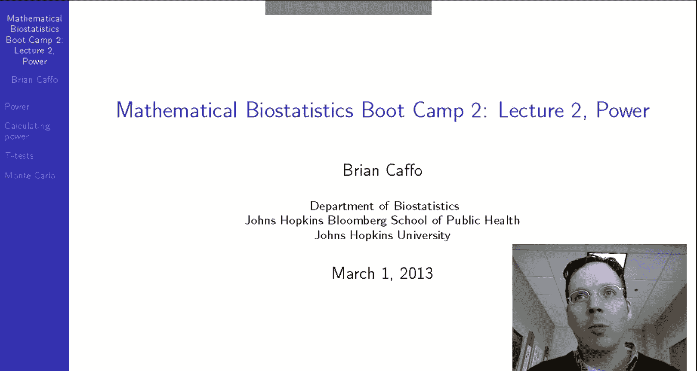
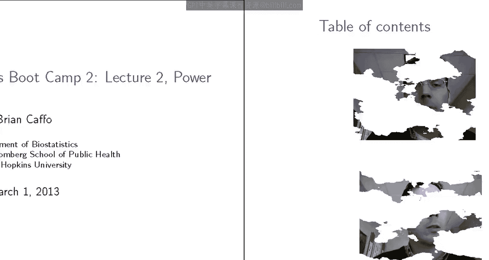
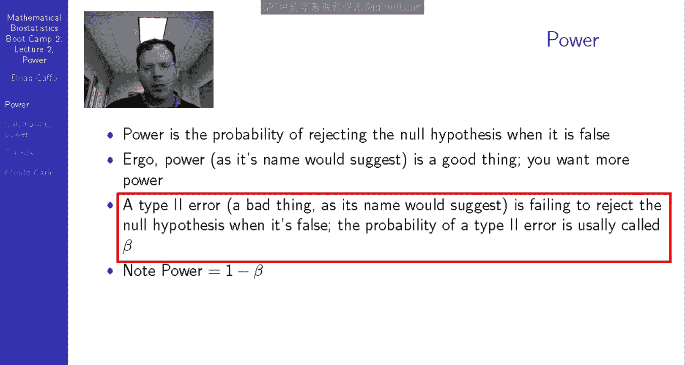
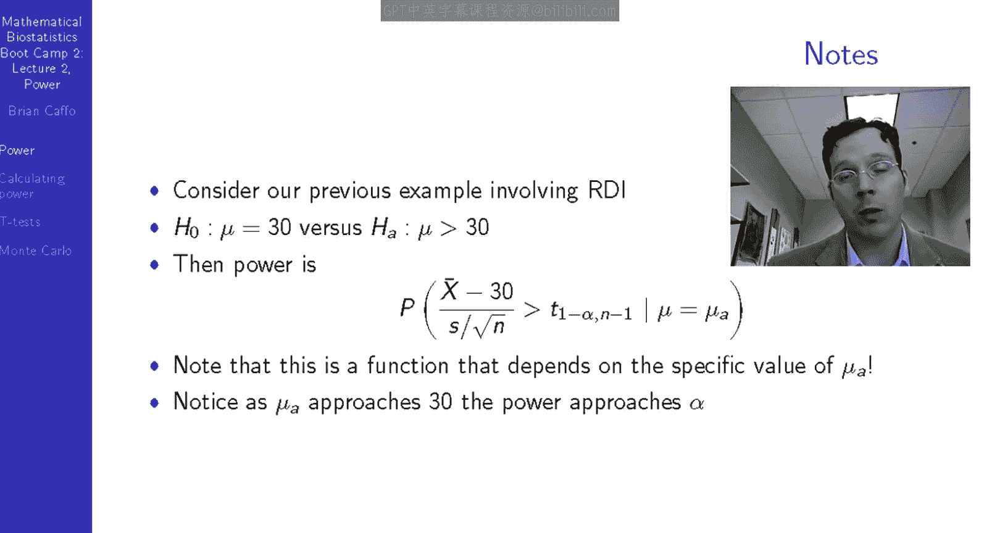

# 约翰霍普金斯大学《数据科学的高级统计｜Advanced Statistics for Data Science》中英字幕（deepseek p36 5_统计功效.zh_en -BV1htPjeYEFH_p36-

Hi， my name is Brian Kaffho and this is Matheal Biosstatistics Boot Camp 2 Le 2 on the subject of Power。

So in this lecture， we're going to talk about power， calculating power。

 power specifically for the T test， and because the T test involves maybe a little bit of math that we don't want to get into。

 we'll talk about how you can do it using Monte Carlo， which is a standard way to estimate power。

So as its name would suggest， power is a good thing， you want more power。

 so power is the probability of rejecting the no hypothesispo when in fact it's false。

So the opposite of power one minus power is the type 2 error rate。

 and that's the probability of failing to reject an hypothesis when it's false。

And we usually label that bigger。So consider our previous example involving the respiratoryatory disturbance index here we are testing whether or not mu was 30 versus the alternative that mu is specifically greater than 30。

Then the power is exactly the probability that our test statistic lies in the rejection region。

Recalled that we calculated the rejection region was if the normalized mean x bar minus 30。

 the value under the null hypothesis divided by the standard error of the mean s over square root n。

 if that normalized mean was greater than a t quantile。

 specifically t1 minus alpha n minus1 quantile where alpha is the desired type 1 error rate。

 so if the statistic is larger than that t quantile， then we reject the null hypothesis。

 so then the power is the probability that we reject the null hypothesis in other words。

 the probability that test statistic is larger than that quantile。

 but instead of calculated under the null hypothesis that mu is 30 calculated under the assumption of the alternative hypothesis that mu is specifically greater than 30。

So in the event that mu A approaches。30， then this probability approaches alpha。

 the type 1 error rate。But on the other hand， if it's not specifically 30。

 if it's actually a power calculation， so the mu is not 30。

 then this calculation depends on the specific value of mu A that we plug in。

 so to do a power calculation， you actually have to know the value under the nu alternative that you want to plug in and then you can perform the calculation。

