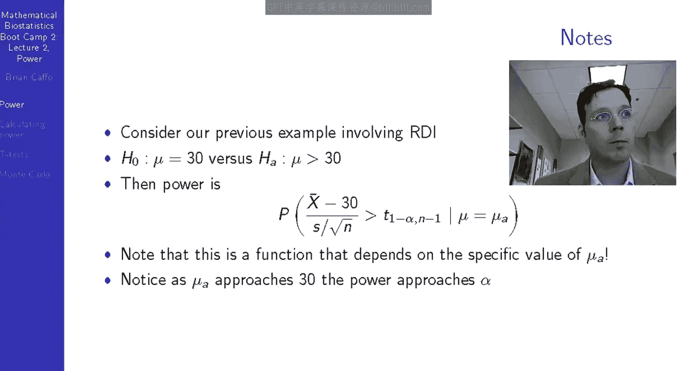
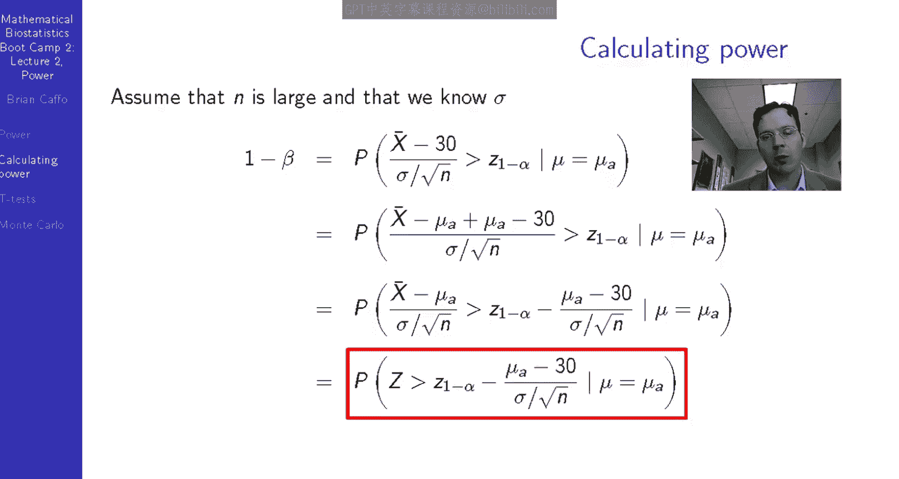
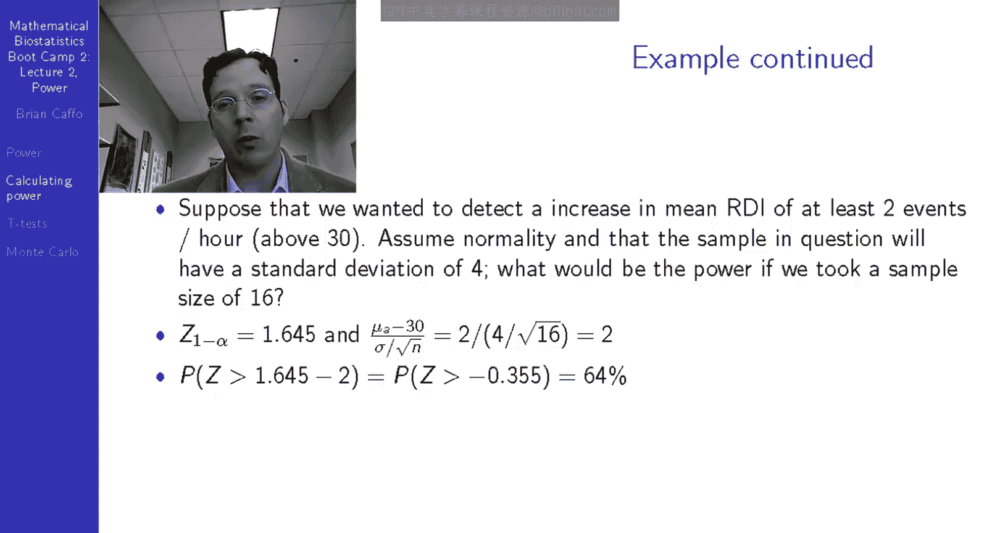
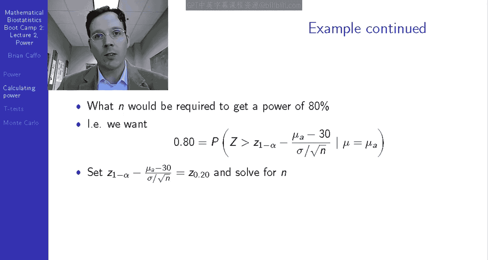

# 约翰霍普金斯大学《数据科学的高级统计｜Advanced Statistics for Data Science》中英字幕（deepseek p37 6_统计功效计算.zh_en -BV1htPjeYEFH_p37-

So let's actually go through this calculation。So remember， beta is the type 2 error rate。

 so1 minus beta is the power。And let's assume n is large so that we can just do standard normal calculations rather than T calculations。

Okay so here notice our s is replaced by sigma， the true value of the standard the population standard deviation。

 so here we have our test statistic， which is x bar minus 30 over sigma over square root n which under the no hypothesispo that mu equals 30 is a Z statistic so our rejection region since we're rejecting whether or not mu is larger than 30 will be as if this mean is large。

 hence if this normalized mean is larger than a standard normal quantile。

 if we want an alpha level error rate we grab the z1 minus alpha level standard normal quantile。

 so for example if we wanted a 5% error rate we would pick the 1。65 the number 1。

645 which is the 95th percentile of the standard normal distribution。

Then one minus beta is the probability that we reject， that the statistic is larger than the cutoff。

 the critical value under the alternative hypothesis， given that mu is in fact mu a。

So now this statistic is no longer a Z statistic because we're considering the alternative hypothesis。

 not the no hypothesis。It's a normal， of course， if the data is Gaussian distributed。

 then this is of course， still normally distributed just with a different mean。

And if n is large and we're applying the central limit theorem。

 then this is again not converging to a Z statisticsistic。

 so what we need to do is convert it to a Z statistics so the easiest thing to do would be to maybe add subtract the mean under the alternative。

And we do that in this line here， then in the next line。

 we simply take the correctly normalized mean x bar minus the mu under the alternate。

 which is what we're assuming to be true， divided by the standard error sigma over square root n。

 and now we're calculating the probability that that is larger than z1 minus alpha minus this quantity over here。

 mu a minus 30 over sigma over square root n。Now again。

 this standardized mean is a Z statistic because we're doing the calculation under the alternative。

 so we want to probability Z is larger than this quantity over here。

 which we can perform this calculation because we know Z1 minus alpha。We're assuming we know sigma。

 we of course know n and we know 30， of course， so muA is the only thing we have to plug in。

 and that is the fact about power calculations is that you have to plug in。

The particular value of the mean that you're interested in。

Okay， so let's actually do a specific version of this calculation and suppose that we want to calculate the power of detecting an increase in the mean RDI of at least two events per hour above our null hypothesis of 30 so we be we want to calculate what's the power if the alternative mean the population the population mean respiratory disturbance index is 32 when our null hypothesispo is that it's 30 and we'd like to calculate the power of detecting that now again。

 under the assumption where the type point error rate is 5%。So again。

 assume normality and that the sampling in question will have a standard deviation of four events per hour。

 what would be the power if we took a sample of size 16 so here our z1 minus alpha is 1。645。

Our mu a minus 30 over4 over square root 16 works out to be two。

 so we want the probability that a standard normal is bigger than 1。645 minus2。

 which is the probability a standard normal is bigger than negative0。

355 which is 64% so under these set of assumptions the probability of detecting an alternative of two events above the hypothesized value per hour is 64% and this is of course a bound if the power only gets larger as the alternative goes away from 30 events per hour。

 this makes sense， of course， right because。The bigger the difference is from the null。

 the easier it should be to detect right if the true population mean is 100 events per hour。

 we shouldn't， you we should have a high probability of detecting that。

 a higher probability of detecting that than if the true mean is 30。01 events per hour。

 which seems like it would be very hard to detect relative to 30 because it's such a small change。

So this。Power 64% is a bound for all values above 32。

So instead of calculating power， given a sample size， a variance and a。Value of the alternative。

 we could flip the question around and say， imagine we have a power that we'd like to achieve。

For a particular value of the alternative， sample what sample size would we need to achieve it。

 and this is called a sample size calculation。And both of these calculations are typically done。

At the phase of designing a study。 So when you actually want to figure out。

How many subjects to have in a study or whether or not to conduct a study if your number of subjects is constrained。

So here we do this calculation exactly where we calculate the sample size we would need to get 80% power。

 80% is a very common benchmark standard in the field of science。

 you can argue whether or not 80% is enough power but it is somewhat of a benchmark in say for example。

 clinical trials。I would admit though most clinical trials do two sided tests and here we're calculating power for a one sided test。

So here we want 0。8 to be the probability that our test statistic。

 which appropriately normalized as a Z statistic under the alternative， is greater than this。

 the standard normal quant Z minus minus alpha， but remember when we converted our test statistic so that it was normalized appropriately under the alternative。

 we have this extra term UA minus 30 over the standard error sigma over square root n and this calculation is then of course calculated under the alternative。

Which is when。when we normalize with respect to mue eggs and you get this extra term out here。

So if we want this probability to be 80%， then we know this entity here on the right。

 Z1 minus alpha minus mua minus 30 over sigma over square root n， we know what it has to be。

 it has to be equal to the 20th。Percentile from the standard normal distribution。Right。

 so we have to set。And so we know what Z1 minus alpha is， we know what mu A is。

 we obviously know what 30 is， and then sigma over square root n。

 we know all of those except n and we can just solve for n。

And that is a so called sample size calculation and you know logic would dictate and of course the mathematics works out this way that if we solve this power calculation for a particular value of muA。

It's going to be applicable for every larger value of muA because the direction of the alternative is larger。

 we're not going to need a smaller or we're going to need a smaller sample size to detect bigger effects。

So once we do this calculation for a specific value of muA。

 it holds that sample size will give us 80% power or higher for all larger values of muA。

 and so usually you pick muA to be the smallest effect that you could reasonably detect。

That you would reasonably want to detect。