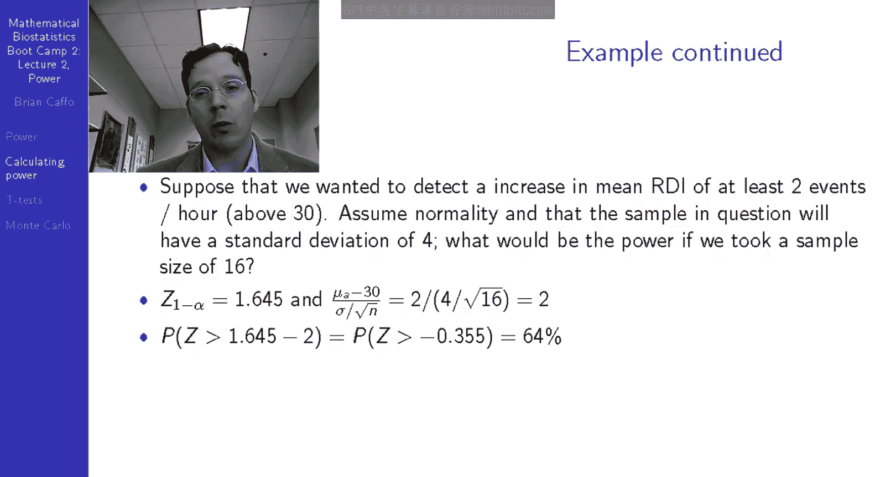

# 高级统计学：P37：统计功效计算

在本节课中，我们将学习如何计算统计检验的功效，以及如何根据期望的功效来确定所需的样本量。我们将通过一个具体的例子，详细讲解计算步骤和背后的逻辑。

## 概述

统计功效（Power）是指当备择假设为真时，正确拒绝原假设的概率。它与第二类错误（β）的关系是：功效 = 1 - β。本节课我们将学习如何计算单侧检验的功效，以及如何反过来根据期望的功效进行样本量计算。

## 功效计算原理

上一节我们介绍了假设检验的基本概念，本节中我们来看看如何具体计算功效。我们假设样本量 n 足够大，因此可以使用标准正态分布（Z分布）进行计算，而无需使用T分布。

我们的检验统计量是：
`Z = (x̄ - μ₀) / (σ / √n)`
其中，μ₀ 是原假设下的均值（本例中为30），σ 是已知的总体标准差。

对于显著性水平 α 的单侧检验（备择假设为 μ > μ₀），我们的拒绝域是：当 Z > z₁₋α 时拒绝原假设。例如，当 α = 0.05 时，z₁₋α = 1.645。

功效是在备择假设（μ = μₐ）为真的条件下，检验统计量落入拒绝域的概率。此时，统计量 `(x̄ - μ₀) / (σ / √n)` 不再服从标准正态分布，但其分布是已知的。通过标准化，我们可以得到功效的计算公式：
`功效 = P( Z > z₁₋α - (μₐ - μ₀) / (σ / √n) )`
其中，Z 是标准正态随机变量。

## 具体计算示例

现在，我们通过一个具体例子来应用上述公式。假设我们想检测呼吸障碍指数（RDI）均值是否比原假设（30次/小时）至少高出2次/小时。

以下是计算所需的具体参数：
*   原假设均值 μ₀ = 30
*   备择假设均值 μₐ = 32
*   显著性水平 α = 0.05，对应 z₁₋α = 1.645
*   已知总体标准差 σ = 4
*   样本量 n = 16

根据公式进行计算：
1.  计算效应量标准化值：`(μₐ - μ₀) / (σ / √n) = (32-30) / (4/4) = 2`
2.  代入功效公式：`功效 = P( Z > 1.645 - 2 ) = P( Z > -0.355 )`
3.  查标准正态分布表或使用统计软件，可得 `P( Z > -0.355 ) ≈ 0.64`

因此，在上述假设条件下，我们有64%的概率（功效）能够检测出均值增加2次/小时的差异。需要注意的是，对于所有大于32的 μₐ 值，检测功效都会高于64%，因为效应越大越容易被检测到。

## 样本量计算

在实际研究设计中，我们更常遇到的问题是：为了在特定效应下达到期望的检验功效（例如常见的80%），需要多大的样本量？这被称为样本量计算。

其逻辑是将功效计算公式反转，求解 n。我们希望：
`0.8 = P( Z > z₁₋α - (μₐ - μ₀) / (σ / √n) )`
这意味着不等式右侧的部分必须等于标准正态分布的20%分位数（即 z₀.₂）。通过方程：
`z₁₋α - (μₐ - μ₀) / (σ / √n) = z₀.₂`
我们可以解出所需的样本量 n。其中，z₁₋α、μₐ、μ₀、σ 均为已知，z₀.₂ ≈ -0.842。

通常，我们会选择有实际意义的最小效应量 μₐ 来进行计算。这样确定的样本量，可以保证在检测大于或等于该最小效应量的所有差异时，功效至少达到80%。

## 总结

本节课中我们一起学习了统计功效的计算方法。我们首先推导了在大样本条件下，基于标准正态分布的单侧检验功效公式。然后通过一个具体实例演示了计算过程。最后，我们探讨了如何根据期望的功效（如80%）反推研究所需的样本量。理解这些计算对于科学研究的实验设计至关重要，它能帮助我们在资源有限的情况下，评估检测到真实效应的可能性，或合理规划研究的规模。