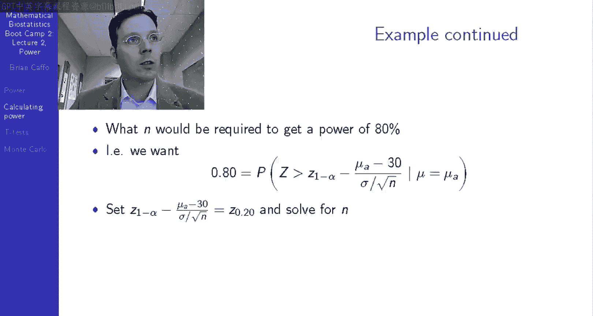
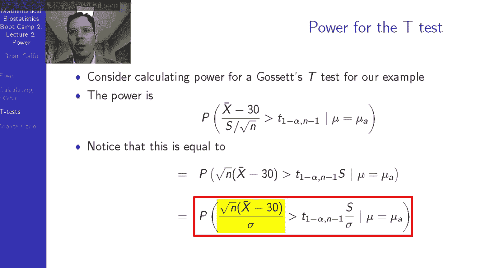
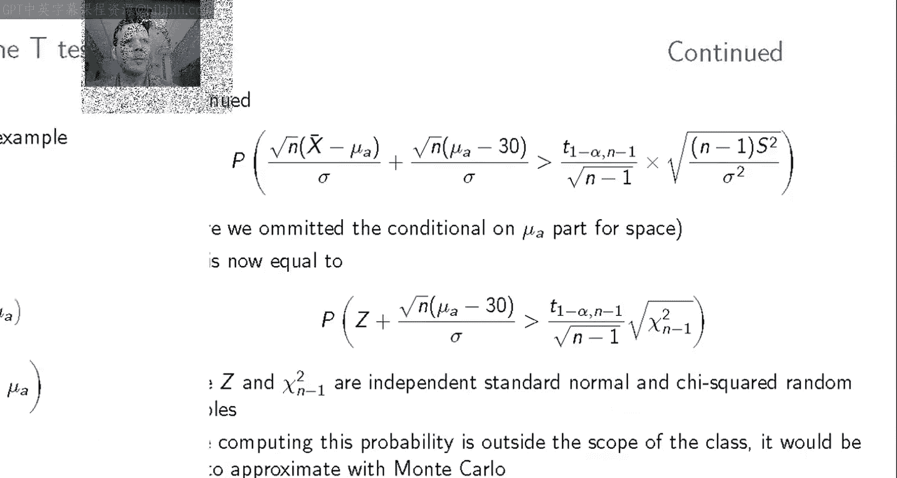
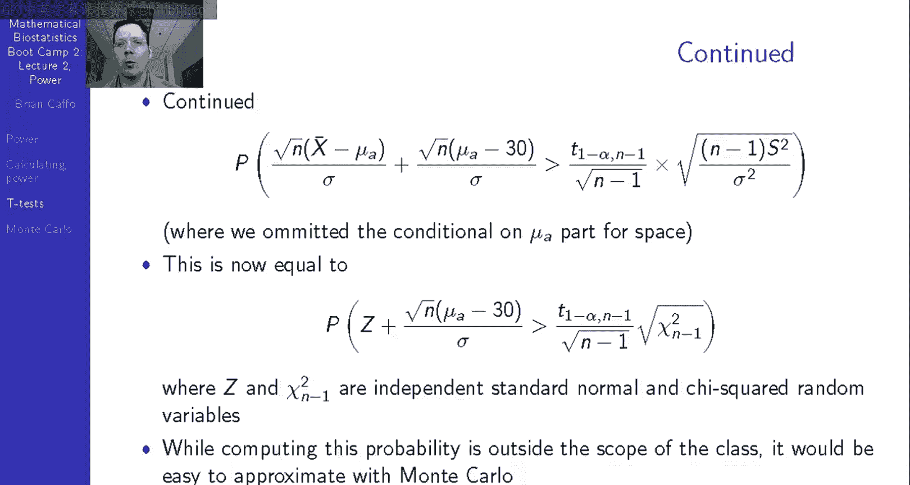
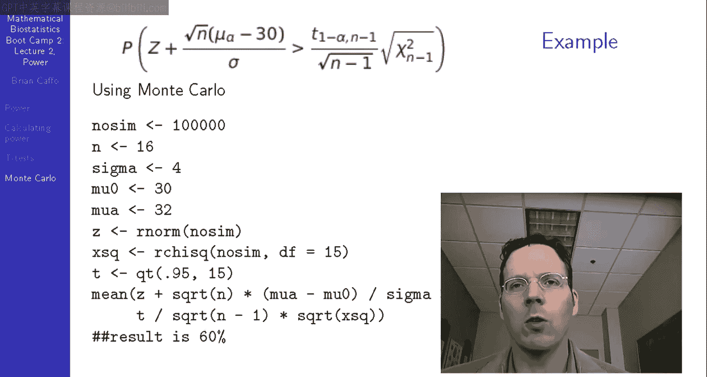
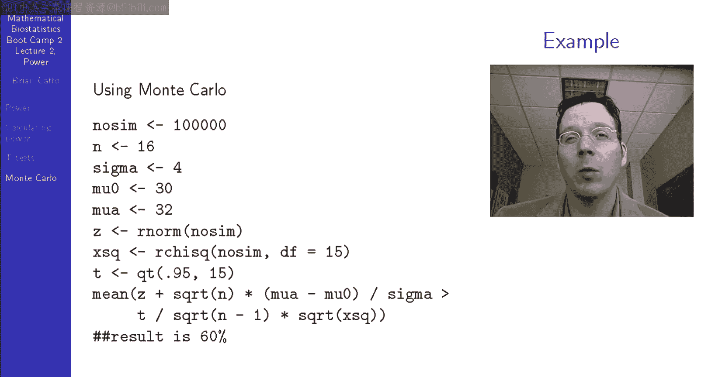
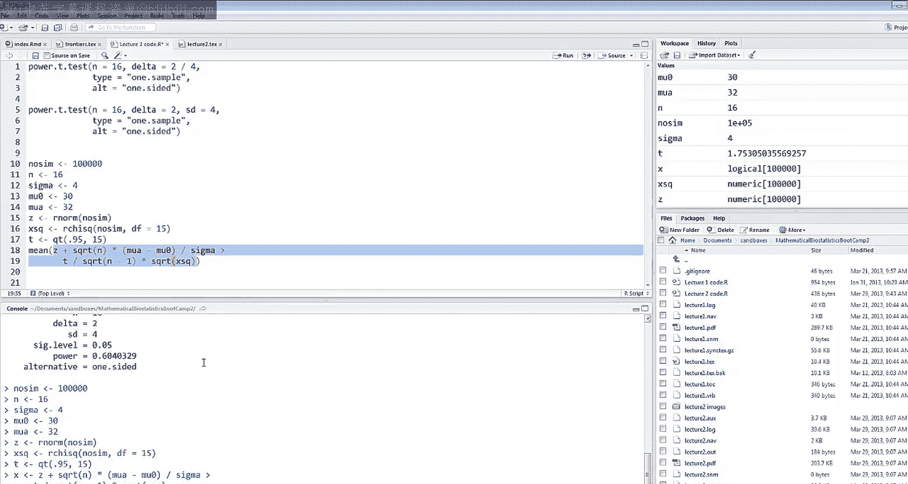
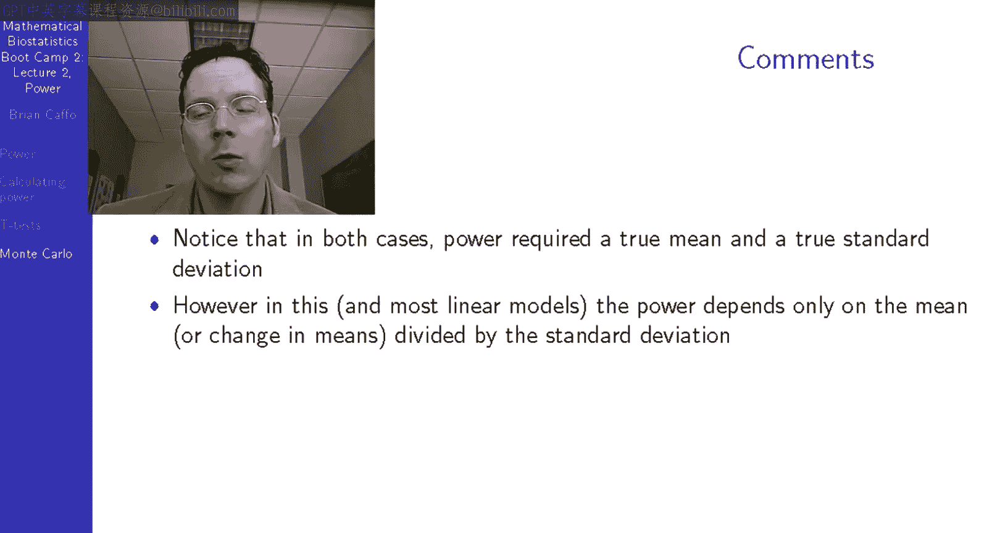

# 约翰霍普金斯大学《数据科学的高级统计｜Advanced Statistics for Data Science》中英字幕（deepseek p38 7_t检验与蒙特卡洛模拟.zh_en -BV1htPjeYEFH_p38-

Okay。So the calculation when mu is when your alternative is less than the null value is very similar。

 you can if you're taking this class， you should be able to do it。For the unequal to hypothesis。

 things change a little bit and here's the procedure I'm going to recommend。

Pick one of the two sides let's say you know in general it's probably easier maybe to do the bigger sides say mua being bigger than mu non so pick the bigger one sided hypothesis with you have to pick you know again to do a power calculation you have to pick the value of the under the alternative that you're going to check and so let's assume you pick a value of muA that's larger so calculate the power for the one sided hypothesis for the test of a larger muA calculate that power but using alpha over two is the error rate instead of alpha for the error rate and this is。

Right enough， it excludes。A little bit of probability in the power calculation， but it's kind of。

Not a probability that you have to worry about so much because it's so small。

And then basically what it omits is the probability if your alternative mean is larger than the null mean。

The probability of randomly getting a test statistic。

 it so small that you reject in the other direction。And you。

 so that probability is usually very small， so who cares。So you can just admit it。

 fancy power calculators might include it， but usually that probability is so small it's irrelevant。

 so I should quit talking about。嗯。As alpha gets larger than the power goes up， right。

 if you're requiring less evidence to reject the no hypothesis then you're going to detect more alternative hypotheses。

 just like in a court of law， if if you don't require much evidence to convict people。

 you're going to convict a lot of guilty people， you also convict some innocent one。

 more innocent ones too， but that's not powers only concern with the probability under the alternative。

Power of a one sided test is obviously bigger than the power of a two sided test。

And you can see this in the calculation pretty easily in the way that I'm suggesting to do it because when you calculate a quantile of alpha over two。

 you move further out， say into the normal probability tail。

 and then that value gets a little bit bigger and you can see that the probability gets a little bit smaller。

嗯。Let's see and then the further your alternative mean gets away from your null mean either you know larger if you're testing larger than or smaller if you're testing less than or absolute value gets further away from you not if you're testing not equal to。

 then the farther it gets away the greater the power is and that of course that makes total sense in that。

know the stronger the alternative hypothesis is， the easier it should be to detect it。

And then of course， as your sample size goes up， power your power goes up。

 and then this is why sample size calculations are so important to me it's because of all the things we're discussing。

 the one that's only potentially under your control is usually N。

So let's talk about calculating power for a T test because things get a little bit more complicated。

So the power， just like we calculated， but let's assume it's a greater than an alternative。

 the power is the probability that our test statistic lies in the rejection region。

 so x bar minus 30 in our RDI respiratory disturbance index example。

 x bar minus 30 over s over square root n is bigger than our t quantile now it's t with1 minus alphan n minus1 degrees of freedom with this calculation being executed under the alternative hypothesis that mu equals mu a。

So。Now if we were to do the same trick we did before where we were to add and subtract muA and drag the term on the other side。

 we'd still have an S， which is random。To contend it on the right hand side。

 so that's you know that's a problem that doesn't yield a collection of things that we know that we can solve for them。

So。Let's manipulate it around and see what we can figure out。So this probability here。

 this top probability is equal to the probability screwed n x bar minus 30 is greater than this T times s and then。

We could divide the left hand side by sigma and the right hand side by sigma as well。

ok。Let's talk about how we can do this calculation given the tools that we have from the class。

So here I've added and subtracted a mu a， so we get a z random variable here for square root n x bar minus mu a over sigma here we get something that we know or we need to plug in values at least so we get mu a minus 30 over sigma square root times square root n here you know again to remember to do any power calculation。

 you're going to have to plug in the value under the alternative。

So even though we don't technically know muA， we've got to be able to plug in potential values of muA。

 we of course know ourt quantile in the square root n minus1。

And then over here on this right hand side， just in case you didn't notice it。

 I multiplied it and divided by a squared at n 1。 so this farmost right hand quantity n minus1 S squared over sigma squared。

We' remember if the data are IID Gaussian that that works out to be a chi squared random variable。

 So we have over here the square root of a chi squared。

 So I've just rewritten this equation now down here on the second line we have replaced the Z random variable by Z and the chi squared random variable by a chi squared notation and we've stated it。

 we've never proved it， we've stated it that the Z and the chi squared are independent。

So this probability statement is a little bit hard because it involves the bivariate distribution of a Z and a chi squared。

 which is a little bit tricky to work with， but we could actually do this via Monte Carlo very easily。

 we could simulate pairs of Z random variables and chi squared random variables。

And evaluate this inequality for every pair， so we would take a simulateulator z random variable。

 we would subtract square root n mua minus 30 over sigma， I mean， I'm sorry we would add that。

And then we would take a chi squared simulant and we would square root it and then multiply it by the t quantile divided by square root n 1。

 and we would just check to see which is bigger if the left hand side was bigger。

 we would record a1 and if the right hand side was bigger， we would record a zero。

 the percentage of ones from that simulation exercise having generated lots of pairs of independent chi squared and Gaussians standard Gaussians。

The percentage of ones would then be an approximation to this probability。

 and it would limit to this probability as we did more and more simulations。

So if you wanted to do this more exactly you would have to be able to numerically calculate the joint distribution of a normal in a chiise quarter。

 which is not so hard， you can figure out how to do it but R actually already has something that's called power。

t。 test and here I give the R code just for doing it for a specific settings and the result in this case is a power of 60% so the function is power。

 t。 test of course you have to enter in the n you have to enter in the delta which in this case is mua minus the mu under the null hypothesispo so let's assume that that's two。

And oh， a little fact that I should have alluded to before。

 if you look back at this calculation here。Notice that。This formula here。

Only depends on the difference between mu a and mu not divided by sigma。 So so I was。

 I was actually incorrect when I said we we needed to know mu A。 We don't really well。

What we need to know is how different muA is from mun in standard deviation units。

 so mua minus mu n over sigma and notice muA and mu n and sigma are all in the same units。

 so this quantity usually called an effect size。I usually what these problems are sort of characterized in terms of because it's a unitfr quantity that has some hope of being interpretable across experiments。

 so here we don't actually have to plug in as sigma。

 we just have to know what mua minus mu not over over sigma works out to if we were to put in here that delta equals 2 and then also add the argument that sigma equals4。

 we'd get the identical answer and you can try it to make sure。

Okay， so let's do the same exact calculation but using Monte Carlo here I'm going define the number of simulations。

 What is that to 100，000 I'm going to set my n is 16。

 my sma is 4 U a mu not to be 32 and 30 and then I'm going to simulate 100，000 standard normals， 100。

000 independent chi squares so now I have 100，000 pairs of normals and chi squared and of course it doesn't matter how I match them up I could permute the normals or the chi squares and you still get the same thing here my degrees of freedom is 15 because I have 16 subjects and my degrees of freedom is n minus1。

My T quantile is the 95th quantile of the percentile of the T distribution with 15 degrees of freedom and that's this QT function right here and then here I。

This line right here， ignore the mean statement for a second。

 imagine if I had just started with the Z here and said z plus square root n times mua minus mu not divided by sigma greater than t divided by square root n minus1 times square root x squared。

X square being the random chi squared。That quantity would simply evaluate it would return a vector of ones every time the left hand side was bigger than the right hand side and a bunch of zeros every time the left hand side was smaller than the right hand side。

 So this vector now is just a vector of zeros and ones。

1 every time z plus square root Ma minus mu divided by sigma is bigger than t divided by square root n minus1 times square root xSq。

Okay， so that returns a vector of that type， and then mean。

 the mean of a vector of zeros and ones is just the proportion of ones， and you can type this in。

 the result is 60%。Or 60% up to Monte Carlo Air so you get 60 point something， of course。

ButBy the way for these calculations， the error rate for the mean is on the order of one over the square root of the sample size。

 so you know we're getting decimal place accuracy on the order of one over square root 100。

000 so if you want higher accuracy you' got to run the computer longer。

Okay， so let's just go through these calculations。 I got my R studio window open here。 Let's see。

 So I'm going to first do the power T test。 Let me do that。 And here's the output right here。

 it returns the values that you input and you get power as 60%。 and then just to check。

 I'm going to do it here。Where。There you go， it was SD not sigma。

 so here I set SD to be 4 and delta to be 2 instead of delta to be 2 over 4。

 and then it assumes that SD is one。嗯。And so here you can see you get identically the same answer here。

 I see if I can。There we go。 So 6060。4032， not。 Yes， same thing。 Okay。

 now let's go ahead and do our Monte Carlo calculation。Willll define a number of simulations。

And then here， let me just enter this in just to show you。嗯。

So I'm just going to show you a couple of values from this vector and see it's actually not zeros and ones。

 it's trues and falses which are the Boolean values in R， but in R。

 if you say let's just multiply them by one， which does nothing。

 it converts whenever it needs to convert them to numerical values for operations， it just does it。

Okay so let's take the mean of those values and it works out to be 60。

608 which is very close to the very precise calculation Okay。

 and then in these final final slides I just remind us that we have to have a true mean and a true standard deviation to do these calculations but that really it's only the change in the means divided by the standard deviations that affect the calculations so just reminding you of that point because it's incredibly useful All right that's the end of lecture two and we'll see you next time for lecture three。

