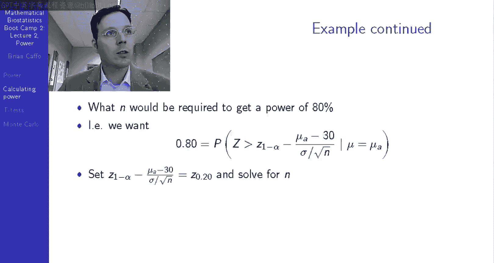
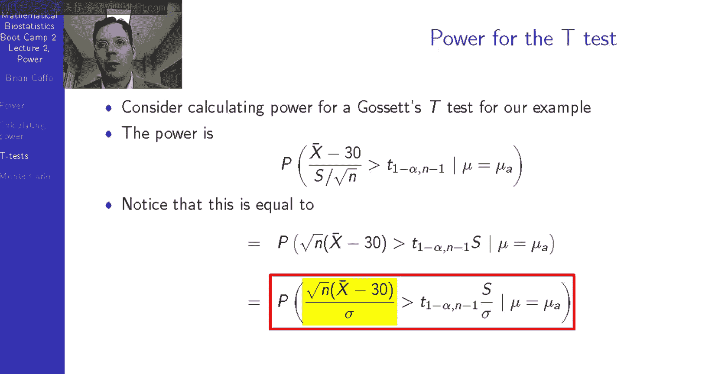
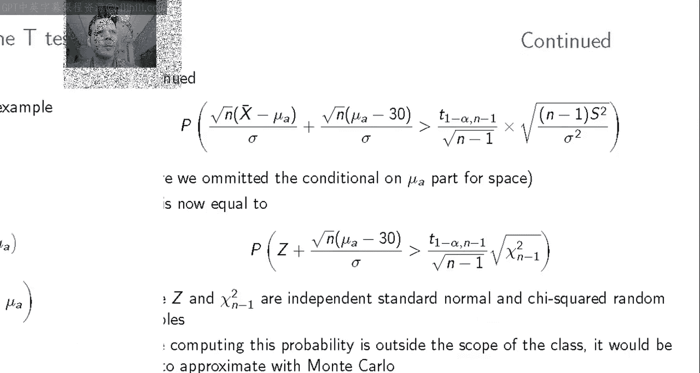
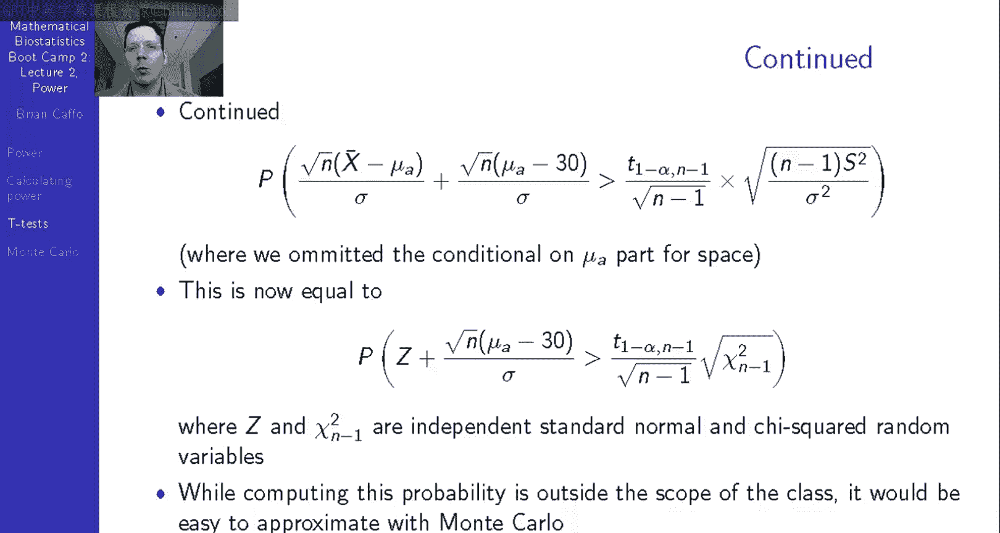
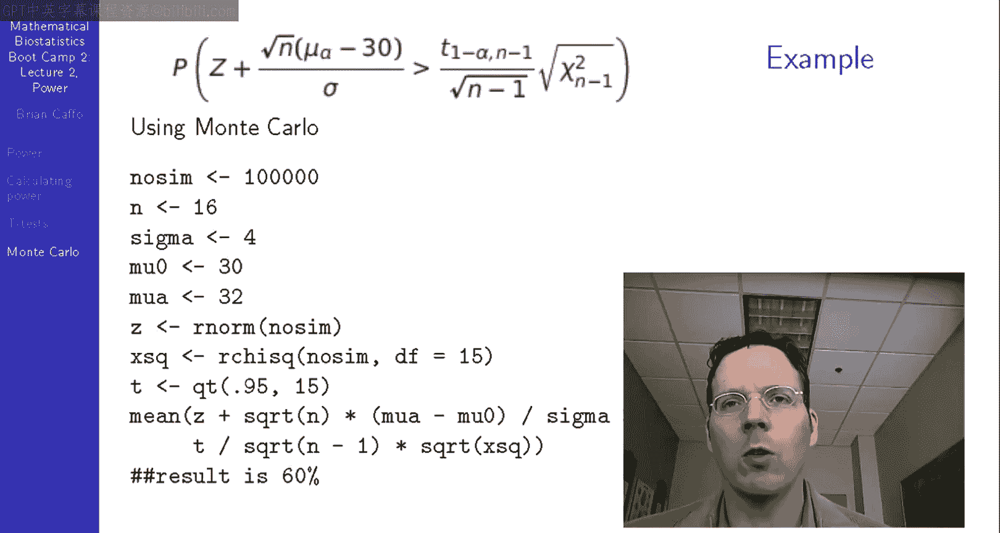
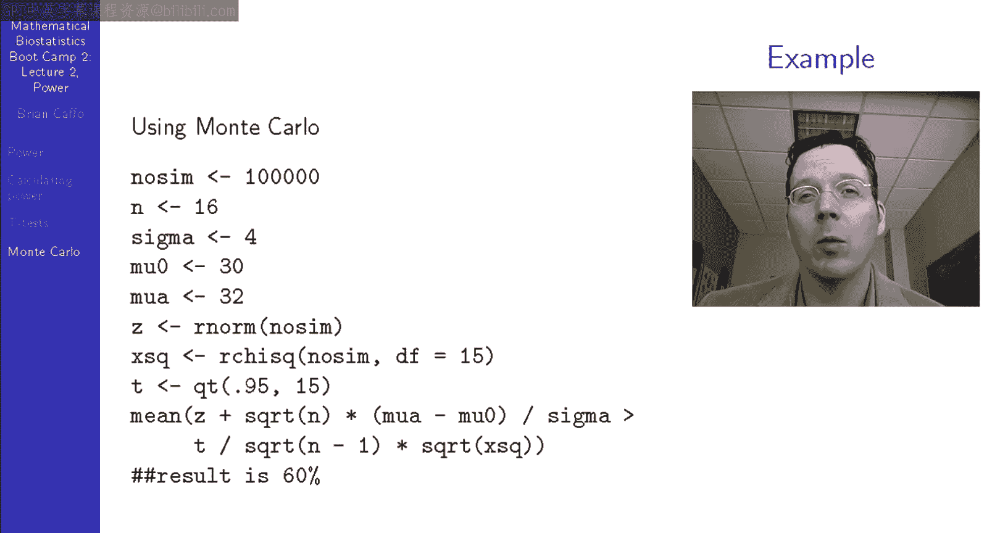
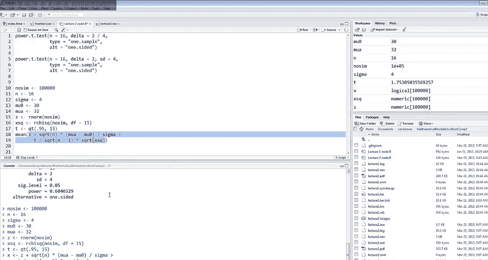
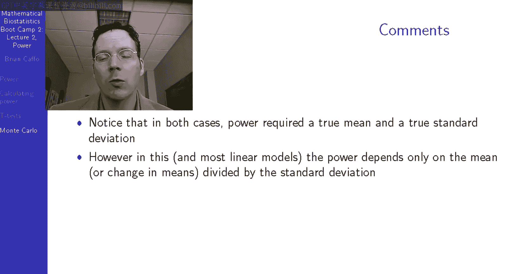

# 高级统计学：2.7：t检验的统计功效与蒙特卡洛模拟 🧪



在本节课中，我们将学习如何计算t检验的统计功效。统计功效是当备择假设为真时，正确拒绝原假设的概率。我们将重点讨论单侧检验与双侧检验的差异，并学习如何使用蒙特卡洛模拟来近似计算t检验的功效。

## 单侧与双侧检验的功效计算

上一节我们介绍了统计功效的基本概念，本节中我们来看看单侧和双侧检验在功效计算上的区别。

对于备择假设小于原假设值的情况，计算过程非常相似。如果你正在学习这门课程，你应该能够完成它。

对于备择假设不等于原假设值的情况，计算过程略有不同。以下是推荐的计算步骤：

选择一个单侧方向。通常，选择备择均值大于原假设值的方向可能更容易。进行功效计算时，必须指定一个备择假设下的具体值。假设你选择了一个更大的值 `μ_A`。

计算这个单侧检验的功效，但使用 `α/2` 作为错误率，而不是 `α`。这种方法足够准确，它排除了在功效计算中的一小部分概率。这部分概率通常非常小，可以忽略不计。它忽略的是，当你的备择均值大于原假设均值时，随机得到一个非常小的检验统计量以至于在相反方向上拒绝原假设的概率。这个概率通常很小，所以无需担心。你可以直接忽略它。复杂的功效计算器可能会包含它，但通常这个概率小到无关紧要。

## 影响统计功效的因素

以下是影响统计功效的几个关键因素：

*   **显著性水平 `α`**：随着 `α` 增大，功效会上升。如果你拒绝原假设所需的证据门槛降低，你将能检测到更多的备择假设。
*   **单侧 vs 双侧检验**：单侧检验的功效明显大于双侧检验的功效。在我建议的计算方法中，当你计算 `α/2` 的分位数时，你会移动到更远的尾部，这个值会变得稍大，导致概率变得稍小。
*   **效应大小**：你的备择均值离原假设均值越远（对于“大于”或“小于”检验是方向性的，对于“不等于”检验是绝对距离），功效就越大。这完全合理，因为备择假设越强，就越容易被检测到。
*   **样本量 `n`**：随着样本量增加，功效也会增加。这就是为什么样本量计算如此重要。在我们讨论的所有因素中，通常只有样本量 `n` 是唯一可能由你控制的。

## t检验的功效计算

现在我们来讨论如何计算t检验的功效，因为情况会变得更复杂一些。

假设是“大于”的备择假设，功效就是我们的检验统计量落在拒绝域的概率。以我们的呼吸障碍指数为例，公式如下：

`P( (x̄ - 30) / (s / √n) > t_{1-α, n-1} )`

这个概率是在备择假设 `μ = μ_A` 下计算的。

如果我们尝试像之前那样，通过加减 `μ_A` 并移动项来处理，我们仍然需要处理右边随机变量 `s` 的问题。这并不容易直接求解。

让我们进行一些代数变换，看看能得到什么。上述概率等价于：



`P( √n (x̄ - 30) > t * s )`



我们可以在左边和右边同时除以 `σ`：

`P( √n (x̄ - 30)/σ > (t/σ) * s )`

现在，我们在左边加上并减去 `μ_A`：

`P( √n (x̄ - μ_A)/σ + √n (μ_A - 30)/σ > (t/σ) * s )`

记住，要进行任何功效计算，你都需要代入备择假设下的值。所以，尽管我们技术上不知道 `μ_A`，但我们必须能够代入 `μ_A` 的潜在值。当然，我们知道t分位数和 `√(n-1)`。

在右边，为了处理 `s`，我们乘以并除以 `√(n-1)`：

`(t/σ) * s = (t/√(n-1)) * √( (n-1)s²/σ² )`

我们记得，如果数据是独立同分布的高斯分布，那么 `(n-1)s²/σ²` 服从卡方分布。因此，我们在这里得到了一个卡方随机变量的平方根。

## 使用蒙特卡洛模拟计算功效

让我们谈谈如何利用本课程的工具进行这个计算。



我已经重写了这个方程。在第二行，我们用 `Z` 表示标准正态随机变量，用 `χ²` 表示卡方随机变量。我们之前陈述过（但未证明），`Z` 和 `χ²` 是独立的。

这个概率陈述有点困难，因为它涉及 `Z` 和 `χ²` 的二元分布。但我们可以通过蒙特卡洛模拟非常容易地完成。

我们可以模拟成对的 `Z` 随机变量和卡方随机变量，并对每一对评估这个不等式。我们会模拟一个 `Z` 随机变量，加上 `√n (μ_A - 30)/σ`，然后模拟一个卡方随机变量，取平方根，再乘以 `t / √(n-1)`。接着，我们检查哪边更大。如果左边更大，我们记录为1；如果右边更大，我们记录为0。

在生成了大量独立的卡方和标准高斯对之后，其中1的百分比就是这个概率的近似值。随着我们进行越来越多的模拟，它会趋近于这个真实概率。

## 使用R进行精确计算与模拟

如果你想更精确地计算，你需要能够数值计算正态分布和卡方分布的联合分布。R实际上已经有一个叫做 `power.t.test` 的函数。

以下是针对特定设置的R代码示例，结果功效为60%：



```r
power.t.test(n = 16, delta = 2, sd = 4, sig.level = 0.05, type = "one.sample", alternative = "one.sided")
```

回顾之前的计算，请注意这个公式只依赖于 `(μ_A - μ_0) / σ`。所以，我之前的说法有误，我们并不需要确切知道 `μ_A`。我们需要知道的是备择均值与原假设均值相差多少个标准差单位。`(μ_A - μ_0) / σ` 这个量通常被称为效应大小。问题通常用这个来表征，因为它是一个无量纲的量，有望在不同实验之间进行解释。

因此，我们实际上不需要单独代入 `σ`，只需要知道 `(μ_A - μ_0) / σ` 的值。如果我们在这里设置 `delta = 2` 并添加参数 `sd = 4`，我们会得到相同的答案。

现在，让我们使用蒙特卡洛做完全相同的计算。

```r
n_sim <- 100000
n <- 16
sigma <- 4
mu_a <- 32
mu_0 <- 30
df <- n - 1
t_quantile <- qt(0.95, df) # 单侧检验，alpha=0.05

# 模拟
set.seed(123) # 可重复性
z <- rnorm(n_sim)
chisq <- rchisq(n_sim, df)

# 计算不等式是否成立
power_est <- mean(z + sqrt(n) * (mu_a - mu_0)/sigma > (t_quantile / sqrt(df)) * sqrt(chisq))
print(power_est)
```

我定义了模拟次数为100,000。设置 `n=16`，`σ=4`，`μ_A=32`，`μ_0=30`。然后我模拟了100,000个独立的标准正态变量和100,000个独立的卡方变量。现在我有了100,000对正态和卡方变量。我的自由度是15，因为我有16个受试者，自由度是 `n-1`。我的t分位数是自由度为15的t分布的95%分位数。

忽略 `mean` 语句，想象一下我从这里的 `Z` 开始，判断 `Z + √n (μ_A - μ_0)/σ` 是否大于 `(t / √(n-1)) * √(chisq)`。这个表达式会返回一个向量：每次左边大于右边时为 `TRUE`，小于时为 `FALSE`。所以这个向量现在就是一堆逻辑值。`mean` 函数作用于一个由 `TRUE` 和 `FALSE` 组成的向量时，会返回 `TRUE` 的比例，也就是1的比例。输入这段代码，结果大约是60%。由于蒙特卡洛误差，你可能会得到60点几。



顺便说一下，对于这些计算，均值的误差率大约在 `1/√(样本量)` 的数量级。所以我们得到的小数点精度大约在 `1/√100000` 的量级。如果你想要更高的精度，就必须让计算机运行更长时间。

## 课堂演示

让我们运行这些计算。首先进行 `power.t.test` 计算，输出返回了你输入的值，功效为60%。为了验证，我设置了 `sd=4` 和 `delta=2`，而不是 `delta=2/4` 且假设 `sd=1`。你可以看到得到了完全相同的答案。

现在让我们进行蒙特卡洛计算。定义模拟次数，然后输入代码。让我展示一下这个向量的几个值，它实际上是 `TRUE` 和 `FALSE`，这是R中的布尔值。在R中，如果你需要将它们转换为数值进行计算，它会自动转换。取这些值的均值，结果大约是60.6%，这与非常精确的计算结果非常接近。

在最后的幻灯片中，我提醒我们，要进行这些计算，必须有一个真实的均值和真实的标准差。但实际上，只有均值的变化除以标准差才会影响计算结果。重申这一点是因为它非常有用。



## 总结

本节课中我们一起学习了t检验统计功效的计算。我们了解到：
1.  单侧检验的功效计算相对直接，而双侧检验需使用 `α/2` 并忽略一个极小的反向拒绝概率。
2.  统计功效受显著性水平 `α`、检验类型（单侧/双侧）、效应大小 `(μ_A - μ_0)/σ` 和样本量 `n` 的影响，其中样本量通常是研究者唯一可控制的变量。
3.  t检验的功效计算涉及正态和卡方分布的联合分布，可通过代数变换理解其结构。
4.  蒙特卡洛模拟提供了一种强大而直观的方法来近似计算复杂的概率，我们通过模拟 `Z` 和 `χ²` 随机变量对，评估不等式来估计功效。
5.  R中的 `power.t.test` 函数可以方便地进行精确功效计算或样本量规划，其核心输入是效应大小（`delta` 与 `sd`）。



掌握功效计算对于设计有说服力的实验和避免II类错误至关重要。