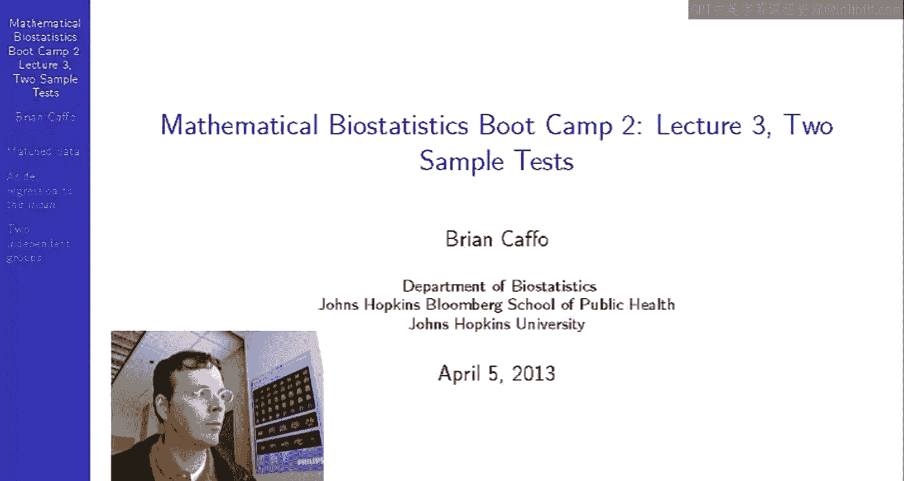
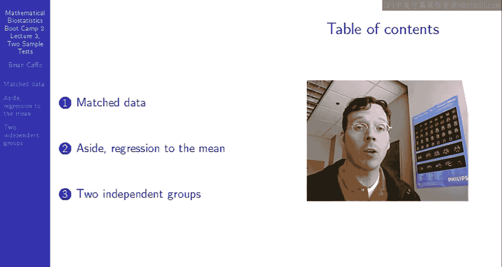
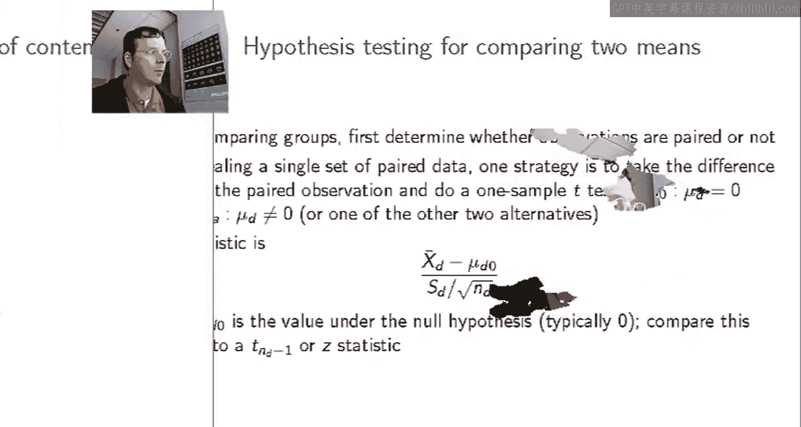
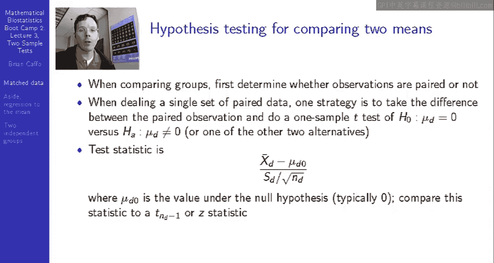

# 约翰霍普金斯大学《数据科学的高级统计｜Advanced Statistics for Data Science》中英字幕（deepseek p39 8_双样本检验：配对数据I.zh_en -BV1htPjeYEFH_p39-

Hi， my name is Brian Kaffho and this is Matheal Biostatistics bootcamp Le3。

 where we're going to talk about two sample tests。

Okay， so today we're going to first talk about match data then we're going to talk and match data brings up a kind of interesting immediate discussion on the topic of regression to the mean which has a very famous history。

 and then we're going to talk about two independent groups。

So when you're comparing two groups， one of the first things you want to ascertain is whether or not the data are paired or not。

 And so it's a little less， little less clear than you might think at first。 So。

 so the most obvious instance where the data are paired is when the。

Observations are both on the same subject， so take as an example， a trial of a treatment。

 say some medication。In one case， imagine if you randomize that treatment to one group of people and randomize say a placebo to another group of people。

 then that's clearly not paired， you have one group of people that received the treatment。

 another group that received the other treatment， the placebo。

In where it's obviously paired would be imagine if you in some random order for every person gave them the treatment and then had maybe a washout period and then gave them the placebo or for some people you gave them the placebo first and then had a washout period and then gave them the treatment in that case it's obviously paired because you had the same person receiving both the treatment and control so in both those cases the question would be to compare the treatment versus the placebo but in one case you'd have two independent groups of separate people and in the other case you would have。

Each person receiving both so in the latter case they would be paired and in some cases pairing is maybe a little less obvious。

 so for example， what might happen is you're not looking at something that's assigned。

 let's say you want to compare， let's say people with high blood pressure to people with low blood pressure and you wanted to compare some other characteristic。

嗯。Let's say there we'll see we used sleep as an example the other day。

 so imagine if you wanted to compare the low blood pressure people to the high blood pressure people and compare their RDI。

 their respiratory disturbance index well that seems like it would be unpaired because you would have the low blood pressure people would be one group of people and the high blood pressure people would be another group of people。

But they could be paired because often what people do in these kinds of experiments is they get。

 say they're low blood pressure people and then for every person in that group。

 they then try and match in terms of age and gender and other characteristics try to closely match for every person another person in the high blood pressure group。

 in that case it would be sort of softly paired in that they would it wouldn't be the exact same person of course。

 because a person at one given instance can't have low blood pressure and high blood pressure at the same time。

But what you could have is where a person one from the low blood pressure group is very closely matched in terms of age and other characteristics weight or whatever。

 to a high blood pressure person， and then they are paired， they're just paired in a different way。

So that that's called matching when you try to take for every person in one group。

 find another person in another group that has very similar characteristics for all these other variables that you're maybe not interested in。

 but you think could contaminate the comparison that process is called matching and it's a very effective way to。

To deal with variable as I mentioned variables that you think might confound the relationship that you want to look at so in any case the discussion for this slide for today is to simply you know to distinguish between two different types of two group comparisons。

 the two main types of two group comparisons one in instances where observations are paired either by matching or something else。

Okay， so let's consider the instance where the observations are paired and this is the easy case because then everything reduces down basically to a one sample problem。

 so when the observations are paired， one strategy is to take the difference between the paired observations and do one sample T test of the nullpo that the population mean difference is zero versus the alternative that the population mean difference nonzero or one of the other two alternatives。

And then that would be a very straightforward thing to do your test statistic would just be the ordinary one sample test statistic。

 the average of the distances。The minus the hypothesized mean you typically zero divided by the standard deviation of the differences。

 divided by the square root of the number of pairs of observations。

 so you want to make sure that you're putting the number of pairs of observations in there。

 not the number of total number of observations because when you start out you wind up with two n observations。

 one for the first measurement and the other for the second measurement so when you subtract them。

You wind up with the half the number of observations that you typically started with so any rate the。

Principal way to do this is to simply take the differences， throw out the data。

 and treat the differences as if they were a one sample test。

 and that's the ordinary paired two group T test。

