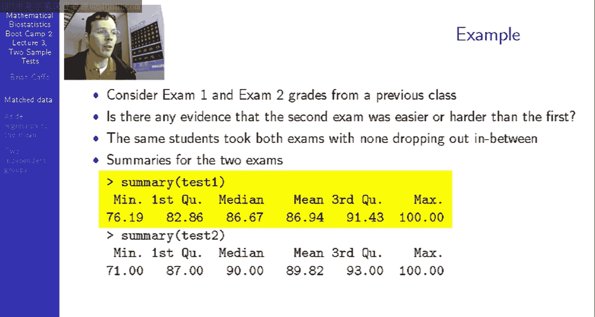
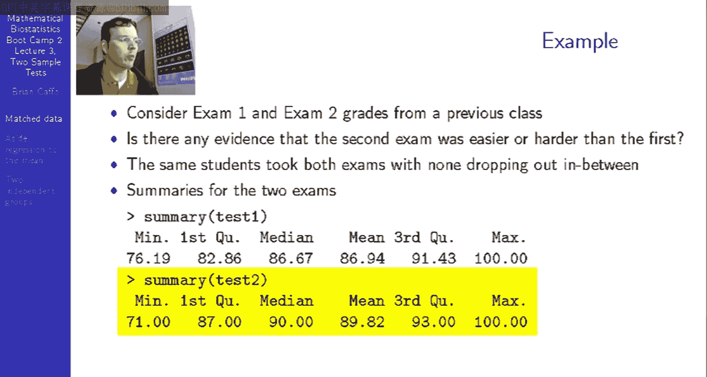
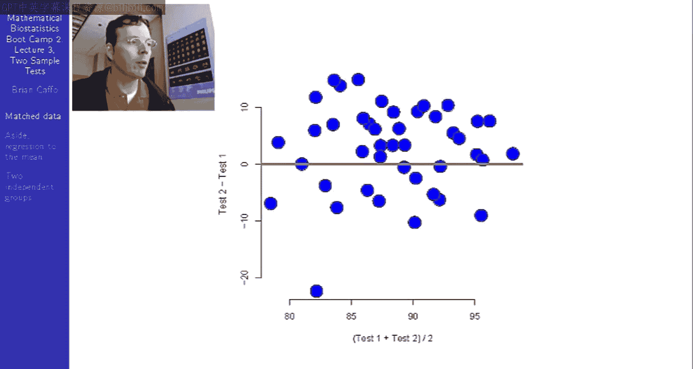
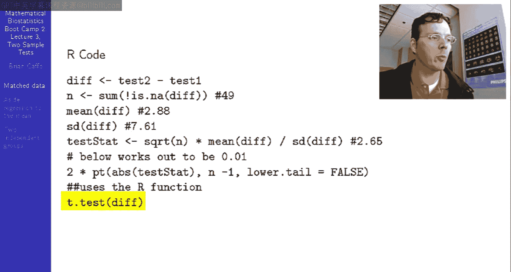
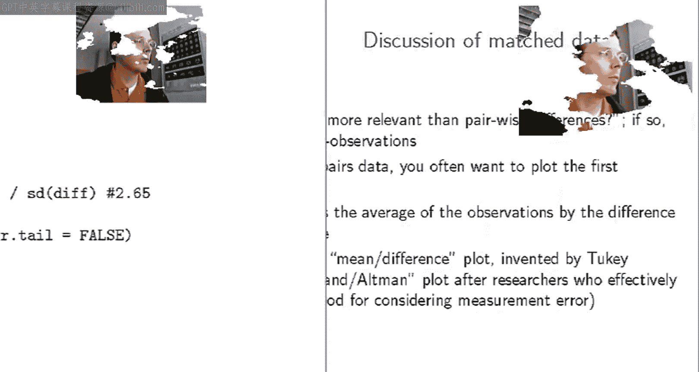
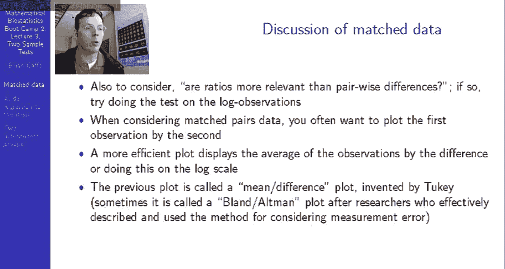
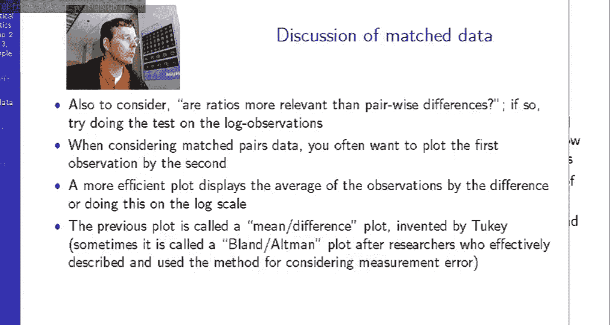

# 约翰霍普金斯大学《数据科学的高级统计｜Advanced Statistics for Data Science》中英字幕（deepseek p40 9_双样本检验：配对数据II.zh_en -BV1htPjeYEFH_p40-

Okay， so here's a simple example of doing a paired T test。

 so I took data from two exams from a particular class one year。

 so we had two exams so clearly the data are paired because it's the same students measured twice。嗯。

And so let's make up a question so I have exam one and exam two and and the question I'm going to try and ask。

 is there any evidence that the second exam was easier or harder than the first and that one way to investigate that question would be to ask whether the mean of exam one or two mean of exam one was different from that of the mean of exam two。

Now， you know again， we're testing a population mean。

 so at some level I'm trying to model this as if the students or some draw from some population of students。

 which you know seems kind of reasonable in this setting。

 even though it wasn't you know they weren't exactly randomly they weren't。Randomly sampled。

 but it seems like a reasonable thing to try and do。Okay so let me take the summary for test one。

 so in R I just take summary test1， and I found that the worst that the students did。

 which wasn't so bad was a 76% and the best people did 100% and for test2 that similarly the worst people did was a 71% and the best person did was 100%。

Okay so here's a plot scatter plot where I have test1 on the horizontal axis and test2 on the vertical axis and let's see I've arranged it so the axie are the same so it's both starting at 70 and ending at 100 and you know maybe there's some suggestion that test2 the scores were a little bit higher it seems like more points are lying above the identity line here than below the correlation was 0。

21 and the standard deviation for test1 was6 and the standard deviation for test 2 was 6 also。Oh。

 in the mean from the previous slide， the mean for test1 was 87 and the mean for test2 was 90。

Sample me。And then on this next plot what I'm showing is the difference between test2 and test1 versus the average of test2 and test1。

 and this plot is basically the previous plot tilted 45 degrees sort of like kind of turning your head like that and the reason for doing that。

 this is called a mean difference plot right the difference on the vertical axis in the mean on the horizontal axis and there's a very famous paper。

 so so Tki was the person who came up with the mean difference plot but there's also a very famous paper on sort of test retest reliability by Bland and Altman where they promote mean difference plots and actually show how to do some inference associated with them so that these plots are quite well known and one of the reason for doing them it's maybe not so necessary for this data set。

But if the correlation is high， then you wind up with a lot of blank space if you do the scatter plot in the upper left hand corner in the lower right hand corner and rotating it in this direction actually gets rid of a lot of that blank space it makes for a far more efficient plot。

 so anyway that's a wellknown technique and whenever you're looking at paired observation I think for many people looking at the mean difference plot is more natural and almost starting point。

When looking at this kind of data。

Okay， so now let's actually perform our test， I'm going to show our code here。

I'm hoping that everyone in the class at this point could actually do the test so the difference I'm going to do the paired differences that's test2 minus test1 that's this first line and is just the number of subjects I put a comment here that that worked out to be 49 subjects The mean in this case worked out to be 2。

88 the standard deviation worked out to be 7。61。 This is again the standard deviation of the differences。

Okay， so my test statistic is the square root of the sample size。

 because remember that's in the denominator， the denominator。

 So could just bring it up to the numerator times the average difference our null value that we're testing against is 0。

 So I'm just gonna leave that out。 divideded by the standard deviation of the difference。

 And I have a little comment here that that works out to be 2。65。嗯。So。

The two sample P value works out to be 0。01 so we reject we knew we were going to reject because 2。

65 is a big value of a standard normal and by the time we get to 48 degrees of freedom we're pretty close to a standard normal so we knew that 2。

65 we were going to reject and the exact way we calculate this p values we take twice the probability of getting a test statistic as large or larger than 2。

65 for a t distribution with n minus1 degrees of freedom I think whether you do this with pt or p norm you're going to get about the same answer and then because we're doing a twosided test we multiply at times 2 here so  two times this T probability and that gives us our P value works out to be around 0。

01 so we reject hypothesis and conclude that there。

Does appear to be some some difference in the means between test one and test two I would say you typically don't go through all these calculations。

You calculate your differences and then you just use a function to do the work for you。

 in this case the function is T dot test in R， but every statistical package has something to do a pair T test。

Okay， so we're not going to spend too much more time on paired differences。

 I'm hoping for everyone in this class that this discussion is no great stretch for them。

So but let me let me raise some points， you know one thing that when you're doing T tests。

 paired T tests， it's generally。Worthwhile to ask the question。

 are ratios more relevant than pairwise differences and if ratios are more relevant。

 then consider doing the paired T test on the log observations rather than the observations themselves？

嗯。So another thing is when considering matched。Matched pairs data。

 you always want to do some plots first plot the first observation by the second and then I showed you this mean difference plot。

 a more efficient plot of the average versus the difference and again。

 if you're interested in relative quantities then do everything on the log scale what I mean by that is take the natural log of every observation。

and then proceed with the analysis with the log data treating it like you would treat the data normally so anyway this plot is called the mean difference plot it was invented by Tki and is often called a Bland Altman plot from the very well knownn paper by Blandon Altman who added quite a bit of inference on top of it。

