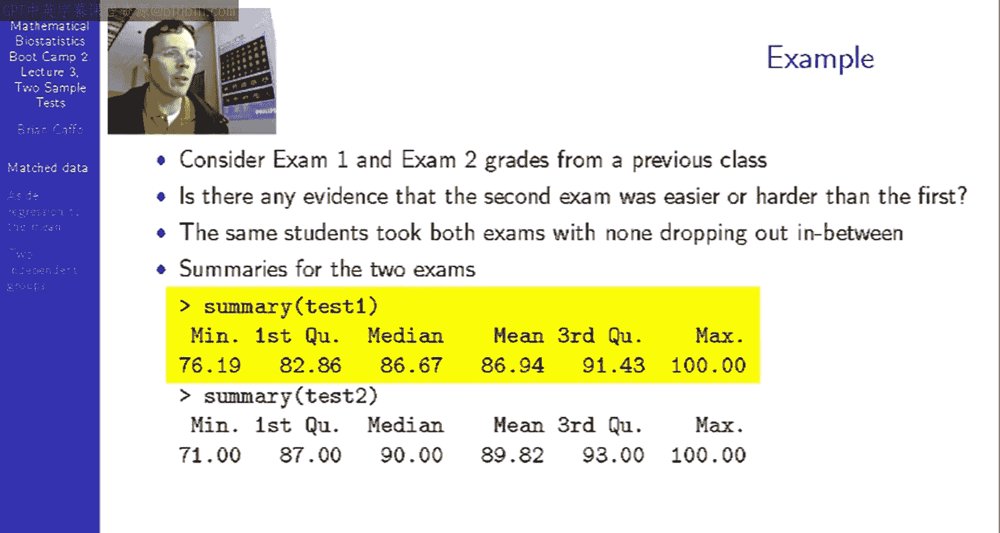
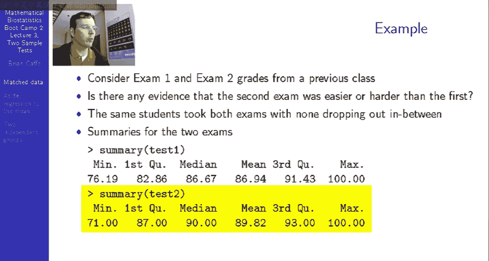
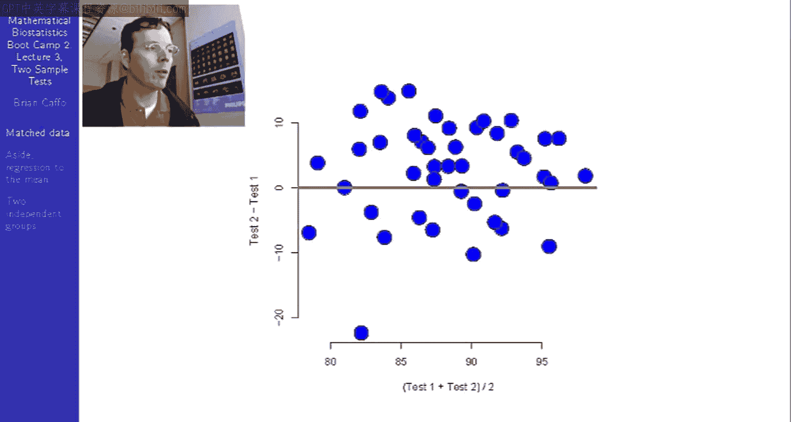
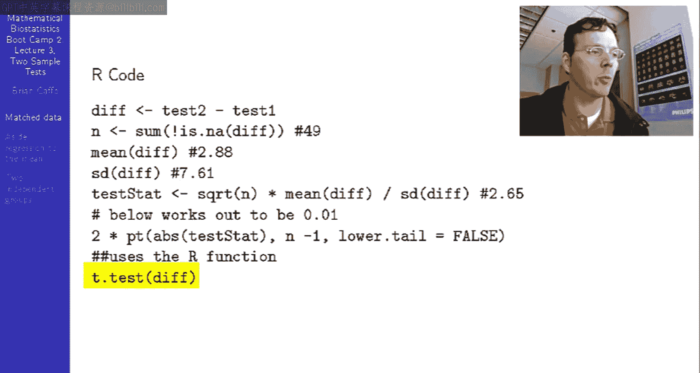
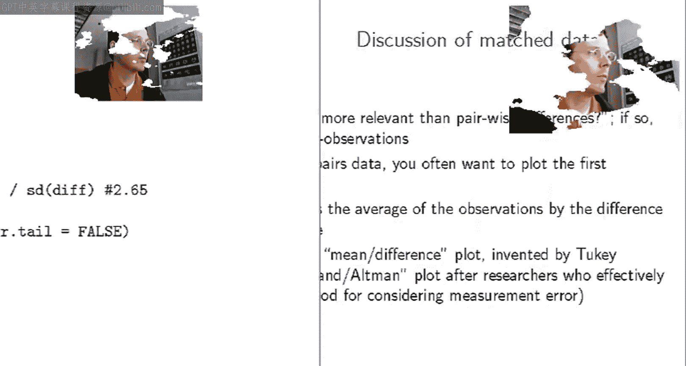
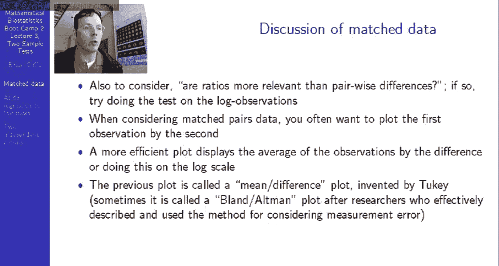
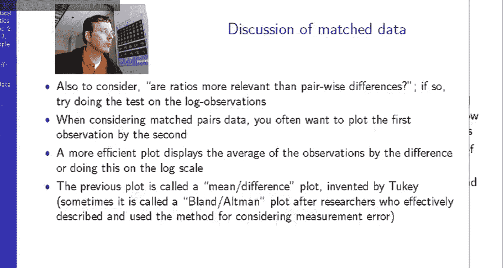

# 高级统计学：9：双样本检验：配对数据II 📊

在本节课中，我们将通过一个具体的例子，学习如何对配对数据进行T检验。我们将分析同一批学生在两次考试中的成绩，以探究两次考试的平均分是否存在显著差异。

---

## 数据背景与问题

我们拥有某班级学生同一年两次考试的成绩数据。数据是配对的，因为每位学生都被测量了两次（考试一和考试二）。我们想要探究的问题是：是否有证据表明第二次考试比第一次更容易或更难？一种调查方法是检验两次考试的平均分是否存在差异。





虽然学生并非严格随机抽样，但在此情境下，将他们视为来自某个学生总体的样本是合理的。

## 数据摘要与可视化

首先，我们查看两次考试成绩的摘要统计。在R语言中，使用 `summary(test1)` 和 `summary(test2)` 命令。

*   **考试一**：最低分76%，最高分100%。
*   **考试二**：最低分71%，最高分100%。

两次考试的平均分分别为：考试一平均分87%，考试二平均分90%。

接下来，我们通过散点图来观察数据。将考试一成绩放在横轴，考试二成绩放在纵轴，并设置相同的坐标轴范围（70到100）。从图中可以看出，似乎有更多点位于对角线（恒等线）上方，这可能暗示考试二的分数略高。两次考试成绩的相关系数为0.21，标准差均为6%。


另一种更高效的绘图方式是**均值-差异图**。该图将两次考试的平均分 `(test1 + test2)/2` 置于横轴，将差异 `test2 - test1` 置于纵轴。这相当于将之前的散点图旋转了45度。当数据相关性较高时，这种绘图方式能更有效地利用空间，避免图表出现大量空白区域。均值-差异图由Tukey提出，后经Bland和Altman在其关于重测信度的著名论文中推广，并附加了统计推断方法，因此也常被称为**Bland-Altman图**。




## 执行配对T检验

上一节我们介绍了配对数据的可视化，本节中我们来看看如何执行正式的统计检验。以下是执行配对T检验的步骤和R代码。

首先，计算配对差异 `d = test2 - test1`。本例中，样本量 `n = 49`，差异的均值 `mean(d) = 2.88`，差异的标准差 `sd(d) = 7.61`。

检验统计量 `t` 的计算公式为：
`t = (mean(d) - 0) / (sd(d) / sqrt(n))`
也可以写为：
`t = sqrt(n) * mean(d) / sd(d)`
在本例中，计算得到 `t = 2.65`。

由于我们进行的是双侧检验，P值计算为：
`p_value = 2 * P(T > |t|)`
其中 `T` 服从自由度为 `n-1 = 48` 的t分布。计算得到P值约为 `0.01`。

以下是执行上述计算的R代码核心部分：
```r
d <- test2 - test1
n <- length(d)
mean_d <- mean(d)
sd_d <- sd(d)
t_stat <- sqrt(n) * mean_d / sd_d
p_value <- 2 * pt(abs(t_stat), df = n-1, lower.tail = FALSE)
```

实际上，我们通常不手动计算，而是直接使用统计软件的函数。在R中，可以使用 `t.test(test2, test1, paired = TRUE)` 函数来完成配对T检验。






## 重要注意事项与总结

关于配对T检验和配对数据分析，有几点重要的补充说明。

在进行配对T检验时，值得思考的一个问题是：**比率是否比差异更相关？** 如果关注相对变化（例如，第二次成绩是第一次的百分之多少），那么考虑对原始观测值取自然对数，然后在对数尺度上进行配对T检验可能更合适。

以下是分析配对数据时的一般建议步骤：
1.  **先绘图**：首先绘制第一次观测值与第二次观测值的散点图。
2.  **使用均值-差异图**：绘制平均分与差异值的均值-差异图（Bland-Altman图），这通常是更高效的起点。
3.  **考虑尺度**：如果关注相对数量，则在对数尺度上进行上述所有分析。






本节课中我们一起学习了如何对配对数据进行T检验。我们通过一个学生两次考试成绩的例子，演示了从数据摘要、可视化（包括散点图和均值-差异图）到执行假设检验（计算检验统计量和P值）的全过程。关键点在于理解配对数据的特性（即观测值之间不独立），通过分析配对差异来推断总体均值差异，并注意在适当情况下考虑使用对数变换。