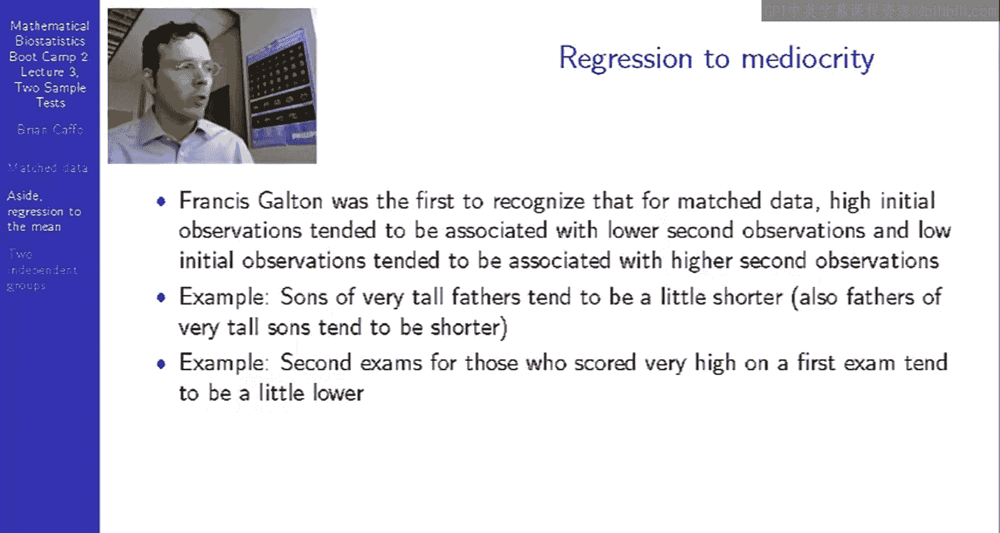
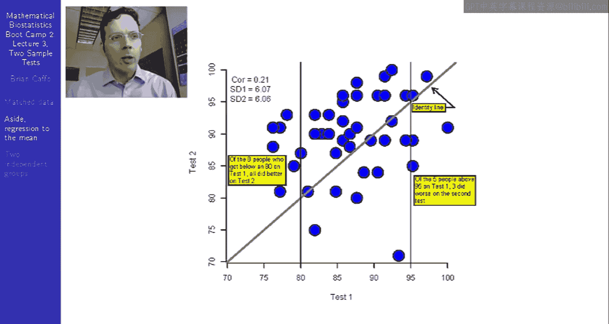
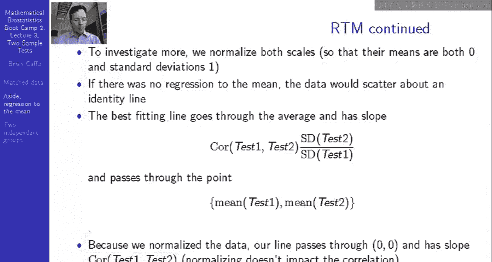
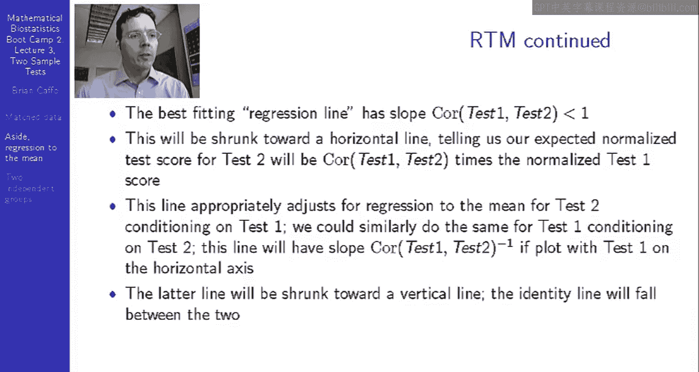
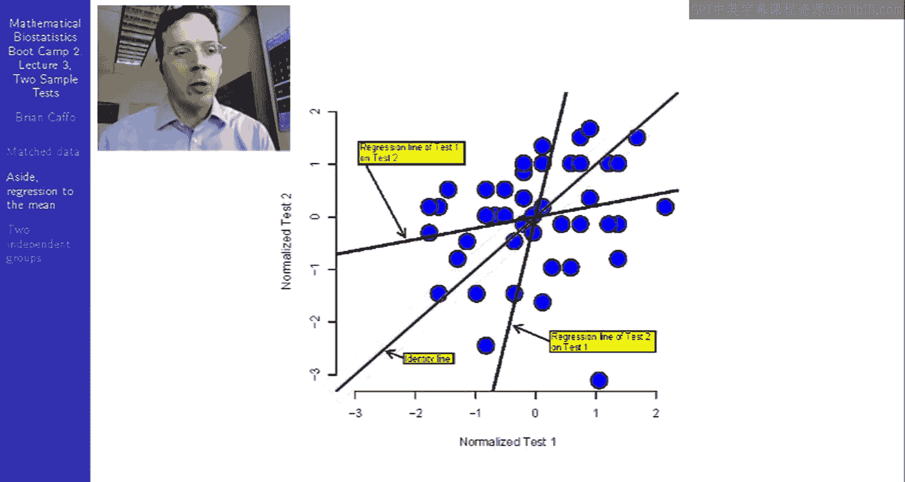
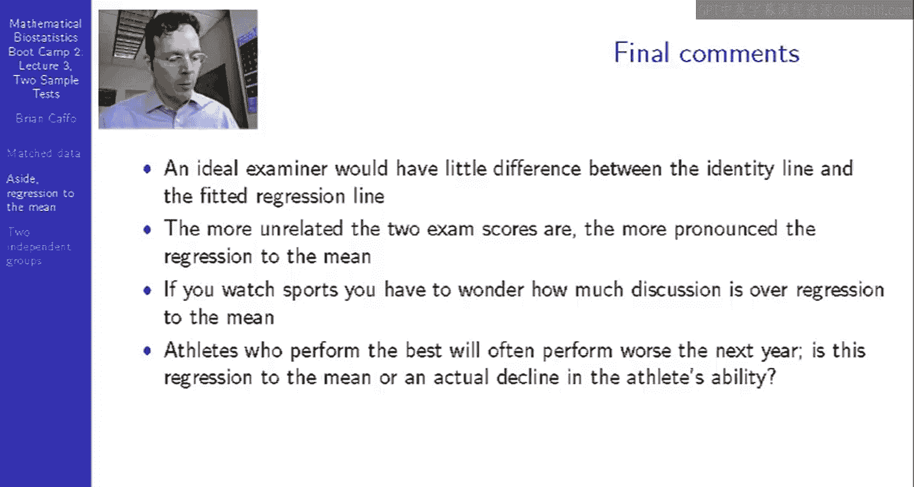

# 约翰霍普金斯大学《数据科学的高级统计｜Advanced Statistics for Data Science》中英字幕（deepseek p41 10_双样本检验：均值回归.zh_en -BV1htPjeYEFH_p41-

Okay， so as a bit of an aside， since we're talking about paired data。

 I thought maybe I'd talk for a minute about regression to the mean because it's a sort of historically famous topic and it involves one of the sort of eminent characters in the discipline of statistics。

 that person's name is Francis Galton。Fs Galton is the cousin of Charles Darwin。

 and he invented quite a few topics in statistics。And he was the first to recognize that this phenomenon that when you have match data。

 high initial observations tended to be associated with lower second observations and low initial observations tend to be associated with higher second observations。

The example that he gave was sons of very tall fathers tended to be a little bit shorter， still tall。

 but tended to be shorter， and paradoxically， not paradoxically， but seemingly paradoxically。

 fathers of very tall sons tended to be a little bit shorter。

 and as an example from what we were talking about today。

 second exams for those who scored very high on a first exam tended to be a little bit lower。

 whereas first exams for those who scored very high on a second exam tended to be a little bit lower。

 so let's talk a little bit about why this phenomenon occurs。

Okay， so the reason this occurs is imagine if the tests were completely random。

Then with and the students where IID draws from that distribution。

So probability- the highest observations on test one were just random observations。

So the probability of a second observation being that high is quite low。

 it's more likely to be in the center of the distribution， conversely a very low test。

 something that had a very low probability of occurring given that it's already low。

 the probability of a second test being that low is small， and so if's perfect if it's exactly noise。

 if the pairs of observations are exactly noise then then you'll get a lot of regression of the mean。

 let's consider the other extreme， let's imagine the test was a perfect adjudicator of students' abilities。

Then and it was perfectly calibrated instrument and there was no noise then a student should ideally get exactly the same score on both exams at which point there would be no。

Variation around an identity line on this plot here that says test one by test2 okay now those are the two extremes。

 one is complete variation and no no trend and the other is 100% correlation basically all trend where the test was a perfect instrument and of course。

Every practical case lies somewhere， usually somewhere in between。So you know。

 here's as an example of the eight people who got below 80 on a test。

 all but one did better on test2 and of the five people who got above a 95 on test1。

 three did worse on the second test。So it's not a tremendous amount of regression in the mean。

 but some certainly is there， and here I draw the identity line。

Okay， so let's discuss this phenomenon a little bit more and we're going to assume that the data has been normalized。

 so what does that mean that means we want the data to have mean zero variance 1 so in this case the mean of the first test。

Was 87， the mean of the second test was about 90。And the standard deviation of the first test and the second test were both about six。

 so for every test in for every first exam we have taken the exam subtracted off 87 and divided by6 and then for every test second test we would have subtracted 90 and divided by6 so you know and of course we would have done it with the exact numbers。

 not just the rounded numbers like I'm suggesting， and then in that case we'd have the empirical mean for test1 would be zero and the empirical standard deviation for test one would be one and the empirical mean for test2 would be zero and the empirical standard deviation for test2 would be one。

So that gets rid of any sort of shift effects or scale effects now when we're talking about testing about the paired data。

 we were exactly looking at shifts in the mean， so here we've gotten rid of the mean information by recentering the data at zero。

So if there is no regression to the mean， the data would just scatter about an identity line。

And well， if there was exactly no regression to the mean it would fall perfectly on an identity line。

 but the more scatter there is about the line， the more regression the mean there is。

So the best fitting line goes to the it actually goes through the average and since we normalized our data。

 it goes to the 0。00 and it has slope， I wrote it out here。

 the correlation between test1 and test2 times the ratio of the standard deviation of test2 to the standard deviation of test1。

 which we normalize the standard test2 and test1， so these standard deviations are exactly one。

So the best fitting line goes to the has slope correlation test1 by test two。Okay。

Okay， so just rehashing something from the previous line， previous slide。

 the best fitting regression line has slope correlation test1 time correlation of test 1 and test2。

 which in general is going to be less than1 in a case where it's1 there isn't much statistics left to do so this will shrink this will be shrunk towards a horizontal line telling us our expected normalized score for test2 will be this correlation times the normalized test 1 score so if the correlations 0。

95 then your estimated test 2 score will be 0。95 times your estimated test 1 score。

And this line sort of appropriately adjust for a regression of the meaning for test2 conditioning on test1 or equivalently test1 conditioning on test2。

 if we knew your test2 score score and we wanted to guess what your test1 score is normalizedize test2 score is and we wanted to guess what your normalized test1 score is we would multiply by the same correlation on our plot the slope of the line will be test2 will have this slope correlation test1 test2 where here I'm assuming test2 is the vertical axis and test1 is the horizontal axis if we wanted the slope going in the other direction the slope would obviously be the inverse I don't know how obvious that is。

 but the slope will be the inverse。So just to rehatsh， in either case。

 if you want to adjust for regression to the mean， you're multiplying the test。

 the normalized test that you have， and the one that you'd want to predict。

 you would multiply it by that correlation， but let me just show you a plot here。

This will probably make it a little bit easier， so here I have normalized test1 score on vertical on the horizontal axis and normalized test2 score on the vertical axis and the slope of this line here is the correlation between the two。

 which is about 0。21。And that's the regression line of test one on test2。

I've show an identity line here in the middle。And then if you wanted to do the same thing where as if you had had test1 on the vertical axis。

 then you would use this almost vertical issue looking line here and that's just the inverse that has slope inverse of this correlation here。

 notice both these lines passed through the point00 and this phenomenon and so this line。

 notice how when now we're looking at test2 and we want to predict our test2 score from our test1 it's very flat it's very flat suggesting that there wasn't a lot of correlation between the two test and that amount of noise means that there's a fair amount of regression to the mean and so that if we want to predict our test2 score from our test1 score we're shrinking it quite a bit and then you can see that the same thing in the other direction that it becomes very the adjustment for the regression of the mean becomes very。

And that's because the correlation was quite low because there was quite a bit of noise。

Notice as the points if they were to fall more and more on an identity line so they would kind of collapse around this identity line。

 then these two crosshaired lines would sort of go like this and they would converge to the identity line themselves and that would mean that there was very little regression to the mean anyway it's a neat historical。

It's a neat historical story that Francis Galton figured this out and his discovery of this was something that led to the discovery of the far more advanced topic of regression。

But let' let's just make some final comments about this， so an ideal examiner。

 I guess I'm not an ideal examiner from this test I gave。

 there would be little difference between the identity line and the fitted regression line。

And the more unrelated the two exam scores are， the more pronounced the regression to the mean so and this is something I heard to talk about this once that there was a question of how how much of our discussion of sports is really discussion of regression to the mean so the idea is that there's a lot of noise and say teams or player performances and the ones that do the best in any one given year is a combination of them just being better plus random variation if that random variation is very high。

 then then there's a good chance that the following year， the following season or whatever。

 they'll have a far lower performance in whatever statistic or measure you're talking about。

 so for example in US in baseball。A popular sport in the US you know if someone has a particularly high batting average early on in the season。

 there's a good chance they'll regress to the mean in the second the latter half of the season and you know the reason for that is because theres a part of a component of it that is performance that's inherent that's the player skill and then there's a component that's that random variation and the larger the amount of random variation。

 the more you'll see regression in the mean and in that case the discussion is。

A lot of discussion about sports， I think actually amounts to discussing regression in the mean that sometimes the players that have huge rebounds were just unlucky and the players that initially and then got luckier when they were having their rebound and the players that did extremely well and then did a lot worse。

 they their intrinsic ability may not have had。Change too much。

 but simply they were lucky early on and then less lucky later on。

