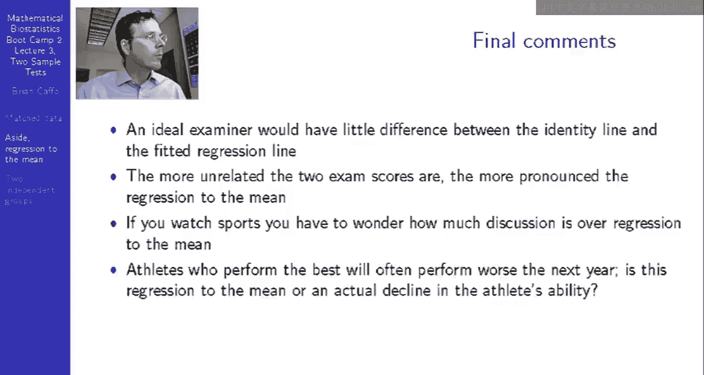
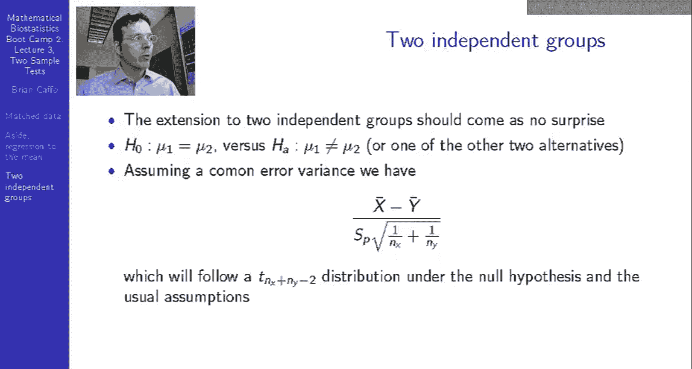
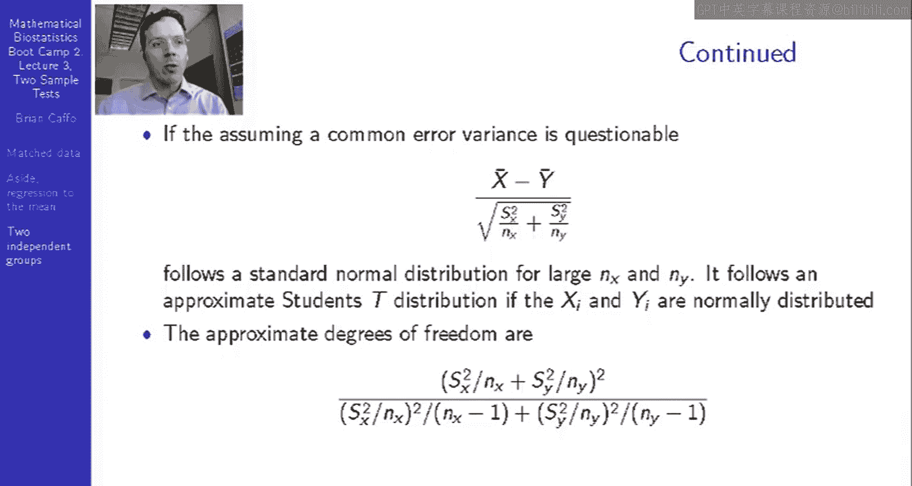
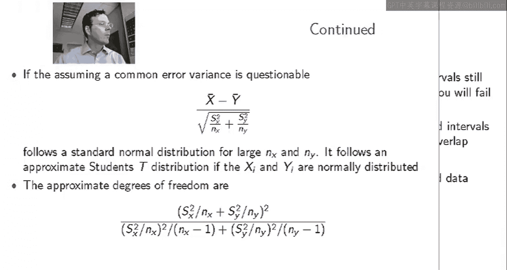
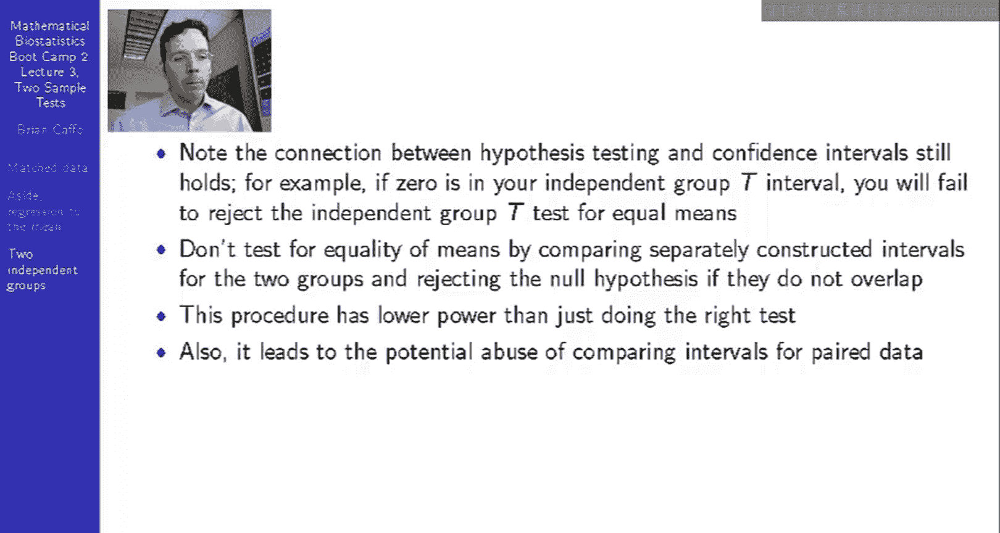
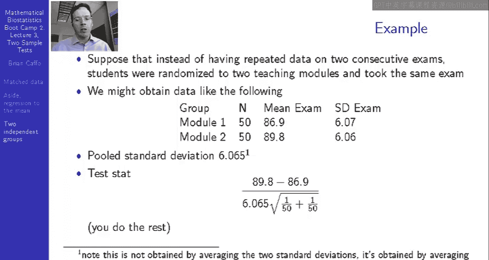
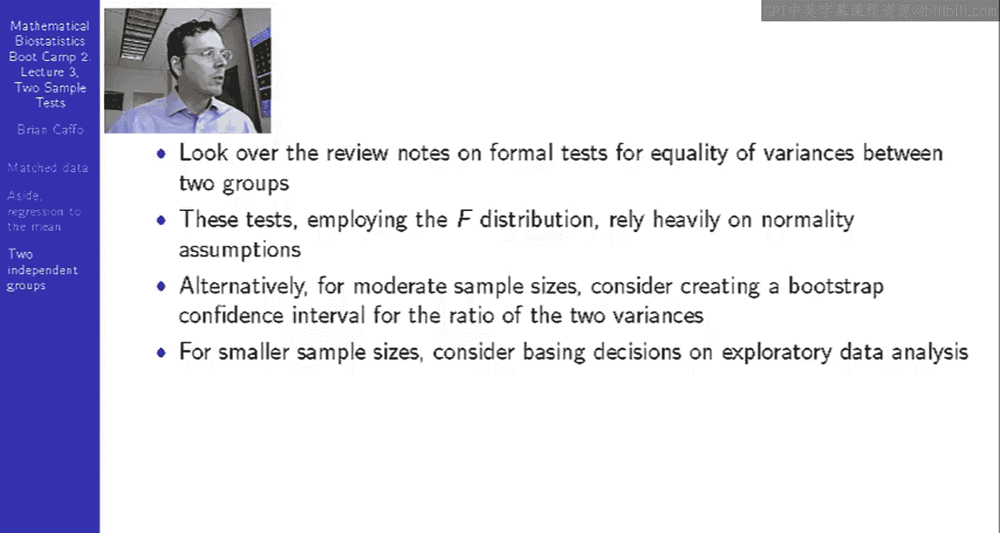
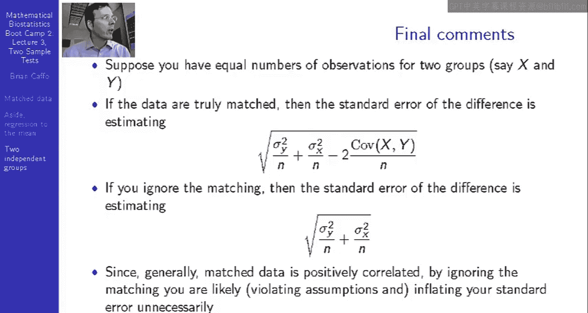

# 约翰霍普金斯大学《数据科学的高级统计｜Advanced Statistics for Data Science》中英字幕（deepseek p42 11_双样本检验：两独立组.zh_en -BV1htPjeYEFH_p42-

Okay， so let's get back to some far more pedestrian points now。

 anyway regression of the mean is a very fun topic。

 and I would suggest you read I also read up on Galton， he was quite an interesting character。嗯。

His name is Francis Galalton and he was just a remarkable figure in history and so I suggest you read up on Galton just out of interest Anyway so let's get back to some of the more straightforward things we're going to talk about the extension not to pair data but to independent groups shouldn't really come as a big surprise either I'm hoping at this point in the class after having taken boot campamp1 that a lot of these that a lot of this discussion will just come very naturally to you so let's suppose we want to test HO mu1 equal mu2 where we have two independent groups versus that they are different or one of the two alternatives that assuming a common error variants。

Between between the two groups， we would have this statistic right here our natural estimator of mu1 minus mu 2 would be。

 let's say x bar is group1 and y bar Y are for group two that our natural estimator of mu1 minus mu 2 would be x bar minus y bar under the null hypothesis that would have a hypothesized mean of zero。

 so we don't need to subtract anything off up here on the right。

 and then the standard error of x bar minus y bar is the common standard deviation across each group times square root1 over this sample size in the first group plus1 over the sample size in the second group and I hope everyone's capable of dering that。

And this follows a t nx plus n minus2 distribution under the No hypothesis and the usual assumptions。

 and we covered this in bootc1 when we talked about confidence intervals。

 basically when we created the interval x bar minus y bar plus or minus this t quantile times this standard error。

 so it's exactly the same thing and it follows exactly the same logic here it's the normalized test statistic as estimator minus hypothesized value under the no hypothesis divided by standard error。

 it follows the same logic as we've been doing for one sample test。

 so it should be no great stretch for anyone。

Then if you， and then if you have large sample sizes。

 it shouldn't be surprising for you that the statistic on the previous page follows a normal distribution。

 if you're not willing to believe that， the variance is the same in the two groups。

 then the standard error of x bar minus y bar works out to be square root。

x squared or sx squared is the variance in group1 divided by Nx plus Sy squared。

 which is the variance in the second group divided bynyY。

 which is the sample size in the second group， square root of the whole thing。And so of course。

 if the variants were the same， then you would be able to pull it out and you get the formula from the earlier part。

 so just to remind you I don't think I mentioned it on the previous slide that the the S sub P from the previous slide is the pooled variance。

 whereas here now we're talking about the variance within group1 Sx squared and the variance within group 2。

So anyway， this follows a standard normal distribution if Nx and MY are large。

 and it approximately follows a student's T distribution if the X and Ys are normally distributed and independent both within and between groups。

But there's this crazy formula for the degrees of freedom and the approximate degrees of freedom are SX。

 this formula here， I'm not going to read it out loud， and you can plug into it if you want。

 and it turns out to be fairly accurate， the distributional approximation turns out to be fairly accurate。

And so you can do this it's a little bit of a crazy formula and there isn't as far as I know a ton of obvious intuition as to why it works out this way。

 but what you want to think about it is that know it's not surprising that X bar minus Y bar divided by its standard error follows something if the data are normal that it follows a distribution that looks like a t distribution and the fact that it doesn't follow exactly a t distribution falls out from the fact that we don't have the common variance。

 but it seems reasonable that you would be able to pick the degrees of freedom that that approximate the actual distribution of this normalized statistic to be as close as the one we're using we're using with these approximate degrees of freedom and the degrees of freedom can be fractional so it's okay that this doesn't work out to be an integer。

And then a couple of notes， so our connection between hypothesis testing and confidence interval still holds if your independent group T interval。

 contains zero， then you will fail to reject the independent group T test for equality means provided you calculated the standard error in the same way。

And vice versa， if you construct a conference interval by finding all the hypothesized values for differences of means for what you fail to reject。

 you would wind up exactly with the appropriate T conference interval。

Another thing that comes up all the time， which is people want to test for equality of means by constructing a confidence interval for group one and a confidence interval for group two。

 and then seeing if those confidence intervals overlap and that procedure works in one sense that if the confidence intervals don't overlap。

And you reject that's an accurate statement， but the confidence intervals can overlap and this testistic the test statistic constructed correctly would reject。

 but the confidence intervals do overlap and so the fancier way of saying is that this procedure of checking whether independently constructed intervals overlap。

 just has lower power than just doing the right test。

Also it has a potential really bad abuse that I've seen happen is that people construct an interval for group one and an interval for group two。

 but they fail to acknowledge that people are paired and then they do this procedure and then that's quite bad because then you're throwing out an incredible amount of information in the pairing。

Right and or the purpose of the pairing， sometimes the purpose of the pairing is to account for confounders or something like that。

 so you're both either throwing out information or eliminating the entire reason that the pairing occurred。

 so don't do that， but I know no one in this class would do that anyway。

Okay let's go through an example， suppose instead of having repeated data on two exams that we randomized to two teaching modules in each group took the same exam。

 so I'm going to treat the data from before as if it was independent group data just to illustrate performing the calculations this it wasn't actually would happen but whatever。

 so imagine it but here's a setting where we would analyze the data this way rather than treating it as paired so and the easiest way to recognize that you don't have paired data is if your ends are different。

But that could also be misleading because you could have some missing data and have different ends。

 so anyway rate the easiest way to determine whether your data is paired is ask yourself this question。

 are my data paired or not， and then you'll know。Okay so here we have two modules that we randomized students to 50 students in each。

 the mean for one was about 87， the mean for the other was about 90。

 we've thought it through and realized that no there was no pairwise association student 1 from group 1 has nothing to do with student1 from group 2 and so on the standard deviations were both about6 so here the pooled standard deviation because the ends of the same works out to be the average 6。

065 of of the variances， remember the pooled standard deviation works out to be the average of the variances。

 not the average of the standard deviations though that does work out to be 6。065。啊。

And then our test statistic is the difference in the means 89。8 minus86。

9 divided by the pooled standard deviation estimate which go back to boot camp line and look at how we do the pooled variance estimate。

 but when the sample sizes are equal it works out to be the average of the variances so in this case it would be square 6。

07 and average it with the square of 6。06 then square root you wind up with 6。

065 times square root 1 over 50 plus 1 over 50 and that's your test statistic and you do the rest you check whether this test statistic is big enough to reject and the sample sizes are big enough to where you can just compare this to a z distribution with the difference between a Z and a T is irrelevant for sample size this large。

So we're moving through this stuff kind of quickly because we want to get to some more interesting stuff and I feel like we've mostly already covered this stuff by covering independent impaired group confidence intervals。

But just some final notes， look over the review notes on formal tasks for quality of variances between two groups。

I'm not a huge fan of this， some books tell you to。Um to employ the following strategy。

 evaluate whether or not the variances are equal by performing a test of equality of variances。

And then if you reject， do the unequal variance tests and if you fail to reject do the equal variance。

 I never like those kind of recipe approach to statistics， I would say， well first of all。

 these tests aren't very good， they rely on the F distribution。

 they're heavily sense they're heavily dependent on the normality assumption。

So I would say just do a bootstrap， if you want to test the quality of variances。

 do some sort of bootstrapping resampling type thing， don't do this F test。

 we have better things now so just do them。And then for smaller sample sizes。

 you know just rely on exploratory data analysis， but in general。

 if you're concerned about equality of variances。Just use the unequal one and that solves the problem right there。

Okay。And then some very final comments， I know I keep saying final comments， but and then lying。

 suppose you have equal numbers of observations for two groups。

And let's label the group's X and Y and the data， you know the data is random variables。

 x and the random variables Y， if the data are matched or paired。

 then the standard error of the difference is estimating sigma squared y plus sigma squared x both over n minus twice the covariance divided by n and you can do this calculation if you'd like。

 or you can just trust me。Square root of the whole thing。 if you want to standard error。

 if you ignore the matching， then the standard error of the difference is estimating this square root。

 my point is。In some in many cases， by ignoring this correlation。

 you're unnecessarily inflating your standard error， right if this covariance is positive right。

 then this negative2 covariance over n， you're throwing out a positive term。

 and this is the idea that，For example， if you're comparing exams and you want to know whether exam one was harder than exam two。

 if you threw out the information that it was the same students taking it twice，Then you。

You discard the fact that some students study more than others。

 some students maybe have different backgrounds than others and so on。

 and so some students will consistently do well on exams and some students will consistently do poorly on exams and that is encoded in this negative2 covariance term and thats saying that that variation associated with inter student。

variabilityability that you're throwing that away and absorbing it into the rest of the variance。嗯。

Now。So at any rate， the point is， is that if you treat。

Group data as these treat paired data as if it's grouped。

 you are you know you are missing out on some you're missing out in an important term in the covariance and we can actually characterize what that term looks like now you might think to yourself why in the world would anyone ever run a non-paired experiment then and I think you know for more complicated settings。

 the rule isn't always the case that the pairing yield always yields lower standard error。

 so in more complex settings， other things can happen。As an example。

 if you're studying tests there might be a learning effect that you don't want to intrinsically study。

 you know students may on the second exam might simply be better by virtue of having already taken the first exam。

 so it's not fair to say is the second exam better it' harder than the first exam or easier than the first exam when the students have had an exam to practice and get used to the teacher's style that sort of learning effect as an obvious thing。

 so if you really wanted to investigate the intrinsic properties of exam one versus exam two。

 you might want to study an independent group exam because otherwise with only with only data where exam two has been tested after exam one。

 you can never learn about that learning。Effect right you know for all the data points exam two was after exam1 so you can't investigate that now so there are study designs where they try to both take advantage of the pairing and investigate these sorts of learning effects and I think you're probably thinking yourself what the obvious thing that you would have to do well for some people they would have to take exam two first and other people they would have to take exam one first and you know maybe in the setting and exam。

 this isn't a reasonable thing to do but in the setting of drug development it is a reasonable thing to do let's suppose not to exams but you're testing two headache medications then you might for every patient give them headache medication one。

Have a washout period， then give them headache medication two， and then for another set of patients。

 give them headache medication two first and then give them headache medication one second。

And those kinds of designs are called crossover designs and they've randomized the order in which the people receive the treatment in order to adjust exactly for this learning or carryover whatever you'd like to call it a fact。

 but any rate my larger point being that the point of this slide is not to say pairing is always better than independent groups。

 but simply to say that if your data are paired， treating them as if they're independent is both。

Wrong from the point of view of assumptions， but also in some cases。

 can actually hurt you in terms of actually making you less likely， you know。

 having a inflating your standard error。 Oops， I guess that means I got to go。

