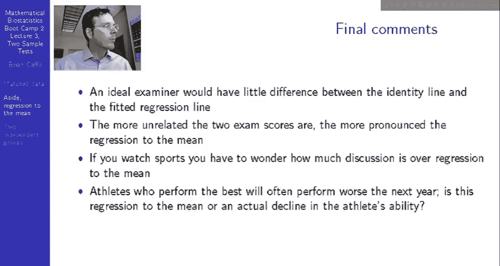
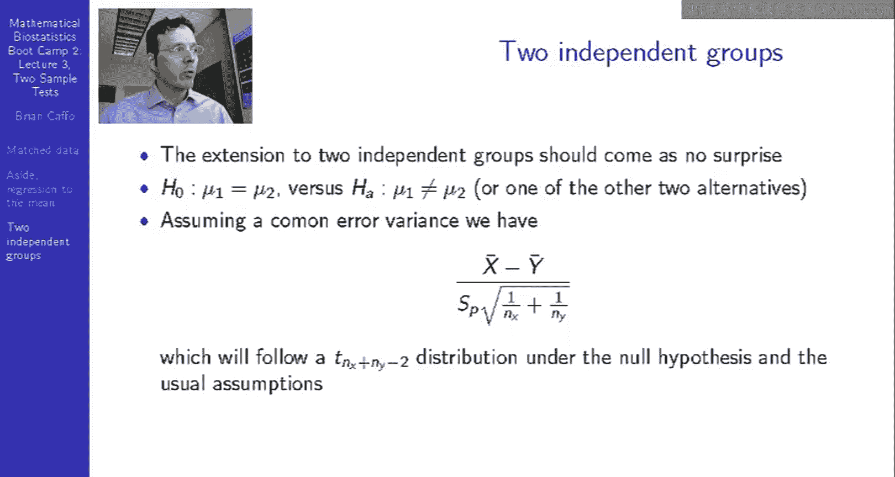
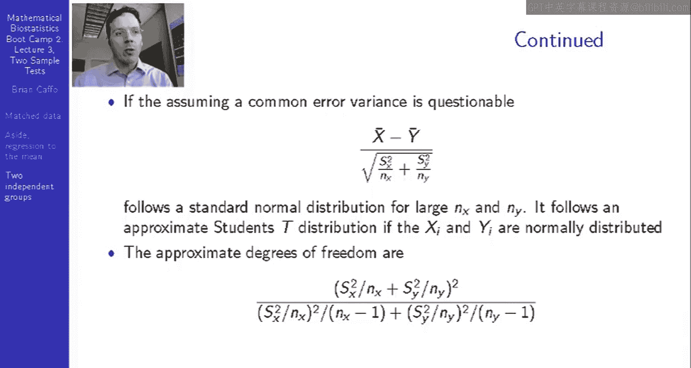
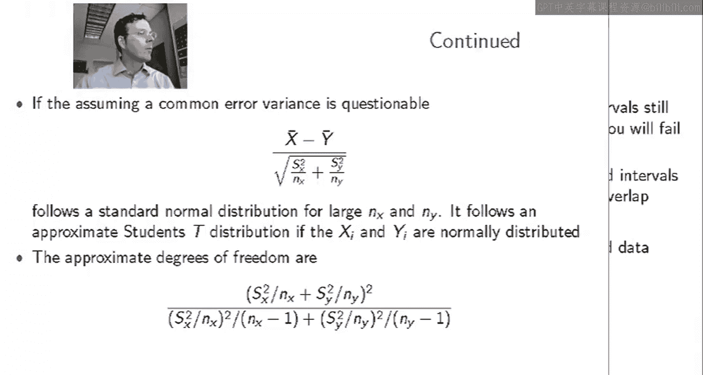
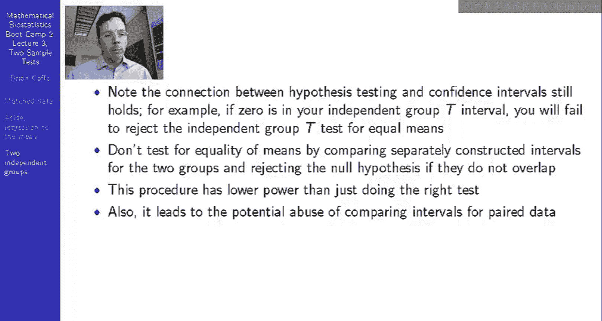
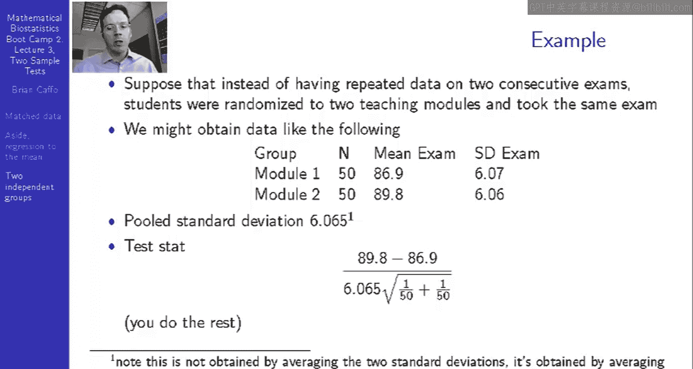
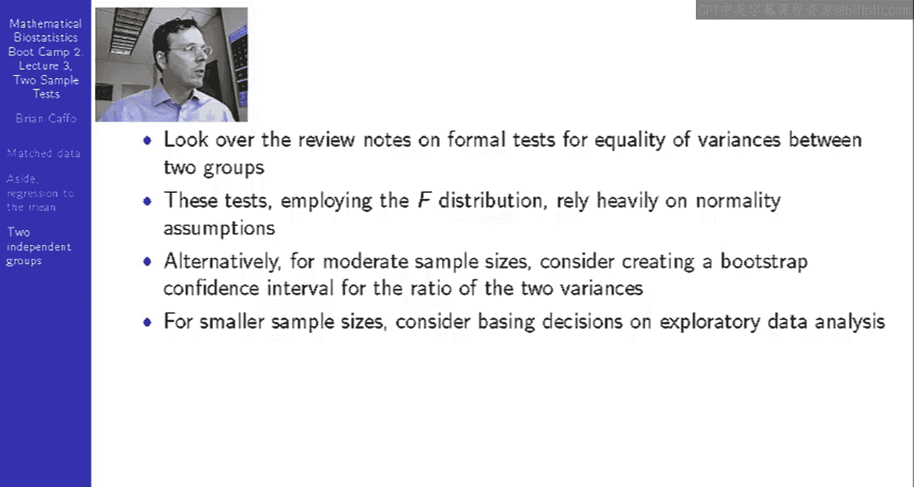
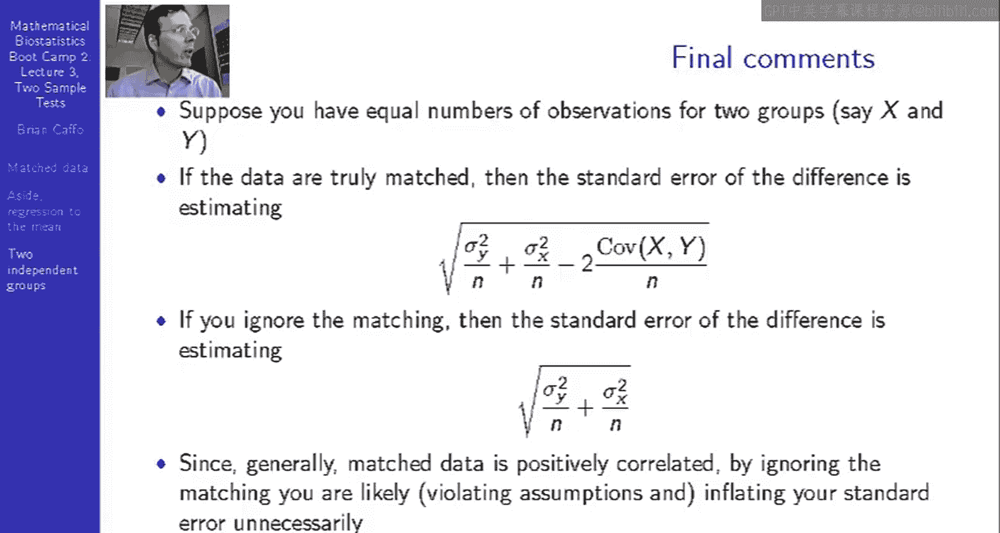

# 高级统计学：第11章：双样本检验：两独立组

在本节课中，我们将学习如何对两个独立组的数据进行均值比较的假设检验。我们将从回顾配对数据检验的局限性开始，自然地过渡到独立组检验的逻辑、公式和应用场景。

## 概述

上一节我们介绍了配对数据的t检验，它利用了数据点之间的配对关系。本节中，我们将探讨当两组数据相互独立时，如何进行均值比较的假设检验。这是数据分析中非常常见且基础的情景。

## 独立组t检验：等方差假设

假设我们有两个独立的组，其总体均值分别为 μ₁ 和 μ₂。我们想检验原假设 H₀: μ₁ = μ₂，备择假设可以是双侧的（μ₁ ≠ μ₂）或单侧的（μ₁ > μ₂ 或 μ₁ < μ₂）。我们假设两组数据具有相同的误差方差（即方差齐性）。

在这种情况下，我们构建的检验统计量如下：

我们的自然估计量是两组样本均值的差：`x̄ - ȳ`。在原假设下，这个差值的期望值为0。其标准误为共同标准差乘以一个与样本量相关的因子。

**检验统计量公式：**
`T = (x̄ - ȳ) / (S_p * √(1/n_x + 1/n_y))`

其中，`S_p` 是合并标准差，计算公式为：
`S_p = √[((n_x - 1)S_x² + (n_y - 1)S_y²) / (n_x + n_y - 2)]`

在原假设及数据正态、独立等通常假设下，该统计量服从自由度为 `n_x + n_y - 2` 的 t 分布。这个逻辑与我们之前进行单样本检验时完全一致：即（估计值 - 原假设下的值）/ 标准误。

## 独立组t检验：异方差情况（韦尔奇t检验）

如果你不相信两组的方差相等，那么 `x̄ - ȳ` 的标准误计算方式会有所不同。

**标准误公式变为：**
`SE = √(S_x²/n_x + S_y²/n_y)`

如果样本量 `n_x` 和 `n_y` 都很大，相应的检验统计量 `(x̄ - ȳ) / SE` 近似服从标准正态分布。如果数据本身服从正态分布，则它近似服从一个 t 分布，但其自由度需要通过一个复杂的公式进行近似计算。

**近似自由度公式：**
`df ≈ (S_x²/n_x + S_y²/n_y)² / [ (S_x²/n_x)²/(n_x-1) + (S_y²/n_y)²/(n_y-1) ]`

这个自由度公式可能看起来不那么直观，但其目的是为了找到一个最接近真实抽样分布的 t 分布来近似。需要注意的是，计算出的自由度可以是分数。

## 假设检验与置信区间的关系

关于假设检验和置信区间之间的联系，在独立组检验中依然成立。

*   如果你构建的独立组 t 置信区间包含了0，那么使用相同方式计算标准误的 t 检验将无法拒绝“均值相等”的原假设。
*   反之，如果你找出所有无法拒绝的均值差值假设值，最终得到的就是相应的 t 置信区间。

这里有一个常见的误区需要避免。

以下是关于独立组均值比较的一个常见错误做法：

*   人们有时会分别为第一组和第二组构建单独的置信区间，然后看这两个区间是否重叠。
*   如果区间不重叠，则拒绝原假设，这个结论是准确的。
*   然而，**即使区间有重叠，正确构建的检验统计量也可能拒绝原假设**。因此，这种比较区间重叠的方法，其统计功效低于直接进行正确的检验。

更糟糕的一种滥用是，数据本身是配对的，但分析者却错误地将其视为独立组，并采用上述“区间重叠”法进行比较。这样做不仅抛弃了配对信息带来的巨大优势，也可能完全违背了当初采用配对设计的初衷（例如控制混杂因素）。

## 实例分析

让我们通过一个例子来具体计算。假设我们不是有配对数据，而是将学生随机分配到两种不同的教学模块中，每组50人，并参加相同的考试。

*   模块一：平均分 `x̄ = 89.8`，标准差 `S_x = 6.07`
*   模块二：平均分 `ȳ = 86.9`，标准差 `S_y = 6.06`

我们意识到两组数据是独立的。由于样本量相同，合并方差就是两个样本方差的简单平均。

**计算过程：**
1.  合并方差：`S_p² ≈ (6.07² + 6.06²)/2`，因此 `S_p ≈ 6.065`
2.  标准误：`SE = 6.065 * √(1/50 + 1/50)`
3.  检验统计量：`T = (89.8 - 86.9) / SE`

计算出 T 值后，我们可以将其与自由度为 98 (`50+50-2`) 的 t 分布进行比较。由于样本量较大，也可以近似使用标准正态分布进行判断。

## 关于方差齐性检验的说明

有些教科书建议采用以下策略：
1.  先进行方差齐性检验（如F检验）。
2.  如果拒绝方差齐性的原假设，则使用异方差的韦尔奇t检验。
3.  如果无法拒绝，则使用等方差的t检验。

我并不推崇这种“食谱”式的统计方法。首先，传统的方差齐性检验（如F检验）效果并不好，它们严重依赖于数据正态性的假设。

我的建议是：
*   如果你真的关心方差是否相等，可以使用**自助法**等重抽样技术进行检验，这比传统的F检验更稳健。
*   对于小样本，可以更多地依赖探索性数据分析。
*   一个更通用的做法是：**直接使用韦尔奇t检验（异方差版本）**。它在方差齐或不齐时都表现良好，这样就省去了预先检验的步骤和风险。

## 配对设计与独立组设计的比较

最后，我们讨论一个关键点：为什么有时要采用配对设计？

假设你有两组数据 X 和 Y，且数据是匹配或配对的（样本量均为 n）。`x̄ - ȳ` 的标准误估计涉及以下部分：

**配对数据的标准误公式核心部分：**
`(σ_y² + σ_x²)/n - 2 * Cov(X, Y)/n`

如果你忽略了配对关系，将其当作独立组处理，那么你计算的标准误估计的是：
`√(σ_y²/n + σ_x²/n)`

关键在于，如果配对数据间的协方差 `Cov(X, Y)` 是**正**的（这很常见，例如同一个学生在两次考试中的表现是相关的），那么配对分析中的 `-2 * Cov(X, Y)/n` 这一项就会使标准误**减小**。

**这意味着什么？**
通过忽略配对，你将个体间固有的、一致性的变异（例如，有些学生总是考得好，有些总是考得差）当成了随机误差，从而不必要地**增大了你的标准误**，降低了检验的效力（统计功效）。

**那么，为什么不是所有实验都用配对设计？**
在某些更复杂的情况下，配对并不总是降低标准误。此外，配对设计可能引入其他效应。例如，在研究两次考试难度时，如果学生总是先考A再考B，那么“考试B表现更好”可能是由于“学习效应”（学生通过考A熟悉了题型），而非考试本身更容易。此时，独立组设计（随机分配学生先考A或先考B）可能更适合研究考试本身的固有属性。这种随机化顺序的设计称为“交叉设计”，常用于药物临床试验中，以调整“遗留效应”。

本节的核心要点是：**如果你的数据本质上是配对的，将其作为独立组分析不仅在假设上是错误的，而且在实践中通常会损害你的分析能力（增大标准误，降低发现真实差异的可能性）。**

## 总结

本节课中我们一起学习了针对两个独立组的均值比较方法。我们介绍了在方差齐性和异方差两种假设下的t检验公式（韦尔奇t检验），强调了假设检验与置信区间的对等关系，并指出了常见的分析误区。最后，我们深入探讨了配对设计与独立组设计的根本区别及其对标准误的影响，理解了在适当情况下利用配对信息的重要性。掌握这些基础的双样本检验方法，是进行更复杂比较和实验设计分析的基石。