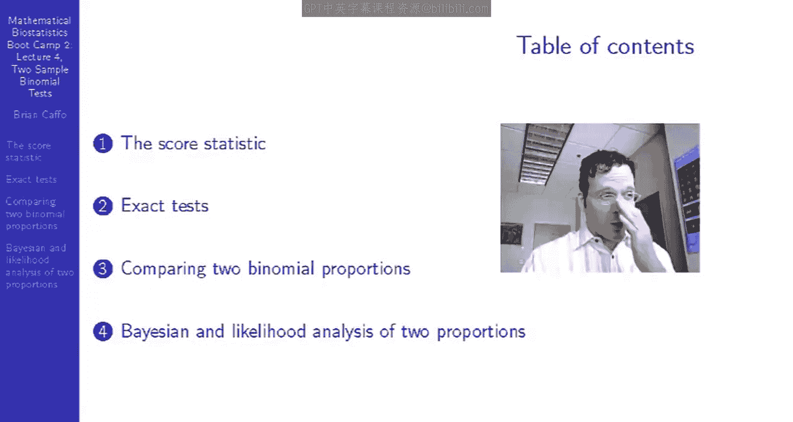
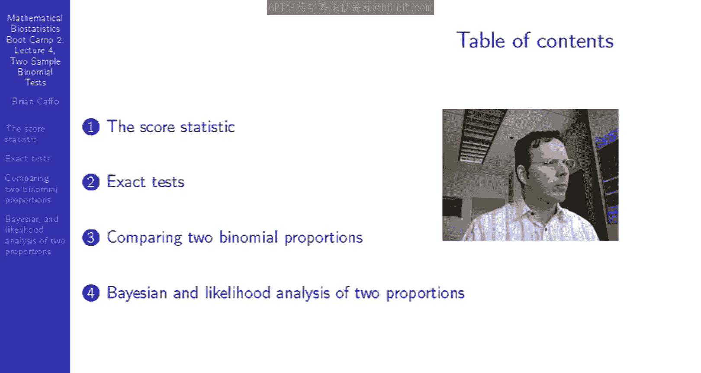
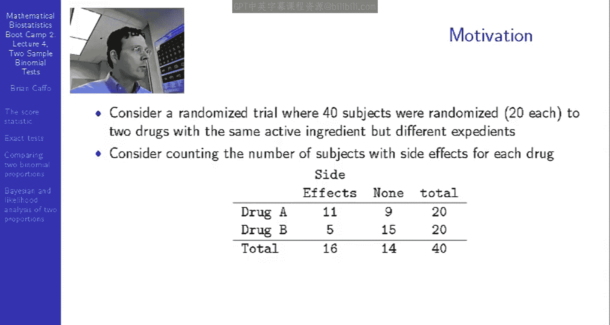
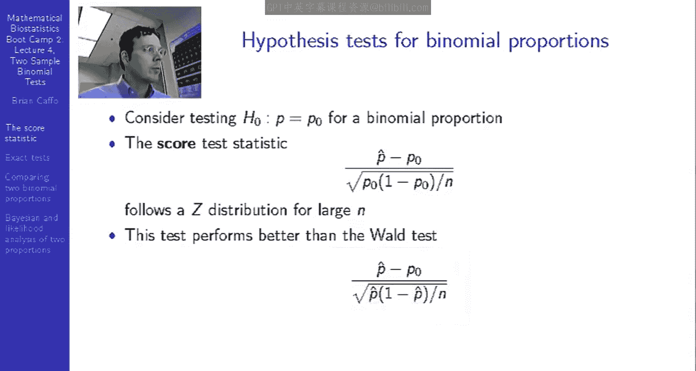
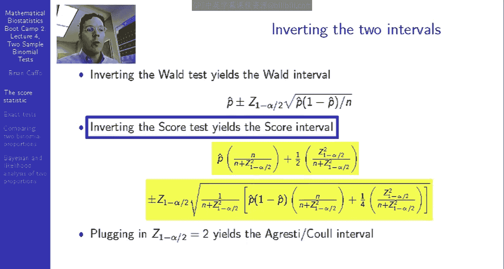
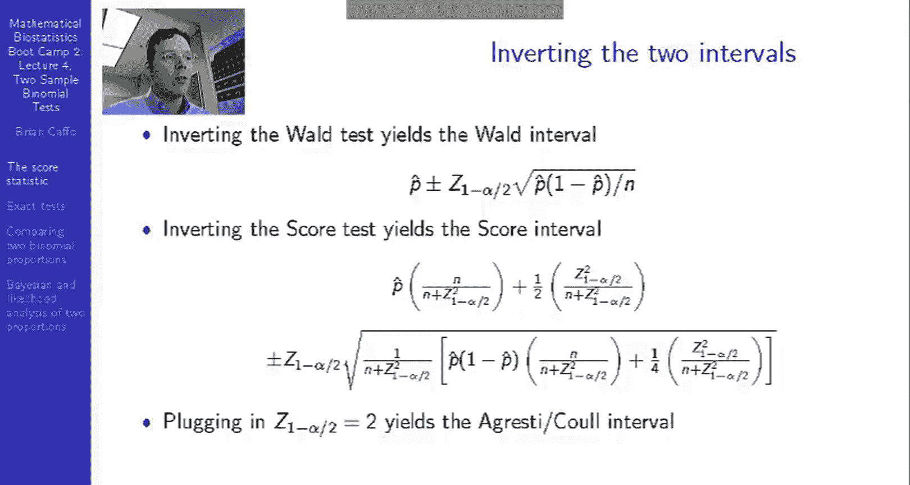
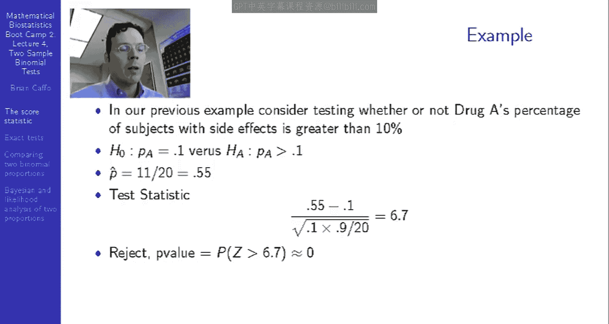

# 约翰霍普金斯大学《数据科学的高级统计｜Advanced Statistics for Data Science》中英字幕（deepseek p43 12_双样本二项检验：得分统计量.zh_en -BV1htPjeYEFH_p43-

Hi， my name is Brian Kaho， and this is Ma Biosstatistics boot camp Leture 4 on two sample binomial tests。

Okay in this lecture we're going to talk about the score statistic。

 which is a specific two sample binomial test that will serve as motivation for creating a confidence interval as well。

 we'll talk about how you can do exact test for two binomial proportions and then we'll talk about comparing two binomial proportions and then we'll go over a little bit about Bayesian and likelihood methods for comparing binomial proportions。

We'll actually spend quite a bit of time on binomial proportions because later on。

 we'll also talk about relative risks and odds ratios and that sort of thing。

Okay， so let's put some context on this so imagine a randomized trial where there was 40 subjects and 20 each were randomized to two drugs and the two drugs had the same active ingredients。

 but let's assume they had different expedients you know that。Ways in which the drugs were delivered。

 one， let's just say one was a capsule and one was a different kind of pill， okay。

So consider counting the number of side effects。For each drug among the 40 people。

 so here we have a table where there's 40 total people， 20 in drug A， 20 in drug B。

So this margin is fixed，20 and 20。 that margin is fixed。And then 11。

From drug A receives side effects。And then nine didn't and then five from drug B had side effects and 15 didn't。

 so on phase value， there seems to be a greater propensity for side effects from drug A than from drug B。

And what we'd like to do is to do a test of whether or not the side effects are the propensity for side effects。

 so it's the same within the two drugs， and there's a lot of different ways we could formulate this problem even from this simple data set。

And we'll talk about some of the ways to do that。But for right now。

 let's just start with talking about score test。

So the scores test should seem fairly familiar to you because it's just going to be constructed in the same way that the ordinary test is the sort of ordinary Z test are constructed in the way that we have before。

So let's consider a single binomial proportion， not two binomial proportions。

 but a single binomial proportion， and later on in the lecture we'll consider two binomial proportions。

So imagine only looking at drug A and saying， well。

 let's test whether or not drug A has a specific population proportion of side effects。

So we want to test H p equal to p naught。And。So our obvious estimate of P is P hat。

 the sample proportion of side effects， okay， so our obvious metric of the discrepancy between P hatAT and PO would be the difference or maybe we could do a log ratio or something like that。

 but let's for right now let's do the difference。Okay。

But in order to compare this to a statistical distribution。

 let's normalize it by the variance of P hatAT well the variance of P hat is p times1 minus P over n and under the null hypothesis that's P times1 minus P over n so the standard standard error is the square root of that。

 and notice that we're plugging in the P under the null hypothesis。

 not plugging in P hat which would give us the estimated standard error that we used， for example。

 in the construction of the confidence interval。So any rate。

 this test when you plug in P knot in the denominator here。

 performs a little bit better than the so-cal wall test。

 where in the denominator rather than plug in in P knot， we plug in P hat。

So remember how we can invert this test statistic to perform a confidence to create a confidence interval and we can。

 you know， of course we can use the test statistic to just perform the test。

 so I should have said this on the previous slide， but that Z statistic you compare to quantiles from the standard normal distribution。

 the upper alpha over twoth quantile if you're doing a two sided test。

 the upper alpha over two quantile if you're doing a one sided greater than test， the lower alpha。

The upper alpha quantile if you're doing a one sided。

A one- sided test where the alternative is greater than p greater than p and the alpha quantile。

 if you're doing a one sided test where you're testing P less than p okay so and this should be obvious to you at this point in the class。

 how you would create take a Z statistic and then use it to perform a test and then of course we've already talked at length in other settings。

 for example， and inverting the T test in the standard Z interval on how we can invert a confidence interval and create I'm sorry invert a hypothesis test and create a confidence interval。

 namely calculate those values of P for which we'd fail to reject。If we invert the wall test。

 we get the walled confidence interval， P hat plus or minus z1 minus alpha over to square root P hat 1 minus P hat over n。

 And if we invert the score test， we get a socalled score interval， which is a lot more complicated。

 We get P hat times this quantity plus1 half times this quantity plus a minus our normal quantile。

 our upper alpha over2 normal quantile and then this standard error formula。

 I want to point out one thing about the。This is not a numerator here by the way。

 this is this quantity P hat times this thing plus1 half times this thing。

 and then I ran out of space， so then on the next line I put plus or minus the normal quantile times the standard error。

So this is P hat times n over n plus z squared。And then plus1 half times z squared over n plus z squared。

 so look at these two factors， n over n plus z squared and z squared over n plus z squared。

 they add up to one， so there are two proportions that add add up to one， so in other words。

 a point on the two dimensional simplex is what you might call say in mathematical parlance。

But what's important is as n gets very big， this first term gets very big and P hat dominates。

 if n is small， then term in front of this term in front of the one half gets a little bit bigger and well the one probably hopefully doesn't dominate。

 but there's more greater fraction placed on the one half。And just to give you context。

 the Z1 minus alpha over2， well that's usually going to be around two， so this is about four。

 so over it's about n over n plus4 plus1 half4 over n plus4。So。

At any rate and his end gets very large， it just becomes very similar to the walled interval。

So what this does is it takes P hatAT and it shrinks it towards one half and that turns out to be a good thing to do because the binomial confidence interval。

 you don't want it centered exactly at P hat because the binomial distribution as P hatAT is further away from one half gets more asymmetric。

 it gets more skewed and because of that you don't want that point right in the middle。At any rate。

 so we had talked previously about confidence intervals for binomial proportions and plugging in z1 minus alpha over 2 equal to2 yields the so-called aD cool interval that we talked about before。

 so this is actually the motivation for the aD cool intervals that most people do 95% intervals and if we take our 1。

96 and just round it up to two then and plug it into the score interval。

 we get exactly the aD cool interval。

Okay， so let's do our example in our previous example。

 consider testing whether or not drug As percentage of subjects with side effects is greater than 10%。

So I made up 10%， so let's assume that the FDA gets really mad for this kind of drug if you have more than 10% prevalence of side effects。

So HO PA is equal to 0。1 versus H PA greater than one。

 where PA is the population proportion of side effects for drug A。

And then our P hat is 11 over 20 which is 0。55， our test statistic is 0。55 minus 0。

1 divided by square root， remember to plug in the PO from the no hypothesis 01 times 0。

9 divided by 20， you get 6。7， we reject the P value we reject know our critical value is going to be for a one sided test is going to be about 1。

65 or two sided test if it would be about 2 either way 6。7 it's going to be bigger than it。

And then our P value， the probability of getting a z bigger than 6。7 is， of course。

 nearly around zero。S almost seven standard deviations away from zero for a standard normal is quite far out in the tails。

 remember that three standard deviations covered the majority of the distribution。

And then if we were doing a two sided test， remember that we would double this P value okay。

 now let's discuss this problem a little bit， so what do we have to do to get this to work？

So mechanically I hope you find this easy but let's talk a little bit about the thinking of this so we're postulating that the number of side effects out of 20 is a binomial trial well that implicit in that is the idea that then we have IID data every person is independent and identically distributed draw from a population so we're using those assumptions。

 the IID assumptions to create the idea of a population superpop。

That has a prevalence of side effects of PA。Of course we cant in general。

 you can't know that unless you're actually in a setting where people are going to great pains to actually sample independently from the population they're interested in。

 which is usually not the case in general， the sample is what what you're doing is you're doing a statistical model where you're hoping that the people are a representative sample。

 you're hoping that there's no。Crossover of side effects。

 So let's suppose some of the people receiving the drug are friends or in the same family or in the same neighborhood or something like that that there's no reason that if one person gets side effects。

 it's more likely for anyone else around them to get side effects who also received the drug。

 So no interference is what they would call that。嗯。And so。

So our IID model is what's giving us here this idea of a population proportion and then we're testing relative to that proportion。

 but it's good， I think whenever you're doing these kinds of tests to actually think about。

What your modeling is random and what your population model is that you're trying to do it because you know modeling is a modeling the calculations here are very simple right I hope we all agree that the calculations are very simple。

 but the principles， the idea of how the modeling is going is a lot more delicate。

And actually on a lot more shaky ground， so that's why it's a good idea to always sort of think through your modeling assumptions and what they imply for your actual hypothesis。

 so just to give you an example， let's assume that。

Our sample of people are all people who are professional。Drug takers for pharmaceutical companies。

 sort of professional guinea pigs whenever a drug company says。

 oh well we want to test out this headache medication。

 they sign up and there are people who do this of course right you can you know you can make maybe not a tremendous living doing it but you know the drug companies of course pay people for their time to test out these sorts of drugs then it would be hard to declare that population IID draw from the general population because this is a very very different sort of people。

 they probably adhere to their medication schedule very。

Very precisely and other things like that they're probably very good takers of medications they probably do the instructions quite well they know and so on so。

So any rate， my larger point being is that when you get this number 6。7。

 which is very easy to obtain。You know， think about what it means in the context of the model that you've used and in this case the model is seemingly very benign but you know the big part of the model is the IID draw from a population。

Think about what that means in the context of the problem that you're studying。

