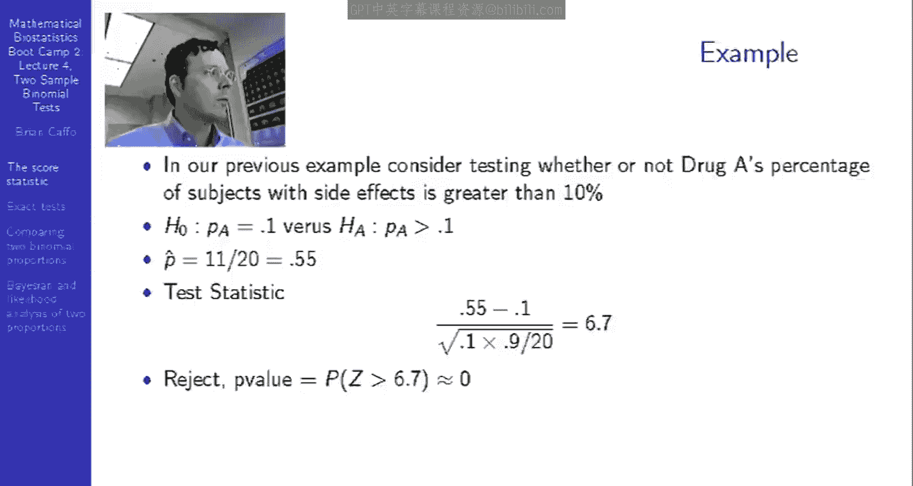
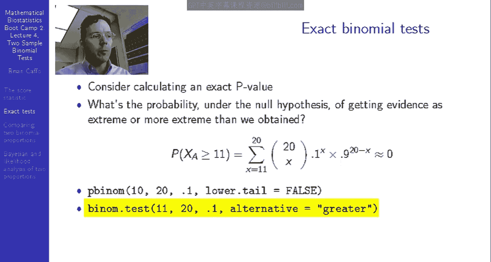
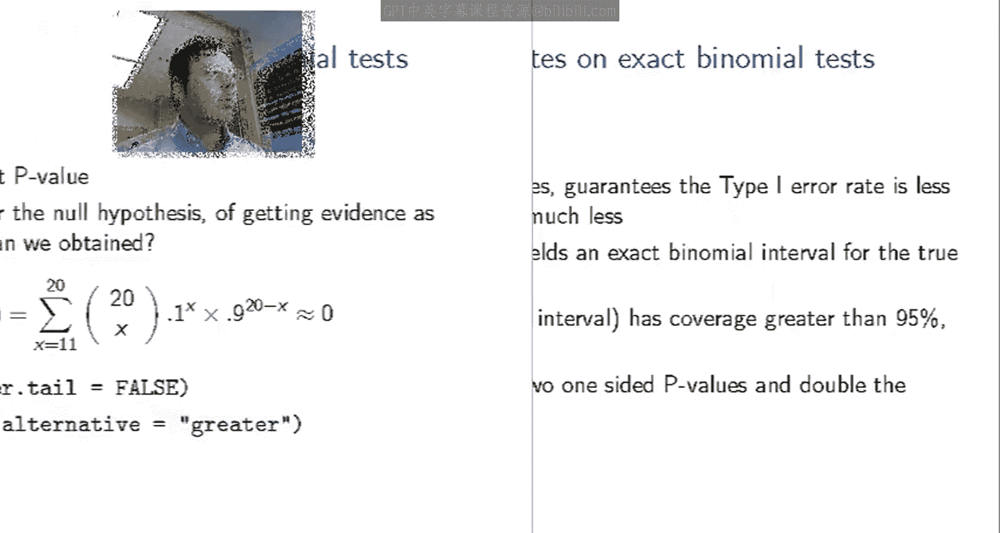
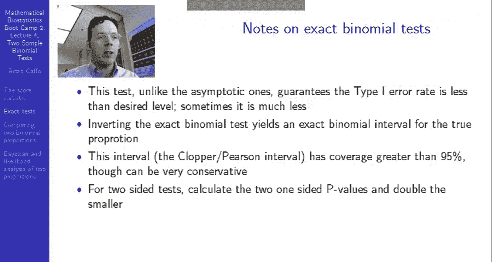
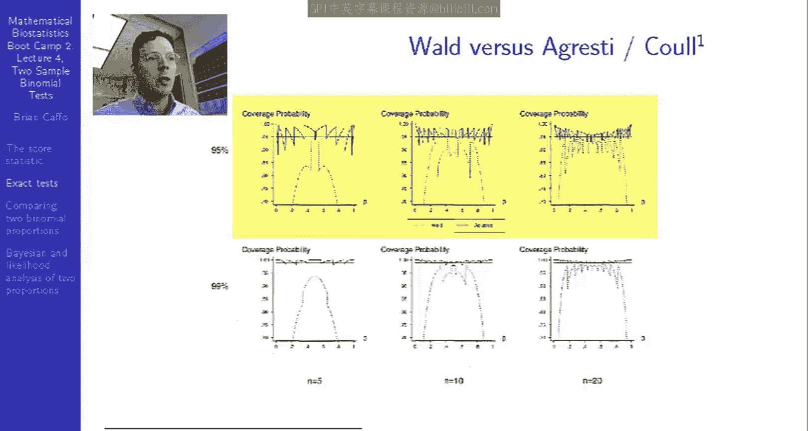

# 约翰霍普金斯大学《数据科学的高级统计｜Advanced Statistics for Data Science》中英字幕（deepseek p44 13_双样本二项检验：精确检验.zh_en -BV1htPjeYEFH_p44-

Okay， so in the previous slide are assumptions dependented on having a large enough sample for the central limit theorem to be applicable。

We can't actually do an exact binomial test， which by exact， I mean。

 the calculation utilizes the binomial distribution rather than the asymptotic distribution of the normalized sample proportion。

So in this case， lets the event of getting so we observed 11 people with side effects in the sample。

 we're testing greater than that our sample proportion is greater than something else。

 so the probability of getting of getting evidence as or more extreme than we obtained。

 would be the probability of getting more people than we observe which is 11 side effects。

 so this is the probability of Xa， which is the count of the number of people with side effects for a drug A being bigger than or equal to 11。

 that's the sum from 11 to 20 of the binomial proportion。

 and then you might ask well where does the no hypothesispo come in。

 where does the fact that we're under the no hypothesispo that。P is P is 0。1。 Well。

 right here it so it's 0。1 to the x 0。9， which is 1 minus0。1 to the 20 minus x。 So in other words。

 this calculation， the probability of getting more than 11 people with side effects out of 20 is done under the no hypothesis that P is 10%。

So this is the probability of getting evidence as or more extreme in favor of the alternative with the probability being calculated under the all hypothesis。

 so this is a P value， if you do this calculation the probability of getting 11 or more。

Out of 20 with a no I with a probability of 0。1。 If you do that calculation。

 that probability is around 0。 There's very little contribution of these these numbers are quite small。

 And you can do this in R very easily， just P by noome 10。20。1 lower dot tail equals false。 Now。

 I just want to point out that the small。Little detail here。 If， if we did P by noome。

And didn't have this lower doallus false。 If we had lower dotlus true or omitted it。

 because the default value is true。 then it's going to calculate 10， the probability of 10。

Plus 9 plus8 plus7 plus6 plus5 plus4 plus3 plus 2 plus1 plus zero。

If we do P byome lower dot tail equals false， in other words it wants to calculate the greater than probability。

 it does strictly greater than so if you do lower dot tail goes true。

 it does less than or equal to so includes 10 if you do greater than if you do lower dot tail equal goes false hence you want greater than it does a strictly greater than so it starts at 11 so if you put P byome 1020。

1 lower dot tail equal false， it's going to calculate the probability of 11 plus 12 plus 13 plus 14 plus 15 plus 16 plus 17 plus 18 plus 19 plus 20。

Okay， so in other words， p by noome 1020。1 lower dot T equals true， that number plus p by noome 1020。

1 lower dot tail equals false， those two numbers add up to1。

10 is only included in the instance where lower O tele goes true in the instance where lower Otlu is false。

 it starts， it goes above 10 to 11 and higher anyway， it's a small point。

 but you get the wrong answer if you don't do that And then if if you want to avoid this discussion you could just do binome test and say。

 well， we had 11 successes out of 20 trials and we want to test the hypothesis that it's 0。

1 and why want my alternative to be greater and binome dot test does it binnome test is maybe a little bit nicer to use because it actually。

It actually does the gives you the exact confidence interval role as well。

Okay。So one of the reasons this test is called exact is that the unlike the asymptotic error rates where the alpha that we use to get the normal quantile is an approximate error rate for the test so do if you perform a 5% level asymptotic test the alpha level is not necessarily 5% and there's been work to show that in some cases it can be substantially。

Higher than 5%。On the other hand， this exact test。This guarantees that the alpha level is if let's say you pick alpha equal to 0。

05， it guarantees that the alpha level is 5% or lower the that problem being or lower is that it's exact but conservative it's 5% or lower so in some cases with very small sample sizes the exact level can be much less than the observed level than the desired level。

And then， you know， so for two sided tests， what I'm going to suggest is calculate the two。

 one side of P values， it should be obvious which one is going to be the smaller one。

And then double it and that just kind of follows our rule we've been using in normal tests and this is good enough there are maybe slightly better procedures。

 but they change the numbers only a little bit。嗯。So given that we can do a two sided test either by this way or maybe by better ways。

We could calculate every value of P nons， let's say， by a grid search。

For which we would fail to reject the nu hypothesis in our two sided test and that would yield a confidence interval and that confidence interval would have an exact coverage rate。

 so it would have coverage if you did a  5% test， it would have coverage 95% or higher so all these things are slightly conservative so it would be 95%。

 maybe much higher， maybe 97% if it's a very small sample size。

And this interval is given a name it's called the C or Pearson interval。

 but the benefit of it is it guarantees your coverage rate， you get coverage 95% or better or higher。

 the problem is is that in the event that it's or higher you've unneces potentially unnecessarily widened the interval because if you want higher coverage you're generally going to get a wider interval。

So there's no such thing as a free lunch。And exact intervals fall under that category just as well as everything else in that they do guarantee your error rates。

 but then they have this tendency to be conservative。

 wider intervals being a little bit less likely to reject the no hypothesis are the consequences of using them。

 on the other hand you do get the assurance that the error rate is exactly adhered to given your assumptions。

I just wanted to show a picture from American statistician paper that I was involved in based on earlier work bygrti and Brent Coole。

And here what we did is we compared the coverage rate of the walled interval versus the approximate walled interval obtained by using the inverting the score test and just simply plugging in two rather than 1。

96。And what you see in these top lines is thatgged they're jagged because of the discretereetness of the binomial distribution。

And here we show let's just look at this top row for 95%。 Okay。

 what you can see is that this solid line the。The aggressive cool interval。

 it hovers right around 95%， sometimes it's a little low， sometimes it's a little high。

 but it still hovers right around the walled interval can be quite a bit off。 Now。

 this is a small sample size so that you know there's no reason to believe the asymptotics have kicked in and done very well。

But you even if you get up to say a sample of size 20。The closer the true value p is to 0 and1。

 you can get coverage that is very low below here I think where it's truncated at 70%。

 but it dips down and touches zero at zero and touches zero at1。

The point being that switching away from this walled interval where you put for the confidence interval where you put P hat in the standard error calculation to the a Co interval where it's a simple fix really improves performance quite a bit at no conceptual or computational cost。

 so that's just the point I'm trying to make here and it relates to this discussion of it's basically saying that the score interval is performing a lot better than the walled interval in this case and that tends to be a general rule。

