# 约翰霍普金斯大学《数据科学的高级统计｜Advanced Statistics for Data Science》中英字幕（deepseek p45 14_双样本二项检验：比较两个二项比例.zh_en -BV1htPjeYEFH_p45-

Of thumb。

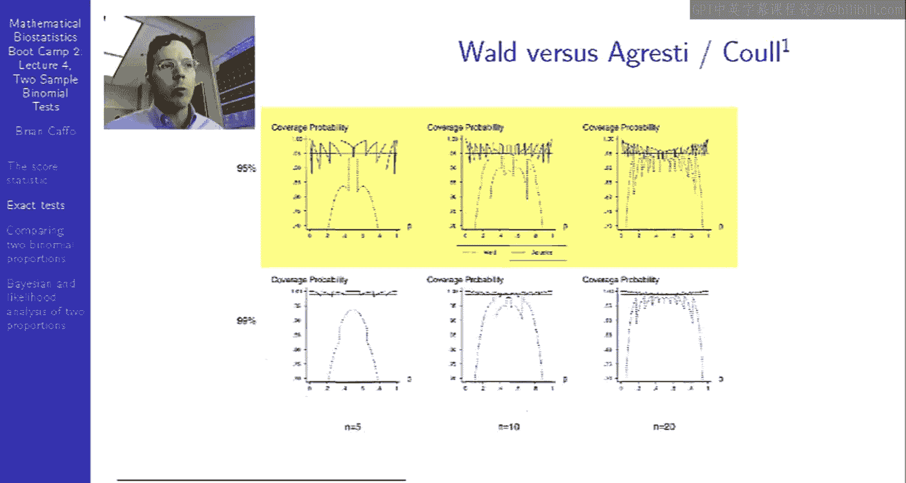

Okay， so now let's actually get to。Comparing two proportions rather than simply looking at one proportion。

 So we want to test whether the side effects is the same in the two groups or different。

So imagine if。A is some new formulation and B is the standard and you want to test whether or not the new formulation has has more side effects than the standard so in general for two by two tables。

 I'm going to use the following notation I'm going to you know have X。

N1 minus x and N1 plus y and2 minus y and N2 plus， and then if I need to I'll refer to the four cells indexing them by their matrix coordinates。

 N11，N12， n21， N22， I'll call N1， the right margin， and to the1， the right top margin。

 n to the right bottom margin， but in the case that I'm referring to both margins。

 I'll say n1 plus2 plus n plus1 and n plus 2 for the respective margins in other words。

 just summing the notation meaning summing over that index。

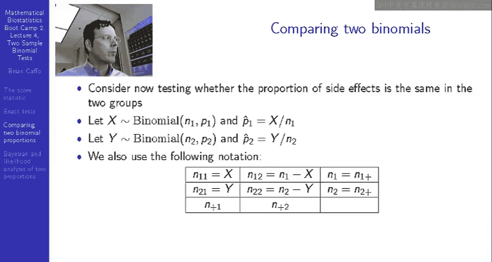

Okay， so now let's do a score test type test of a hypothesis that P1 equals P2。

So our null hypothesis is h not p1 equals p2 versus not equal to greater than or less than。

And then the score test for this no hypothesis our numerator is P1 minus P1 hat minus P2 hat。

 the sample proportion in group1 minus the sample proportion in group two。

And then if we were assuming that this difference was a constant other than zero。

 we would put that in the numerator here， the null hypothesis difference。

 but in typically the null hypothesis is they're equal， so there's minus zero here。

 the hypothesized null value of the difference so we can just omit that。And then in the denominator。

 under the hypothesis that P1 equals P2， then the the variance of P1 hat minus P2 hat is P times 1 minus P。

Quantity times1 over n 1 plus 1 over n 2， where p is the common proportion P1 equal to P2。

So under the no hypothesis， we need an estimated version of that if we're going to。

Actually get a number here that we can use compared to a normal normal quantile。

 so we need a value of P to plug in there so we say plug in P hat。If under the no hypothesis。

 the sample proportions are identical， then group A is a bunch of IID draws。

 II Bernoulli draws from group1。 Group B is a bunch of IID Bernoulli draws from group 2。

 but they have the same proportion。 So we really just have N1 plus N to Bernoulli draws and our estimate of the proportion would simply be the total number of of events。

 So that P hat is x plus Y over N1 plus N2。 And that is exactly the ML E for P。

The common proportion under the no hypothesis that the two proportions are equal。

 So we plug that into the denominator P hat times 1 minus P hat。And then we get our test statistic。

 which is again， just estimate minus hyposized value divided by the standard error。

And then this statistic is normally distributed under the no hypothesis for large N。

 standard normally distributed under the nu hypothesis for large N1 and and2。

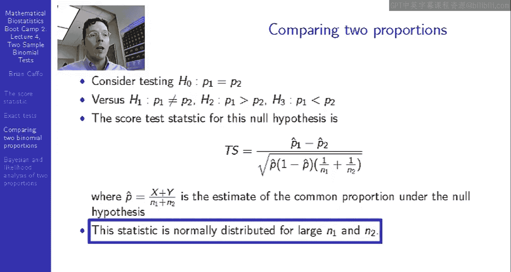

So if we want to invert this to create a confidence interval， well。

 we don't have a closed form like we do in the score task for a single proportion。A。

The walled interval is P1 hat minus P2 hat， and then it doesn't utilize the fact that under the no hypothesis。

 the proportions are equal， so then you just have a separate P1 hat。

1 minus P1 half or M1 plus P2 hat1 minus P2 hat over N2 in the denominator square root the whole thing and you can of course invert that to get a conference interval。

 P1 hat minus P2 hat plus or minus Z1 minus alpha over 2 times the square root of the standard error。

By the way， do you see why you can't invert the score test。

 the reason being that if you change the denominator was explicitly calculated under the specific null hypothesis？

That P1 equals P2 here in this test statistic if we were to have a different null that p1 minus p2 wasn't just equal to0 but was equal to some other value。

 we would add that in the numerator and then the denominator wouldn't change whereas in our score test we wouldn't have any way to adapt that denominator and that's no immediate way to adapt the denominator and that's why you have to use some programming to get the confidence interval from that one but this one the wall test we could invert very easily and we get an interval that should be fairly familiar to us。

P1 hat minus P2 hat plus or minus the normal quantile times the square root of the standard error。

 that's the so called walled interval it's very easy to calculate and it's taught in nearly every statistics textbook。

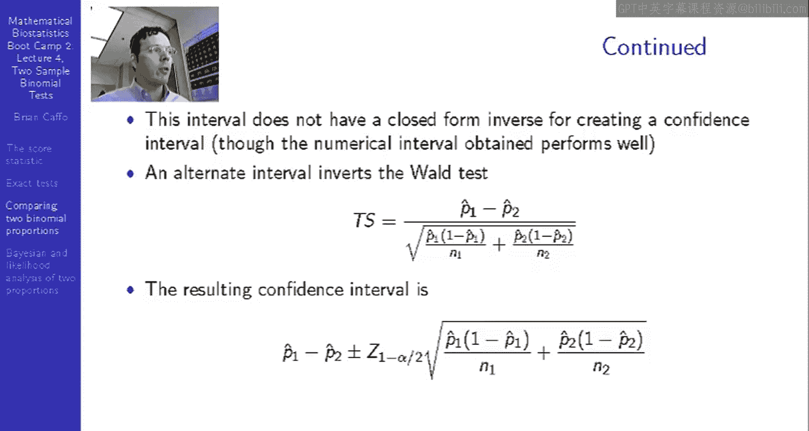

So this performs poorly， this weled interval performs poorly。

And it's relative to the score interval and test， the walled test and the wed interval perform relatively poorly but they they。

Decrease in performance is less so in the one sample case in the one sample case there's a huge decrease in performance。

 but the subtraction of the two proportions， subtracting two things tend to make them more normally distributed so it helps a little bit and the decrease in performance for the walled interval isn't anywhere near as bad as it is in the single proportion case。

So for testing I would just say always use the score test that's easy for intervals inverting the score test is hard and it's not in standard software。

 so our simple fix that we propose in an American statistician paper is to add one success and1 failure in each group。

 so calculate P1 Tildo which is x1 plus x plus1 over n1 plus2 n1 Tildo which is n1 plus2 p2 Tilde which is y plus1 over n2 plus2 and N2 Tilde which is n2 plus2 so this is exactly taking this2 by2 table。

That has the successes and failures for each group and adding one to every cell that's exactly what this is and then just treat that as if it's the data and construct a walled interval and this interval it doesn't approximate the score interval like in the ay cool interval。

But it does perform better than the Wal interval， and I'll have a slide in a second to show you this。

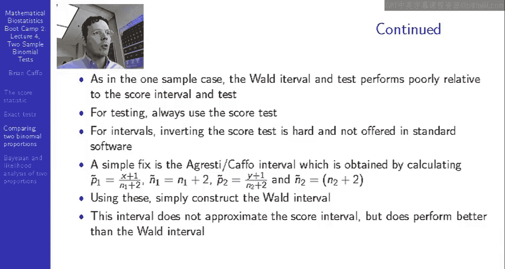

Okay， so let's just perform the test the score test test whether or not the proportion of side effects is the same for the two drugs PA hats 0。

55 PB hat is 5 over 20 which is 0。25 P hat the common proportion is 16 over 4011 plus 5 over 20 plus 20 which is 0。

4 so our test statistic is 0。55 minus 0。25 over 0。4 times 0。6 times square root。

2 over 20 I'm sorry square root the whole thing anyway you can plug in the formula you get 1。

61 and then we fail to reject H0 at the 5% level in other words， you compare it with 1。

96 for two sided test， the two sided P value calculate that probably the standard。

 the absolute value of a standard normal is bigger than 1。61， which is that the positive。

Part of a normal is bigger than 1。61 plus the probability that the negative part of a normal is below negative 1。

61 that's I guess 0。055 in either tail so we fail to reject there's our P value and so hopefully everyone can do this calculation very easily at this point in the class。

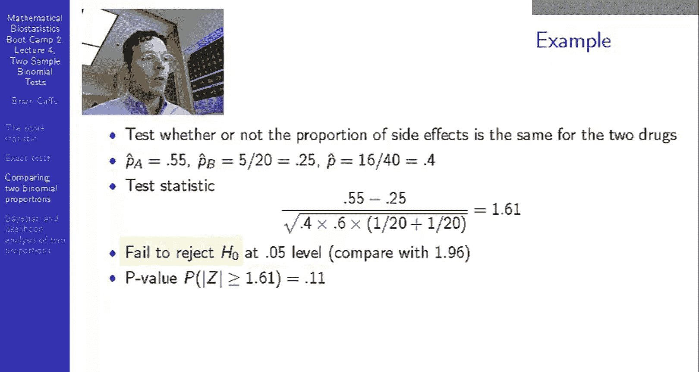

Okay， so here's the same picture as before， where in the previous picture。

 I showed the true value of the proportion by the coverage rate of the interval。

For the single proportion now here there's two proportions P1 and P2 so here by the true value of P1 and P2。

 here's the coverage probability on the left I have the walled interval on the right I have this a dec caho interval where you add one one success。

 one failure to each group， one to every cell and the two by two table and you can see that you get these big kind of dips down towards zero in the walled interval。

 if either of the proportions is either of the proportions is either very low or very high。

 you get very bad performance and you get performance that's well below 0。

95 and this shrinkage towards 0。5 for each of the means for each of the proportions improves things dramatically and it's a very easy thing to do。

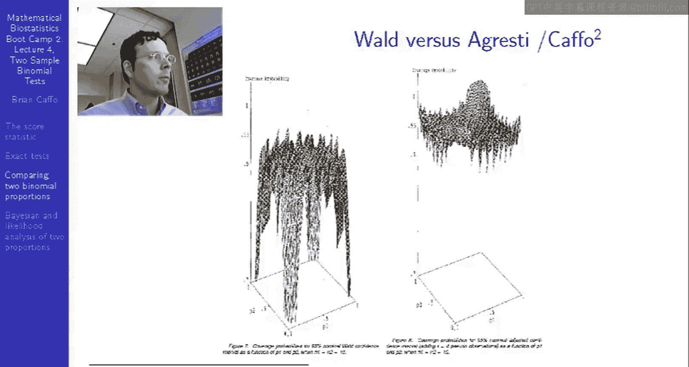

And then here's a simple another exact same plot， just some cross sections through it of different sorts and in the top ones I have where P1 minus P2 equals particular values and then on the bottom one I have ones where ratios of P1 and P2 are fixed in other words it's just sort of slices。

 maybe not slices or curves through that two dimensional picture and again it just shows that。

In a nice easy 2D plot what the。Relative performance of the aggressive caho interval is relative to the walled interval。

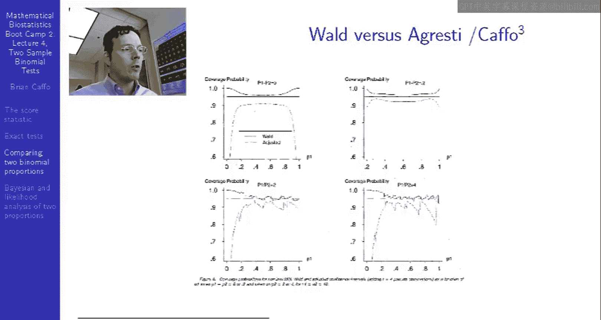

Okay， let's briefly go over some likelihood plots in Bayesian analysis of。To binomial proportions。

 so likelihood analysis requires the use of profile likelihood or some other technique to reduce the dimension down if you want to do a 1D likelihood plot and we can actually show you later on a way you can use the so-called noncentral hypergemetric distribution to get an exact likelihood plot for the odds ratio。

 but for the difference in the proportions is's a little harder。

 probably doing a profile likelihood would be the way to go so it's a little hard so let's leave that discussion for elsewhere。

So instead let's talk about being a Bayesian so imagine so we talked about for a single binomial proportion putting a beta prior on a probability to get a posterior so。

So imagine putting an independent beta alpha1 beta 1 prior and a beta alpha 2 beta 2 prior on P1 and P2 respectively。

 then the posterior， so remember how the calculation goes you take。Likelihood。

Times prior equals posterior。So here the likelihood is P1 to the x1。1 minus p1 to the n1 minus x1。

 P2 to the y1，1 minus p2 to the n2 minus y2， and then the beta prior is p1 to the alpha 1 minus1。

1 minus p1 to the beta 1 minus1 P2 to the alpha 2 minus11 minus p2 to the beta 2 minus1。

 So if we multiply all those together we get this formula right here。

 which exactly shows that if we have two independent binomials。

And then we multiply them by two independent betas。

 we wind up with an independent pair of independent beta posteriorors， one beta posterior for p1。

 one beta posterior for p2， where now the beta parameter is no longer alpha 1 but alpha1 plus x1 for p1。

 and the beta parameter for p1 is n1 plus beta1， the alpha parameter for p2 is y plus alpha 2。

 and the beta parameter for p2 is1 minus is n2 plus beta 2。So it's basically like。

Alpha and alphapha 1 and beta 1 are the be alpha beta parameters for p1。

 a priori after you factor in the data that just you add the successes to alpha and the failures to beta。

 add in the same for P2 and then you get the beta posteriorors。

 and the easiest way to explore this posteriorors with Monte Carlo simulation and I'll show that right here。

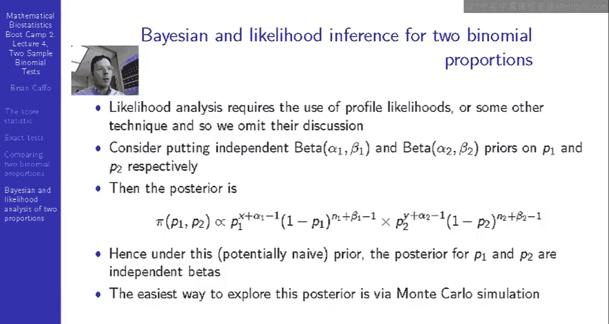

So it's very simple。 So here I define my x， my N1， my alpha 1， my beta 1， my y， my N2。

 my alpha 2 and beta 2。 And here I just did a uniform plot prior。 so if I have a beta with a1 and a1。

 that's just uniform。 So I put a uniform on both P1 and P2。

Then I'm going to sample from the posterior， so I just simulate random betas。

 I simulated 1000 beta pairs where now my alpha parameters x plus alpha 1， n minus x plus beta 1。

 and then for P2， my alpha parameters y plus alpha 2 and n minus y plus beta 2。

So imagine if I want to look at the risk difference here the risk of side effects。

 P2 minus P1 is the parameter I want and it does so here P1 is a bunch posterior P1 simulations。

 P2 is a bunch of posterior P2 simulations if I subtract them R does it component by components I get a collection of 1000 risk differences。

I could plot the density of the risk differences in the next line。

 I could calculate the lower 25th and the upper 97。

5th quantiles of these simulations to get a Bay incredibleed interval for them。

 I could calculate the posterior mean， and I could calculate the posterior median。And。

In the next slide， you see exactly this， I have some R code called2 byome post。

 which is on the GitHub repository， but also will be on the。

I'll put on the course website it puts out the mean risk difference， relative risk and odds ratio。

 the median for those three， the mode for those three and equitail confidence intervals boy what I mean by equitail confidence intervals I mean is 25% in the lower tail and 97。

 25。2。5% in the lower tail and 2。5% in the upper tail， which I think we discussed on the。

On the for the。One sample binomial case， we discussed that maybe it's better to not do equita conference intervals。

 but a credible intervals， but in this case it's easy enough to do it that way。

 so why don't we just do it that way and you know go through the two binome postcode。

 it's very simple to do this。

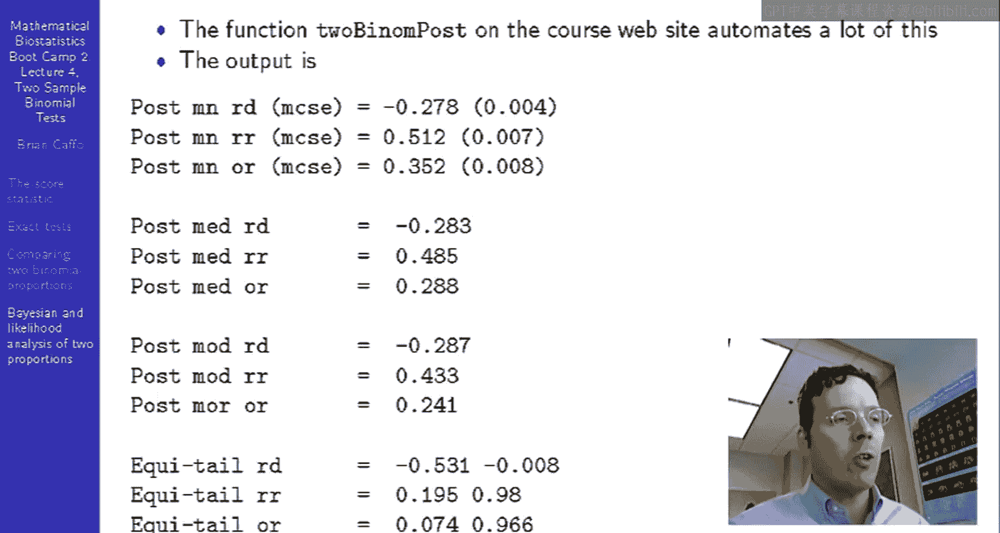

And here， what I'm showing is the。Poserior for the risk difference。

 And this is what's nice about Bayesian intervals。 So here we're simulating P1 and P2 posteri。

 So we're getting the posterior joint draws from the joint posterior distribution of P1 and P2。

 Any function of P1 and P2 that you then want to investigate it becomes very easy to do。

 And so here I took the risk difference and plotted the density。

 I put some blue lines where the credible interval occurs。 And I blew。

Oh the red line is identically at zero and so you can see that zero does fly within the credible interval。

 but you can also see with the posterior where the kind of more what points are better supported by the data for the risk difference and even though zero is in our credible interval。

 you know it's not a terribly well supported value and the value in the data。

I should say it's not a terribly well supported value posterii。

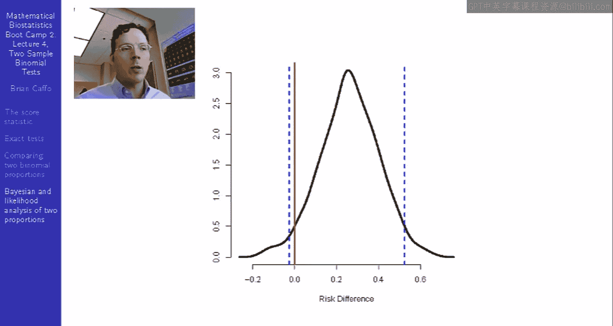

Well that's the end of the lecture that was a whirlwind tour of risk different style intervals for two binomial proportions。

 I'm hoping at this point that a lot of these topics in the class will start to come very easily to you because we're just kind of using the same techniques over and over again and I look forward to seeing you for the next lecture。

