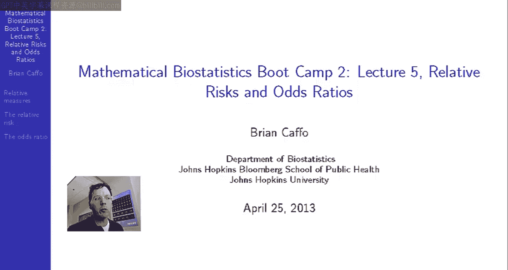
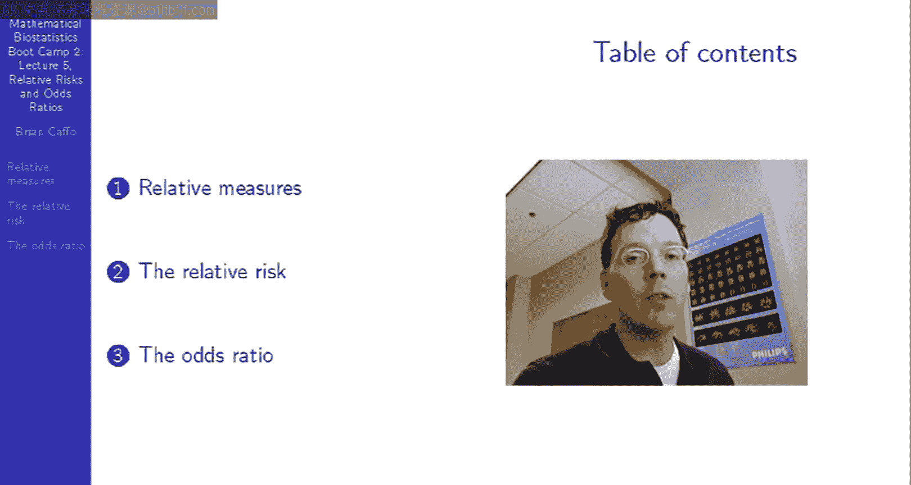
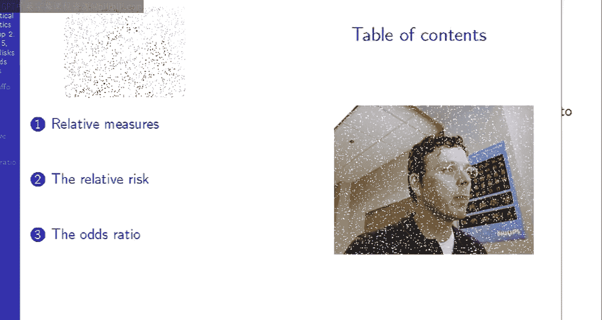
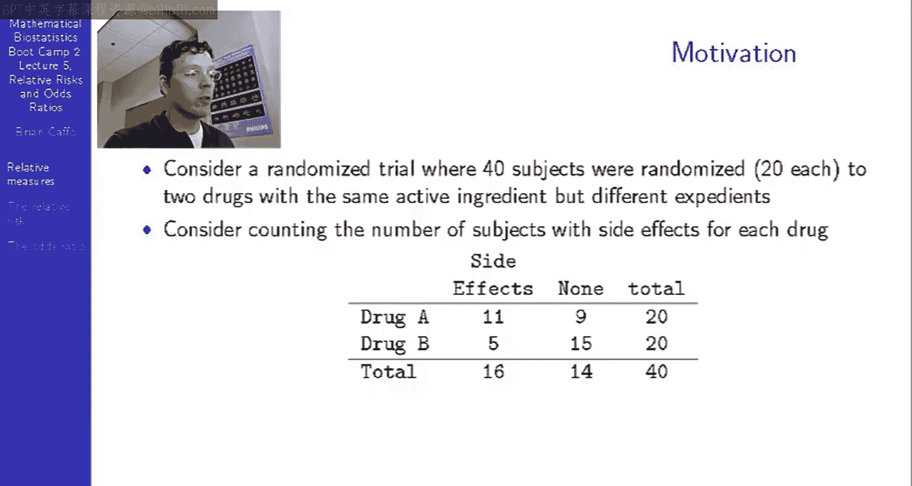
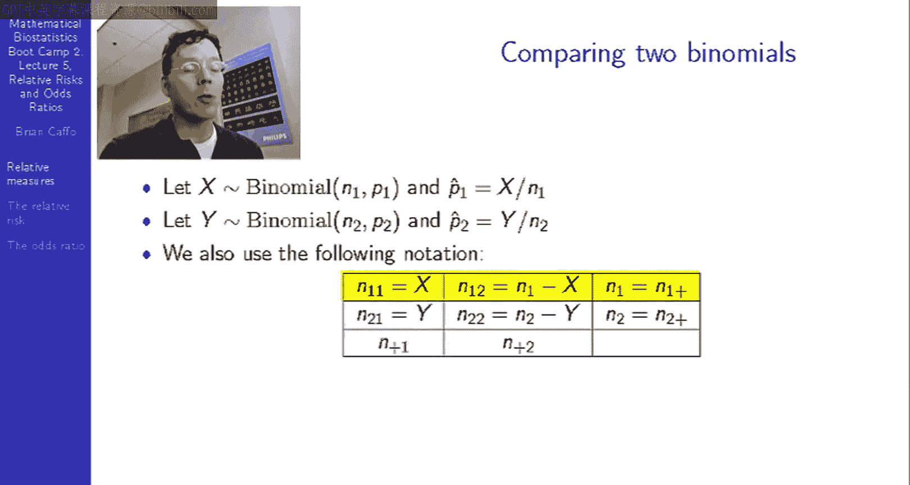
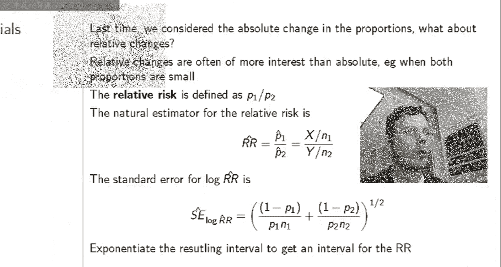

# 约翰霍普金斯大学《数据科学的高级统计｜Advanced Statistics for Data Science》中英字幕（deepseek p46 15_相对风险与优势比：相对度量.zh_en -BV1htPjeYEFH_p46-

Okay， hi troops， my name is Brian Kaho and this is Matheal Biosstatistics bootcamp Le5。

 where we're going to be talking about relative risks and odds ratios。

So the goal of today is to talk about some relative measures like the odds ratio and the relative risk。

 and there's many reasons why you might want to consider a odds ratio or a relative measure rather than an absolute measure like a risk difference。

 so as an example， if you're considering comparing an event that's somewhat rare。

 so say for example if you're interested in whether or not。

Some environmental effect causes a fairly rare disease where you're comparing a small proportion of people who contract the disease among the unexposed group and a small proportion of people who contract the disease among the exposed group and so it might be interesting to know that even though the absolute difference in rates is very small。

 the relative difference might be very large， so frequently we interested in relative differences rather than absolute differences。

 and two particular in the case of proportions that are interesting are a dividing the two proportions。

 that's the relative risk， and B dividing the two associated odds。

 which is called the odds ratio for obvious reasons。

Okay so let's put some context on this where we use a data similar to or exactly the same as we've used before。

 so consider a randomized trial where 40 subjects were randomized 20 each to two drugs with the same active ingredient but say different expedients so one's a capsule and one's of tablet or something like that。

 let's say so consider counting the number of subjects having side effects for each drugs so drug A had 11 people with side effects。

 9 with none， 20 total， drug B had five people with side effects。

 15 with none and 20 total which left 16 total people with side effects。

 14 with none and 40 total and the interest is whether drug A has a statistically higher percentage of side effects than drug B accounting for what would be expected by chance。

So let's look into that。

So there are several ways to approach this problem， in fact。

 the two by table is a surprisingly complex set of four numbers。

 but we're going to approach it from the following way。

 we're going to assume that the count of the number of people with side effects from group 1 is binomial with N1 equal to 20 and P1 a proportion that we'd like to know and why the proportion the count of people with side effects from drug B will also be binomial with number of subjects N2 which is 20 in this case。

 and P2 being the proportion of people with side effects from that group。

The obvious estimate of P1 is P1 hat， which is x over n1。

 and the obvious estimate of P2 hat is Y over N2， of course。

So we're going to use the following notation below in addition to the X and Y notation。

 So x is the side of the count for drug A Y is the count for drug B and so on。

 but we'll also you know given that it's a little2 by two matrix。

 we can index the elements by I and J so N11 is the upper left hand cell N21 is the lower left hand cell and so on。

 and then if we need a margin， a point that's fixed by the。I'm sorry。

 a point that aggregates over either rows or columns will mark that with a plus。

 so n plus one means that we summed over the two first indices and one plus would mean we summed over the two latter indices。

