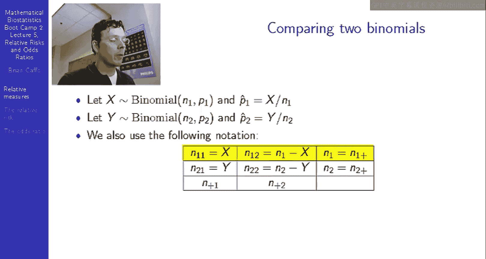
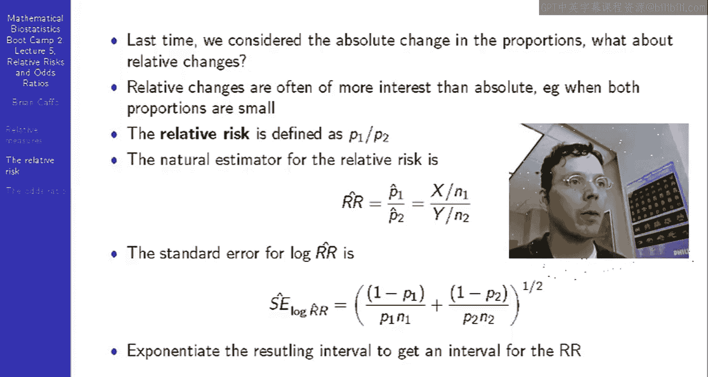
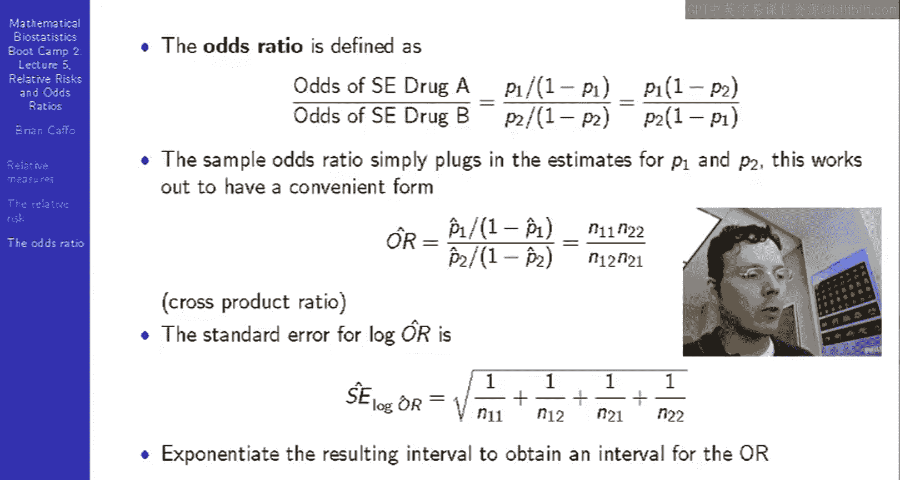
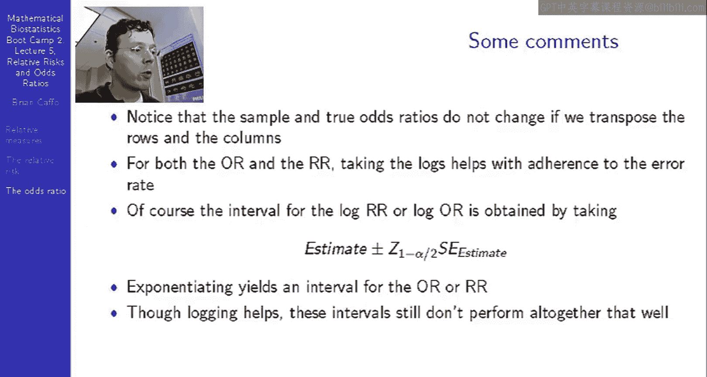

# 约翰霍普金斯大学《数据科学的高级统计｜Advanced Statistics for Data Science》中英字幕（deepseek p47 16_相对风险与优势比：相对风险.zh_en -BV1htPjeYEFH_p47-

Okay， so last time we considered absolute changes in proportions。

 but what about relative changes and as I said， relative changes are often of interest？For example。

 when the proportions are small， you might have in the example we were discussing earlier。

 a tenfold change in the exposed group contracting the disease over the control group or the non-exposed group。

 but the absolute difference be quite very small less than a fraction of 1%。

 and so in that case it's very natural to consider relative amounts rather than absolute amounts。

Well the most obvious thing to do in the case of proportions is to define the relative risk。

 which is simply just one of the proportions divided by the other and then of course it doesn't matter which one you put in the numerator and which one you put in the denominator as long as you remember what you did。

So and just to remind you， so we have P1 and P2 population parameters defined here because remember on the previous slide。

 we actually talked about a model where our data our IID draws from a population。

There's other ways to think about this problem， but that's how we're going to think about it。Okay。

 so the obvious estimator of the relative risk is the estimated relative risk。

 which is P1 hat divided by P2 hat， which is of course just x over n1 divided by y over N2。And。So。

The route of risk is obviously there's an issue if y has zero counts， right you're dividing by zero。

 so that's potentially a problem， but also if we want to create an asymptotic conference interval where we treat data our estimator as if it's normal。

 there's a problem that this is of course bounded from below by zero。

And it turns out that the log relative risk， the log estimated relative risk。

 has much better asymptotic behavior in the confidence interval， looks a little bit better。

So what people do is they say， okay， and often when you're working with ratios。

 we know already that it's very convenient to look at logs。

So the log relative risk is just the log of this quantity here， x over n1y over n2。

 and that quantity has an asymptotic standard error that you can calculate and in fact。

 in one of thes one of the next two lectures or so we'll show you exactly how to get this standard error。

That standard error works out to be 1 minus p1 over p1 n1 plus1 minus p over p2 n2 all raised to the1 half power and that's the standard error of the log relative risk。

 so what you do to create a confidence interval for the relative risk is you log the estimated relative risk you add and subtract a standard normal quantile and then you multiply that standard normal quantile times this standard error of the log relative risk that will give you a confidence interval for the log relative risk and if you then want a confidence interval for the relative risk you then expentiate the endpoints。

Okay， so。We could equivalently take the ratio of odds instead of the ratio probabilities if you prefer。

 there's a variety of reasons to do that， but one is maybe what if you just prefer to interpret things in terms of odds rather than probabilities anyway。

 some people like to think about things in terms of odds。

 saying the an odds of say 10 to one is more interpretable to them then saying a probability of 1011s。

So。The odds ratio， the population odds ratio would just be P1 over1 minus P1 divided by P2 over1 minus P2。

 so the odds associated with probability1 divided by the odds associated with probability 2。

 so this would be the ratio of the odds of contracting side effects comparing drug A to drug B。

And of course， just like the relative risk you'll be comparing the odds ratio to one。

 if it's bigger than one， it's going to suggest a greater propensity of side effects for drug A and if it's less than one。

 it's going to suggest a smaller propensity for side effects of drug A。嗯。And then of course。

 the obvious estimate of the odds ratio is P1 hat divided by1 minus P1 hat。

 P2 hat divided by 1 minus P2 hat。And you can you can plug in the x and N1 and y and N2 into that formula。

 and what you'll find is that it works out to be if we go to our other notation where we talk about the cell counts。

 the N11， N22 times N21 times N2， N12。And the easy way to remember that is it's so called cross product ratio。

 so the product along the let's see what I'm recording， it's not the product along that diagonal。

Divided by the product along this other diagonal and。

And so that way you can always remember how to do it。

 some people tend to if you label the elements of the two by two table， ABCD。

 some people tend to remember it in terms of the specific letters。

 but I think it's probably better to remember it in terms of it the product along one diagonal divided by the product along the otheragonal。

 the off diagonal。So just like for the relative risk， the odds ratio， the estimated odds ratio。

 has better asymptotic Gaussian behavior if you log it。

So we can calculate a standard error for the loggos ratio that works out to be an incredibly convenient formula it's the square root of one over all the cell counts added up so one over n11 plus1 over n12 plus1 over n21 plus1 over n22 square root of the whole thing so you shouldn't forget the standard error of the log odds ratio because it's super easy so again。

To create a conference interval for the population odds ratio， you calculate the odds ratio， log it。

 calculate the standard error of the log odds ratio， add or subtract a standard normal quant say 1。

96 if you want a 95% confidence interval to your log odds ratio and that will give you an interval estimate for the log odds ratio。

 exponentialoniate the endpoints and that gives you an interval estimate for the odds ratio now。

Again， we have a little bit of a problem if N12 or N21 is0。

 and there's some fixes for that often involving adding small amounts to every cell is a common fix。

Okay， so some comments about the odds ratio。 so one interesting fact is if you noticed if you transpose so the little two by two tables of matrix。

 if you transpose the matrix， so simply record it in this case。

We had side effects versus none labeled on the columns。

 I believe in drug A versus drug B labeled along the rows。

 but what if we correctly entered in the data with side effects entered along the rows and drug A versus B entered along the columns and then calculated odds ratio where you get identically the same number so the odds ratio doesn't care what is the sort of predictor and what is the response you get the same exact answer。

And for both the odds ratio and the relative risk taking logs helps with the adherence to the error rate。

 so again because it's asymptotics， you don't necessarily if you want a 95% conference interval。

 you don't exactly get a 95% conference interval because it's all based on the central limit theorem。

 it's only true in the limit。So the taking logs helps adherence to that error rate。

And then the interval is just at log estimate， right log odds ratio or log relative risk plus or minus the appropriate normal quantile。

 then times the standard error of the estimate， and then exponentialing yields the interval on the natural scale and I would also add the logging helps these intervals still do have some issues。

 they're better than the risk difference which I think they're better than the risk difference but still there's ways you can improve on these confidence intervals。

 but they involve a little bit more lengthy calculation so we won't go over them。

 these are the quick versions。Okay， so let's go over our example next。

