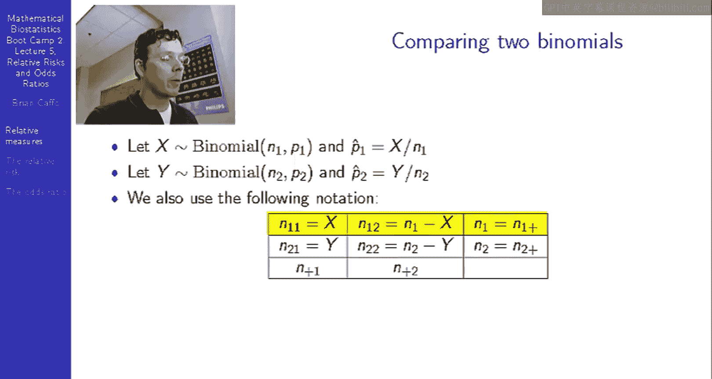
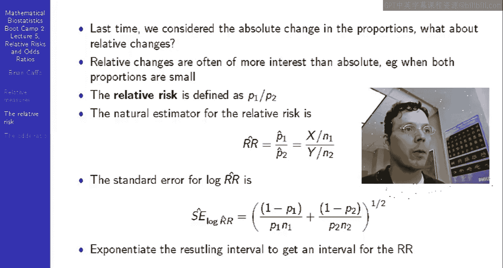
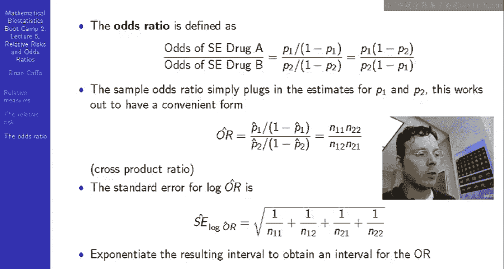
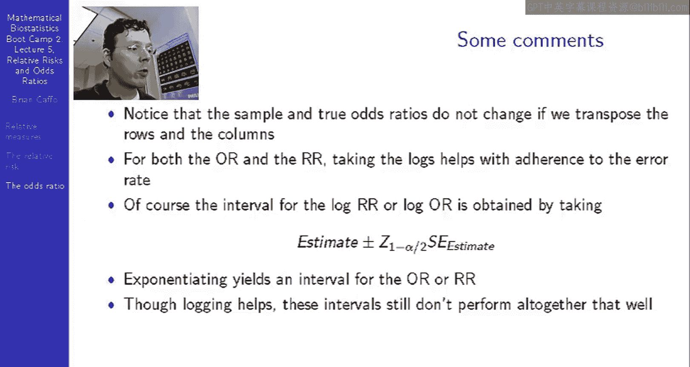

# 高级统计学：第16讲：相对风险与优势比

在本节课中，我们将学习如何衡量两个比例之间的相对变化，而不是绝对变化。我们将重点介绍两个核心概念：**相对风险**和**优势比**。它们常用于医学、流行病学和社会科学等领域，用于比较不同组别之间事件发生概率的差异。

上一节我们讨论了比例之间的绝对差异。本节中，我们来看看如何衡量相对变化。当比例本身很小时，即使相对变化很大（例如十倍），绝对差异也可能微不足道。因此，在这种情况下，考虑相对量而非绝对量更为自然。

## 📊 相对风险

最直观的方法是定义**相对风险**，它就是一个比例除以另一个比例。只要记住哪个是分子、哪个是分母，顺序并不重要。

我们定义两个总体参数：`P1` 和 `P2`。相对风险的公式为：
`RR = P1 / P2`

相对风险的估计量是：
`RR_hat = (x / n1) / (y / n2)`

这里存在一个问题：如果 `y` 的计数为零，就会导致除以零的错误。此外，如果我们想构建一个渐近置信区间，将估计量视为正态分布，由于相对风险的下限为零，其分布可能不对称。

因此，实践中通常使用**对数相对风险**，因为它具有更好的渐近性质，其置信区间也更对称。

对数相对风险定义为：
`log(RR_hat) = log( (x / n1) / (y / n2) )`

对数相对风险的渐近标准误计算公式为：
`SE[log(RR_hat)] = sqrt( (1-p1_hat)/(p1_hat * n1) + (1-p2_hat)/(p2_hat * n2) )`

以下是构建置信区间的步骤：
1.  计算对数相对风险 `log(RR_hat)`。
2.  计算其标准误 `SE[log(RR_hat)]`。
3.  构建对数尺度上的置信区间：`log(RR_hat) ± Z * SE[log(RR_hat)]`，其中 `Z` 是标准正态分位数（例如，95%置信区间对应1.96）。
4.  最后，将区间的上下限取指数，即可得到原始尺度（相对风险）上的置信区间。

## ⚖️ 优势比

除了比较概率，我们还可以比较**优势**。有些人更习惯用优势（例如10比1）而非概率（例如10/11）来思考问题。

总体优势比定义为：
`OR = (P1 / (1-P1)) / (P2 / (1-P2))`

其估计量为：
`OR_hat = (p1_hat / (1-p1_hat)) / (p2_hat / (1-p2_hat))`

如果使用列联表的单元格计数表示（例如，将数据整理为2x2表格，单元格计数分别为 `n11`, `n12`, `n21`, `n22`），优势比有一个非常方便的计算公式，即**交叉乘积比**：
`OR_hat = (n11 * n22) / (n12 * n21)`

与相对风险类似，对数优势比具有更好的渐近正态性。其标准误的计算公式极其简单：
`SE[log(OR_hat)] = sqrt( 1/n11 + 1/n12 + 1/n21 + 1/n22 )`

以下是构建优势比置信区间的步骤：
1.  计算优势比 `OR_hat` 并取其对数 `log(OR_hat)`。
2.  计算对数优势比的标准误 `SE[log(OR_hat)]`。
3.  构建对数尺度上的置信区间：`log(OR_hat) ± Z * SE[log(OR_hat)]`。
4.  将区间的上下限取指数，得到原始尺度（优势比）上的置信区间。

同样，如果任何单元格计数为零，计算会遇到问题。常见的解决方法是为所有单元格加上一个小的常数（如0.5）。

## 💡 重要说明与总结

关于优势比，有一个有趣的性质：它不关心变量中哪个是预测因子、哪个是响应变量。即使交换2x2表的行和列，计算出的优势比也完全相同。

对于相对风险和优势比，取对数都有助于提高置信区间的覆盖率（即更接近我们声称的置信水平，如95%），因为这些方法都基于中心极限定理，只在样本量足够大时精确。

本节课中，我们一起学习了如何计算和解释**相对风险**与**优势比**，这是比较两个比例相对差异的核心工具。我们了解到，通过取对数并使用相应的标准误公式，可以构建它们的置信区间。这些方法在比例较小或我们更关心相对变化时尤其有用。记住，优势比的计算公式 `(n11*n22)/(n12*n21)` 及其标准误 `sqrt(1/n11+1/n12+1/n21+1/n22)` 非常简洁，是实践中常用的工具。