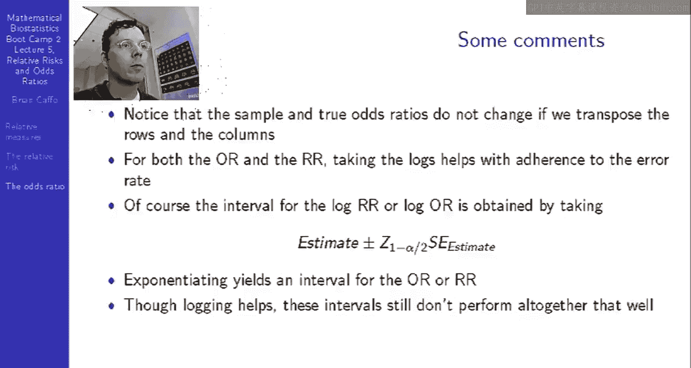
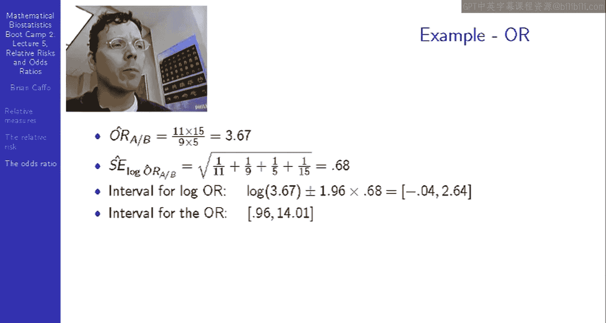
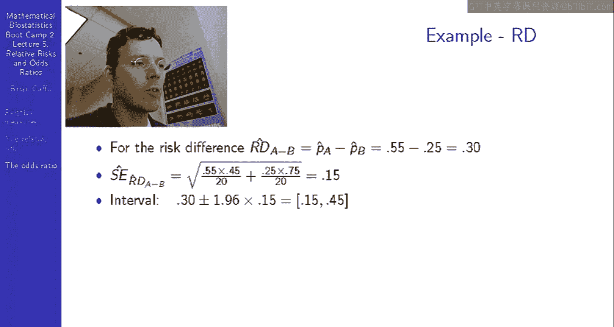
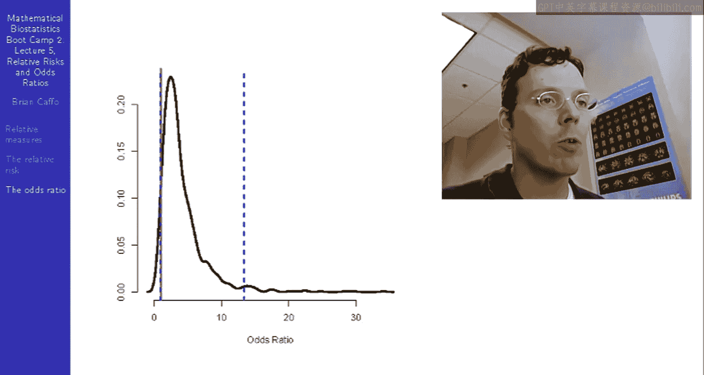

# 约翰霍普金斯大学《数据科学的高级统计｜Advanced Statistics for Data Science》中英字幕（deepseek p48 17_相对风险与优势比：优势比.zh_en -BV1htPjeYEFH_p48-

Okay so for the relative risk， our PA hat worked out to be 11 over 20， which is 0。

55 PB hat worked out to be 5 over 20 which is 0。25 so the relative risk is 0。55 over 。

25 for just I always I think it's probably a good habit to write that we're comparing A over B in the relative risk just to remind ourselves what order we divided in that works out to be 2。

2 quite a large difference quite a large indication of a difference but is it actually statistically significant is it something that would be of interest that in the sense that it could be more than just a chance association okay so let's calculate the standard error of the log relative risk here I plug into the formula I get 0。

44。The interval for the log relative risk is then log 2。2 log of our relative risk plus or minus1。96。

 the standard normal 97。5 quantile times 0。44 that gives us negative 007 to 1。65。

We're interested on the log scale in comparing whether or not this interval contains zero。

 and then if we were to exponentiate it back， the interval for the relative risk is 0。93 to 5。21。

 which again shows an indication that drug A has a greater propensity for side effects than drug B。

 but isn't exactly significant because this interval contains one and on the log scale。

 the interval contains zero， of course because log is a monotonic function if it contains0 on the log scale it will contain one on the natural scale and vice versa。

 so the whether you check for zero on the log scale or one on the un log scale will always yield the identical answer。

Okay， let's go over the odds ratio， the odds ratio for a divided by B。 Well。

 let's just do this cross product formula，11 times 15 divided by 9。Time 5 that gives us 3。67。

 the standard error then is square root1 over the addition of one over the cell counts that works out to be 0。

68， so the interval for the log odds ratio is log 3。67 plus or minus 1。

96 times 068 that works out to be negative 0。4 to 2。64 the interval for the odds ratio is 096 to 14。

01。Now。So this is on the natural scale。

Okay， and then just to finish off our thinking about this problem。

 consider the risk difference as well， so the risk difference would betract here you know like I think it's good idea to put that you're subtracting a minus B there PA hat minus PB hat that works out to be 0。

30 the standard error of the risk difference is given in this formula here， it works out to be 0。

15 and the intervals is again given here。You know， there's issues with a risk difference formula。

As well， and we covered some of that before and showed that you can maybe improve on its performance a little bit by。

Adding one to every cell， for example。啊。And that was covered in the last lecture， I believe。

And then the final thing I wanted to just show were two plots just to discuss just to finish some thoughts from the last lecture where we talked about Bayesian analysis。

 So if you recall， if you look back to the last lecture。

 what we did was we postulated a prior for P1 and P2 that were independent beta priors。

 we found that if we did that， then we got independent beta posteriors for P1 and P2。

We saw that an efficient way to explore the posterior was to do a simulation from it。

And that would allow us to calculate things like the posterior mean。

 the posterior variance and so on so if you go back to that lecture you'll hopefully be reminded of exactly what we did。

When you conduct these posterior simulations you get a PA in a PB， P1 and P2。

 you get lots and lots of pairs of those things that represent draws from the posterior distribution and it's convenient to do that because it's just a convenient numerical way to investigate the posterior if you take the arithmetic mean of those posterior draws right。

 you would get the posterior mean for PA and the posterior mean for PB。

 you could get the posterior mean then for the risk difference。

 the posterior mean for the odds ratio by taking every pair PA and PB。

And calculating the odds ratio and so on here what I did is I calculated for every PA PB pair simulated from the posterior。

 I then simply plotted a histogram of them and this is just a approximation of the posterior where the accuracy of the approximation only depends on how many Monte Carlo samples I elected to for the computer to generate。

 So if I let the computer run for a really long time I get a near perfect representation of the posterior is the so this in this case it's the posterior for the risk ratio。

 So again， I took PA divided it by PB right and then for all of those pairs。

II plotted a density estimate and there's the density this gives you a lot of information about where the evidence concerning the risk ratio。

 the route of risk lies here I drew the blue lines for the 95% credible interval where there's 2。

5% above either below the lower blue line and above the upper blue line。

 and then I put a reference line at one in this case。

 and as we saw when we calculated the confidence interval， the lower endpoint is just below one。

So that if you were sort of interested in something like significance， you wouldn't get significance。

 but I think you know the posterior displays a lot of information and does a lot give you a lot more than just a conference interval or the result of a hypothesis test or。

啊。You know just even worse， giving the asterisks on how significant the P value is。

 which some software does， okay。嗯。And then on the next slide。

 what I'm showing here is the same exact calculation done for the odds ratio。

 So this is just to give you a flavor of what the sort of output or the desired output from a simple Bayesian analysis would be。

 The posterior is the quantity that you would use to to investigate the。

The relative proportions either through the odds ratio or through the relative risk。

