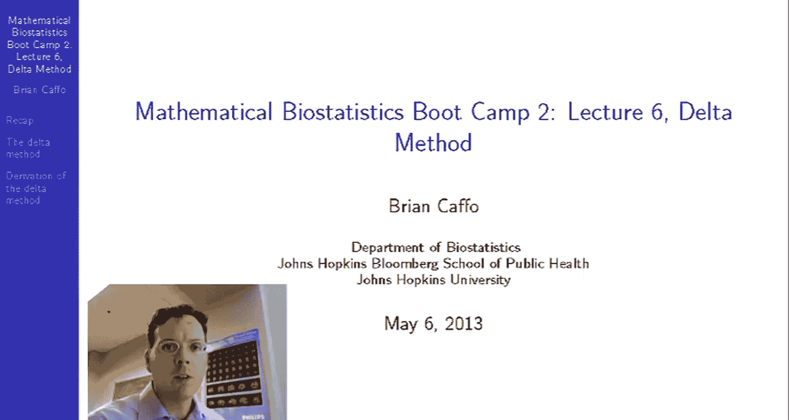
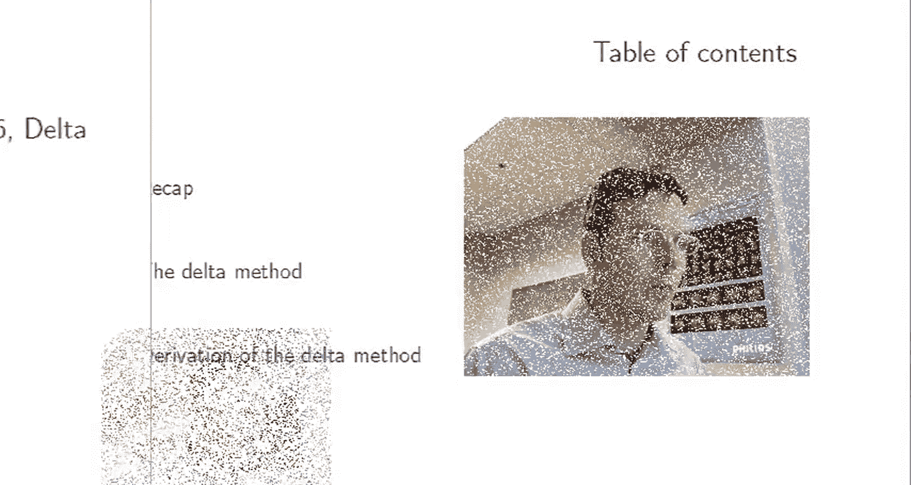
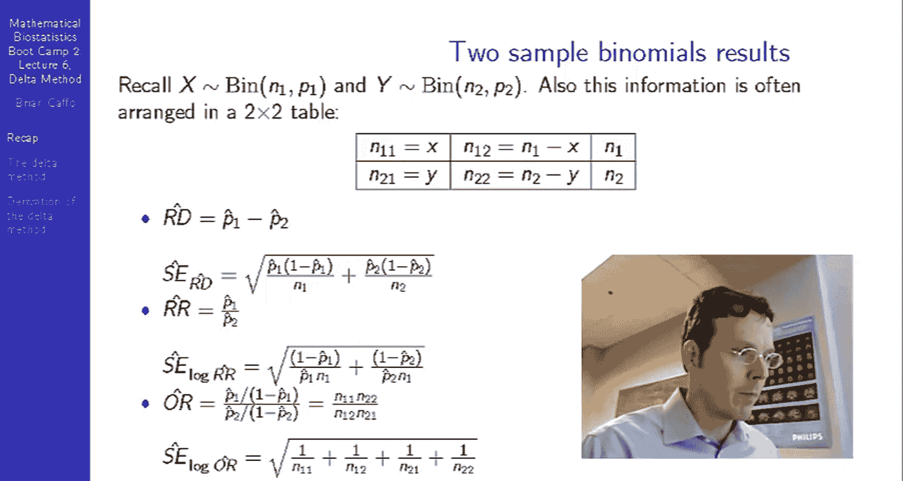
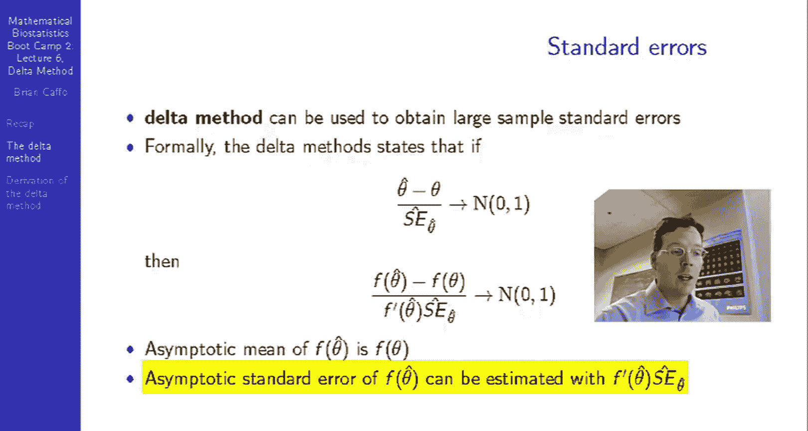

# 约翰霍普金斯大学《数据科学的高级统计｜Advanced Statistics for Data Science》中英字幕（deepseek p49 18_Delta方法.zh_en -BV1htPjeYEFH_p49-

Hi， my name is Brian Kaffho and this is Matheal Biostatistics Boot Campamp 2。

 Le 6 on the Delta methodth。

So in this video we're going to recap a little bit about the odds ratio。

 the relative risk and these measures， and then I'm going to describe basically how you get the standard error and test statistics for these methods using this technique called the Delta method and then I'll briefly derive the Dlta method but in a very。

General way， not in a highly technical way。

Okay， so recall。We had a setting where X was binomial n1 P1， Y was binomial n2 P2。

 and then we could have this two by2 table here as well。

 and we defined the risk difference as the difference in the proportions and this is because this is just an average we can derive the standard ER very quickly we have the relative risk which is P1 over P2 and the associated estimator P1 hat over P2 hat。

And we have the standard error of the log relative risk， which is given here。

 and it's not clear how we derive that yet， and then we have the odd ratio。

 which is the odds associated with group1 p1 over1 minus P1 divided by the odds associated with group 2。

 which is P2 over1 minus P2， the associated estimate is P1 hat divided by1 minus P1 hat whole thing divided by P2 hat divided by1 minus P2 hat。

 and if you were to plug in the elements， the cells of the2 by 2 table into that estimate you would see that it's the crossproduct ratio。

 the main diagonal N11 times n12 divided by the off diagonal N12 and N21。

We also gave you the standard error for the log odds。

 the estimated standard error for the log odds ratio estimate。

 and that is square root of one over the cell entries from the two by two table this one over n11 plus1 over n12 plus1 over n21 plus1 over n22 and then in any of the cases the confidence interval is the estimate plus or minus the normal quantile times the standard error of the estimate Now a couple of notes are in order first in terms of the risk difference we saw that maybe we can improve on this confidence interval by adding to the cells in a particular way。

So hopefully you can recall back to that lecture。In addition for the two other estimates。

 the relative risk and the odds ratio， you have the issue that you are the estimate here is the log relative risk and the log odds ratio you add and subtract z1 minus half over 2 times the standard error of the log estimate。

 and then if you want an estimate for the relative risk or odds ratio respectively。

Then you have to expentiate the endpoints of the interval okay so I hope you remember that as well so this is our starting point and during this lecture we're going to show you how to get these standard error estimates or at least describe how they're obtained and then hopefully you'll get a pretty good sense of how it's done and think very reasonably how it could apply far more broadly。

Okay， so the Delta method is a method that we can use to obtain standard errors for these instances where things aren't just a simple difference of averages。

Or a simple average itself， like in the risk difference case。

 so like in the case of the log relative risk or the log odds ratio。

So here's formally what the Delta method states， it says that if you have an estimator theta hat and it'sest theta divided by the estimated standard error。

 if that tends to a normal one in distribution。Then take a sufficiently smooth function f。

 f of theta hat， minus f of theta over f prime of theta hat times the standard error again also converges to a normal zero1。

So in a sense， what this is saying is sort of the asymptotic mean of f of theta hat is still f of theta。

 so if you want to estimate the。This this function of theta。

 then the obvious estimate is f of theta hat， and this is saying that well。

 maybe if we're going to use f of theta hat as an estimate of f of theta。

 we'd like a standard error and it says okay， we'll take the standard error that you would use if you weren't taking the function standard error hat here of theta hat and then simply multiply it times the derivative of F evaluated at theta hat and that's what the delta method says。

