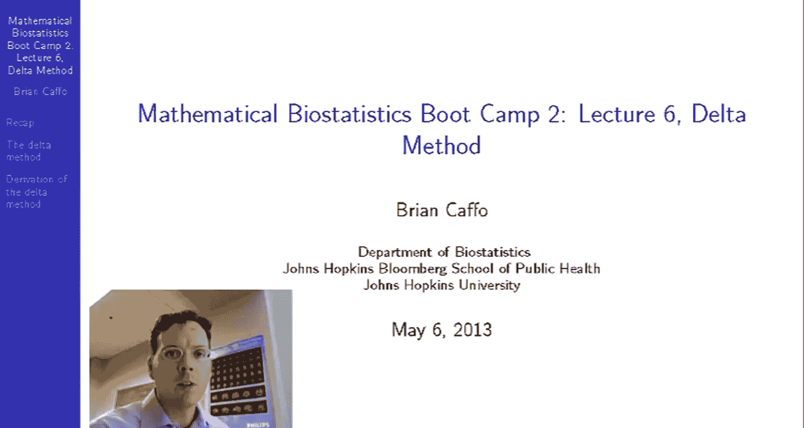
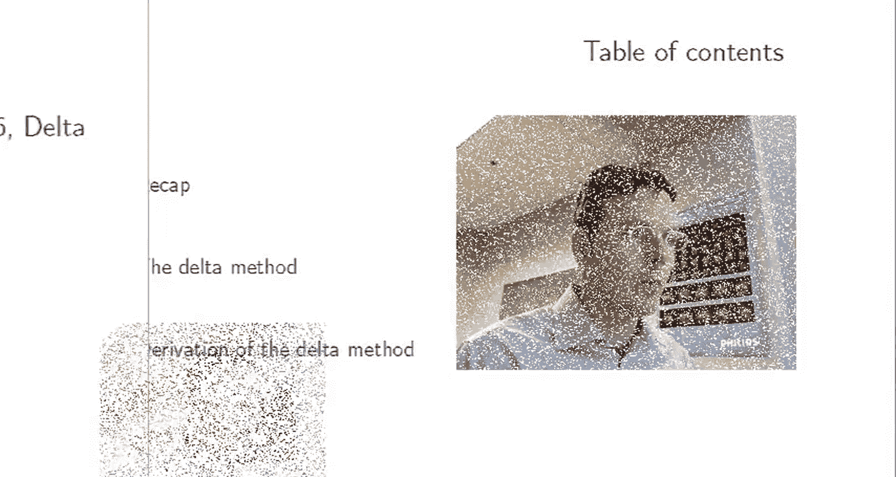
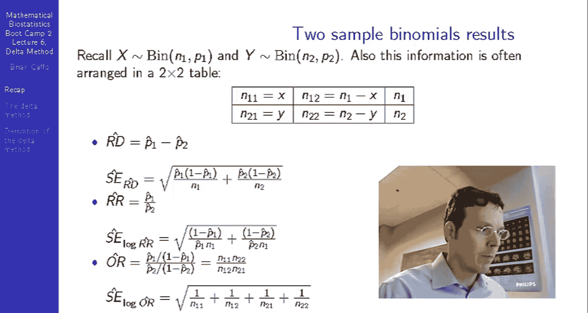
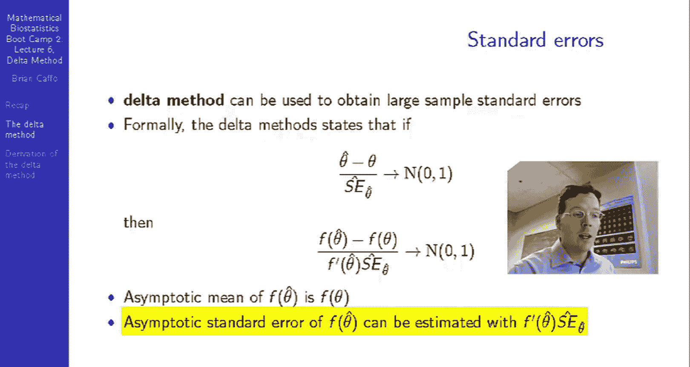

# 高级统计学：第6讲：Delta方法 🧮

在本节课中，我们将学习Delta方法。我们将首先回顾优势比、相对风险等概念，然后介绍如何使用Delta方法来计算这些统计量的标准误和检验统计量。最后，我们将简要推导Delta方法，并以一种通俗易懂的方式解释其原理。

## 回顾核心概念

上一节我们介绍了二项分布数据下的几种效应度量。现在我们来回顾一下。

假设有两个组，X服从二项分布 `X ~ Binomial(n1, P1)`，Y服从二项分布 `Y ~ Binomial(n2, P2)`。数据可以整理成一个2x2列联表。

以下是几种常用的效应度量及其估计量：

*   **风险差**：定义为两组比例之差 `RD = P1 - P2`。其估计量为 `RD_hat = P1_hat - P2_hat`。由于这是一个简单的平均值之差，其标准误可以快速推导。
*   **相对风险**：定义为 `RR = P1 / P2`。其估计量为 `RR_hat = P1_hat / P2_hat`。我们给出了对数相对风险的标准误公式，但尚未解释其推导过程。
*   **优势比**：定义为第一组的优势 `P1/(1-P1)` 除以第二组的优势 `P2/(1-P2)`，即 `OR = (P1/(1-P1)) / (P2/(1-P2))`。其估计量为 `OR_hat = (P1_hat/(1-P1_hat)) / (P2_hat/(1-P2_hat))`。如果代入2x2表的单元格数值，你会发现它就是交叉乘积比 `(n11 * n22) / (n12 * n21)`。

我们还给出了对数优势比估计值的标准误公式：`SE(log(OR_hat)) = sqrt(1/n11 + 1/n12 + 1/n21 + 1/n22)`。

在所有情况下，置信区间的构建方式都是：`估计值 ± 正态分位数 × 估计值的标准误`。

有几点需要注意：
1.  对于风险差，我们可以通过向单元格添加特定数值来改进其置信区间。
2.  对于相对风险和优势比，我们构建的是其对数尺度（log RR 和 log OR）的置信区间，即 `log(估计值) ± z * SE(log(估计值))`。若想得到原始尺度（RR 或 OR）的置信区间，需要对区间的上下限取指数运算。

以上是我们的起点。在本节中，我们将展示如何获得这些标准误估计值，至少描述其获取方法，以便你对其原理有清晰的认识，并理解其更广泛的应用。

## 引入Delta方法

上一节我们介绍了风险差、相对风险和优势比。对于风险差，其标准误易于计算。但对于像对数相对风险或对数优势比这样的复杂函数，我们需要一种通用方法来推导其标准误。本节中我们来看看Delta方法。

Delta方法是一种用于获取那些并非简单平均值或平均值之差的统计量（例如对数相对风险或对数优势比）的标准误的方法。

以下是Delta方法的正式表述：

假设有一个估计量 `θ_hat`，并且 `(θ_hat - θ) / SE(θ_hat)` 依分布收敛于标准正态分布 `N(0,1)`。那么，对于一个足够光滑的函数 `f`，有：
`[ f(θ_hat) - f(θ) ] / [ f'(θ_hat) * SE(θ_hat) ]` 也依分布收敛于标准正态分布 `N(0,1)`。

本质上，这说明了：
*   `f(θ_hat)` 的渐近期望值仍然是 `f(θ)`。因此，如果我们想估计 `f(θ)`，自然的估计量就是 `f(θ_hat)`。
*   如果我们使用 `f(θ_hat)` 作为 `f(θ)` 的估计量，我们同样需要一个标准误。Delta方法指出，这个标准误可以通过将原始估计量 `θ_hat` 的标准误 `SE(θ_hat)` 乘以函数 `f` 在 `θ_hat` 处的导数值 `f'(θ_hat)` 来获得。

## 总结

本节课中我们一起学习了Delta方法。我们首先回顾了优势比、相对风险和风险差等核心概念及其标准误问题。然后，我们引入了Delta方法，它提供了一种通用技术，能够通过原始估计量的标准误和所研究函数的导数，来推导复杂函数估计量（如对数相对风险）的标准误。理解Delta方法有助于我们处理更广泛的统计推断问题。