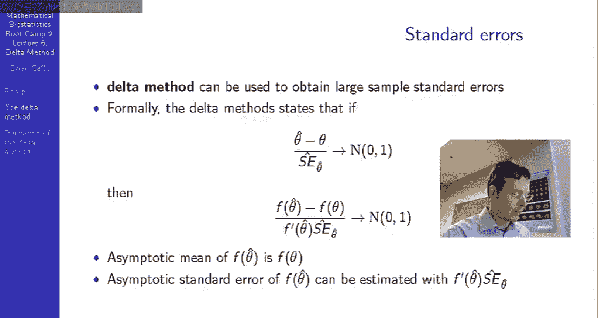
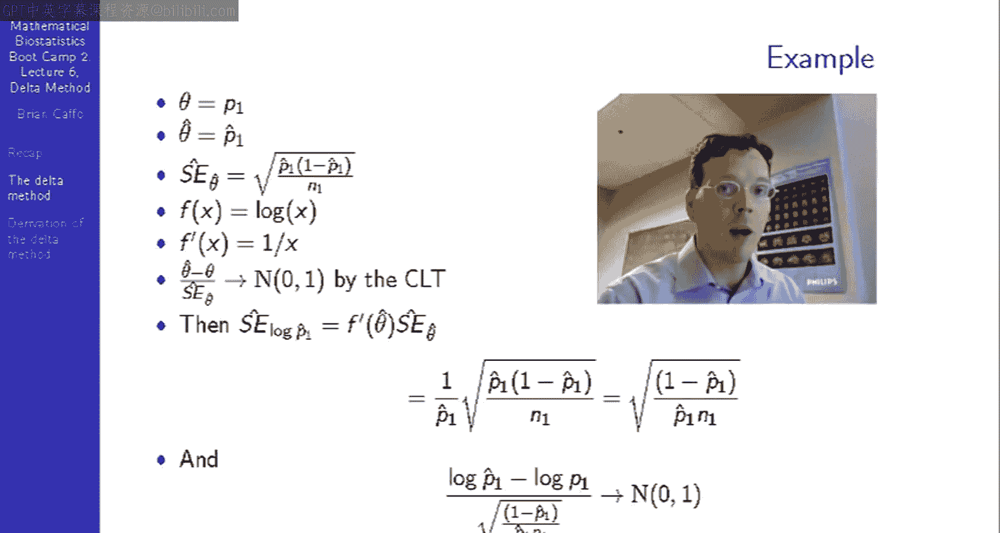
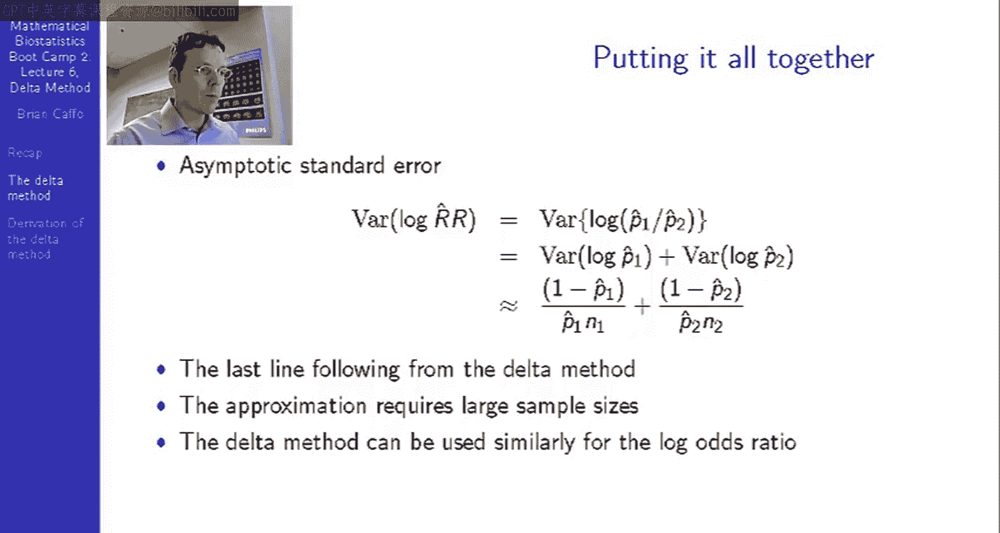
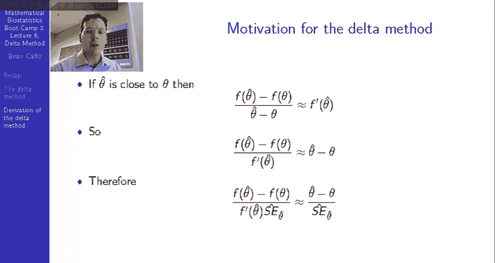

# 约翰霍普金斯大学《数据科学的高级统计｜Advanced Statistics for Data Science》中英字幕（deepseek p50 19_Delta方法推导.zh_en -BV1htPjeYEFH_p50-

Okay， so let's go through an example。So theta let's consider an instance where theta is p1。

 we're only going to consider x at this point， our theta hat is p1 hat x over n1 our estimated standard error right the standard error for x over n1 is square root P1 hat1 minus P1 hat over n1 I hope that's not news to anyone in this case and let's assume that F we want to estimate is log。

 so we're interested in log P1 for example。So f of x in this case is log x。

 then f prime of x is1 over x， and then we know that theta hat minus theta over its standard error that tends to a standard normal by the ordinary central limit theorem in this case。

 theta hat is a simple average。Okay and we're just simply subtracting off its mean and dividing by a consistent standard error so it converges to a normal 01 by the ordinary central limit theorem。

 So then it's saying that the standard error， the estimated standard error of the log of the sample proportion is f prime theta hat times standard error of theta hat so let's go through that calculation So F prime of theta hat in this case is f prime is1 over its argument So in this case in theta hat is P1 hat So it's1 over P1 hat times the standard error which is square root P1 hat1 minus P1 hat over n1 rearrange terms and you get square root 1 minus P1 hat divided by P1 hat divided by n1。

And so what this is saying is that log P1 hat minus P1 divided by this standard error square root 1 minus P1 hat over P1 hat times n1。

That tends to a normal 01。 So if I want a confidence interval for P1 for log P1。

 what I could do is take log P1 hat and add and subtract a standard normal quant， let's say 1。

96 for a 95% interval times this standard error here。

 square root 1 minus P1 hat over P1 hat and1 hat， and that would be an interval。

 And so that works out to be very convenient。 The only complexity in this whole calculation。

And it was very mild complexity was calculating the derivative of the function that we're interested in。

 the rest of it was simple arithmetic and that's why the delta method is so powerful。

Okay， so that actually doesn't give us a standard error for the log relative risk and to honestly to do that in its full glory you need a multivariate version of the deelta method which there is but we don't really cover it in this class so let's look at the asymptotic standard error for the log relative risk。

 let's just kind of heuristically do it， so the variance of the log relative risk is the variance of log P1 hat divided by P2 hat。

And so let's just say， you know so that is the variance of log P1 hat plus the variance of log P2 hat because we're assuming that x and y are independent。

 the group1 and group 2 binomial count are independent and so from going from these first three statements。

 this variance to this variance to this second line here。

 these are all exact equal we haven't done anything Now if we were to use our delta method estimate of the variance for each of these things that we calculated on the previous page then we get one minus P1 hat over P1 hat n1 plus1 minus P2 hat over P2 hat n2 and if we screw root that that is exactly the standard variance estimate for the log relative risk that we gave at the beginning of the class okay and so that's where it comes from。

And you could do exactly the same thing for the odds ratio and you may have to do a little bit of arithmetic to show that it works out to be1 over n11 plus1 over n12 and so on。

 but the same exact rule applies and it's it's relatively easy to do there's one small bit of fudging that we're doing here in that we're saying that delta method variances add in the same way that that random variable variances add and that is the case。

 that is the case if you work out the multivari delta method the delta method estimated variances of independent things works out to be the sum of their delta estimated variances worked out independently but for the purposes of the class。

 this is not an issue， I think hopefully what you can follow is that for the log relative risk works out to be for the variance of the log relative risk we work out to needing the variance of the two component part。

It's log P1 hat and log P2 hat。And that we can calculate those associated variances with the Dlta method Now notice the delta method doesn't just give you a standard error and a variance calculation。

 it also gives you the asymptotic normality so that not only do you get the variance estimate。

 but you get the inference to you get the actual confidence interval that you want to create as well or the hypothesis test that you'd like to perform so the delta method isn't just the standard error variance calculation that's just the neat part of it。

 the rest of it the delta method also tells you you can put the whole thing together as a confidence interval estimate。

So for my final thought on the Delta method， I thought I'd just show you quickly why it works and it's very easy。

 it's surprisingly easy to prove now we're going to do a heuristic here。

 but the actual fullproof is just not that different。

So let's assume you have a large sample size and the delta method is an asymptotic technique。

 so we can assume there's a large sample size， and if theta hat is close to theta，All right。

 then f of theta hat minus f of theta over theta hat minus theta。

 well that should be approximately close to f prime of theta hat Now why is that well on the left hand side here as theta approaches theta hat or theta hat approaches theta either way。

 this is just the definition of a derivative of F。Okay if you're not familiar with it。

 just go look up the definition of a derivative， it's the change in the function divided by the change in the arguments as the change in the arguments goes to zero。

So this is exactly just the derivative of F， okay？And then， you know here。You know。

 we're assuming that theta hat is close to theta because theta hat converges the theta。

 it's a consistent estimate。Okay， so this first lines true。

 and let's just assume we multiply both sides by theta hat minus theta and divide both sides by f prima theta hat and we get this left hand expression here under this right hand expression here。

And then let's just suppose we divide both sides by the standard error， the estimated standard error。

 and then what you get is that the right hand side is roughly equal to the left hand side。

And so since the right hand side converges to a normal01。

 the left hand side should similarly converge to a normal01。

And it also kind of gives you the heuristic of kind of why it works if we assume f is a smooth enough function。

And we appropriately divide by the derivative。Then we're really kind of estimating the same thing as theta minus theta hat。

As provided Theta had is close to theta and that's ultimately why it works。

 it's nothing other than an instance of applying the definition of differentiation and if you want the formal proof。

 if you really want that kind of detail， you know incidentally， by the way。

 my office is you know we're on a medical campus and I'm right near the emergency room。

 which is probably why you constantly hear the sirens going by。

 so those are the ambulances going to the emergency room。In case you were wondering， so anyway。

 if you want to prove the mean value theorem identically， right？

If you want to prove the delta method， exactly what you have to use is a thing called the mean value theorem and then you get a very formal proof of it。

 this heuristic is just based on the definition of a derivative。

 but if you use the exact mean value theorem then you get the full proof。

And that's it and so in case you were wondering where。

How in the world do people pull out these crazy standard errors for the odds ratio and the relative risk。

 where do these formulas come from， it's a surprisingly easy little argument involving this concept called the Delta method。

