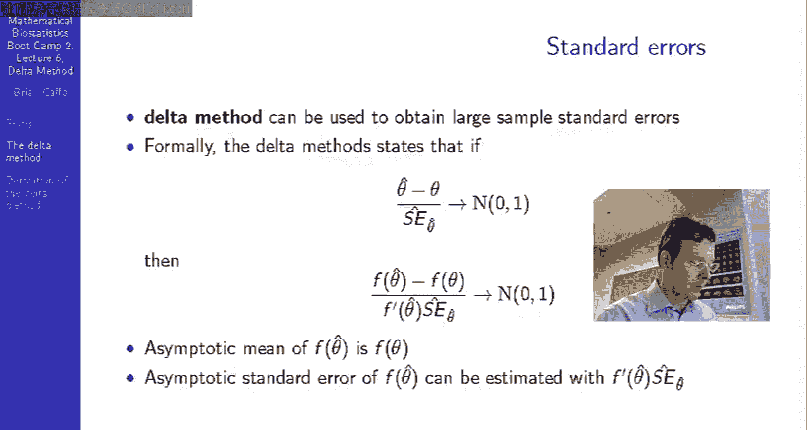
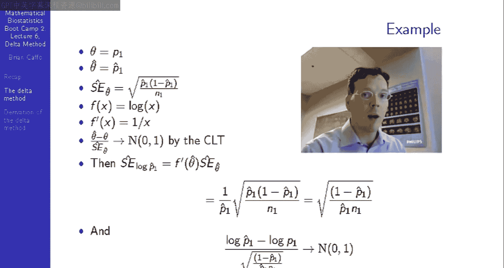
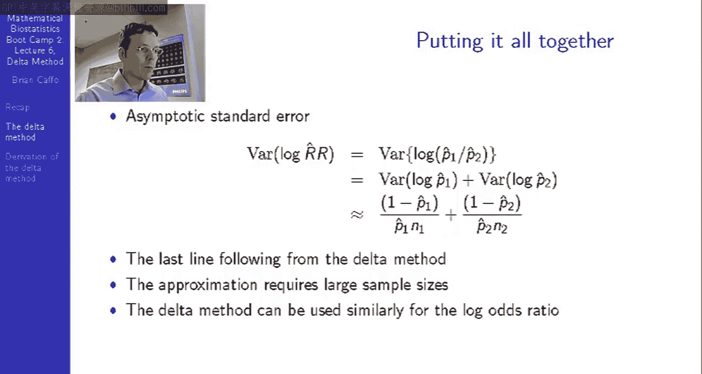
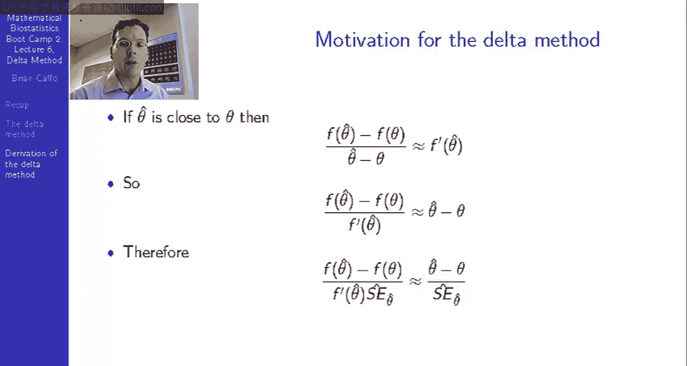

# 高级统计学：第50讲：Delta方法推导 🧮

在本节课中，我们将学习Delta方法，这是一种用于推导估计量函数（如比值比、相对风险的对数）的标准误的强大工具。我们将通过一个具体例子来理解其原理和应用。

---

## 概述

Delta方法的核心思想是，如果一个估计量是渐近正态的，那么它的一个光滑函数的估计量也是渐近正态的。我们可以利用这个性质，通过原始估计量的标准误和函数的导数，来推导出新估计量的标准误。本节将通过一个比例对数的例子，详细演示Delta方法的推导过程。

---

## 例子：比例对数的标准误

上一节我们介绍了Delta方法的基本概念，本节中我们来看看如何将其应用于一个具体问题：估计比例 `p1` 的对数 `log(p1)` 的标准误。

假设我们的参数 `θ = p1`。其估计量 `θ̂ = p̂1 = X / n1`，其中 `X` 服从二项分布。`p̂1` 的标准误为：
`SE(p̂1) = sqrt( p̂1 * (1 - p̂1) / n1 )`

我们感兴趣的函数是 `f(θ) = log(θ)`，因此 `f(p̂1) = log(p̂1)`。该函数的导数为 `f'(x) = 1/x`。

根据中心极限定理，我们知道：
`(θ̂ - θ) / SE(θ̂) → N(0, 1)`

现在，应用Delta方法。函数 `f(θ̂)` 的估计标准误为：
`SE( f(θ̂) ) ≈ |f'(θ̂)| * SE(θ̂)`

将我们的函数代入计算：
`f'(θ̂) = f'(p̂1) = 1 / p̂1`
`SE( log(p̂1) ) ≈ (1 / p̂1) * sqrt( p̂1 * (1 - p̂1) / n1 ) = sqrt( (1 - p̂1) / (p̂1 * n1) )`

因此，根据Delta方法，我们有：
`( log(p̂1) - log(p1) ) / sqrt( (1 - p̂1) / (p̂1 * n1) ) → N(0, 1)`

基于此，我们可以构建 `log(p1)` 的95%置信区间：
`log(p̂1) ± 1.96 * sqrt( (1 - p̂1) / (p̂1 * n1) )`

整个计算过程中，唯一的复杂性在于计算我们所关注函数的导数，其余部分都是简单的算术运算。这正是Delta方法强大之处。

---

## 扩展到对数相对风险

上一节我们计算了单个比例对数的标准误，本节中我们来看看如何将其思想扩展到更复杂的统计量，例如对数相对风险 `log(RR) = log(p1/p2)`。

对数相对风险的方差为：
`Var( log(p̂1 / p̂2) ) = Var( log(p̂1) - log(p̂2) )`

由于假设两组数据独立（例如，两个独立的二项计数X和Y），方差可以分解为：
`Var( log(p̂1) ) + Var( log(p̂2) )`

现在，利用上一节通过Delta方法得到的每个对数比例的方差估计：
`Var( log(p̂1) ) ≈ (1 - p̂1) / (p̂1 * n1)`
`Var( log(p̂2) ) ≈ (1 - p̂2) / (p̂2 * n2)`

因此，对数相对风险的方差估计为：
`Var( log(RR̂) ) ≈ (1 - p̂1)/(p̂1 n1) + (1 - p̂2)/(p̂2 n2)`

其标准误即为该方差的平方根。这正是本课程开始时给出的对数相对风险的标准误公式的来源。对于比值比，可以应用完全相同的规则进行推导。

这里有一个细微之处：我们默认了独立随机变量的Delta方法方差可以像普通方差一样相加。在多变量Delta方法的严格框架下，这一点是成立的。对于本课程的目的而言，这没有问题。

需要注意的是，Delta方法不仅提供了标准误和方差的计算，还保证了估计量的渐近正态性。这意味着我们可以直接基于它构建置信区间或进行假设检验。

---

## Delta方法为何有效：直观解释

在了解了Delta方法的应用后，我们来看看其背后的原理。它的证明出乎意料地简单。

假设样本量很大，且 `θ̂` 是 `θ` 的一致估计量（即 `θ̂` 接近 `θ`）。考虑函数 `f`。

根据导数的定义，当 `θ̂` 接近 `θ` 时，差商近似等于导数：
`[ f(θ̂) - f(θ) ] / (θ̂ - θ) ≈ f'(θ̂)`

整理上式，得到：
`f(θ̂) - f(θ) ≈ f'(θ̂) * (θ̂ - θ)`

现在，将两边同时除以 `f'(θ̂)` 和 `SE(θ̂)`：
`[ f(θ̂) - f(θ) ] / [ f'(θ̂) * SE(θ̂) ] ≈ (θ̂ - θ) / SE(θ̂)`

由于根据中心极限定理，右边 `(θ̂ - θ) / SE(θ̂)` 依分布收敛于标准正态分布 `N(0,1)`，因此左边也同样收敛于标准正态分布。

这就启发式地解释了Delta方法为何有效：它本质上是将函数 `f` 在 `θ` 处进行线性近似（一阶泰勒展开），从而将问题转化为我们已经知道分布（正态分布）的线性部分。

如果想要更严格的证明，需要用到**中值定理**，但核心思想与上述基于导数定义的直观解释是一致的。

所以，当您好奇比值比、相对风险等复杂统计量的标准误公式从何而来时，答案往往就源于这个被称为Delta方法的、巧妙而简单的论证。

---

## 总结

本节课中我们一起学习了Delta方法。我们首先通过估计比例对数的标准误这一例子，逐步演示了Delta方法的计算过程。接着，我们探讨了如何将其思想扩展到对数相对风险，并理解了其标准误公式的来源。最后，我们从导数的定义出发，直观地解释了Delta方法为何有效。Delta方法是一个强大的工具，它允许我们通过简单的导数计算和算术运算，推导出复杂估计量的渐近分布和标准误，从而为统计推断（如构建置信区间）奠定基础。